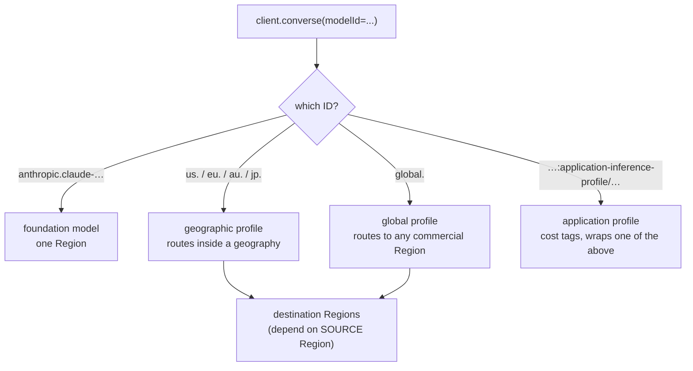

# Bedrock — Models, Access, Regions & the Converse API

How you reach a model on Bedrock (access, model IDs, inference profiles, Regions), how you call it (Converse), and what limits you (quotas, tokens, price). Model facts below come from the AWS model cards and user guide as of 2026-10-21 and **change often**: treat the tables as a snapshot and re-check the model card before you pin an ID.

## How Model Access Works Now

The old "request access per model" console page is gone in commercial Regions. Access is enabled on first use, and you control it with IAM and SCPs.

| Topic | Current behaviour |
|-------|-------------------|
| Serverless models | Enabled by default. Select a model in the catalog or just call `Converse` / `InvokeModel` |
| Third-party models (Anthropic, Cohere, ...) | The **first invocation starts an AWS Marketplace subscription in the background** (up to 15 minutes, then up to 2 more after fixing permissions). Calls can fail with `AccessDeniedException` until it finishes |
| Marketplace permissions | The calling role needs `aws-marketplace:Subscribe`, `Unsubscribe`, `ViewSubscriptions` **once per account** for models sold through Marketplace; afterwards they are not needed to invoke |
| Anthropic models | A one-time **use-case form** per account (or per Organization via the management account): console, or `put_use_case_for_model_access`. State shows in `get_foundation_model_availability` as `agreementAvailability.status`: `AVAILABLE`, `PENDING`, `NOT_AVAILABLE`, `ERROR` |
| No Marketplace product | Amazon, DeepSeek, Google, Meta, MiniMax, Mistral AI, Moonshot AI, NVIDIA, Qwen, xAI, Z.AI models, and OpenAI `gpt-oss-*` |
| Billing | Third-party models appear on your AWS bill under the **provider**, not under "Amazon Bedrock" |
| Blocking a model | Deny `bedrock:InvokeModel*` on the model ARN in an SCP or IAM policy. Denying only `aws-marketplace:Subscribe` does **not** block the first call |
| GovCloud | Still uses the Model access console page |

```python
# Check that a model is usable before a smoke test (control-plane client)
import boto3

bedrock = boto3.client("bedrock", region_name="us-east-1")
av = bedrock.get_foundation_model_availability(modelId="anthropic.claude-haiku-5-5")
assert av["agreementAvailability"]["status"] == "AVAILABLE", av
profiles = bedrock.list_inference_profiles(typeEquals="SYSTEM_DEFINED")["inferenceProfileSummaries"]
print([p["inferenceProfileId"] for p in profiles if p["inferenceProfileId"].startswith("global.")][:3])
```

## Model Catalog Snapshot

Model cards list every ID. Rows reflect the model cards as of 2026-10-21 and what each card marks as supported on `bedrock-runtime`.

| Model | Base model ID | Profile IDs | Context / max output | Notes |
|-------|---------------|-------------|----------------------|-------|
| Claude Sonnet 5.5 | `anthropic.claude-sonnet-5-5` | `us.`, `eu.`, `au.`, `global.` + base ID | 1M / 128K | Adaptive thinking on by default. Structured outputs, explicit caching, Guardrails, Knowledge Bases, Agents. **No** `CountTokens`, **no** batch, standard service tier only |
| Claude Haiku 5.5 | `anthropic.claude-haiku-5-5` | `us.`, `eu.`, `au.`, `jp.`, `global.` + base ID | 1M / 128K | Fastest 5.5 model. Prompts over 100K tokens are billed at a higher "long context" rate. Same feature set as Sonnet 5.5 for the rows above |
| Claude Opus 5.5 | `anthropic.claude-opus-5-5` | list them via the API | see model card | Listed in the caching table (512-token minimum) |
| Nova 2 Lite | `amazon.nova-2-lite-v1:0` | `us.`, `eu.`, `jp.`, `global.` + base ID | 1M / 64K | Image and video input. Reasoning off by default (`reasoningConfig`). **No** structured outputs, **no** `CountTokens`, no Knowledge Bases. Priority and flex tiers available |
| Nova Micro / Lite / Pro | `amazon.nova-micro-v1:0`, `amazon.nova-lite-v1:0`, `amazon.nova-pro-v1:0` | see model cards | see cards | Explicit caching on `system` and `messages` (1K minimum, 5 min TTL); on the batch list |
| gpt-oss-120b / 20b | `openai.gpt-oss-120b-1:0`, `openai.gpt-oss-20b-1:0` | see cards | see cards | Open-weight, no Marketplace subscription; on the batch list |

Anthropic's older line (Claude 4.x, 3.x) is still listed. Some models are **gated** (for example Claude Mythos 5 and 5.1 are marked "Gated" in the caching table); you do not get them by calling the API.

Find IDs programmatically instead of copying them:

| Question | Call |
|----------|------|
| Which models exist, by provider or modality? | `bedrock.list_foundation_models(byProvider="Anthropic", byOutputModality="TEXT")` |
| Lifecycle of one model | `bedrock.get_foundation_model(modelIdentifier=...)["modelDetails"]["modelLifecycle"]` (`status` is `ACTIVE` or `LEGACY`, plus `startOfLifeTime`, `endOfLifeTime`, `legacyTime`) |
| Which profile IDs can I call from this Region? | `bedrock.list_inference_profiles(typeEquals="SYSTEM_DEFINED")` |
| Where can a profile route? | `bedrock.get_inference_profile(inferenceProfileIdentifier=...)["models"]` (each model ARN carries a destination Region) |

### Model lifecycle

Every model is **Active**, **Legacy** or **End-of-Life**. A Legacy model still works, but new customers cannot adopt it and existing customers "may lose access after 15 days of inactivity". After the EOL date requests fail and nothing migrates automatically. For models launched on or after 2026-09-07 the model card shows an "EOL no sooner than" date (Sonnet 5.5: 2027-09-28) and a **legacy period** of 6 months (a few models: 45 days). Put the model ID in configuration, not in code, and alert on `LegacyModelInvocations` (CloudWatch).

## Model IDs vs Inference Profiles

The `modelId` parameter of `Converse` accepts four kinds of identifier:

| Kind | Example | Routing | Use when |
|------|---------|---------|----------|
| Foundation model ID | `amazon.nova-2-lite-v1:0` | One Region (where the model is served in-Region) | The model card shows **In-Region** support for your Region. For the 5.5 Claude models and Nova 2 Lite the cards show **no** in-Region column |
| Geographic profile | `us.anthropic.claude-sonnet-5-5`, `eu.…`, `au.…`, `jp.…` | Within one geography | Data residency: processing stays inside the geography |
| Global profile | `global.anthropic.claude-sonnet-5-5` | Any commercial Region AWS lists for the model | Best capacity; **about 10% cheaper** than geographic per the AWS comparison table; no residency guarantee |
| Application profile (ARN) | `arn:aws:bedrock:us-east-1:123456789012:application-inference-profile/abc123` | The model or system profile you copied from | Cost allocation: tag the profile, invoke by ARN. Create with `create_inference_profile(modelSource={"copyFrom": ...})` |



Rules that bite in practice:

- **Destination Regions depend on the Region you call from.** `us.anthropic.claude-haiku-5-5` from `us-west-1` can route to four US Regions; from `us-east-1` to three. For data-residency claims call `get_inference_profile` from **every** source Region you use; AWS says not to rely on the geographic prefix alone.
- Cross-Region calls need IAM access to the **profile** and to the **foundation model in every destination Region**. If any destination Region is blocked by an SCP, the request fails even if others are open. Global profiles need an SCP that allows `aws:RequestedRegion` = `unspecified`.
- Price is that of the Region you **call from**; there is no routing surcharge. CloudTrail logs the call in the source Region with `additionalEventData.inferenceRegion` showing where it ran.
- Inference profiles do not support Provisioned Throughput. Prompts and outputs may be stored in opt-in Regions for abuse detection when a profile routes there.
- Some profiles lack features: for example, AWS lists structured outputs as unsupported for Claude Haiku 4.5 through the India (`in.`) profile. Check the model card per profile.

## Converse vs InvokeModel

| | `Converse` / `ConverseStream` | `InvokeModel` / `InvokeModelWithResponseStream` |
|---|---|---|
| Request body | One schema for all models (`messages`, `system`, `inferenceConfig`, `toolConfig`, ...) | The model's **native** JSON in `body`, plus `contentType` and `accept` |
| Model-specific knobs | `additionalModelRequestFields` | Everything in the body |
| Tools, Guardrails, caching, structured output | Same fields on every model that supports them | Per-model format (for Claude: `anthropic_version`, `output_config`, `cache_control`, ...) |
| Response | Normalised: `output`, `stopReason`, `usage`, `metrics` | Native JSON in a streaming `body` you read and parse |
| Use for | Almost everything | Image/video/embedding models, Claude features without a Converse field, batch jobs in native format |

Embeddings, image generation (Nova Canvas, Stability) and video models are called with `InvokeModel` (or async invoke); Converse is for text-and-multimodal chat models.

## Anatomy of a Converse Request

Fields below were read from the botocore model (`*` = required):

| Field | Meaning |
|-------|---------|
| `modelId*` | Foundation model ID, inference profile ID/ARN, provisioned model ARN |
| `messages` | List of `{"role": "user" or "assistant", "content": [blocks]}`. Blocks: `text`, `image`, `document`, `video`, `audio`, `toolUse`, `toolResult`, `guardContent`, `cachePoint`, `reasoningContent`, `citationsContent`, `searchResult` |
| `system` | List of `{"text": ...}`, `{"guardContent": ...}` or `{"cachePoint": ...}` blocks |
| `inferenceConfig` | `maxTokens`, `temperature`, `topP`, `stopSequences` |
| `toolConfig` | `tools` (`toolSpec` with `name`, `description`, `inputSchema.json`, optional `strict`; or `cachePoint`) and `toolChoice` (`auto`, `any`, `tool`) |
| `guardrailConfig` | `guardrailIdentifier`, `guardrailVersion`, `trace` (`enabled`, `disabled`, `enabled_full`); `ConverseStream` adds `streamProcessingMode` (`sync`, `async`) |
| `additionalModelRequestFields` | Provider-specific JSON merged into the model request (for example Claude `thinking`) |
| `additionalModelResponseFieldPaths` | JSON pointers of extra model fields to return in `additionalModelResponseFields` |
| `requestMetadata` | String map echoed into invocation logs (use for test and cost attribution) |
| `performanceConfig` | `latency`: `standard` or `optimized` (supported models only) |
| `serviceTier` | `type`: `priority`, `default`, `flex`, `reserved` |
| `outputConfig` | `textFormat` (JSON Schema output) and `effort` |
| `promptVariables` | Variables for a Bedrock Prompt Management prompt |

Rules: the conversation alternates `user` and `assistant`; tool results go in a **user** message; `maxTokens` caps thinking tokens plus text; unsupported fields fail with `ValidationException` instead of being ignored.

## Anatomy of a Converse Response

```python
resp = client.converse(modelId=MODEL, messages=[...])
msg = resp["output"]["message"]          # {"role": "assistant", "content": [blocks]}
resp["stopReason"]                       # why generation stopped: see table
resp["usage"]                            # inputTokens, outputTokens, totalTokens (+ cache fields)
resp["metrics"]["latencyMs"]             # server-side latency
resp.get("trace")                        # guardrail / prompt-router trace when enabled
```

| `stopReason` | Meaning | Action |
|--------------|---------|--------|
| `end_turn` | Model finished normally | Use the text |
| `tool_use` | Model wants a tool called | Run the tool, send a `toolResult` (page 02) |
| `max_tokens` | Hit `maxTokens` | Output is **truncated**: JSON may be invalid. Raise the limit or fail |
| `stop_sequence` | A `stopSequences` entry was produced | Usually expected |
| `guardrail_intervened` | A guardrail blocked **or masked** content | Read the trace (page 03). Masking returns the same reason |
| `content_filtered` | The provider's own content filter fired | Treat as a refusal |
| `malformed_model_output`, `malformed_tool_use` | The model produced invalid output or an invalid tool call | Retry once, then fail; log the request |
| `model_context_window_exceeded` | The prompt plus output exceeded the context window | Trim history, summarise, or use a larger-context model |

A response with several content blocks is normal (reasoning, text, `toolUse`). Join text blocks instead of reading `content[0]`:

```python
def reply_text(response: dict) -> str:
    return "".join(b["text"] for b in response["output"]["message"]["content"] if "text" in b)
```

`usage` with prompt caching: `inputTokens` counts only the **non-cached** part, so total input = `inputTokens + cacheReadInputTokens + cacheWriteInputTokens`.

## Quotas and Throttling

Inference is limited by **tokens per minute (TPM)** and **tokens per day (TPD)** per model per Region (embedding models by requests per minute). `bedrock-runtime` and `bedrock-mantle` have **separate** quotas. Values are in Service Quotas; they depend on account age and usage, and increases are not automatic.

How a request is charged against the quota:

| Moment | Deducted |
|--------|----------|
| Request start (decides throttling) | input tokens + `maxTokens` |
| During generation | adjusted toward real output |
| After completion | `InputTokenCount + CacheWriteInputTokenCount + OutputTokenCount × burndown` |

Cache **reads** never count. Output **burndown** (how many quota tokens one output token costs): 15× for Claude 4.8, 10× for Claude Opus 5.5, Sonnet 5, Opus 5 and Fable 5.1 and for GPT-5.6, 5× for Claude 4.7 and older, 1× for other models. For Claude Sonnet 5.5 and Haiku 5.5, check your quotas in Service Quotas. You are billed for actual tokens only.

```python
def estimate_quota_tokens(input_tokens, max_tokens, output_tokens, burndown=1, cache_write=0):
    """(deducted at request start, deducted after completion)"""
    return input_tokens + cache_write + max_tokens, input_tokens + cache_write + output_tokens * burndown

# AWS docs example, 5x burndown: input 3000, cache write 1000, output 1000
assert estimate_quota_tokens(3000, 32000, 1000, burndown=5, cache_write=1000) == (36000, 9000)   # maxTokens too high
assert estimate_quota_tokens(3000, 1250, 1000, burndown=5, cache_write=1000) == (5250, 9000)     # maxTokens right-sized
```

The lesson: with `maxTokens=32000` each request reserves 36,000 quota tokens while it runs, so fewer run in parallel. **Size `maxTokens` to the real answer length.**

Capacity options when on-demand throttles:

| Option | What it is | Notes |
|--------|------------|-------|
| Cross-Region profile | More Regions' capacity | First thing to try; geographic or global |
| Service tier `priority` / `flex` | Per-request flag (`serviceTier={"type": "flex"}`); one on-demand quota shared by `priority`, `default`, `flex` | Priority costs a premium and is served first; flex is cheaper and tolerates latency. Not every model supports every tier (Sonnet 5.5 and Haiku 5.5 cards show standard only; Nova 2 Lite shows standard, priority, flex). The response and CloudWatch show the **resolved** tier |
| Reserved tier | Capacity commitment of 1 or 3 months, billed monthly; minimum 100,000 input and 10,000 output TPM; overflow falls back to standard | Arranged with your AWS account team; cannot be set per request |
| Provisioned Throughput | Model units with a commitment (`OneMonth` or `SixMonths`) via `create_provisioned_model_throughput`; invoke by provisioned model ARN | Not usable with inference profiles; unavailable for models in Legacy; not supported by batch |
| Batch inference | Async S3 jobs (page 03) | Separate quotas, offline workloads |
| Queue in front | [SQS](../sqs/index.md) with bounded worker concurrency | Smooths bursts, gives retries and a DLQ |

## Pricing Dimensions

No prices here: they change. Know what you are billed on so tests and budgets measure the right thing:

| Dimension | Notes |
|-----------|-------|
| Input and output tokens, per model | Output is several times more expensive than input. Thinking tokens bill as output |
| Cache write and cache read tokens | Reads are discounted; writes may cost more than normal input (model-dependent) |
| Long-context rate | Some models (Haiku 5.5) bill prompts over 100K tokens at higher rates |
| Service tier | Priority premium, flex discount |
| Cross-Region | Global profile about 10% cheaper than geographic; no routing fee |
| Batch | Priced separately; see the pricing page |
| Provisioned Throughput, Reserved tier | Per model unit or per 1K tokens-per-minute, billed by time even when idle |
| Guardrails | Reported as units per policy type on every guardrail evaluation, attached or `ApplyGuardrail` (page 03) |
| Knowledge Bases, Agents, AgentCore | Billed separately from model tokens |

## IAM and Authentication

| Action | Allows |
|--------|--------|
| `bedrock:InvokeModel` | `InvokeModel` and `Converse` |
| `bedrock:InvokeModelWithResponseStream` | The streaming variants. AWS's own examples use `bedrock:InvokeModel*` |
| `bedrock:ApplyGuardrail`, `bedrock:CountTokens` | The standalone operations |
| `bedrock:GetInferenceProfile`, `ListInferenceProfiles` | Discover profiles |
| `bedrock:CallWithBearerToken` | Use a Bedrock API key |

A role that may call Claude Haiku 5.5 only through the **global** profile in `us-east-1` (pattern copied from AWS's example for another model, with this guide's IDs and the placeholder account `123456789012`):

```json
{
  "Version": "2012-10-17",
  "Statement": [
    {
      "Effect": "Allow",
      "Action": ["bedrock:InvokeModel*"],
      "Resource": ["arn:aws:bedrock:us-east-1:123456789012:inference-profile/global.anthropic.claude-haiku-5-5"]
    },
    {
      "Effect": "Allow",
      "Action": ["bedrock:InvokeModel*"],
      "Resource": [
        "arn:aws:bedrock:us-east-1::foundation-model/anthropic.claude-haiku-5-5",
        "arn:aws:bedrock:::foundation-model/anthropic.claude-haiku-5-5"
      ],
      "Condition": {
        "StringLike": {
          "bedrock:InferenceProfileArn": "arn:aws:bedrock:us-east-1:123456789012:inference-profile/global.anthropic.claude-haiku-5-5"
        }
      }
    }
  ]
}
```

For a geographic profile, list the foundation-model ARN of **each destination Region** instead of the Region-less ARN.

### API keys

A Bedrock API key is a bearer token instead of SigV4. **Short-term** keys last up to 12 hours (or the session) and inherit the creator's permissions; AWS recommends them for production. **Long-term** keys create an IAM user and are "for exploration only". boto3 reads `AWS_BEARER_TOKEN_BEDROCK` with no other credentials and sends the header:

```text
Authorization header: Bearer bedrock-api-key-PLACEHOLDER
```

Control them with `bedrock:CallWithBearerToken` (deny it to forbid keys) and the `bedrock:bearerTokenType` condition (`SHORT_TERM`, `LONG_TERM`). A long-term key works only in the Region it was created in. In CI prefer an OIDC role ([Foundations](../foundations/02-credentials-iam-local-testing.md)) over a stored key.

## Counting Tokens Before You Call

`bedrock-runtime` has `count_tokens(modelId=..., input={"converse": {...}})` (or `{"invokeModel": {"body": ...}}`); it is free and returns `inputTokens`. **Not every model supports it**: the Claude Sonnet 5.5, Haiku 5.5 and Nova 2 Lite cards list it as unsupported on `bedrock-runtime`. For Claude models without it, AWS documents an HTTP `count_tokens` call on the `bedrock-mantle` endpoint (`/anthropic/v1/messages/count_tokens`, SigV4 or API key; no SDK method). Otherwise read `usage` from responses and budget from that (page 04).

## Quick Rules

1. **Resolve access before blaming code:** `get_foundation_model_availability`, the Anthropic use-case form, Marketplace permissions, then wait up to 15 minutes.
2. **Use inference profile IDs** for current models; choose `global.` for capacity and cost, a geography prefix for residency.
3. **Verify routing from each source Region** with `get_inference_profile` before claiming data residency.
4. **Branch on `stopReason`**, not on text. `max_tokens` means the answer is incomplete.
5. **Right-size `maxTokens`.** It is reserved against TPM at the start and lowers your concurrency when too high.
6. **Keep model IDs in config** and watch the lifecycle (`LEGACY`, `LegacyModelInvocations`).
7. **Scope IAM to the profile ARN and each destination Region's model ARN**; add SCPs for Regions.
8. **Prefer short-term credentials or short-term API keys**; never commit a long-term key.

---
## See also
- [Amazon Bedrock](./index.md)
- [02 Streaming, Tools, Structured Output, Multimodal & Caching](./02-streaming-tools-structured-output.md)
- [03 Guardrails, Knowledge Bases, Agents & Batch](./03-guardrails-knowledge-bases-agents-batch.md)
- [04 Testing & Production](./04-testing-production.md)
- [AWS Foundations: Clients, Config, Retries & Errors](../foundations/01-clients-config-errors.md)
- [AWS Foundations: Credentials, IAM & Local Testing](../foundations/02-credentials-iam-local-testing.md)
- [Amazon SQS](../sqs/index.md)
- [LiteLLM — One API for 100+ LLM Providers](../../libs/litellm/index.md)
