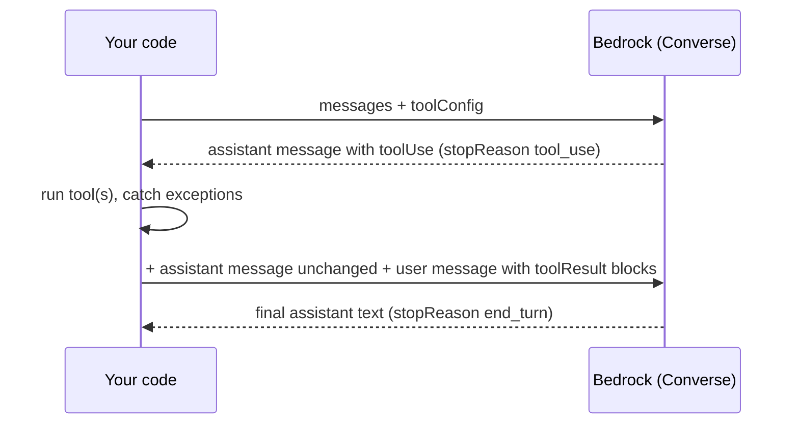

# Bedrock — Streaming, Tool Use, Structured Output, Multimodal & Prompt Caching

The features you add to a plain `converse` call once a real application needs them. The output below comes from the local fake Bedrock server in [page 04](./04-testing-production.md). The fake's chunk sizes and token numbers are invented: the output shows **shapes and control flow**, not real model behaviour.

## ConverseStream

`converse_stream` returns `{"stream": <event iterator>}`. Events arrive as one-key dicts:

| Event | Payload | Use |
|-------|---------|-----|
| `messageStart` | `role` | Start of the assistant message |
| `contentBlockStart` | `contentBlockIndex`, `start` (`toolUse` with `toolUseId` and `name`, or `toolResult`, `image`) | A tool call begins |
| `contentBlockDelta` | `contentBlockIndex`, `delta`: `text`, `toolUse.input` (a **JSON string fragment**), `reasoningContent` (`text`, `signature`, `redactedContent`), `citation`, `image` | Append to the block with that index |
| `contentBlockStop` | `contentBlockIndex` | The block is complete; parse tool JSON now |
| `messageStop` | `stopReason`, `additionalModelResponseFields` | Why it ended |
| `metadata` | `usage`, `metrics.latencyMs`, `trace` (guardrail), `performanceConfig`, `serviceTier` | Token counts arrive **last**, after the text |
| exceptions | `internalServerException`, `modelStreamErrorException`, `validationException`, `throttlingException`, `serviceUnavailableException` | Failure after the 200 response started |

Example output from the fake (text reply, then a tool reply; the 5-character tool fragments are the fake's choice):

```text
event types: ['messageStart', 'contentBlockDelta', 'contentBlockDelta', ..., 'contentBlockStop', 'messageStop', 'metadata']
first delta event: {'contentBlockDelta': {'delta': {'text': 'Your'}, 'contentBlockIndex': 0}}
tool input fragments: ['{"ord', 'er_id', '": "o', 'rd-42', '"}']
tool start event: {'contentBlockStart': {'start': {'toolUse': {'toolUseId': 'tooluse_abc123', 'name': 'lookup_order'}}, 'contentBlockIndex': 0}}
```

A reusable assembler:

```python
import json
from dataclasses import dataclass, field


@dataclass
class StreamResult:
    text: str = ""
    tool_uses: list[dict] = field(default_factory=list)
    stop_reason: str | None = None
    usage: dict = field(default_factory=dict)
    trace: dict | None = None


def consume_stream(stream, on_text=None) -> StreamResult:
    res, pending = StreamResult(), {}                 # pending: contentBlockIndex -> tool call being built
    for event in stream:
        if "contentBlockStart" in event:
            start = event["contentBlockStart"]["start"]
            if "toolUse" in start:
                pending[event["contentBlockStart"]["contentBlockIndex"]] = {**start["toolUse"], "raw": ""}
        elif "contentBlockDelta" in event:
            d = event["contentBlockDelta"]
            if "text" in d["delta"]:
                res.text += d["delta"]["text"]
                if on_text:
                    on_text(d["delta"]["text"])       # push to the UI / websocket here
            elif "toolUse" in d["delta"]:
                pending[d["contentBlockIndex"]]["raw"] += d["delta"]["toolUse"]["input"]
        elif "contentBlockStop" in event:
            tu = pending.pop(event["contentBlockStop"]["contentBlockIndex"], None)
            if tu:
                res.tool_uses.append({"toolUseId": tu["toolUseId"], "name": tu["name"], "input": json.loads(tu["raw"] or "{}")})
        elif "messageStop" in event:
            res.stop_reason = event["messageStop"]["stopReason"]
        elif "metadata" in event:
            res.usage, res.trace = event["metadata"]["usage"], event["metadata"].get("trace")
    return res
```

Streaming failure modes (a mid-stream error frame):

- An error **after** the first bytes is raised **while iterating** as `botocore.exceptions.EventStreamError` with `response["Error"]["Code"] == "modelStreamErrorException"`. It is **not** the modeled `client.exceptions.ModelStreamErrorException`, and botocore does **not** retry it because the HTTP call already succeeded. Partial text may already be delivered (for example `['Your', ' ord']`): decide whether to discard it, show it, or restart the call.
- Errors **before** the stream starts (throttling, validation, access) are normal `ClientError`s raised by `converse_stream(...)` itself and follow the retry rules below.
- Use a larger `read_timeout` (default 60 s) for long generations; idle gaps between events count. If traffic crosses a NAT gateway, interface endpoint or NLB, idle connections are dropped after 350 s: set `tcp_keepalive=True` **and** lower the OS `net.ipv4.tcp_keepalive_time` below 350 s (AWS troubleshooting guide).
- With a guardrail, streaming has `sync` (buffered, accurate) and `async` (fast, may leak content before the block) modes: page 03.
- Some models accept tools only on non-streaming `Converse`: Llama 3.1/3.3/4, Mistral Large 1 and 2, Pixtral Large and Writer Palmyra X4/X5 reject `ConverseStream` with a tools config.

## The Tool-Use Loop

The model never runs your function. It returns `stopReason == "tool_use"` with one or more `toolUse` blocks; you run them and send **one** user message with all `toolResult` blocks.



```python
TOOLS = {"tools": [{"toolSpec": {
    "name": "lookup_order",
    "description": "Look up an order by id",
    "inputSchema": {"json": {"type": "object",
                             "properties": {"order_id": {"type": "string"}},
                             "required": ["order_id"]}},
    # "strict": True,        # constrain tool names and inputs to the schema (supported models only)
}}]}


def run_tool_loop(client, model_id, messages, tool_config, handlers, *, system=None, max_tokens=1024, max_turns=6):
    messages = list(messages)
    for _ in range(max_turns):                                        # always bound the loop
        kwargs = dict(modelId=model_id, messages=messages, toolConfig=tool_config, inferenceConfig={"maxTokens": max_tokens})
        if system:
            kwargs["system"] = system
        resp = client.converse(**kwargs)
        message = resp["output"]["message"]
        messages.append(message)                                      # keep it unchanged: reasoning blocks must come back as-is
        if resp["stopReason"] != "tool_use":
            if resp["stopReason"] != "end_turn":
                raise RuntimeError(f"stopped: {resp['stopReason']}")
            return "".join(b["text"] for b in message["content"] if "text" in b), messages
        results = []
        for block in message["content"]:
            if "toolUse" not in block:
                continue
            tu = block["toolUse"]
            try:
                out = handlers[tu["name"]](**tu["input"])
                results.append({"toolResult": {"toolUseId": tu["toolUseId"], "content": [{"json": out}]}})
            except Exception as exc:                                  # tell the model; do not crash the request
                results.append({"toolResult": {"toolUseId": tu["toolUseId"], "status": "error",
                                               "content": [{"text": f"{type(exc).__name__}: {exc}"}]}})
        messages.append({"role": "user", "content": results})        # ALL results of the turn in ONE user message
    raise RuntimeError(f"no final answer after {max_turns} turns")
```

Trace of the conversation (the model replies are scripted):

```text
user      [{"text": "Status of ord-42?"}]
assistant [{"toolUse": {"toolUseId": "tooluse_abc123", "name": "lookup_order", "input": {"order_id": "ord-42"}}}]
user      [{"toolResult": {"toolUseId": "tooluse_abc123", "content": [{"json": {"order_id": "ord-42", "status": "shipped"}}]}}]
assistant [{"text": "Order ord-42 has shipped."}]
```

Tool rules:

| Rule | Why |
|------|-----|
| `inputSchema.json` is a JSON Schema **object** (not a string) | Different from structured output, where the schema is a **string** |
| Echo `toolUseId` exactly; ids Bedrock generates start with `tooluse_` (some models pass the provider's id through) | The model matches results to calls by id |
| Report failures with `"status": "error"` and a message | The model can apologise or retry instead of hanging |
| Parallel calls give several `toolUse` blocks in one message | Return one `toolResult` per block, same user message |
| `toolChoice`: `auto` (default, universal), `any`, `tool` | `any` and `tool` are **per-model**; an unsupported value raises `ValidationException`. The Claude Sonnet 5.5 card lists only `auto` and `none`: do not rely on forcing a tool there |
| `tools` may also hold a `cachePoint`; `toolSpec.strict=True` | Caching below; strict is the structured-output switch for tools |
| Guardrails do **not** inspect `toolUse.input`, `toolResult` or tool definitions | Validate tool arguments and results yourself (page 03) |
| Batch Converse jobs reject `toolConfig` | Use the `InvokeModel` invocation type for batch tool calls |

Tool-calling quality (right tool, right arguments) is an eval problem: see the agent metrics in the [DeepEval guide](../../llm-evaluation/01_metrics/04_agent_metrics.md).

## Structured Output

Two independent mechanisms (usable together). Both are supported on `Converse`, `ConverseStream`, `InvokeModel`, cross-Region profiles and batch, but **only on models that list "Structured outputs"** (Claude 5.5 yes; Nova 2 Lite no).

```python
import json

import jsonschema

SCHEMA = {
    "type": "object",
    "properties": {"title": {"type": "string"}, "severity": {"type": "string", "enum": ["low", "medium", "high"]}},
    "required": ["title", "severity"],
    "additionalProperties": False,
}

resp = client.converse(
    modelId=MODEL_ID,
    messages=[{"role": "user", "content": [{"text": "Summarize this bug report: ..."}]}],
    outputConfig={"textFormat": {"type": "json_schema", "structure": {"jsonSchema": {
        "name": "bug_summary",
        "description": "A bug summary",
        "schema": json.dumps(SCHEMA),                      # a JSON STRING, not a dict
    }}}},
    inferenceConfig={"maxTokens": 400},
)
assert resp["stopReason"] == "end_turn"                    # max_tokens would mean truncated JSON
data = json.loads(resp["output"]["message"]["content"][0]["text"])
jsonschema.validate(data, SCHEMA)                          # cheap insurance in tests and prod
```

**Strict tool use** is the other switch: add `"strict": True` to the `toolSpec` so tool names and inputs follow the schema.

| Fact (AWS docs) | Consequence |
|-----------------|-------------|
| Supported schema: JSON Schema 2020-12 subset: basic types, `enum`, `const`, `anyOf`, `allOf` (limited), internal `$ref`/`$defs`, string `format` (`date-time`, `date`, `email`, `uuid`, `uri`, ...), `minItems` 0 or 1 | Keep schemas flat and simple |
| **Not** supported: recursion, external `$ref`, `minimum`/`maximum`/`multipleOf`, `minLength`/`maxLength`, `additionalProperties` other than `false` | Unsupported keywords return **400 immediately**. Validate ranges and lengths in code after parsing |
| First use of a schema compiles a grammar, "up to a few minutes"; cached **24 hours** per account | Warm schemas in a deploy step; expect a slow first call in tests |
| Incompatible with **citations** on Anthropic models | 400 if both enabled |
| Some geographic profiles lack support for a given model | Check the model card for your profile |
| The guarantee covers a **completed** response | Still check `stopReason`; a `max_tokens` cut gives invalid JSON |

Generate schemas from your models instead of hand-writing them (for Pydantic see [Pydantic](../../libs/pydantic/index.md)), then strip unsupported keywords.

## Images, Documents, Video and Audio

```python
msg = [{"role": "user", "content": [
    {"text": "Compare the screenshot with the spec."},                       # a text block is required with a document
    {"image": {"format": "png", "source": {"bytes": png_bytes}}},
    {"document": {"format": "pdf", "name": "Spec v2 (draft)", "source": {"bytes": pdf_bytes}}},
]}]
```

The SDK base64-encodes `bytes` for you.

| Block | Formats (boto3 enums) | Rules |
|-------|----------------------|-------|
| `image` | `png`, `jpeg`, `gif`, `webp` | `bytes`, or `s3Location` on **Nova models only** (others reject S3 URIs) |
| `document` | `pdf`, `csv`, `doc`, `docx`, `xls`, `xlsx`, `html`, `txt`, `md` | `format` is **required** (`ValidationException: Document format is required`); include a text block in the same message; `name` allows only alphanumerics, single spaces, hyphens, parentheses, square brackets. The name is visible to the model: pick a neutral one (prompt injection) |
| `document` + `citations: {"enabled": True}` | `txt`, `pdf` only | No `s3Location`; incompatible with structured output on Anthropic models |
| `video` | `mkv`, `mov`, `mp4`, `webm`, `flv`, `mpeg`, `mpg`, `wmv`, `three_gp` | Model-dependent; Nova accepts S3 |
| `audio` | `mp3`, `opus`, `wav`, `aac`, `flac`, `mp4`, `ogg`, `mkv`, `mka`, `x-aac`, `m4a`, `mpeg`, `mpga`, `pcm`, `webm` | Model-dependent |

Which modalities a model accepts is on its card (Sonnet 5.5, Haiku 5.5: text and image in, text out; Nova 2 Lite: text, image, video in). For size and count limits, check Service Quotas and the model card. Images and documents passed to Converse are not stored by Bedrock; with invocation logging and image delivery enabled they are written to S3 (page 04).

## Prompt Caching

Caching reuses a repeated **prefix** (tools, then system, then messages) so repeated calls cost less and start faster.

| | Implicit | Explicit |
|---|----------|----------|
| How | Automatic, best effort, no request change | You add `cachePoint` blocks |
| Guarantee | None | Control over what is eligible; still no hit guarantee |
| Where | Nova text prompts; Anthropic models | Models that list "Explicit prompt caching" |

```python
long_prefix = open("support_policy.md").read()                    # must exceed the model's minimum
resp = client.converse(
    modelId=MODEL_ID,
    system=[{"text": long_prefix}, {"cachePoint": {"type": "default", "ttl": "1h"}}],   # ttl omitted -> 5 minutes
    messages=[{"role": "user", "content": [{"text": "Question 7?"}]}],
)
u = resp["usage"]
total_input = u["inputTokens"] + u.get("cacheReadInputTokens", 0) + u.get("cacheWriteInputTokens", 0)
```

A cache hit shows up in `usage` as, for example, `cacheReadInputTokens: 3000` and `cacheDetails: [{"ttl": "1h", "inputTokens": 3000}]`.

| Model | Min tokens / checkpoint | Max checkpoints | TTL | Fields |
|-------|------------------------|-----------------|-----|--------|
| Claude Haiku 5.5, Sonnet 5.5, Opus 5.5 | 512 | 4 | 5 min, 1 h | `system`, `messages`, `tools` |
| Claude Sonnet 5, Sonnet 4.6, Sonnet 4.5 | 1,024 | 4 | 5 min, 1 h | same |
| Claude Haiku 4.5, Opus 4.5/4.6/4.7 | 4,096 | 4 | 5 min, 1 h | same |
| Nova 2 Lite, Pro, Lite, Micro | 1K (max 20K cached) | 4 | 5 min | `system`, `messages` |

Rules:

- The minimum applies to the **cumulative** prefix before each checkpoint. Below it the call still succeeds but nothing is cached: check `cacheWriteInputTokens` in tests.
- Order is `tools` → `system` → `messages`; changing an earlier section invalidates later ones. Put stable content first, dynamic content last.
- A single checkpoint at the end of the static part is enough for Claude: Bedrock looks back about **20 content blocks** for an earlier match.
- A `ttl` on a model that supports only 5 minutes can raise `ValidationException`: omit it. Mix 1-hour and 5-minute checkpoints only with the **longer TTL first**.
- The TTL refreshes on each hit. Prompts used more often than every 5 minutes: keep 5 minutes (refresh is free). Use 1 hour for gaps up to an hour, or to avoid quota use (cache reads do not count toward TPM).
- Cache **writes** count toward TPM and may bill higher than plain input; reads bill at a discount. Not supported in batch inference.
- Adaptive-thinking requests keep message cache breakpoints; switching between `adaptive` and `enabled`/`disabled` thinking breaks them.

## Thinking (Reasoning) Models

For Claude 5.5 models adaptive thinking is **on by default** (Sonnet 5.5; Haiku 5.5 "can be turned off"), with effort levels `low`, `medium`, `high`, `xhigh`, `max` (defaults: `high` on Sonnet 5.5, `medium` on Haiku 5.5). Thinking tokens bill as **output** and count against `maxTokens`. In Converse, provider fields go in `additionalModelRequestFields` (the AWS example uses the Opus 4.6 ID; the field names are the same for the 5.x models):

```python
resp = client.converse(
    modelId=MODEL_ID,
    messages=[{"role": "user", "content": [{"text": "Why is the sum of two even numbers even?"}]}],
    inferenceConfig={"maxTokens": 4000},                        # leave room for thinking + answer
    additionalModelRequestFields={
        "thinking": {"type": "adaptive"},                       # {"type": "disabled"} turns it off where allowed
        "output_config": {"effort": "low"},                     # effort is a SIBLING of thinking, never inside it
    },
)
```

- Response `content` contains `reasoningContent` blocks. With the default display (`omitted`) the block has **empty text and a `signature`**; set `thinking.display` to `summarized` for readable text (not guaranteed on every model). Pass the assistant message back **unchanged** in later turns, including in a tool loop (the code above does).
- `thinking: {"type": "enabled", "budget_tokens": N}` is not supported on Sonnet 5 (AWS: `ValidationException`) or Haiku 5.5. For Sonnet 5.5, use `adaptive`. On Sonnet 5, only explicit `disabled` turns thinking off; omitting the field leaves it **on**.
- A workload migrated from an older Sonnet without thinking changes behaviour and cost until you set it. Test `usage.outputTokens` after the migration.
- botocore also has a top-level `outputConfig.effort` string on `Converse`; this guide uses the documented `additionalModelRequestFields` route.
- Nova 2 Lite has reasoning off by default, enabled with `reasoningConfig` (effort `low`, `medium`, `high`); see the Nova user guide for the request syntax.
- `reply_text` must skip non-text blocks (page 01), so a `reasoningContent` block is ignored.

## Errors and Retries

Generic botocore retry configuration is in [AWS Foundations](../foundations/01-clients-config-errors.md#retries). The Bedrock-specific part is **which errors botocore retries**. With `Config(retries={"mode": "standard", "total_max_attempts": 4})`, botocore behaves as follows:

| Exception | HTTP | `converse` in botocore model | Result in standard mode |
|-----------|------|------------------------------|-------------------------|
| `ThrottlingException` | 429 | yes | **retried**; after 4 attempts raises with `MaxAttemptsReached: True` |
| `ServiceUnavailableException` | 503 | yes | **retried** |
| `InternalServerException` | 500 | yes | **retried** |
| `ModelNotReadyException` | 429 | yes | **retried** (modeled `retryable` trait) |
| `ModelTimeoutException` | 408 | yes | **not retried**: raised after 1 request |
| `ValidationException` | 400 | yes | not retried; fix the request |
| `AccessDeniedException` | 403 | yes | not retried; permissions, Marketplace, FTU form |
| `ServiceQuotaExceededException` | 400 | **not** in `converse`'s error list (it is for `InvokeModel`) | not retried; a service quota, not a rate |
| `ModelErrorException` | 424 | yes | the model failed; not retried |
| `ResourceNotFoundException` | 404 | yes | wrong model ID/Region/profile |

Policy:

```python
from botocore.config import Config
from botocore.exceptions import ClientError

cfg = Config(retries={"mode": "standard", "total_max_attempts": 4}, read_timeout=120, connect_timeout=5, tcp_keepalive=True)

RETRY_AT_APP_LEVEL = {"ModelTimeoutException"}                      # botocore does not retry this one
def call_with_one_more_try(fn):
    try:
        return fn()
    except ClientError as exc:
        if exc.response["Error"]["Code"] in RETRY_AT_APP_LEVEL:
            return fn()                                              # at most once: a long prompt will just time out again
        raise
```

- AWS guidance: bounded retries with exponential backoff and jitter; honour `Retry-After` if present; do not ramp traffic during sustained 503. Throttling (429) means **your quota**; 503 means **service capacity**, not your quota.
- 429/503 persisting: cut concurrency, queue work ([SQS](../sqs/index.md)), try a cross-Region profile, consider the flex or priority tier. The `529 overloaded_error` appears on the Anthropic Messages protocol, not in Converse.
- Retrying a call that already streamed text re-sends a whole new request: it is not idempotent, and you pay twice.
- Use a [circuit breaker and fallback model](../../libs/resilience/03-timeouts-fallbacks-breakers.md) for outages; a fallback must be tested on the same prompts because tool and thinking support differ per model.
- Throttled requests show up in the CloudWatch metric `InvocationThrottles`, not in `Invocations`, and how many you see depends on your SDK retry settings.

## Quick Rules

1. **Assemble streams by block index**, parse tool JSON only at `contentBlockStop`, and read usage from the **last** event.
2. **Expect `EventStreamError` mid-stream**: it is not retried and partial text may already be on screen.
3. **Bound the tool loop** (`max_turns`), return all results of a turn in one user message, and report tool errors with `status: "error"`.
4. **Append the assistant message unchanged** (reasoning blocks, tool ids).
5. **Schema goes as a JSON string** in `outputConfig`, as an object in `toolSpec.inputSchema`. Validate ranges yourself and check `stopReason`.
6. **Put stable content first and check `cacheWriteInputTokens`** to prove caching works; size prompts above the model's minimum.
7. **Set thinking explicitly** (`adaptive` with an effort, or `disabled`) and budget `maxTokens` for it.
8. **Know your retry map:** botocore retries 429, 500 and 503 but not `ModelTimeoutException`; set `read_timeout` for long outputs.

---
## See also
- [Amazon Bedrock](./index.md)
- [01 Models, Access, Regions & the Converse API](./01-models-access-converse.md)
- [03 Guardrails, Knowledge Bases, Agents & Batch](./03-guardrails-knowledge-bases-agents-batch.md)
- [04 Testing & Production](./04-testing-production.md)
- [AWS Foundations: Clients, Config, Retries & Errors](../foundations/01-clients-config-errors.md)
- [Resilience: Timeouts, Fallbacks & Circuit Breakers](../../libs/resilience/03-timeouts-fallbacks-breakers.md)
- [LiteLLM: Tools & Structured Output](../../libs/litellm/02-tools-structured-output.md)
- [DeepEval: AI Agent Metrics](../../llm-evaluation/01_metrics/04_agent_metrics.md)
- [Pydantic](../../libs/pydantic/index.md)
