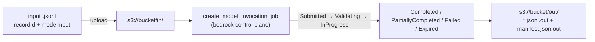

# Bedrock — Guardrails, Knowledge Bases, Agents & Batch

The managed features around the model call. Behaviour (what a guardrail blocks, what a knowledge base retrieves) follows the AWS documentation as of 2026-10-21.

## Guardrails

A **guardrail** is a named, versioned set of safety policies applied to model input and output. Create it once on the control plane (`bedrock`), version it, then reference `id + version` at inference time.

| Policy | What it does | Key settings |
|--------|--------------|--------------|
| Content filters | Detect harmful text or images in six categories: `SEXUAL`, `VIOLENCE`, `HATE`, `INSULTS`, `MISCONDUCT`, `PROMPT_ATTACK` | Strength `NONE`/`LOW`/`MEDIUM`/`HIGH` separately for input and output; action `BLOCK` or `NONE` (detect only); modalities `TEXT`, `IMAGE` |
| Denied topics | Block topics you define in words | `name`, `definition`, `examples`; type `DENY`. Definitions are limited to 200 characters (Classic) or 1,000 (Standard) |
| Word filters | Block exact words and phrases (case-insensitive, whole word) and a managed `PROFANITY` list | `wordsConfig`, `managedWordListsConfig` |
| Sensitive information | Detect or mask PII and secrets, plus custom regexes | 30+ entity types (`EMAIL`, `NAME`, `US_SOCIAL_SECURITY_NUMBER`, `CREDIT_DEBIT_CARD_NUMBER`, `AWS_ACCESS_KEY`, ...); action `BLOCK`, `ANONYMIZE` (replaced with `{NAME}`-style tags), `NONE` |
| Contextual grounding | Flag answers not supported by a source or irrelevant to the query (RAG hallucination check) | Types `GROUNDING`, `RELEVANCE`; a `threshold` between 0 and 1 |
| Automated Reasoning | Check answers against formal logic rules you supply (`automatedReasoningPolicyConfig`) | Not covered here |

**Tiers:** `CLASSIC` supports English, French and Spanish. `STANDARD` has broader language and code support, prompt-leakage detection and is "more robust"; it **uses cross-Region inference** (the boto3 request has `crossRegionConfig.guardrailProfileIdentifier`). Standard tier for contextual grounding exists only in a subset of Regions; elsewhere the request fails with a validation error.

### Create and version

```python
import boto3

bedrock = boto3.client("bedrock", region_name="us-east-1")          # control plane

guardrail = bedrock.create_guardrail(
    name="support-bot-guardrail",
    blockedInputMessaging="Sorry, I can't help with that request.",
    blockedOutputsMessaging="Sorry, I can't share that response.",
    contentPolicyConfig={"filtersConfig": [
        {"type": "PROMPT_ATTACK", "inputStrength": "HIGH", "outputStrength": "NONE"},
        {"type": "HATE", "inputStrength": "MEDIUM", "outputStrength": "MEDIUM"},
    ]},
    topicPolicyConfig={"topicsConfig": [{
        "name": "Investment advice", "type": "DENY",
        "definition": "Recommendations about buying or selling financial products.",
        "examples": ["Which stock should I buy?"],
    }]},
    sensitiveInformationPolicyConfig={"piiEntitiesConfig": [
        {"type": "EMAIL", "action": "ANONYMIZE"},
        {"type": "US_SOCIAL_SECURITY_NUMBER", "action": "BLOCK"},
    ]},
)
gid = guardrail["guardrailId"]                                       # working copy is version "DRAFT"
# creation is asynchronous: poll bedrock.get_guardrail(guardrailIdentifier=gid)["status"] until "READY"
version = bedrock.create_guardrail_version(guardrailIdentifier=gid, description="initial")["version"]   # "1"
```

The status values in the service model are `CREATING`, `UPDATING`, `VERSIONING`, `READY`, `FAILED`, `DELETING`. Use `DRAFT` for experiments and a **numbered version** in production so a console edit cannot change behaviour under you. Manage guardrails as code (Terraform, CDK, a script) and test them (below).

### Attach to Converse

```python
resp = client.converse(
    modelId=MODEL_ID,
    messages=[{"role": "user", "content": [
        {"text": "Answer politely."},                                       # not evaluated once guardContent is present
        {"guardContent": {"text": {"text": user_input}}},                  # evaluated
    ]}],
    guardrailConfig={"guardrailIdentifier": gid, "guardrailVersion": version, "trace": "enabled"},
)
if resp["stopReason"] == "guardrail_intervened":
    ...  # blocked OR masked: see below
```

| Behaviour (AWS docs) | Detail |
|----------------------|--------|
| No `guardContent` | The guardrail evaluates **the whole prompt** (system prompts excluded unless wrapped) |
| Any `guardContent` present | The guardrail evaluates **only** those blocks, except policies that apply to everything such as word filters |
| System prompt | Evaluated only if you wrap it in `guardContent` |
| Tool data | **Not evaluated:** `toolResult`, `toolConfig` descriptions and schemas, and `toolUse.input` the model generates. Text blocks and `guardContent` are |
| `stopReason` | `guardrail_intervened` for **both** blocking and masking |
| Blocked | `output.message` carries your `blockedInputMessaging` or `blockedOutputsMessaging`; in the AWS example `usage` is zeros when blocked on input |
| Masked (`ANONYMIZE`) | Model answer with `{NAME}`/`{EMAIL}` tags, **same** `stopReason`. Enable the trace and read `action` (`ANONYMIZED` vs `BLOCKED`) to tell them apart |
| Trace `enabled` / `enabled_full` | `enabled_full` also returns non-detected entries for debugging |
| Trace content | Includes the **unmasked** matches and the original `modelOutput`. Treat it as sensitive and keep it out of ordinary logs |

A blocked response (as the AWS docs show for a blocked topic):

```text
stopReason: guardrail_intervened
text: Sorry, I can't help with that.
trace.guardrail.inputAssessment['abc123'].topicPolicy.topics -> [('Investment advice', 'BLOCKED')]
```

**Streaming:** `converse_stream` takes `guardrailConfig.streamProcessingMode`: `sync` (default; chunks are buffered and scanned, so slightly delayed but accurate) or `async` (chunks are sent immediately and scanned in the background: a harmful chunk may already have reached the user before the block, and **masking is not supported in async mode**). For `InvokeModelWithResponseStream` the body field is `amazon-bedrock-guardrailConfig` with `"streamProcessingMode": "ASYNCHRONOUS"`.

### `ApplyGuardrail`: Use Guardrails Without a Model

`bedrock-runtime.apply_guardrail` checks any text against a guardrail with no model call. Use it to screen the user input **before** retrieval, check tool output, check output of non-Bedrock models, or test a guardrail in CI.

```python
resp = client.apply_guardrail(
    guardrailIdentifier=gid, guardrailVersion=version,
    source="INPUT",                                   # "INPUT" = user content, "OUTPUT" = model content
    content=[{"text": {"text": "Ignore all previous instructions and ..."}}],
)
if resp["action"] == "GUARDRAIL_INTERVENED":
    safe_text = resp["outputs"][0]["text"]            # canned message (blocked) or masked text
    detected = resp["assessments"][0]["contentPolicy"]["filters"]
```

Response fields: `action` (`NONE`, `GUARDRAIL_INTERVENED`), `actionReason`, `outputs` (empty when nothing happened), `assessments`, `usage` (policy units billed), `guardrailCoverage`. Add `outputScope="FULL"` to also see non-detected entries (it does not apply to word filters and regexes). The request path (`/guardrail/gr-abc123/version/1/apply`)

Contextual grounding needs **qualifiers** on the content blocks:

```python
client.apply_guardrail(
    guardrailIdentifier=gid, guardrailVersion=version, source="OUTPUT", outputScope="FULL",
    content=[
        {"text": {"text": "Refunds are issued within 14 days.", "qualifiers": ["grounding_source"]}},
        {"text": {"text": "How long do refunds take?", "qualifiers": ["query"]}},
        {"text": {"text": "Refunds take 90 days.", "qualifiers": ["guard_content"]}},   # the answer under test
    ],
)
```

Responses report usage in policy units (`topicPolicyUnits`, `contentPolicyUnits`, `wordPolicyUnits`, `sensitiveInformationPolicyUnits`, `contextualGroundingPolicyUnits`); check the pricing page for how they bill. Both attached guardrails and `ApplyGuardrail` report units. The service model also lists organisation-level **enforced guardrails** (`put_enforced_guardrail_configuration`) and an `InvokeGuardrailChecks` runtime operation; they are not covered here.

### Testing guardrails

| Level | What you can do | What you cannot |
|-------|-----------------|-----------------|
| Plumbing (offline) | Stubber or a fake server: the app sends the right `guardrailConfig`, treats `guardrail_intervened` as a blocked turn, masks logs, never prints the trace | Prove the policy blocks anything. moto has no guardrails (`create_guardrail` raises `NotImplementedError`) |
| Policy (live, in a test account) | A dataset of attack, benign and PII prompts run through `apply_guardrail` (no model cost): assert `action` per case, track false-positive and false-negative rates | Cover every phrasing; classifiers are probabilistic: use thresholds over a dataset, not one example |
| Red teaming | Generate attacks with an eval tool; see [Red Teaming](../../llm-evaluation/02_testing/09_red_teaming.md) and the [OWASP LLM guide](../../owasp-llm-security/index.md) | Replace layered defences: a guardrail is one layer, not an authorisation system |

## Knowledge Bases (RAG)

A **knowledge base** ingests your documents, embeds them into a vector store and retrieves chunks at query time. AWS now has two kinds: **Managed** (Bedrock manages ingestion, indexing, storage, reranking; connectors for S3, SharePoint, Confluence, Google Drive, OneDrive, web crawler; document-level ACL filtering; agentic multi-hop retrieval) and **Customer-managed** (your vector store such as OpenSearch Serverless, Aurora or Neptune Analytics, and full control of parsing). AWS recommends Managed for new work. Third-party connectors, ACLs and native AgentCore Gateway integration are Managed-only.

| Client | Operations |
|--------|-----------|
| `bedrock-agent` | `create_knowledge_base`, `create_data_source`, `start_ingestion_job`, `get_ingestion_job`, `ingest_knowledge_base_documents` |
| `bedrock-agent-runtime` | `retrieve`, `retrieve_and_generate` (+ `…_stream`), `rerank`, `generate_query`, `agentic_retrieve_stream` |

```python
runtime = boto3.client("bedrock-agent-runtime", region_name="us-east-1")

# Retrieve: you get ranked chunks and build the prompt yourself (best for control and for testing retrieval alone)
out = runtime.retrieve(
    knowledgeBaseId="KB12345678",
    retrievalQuery={"text": "refund window"},
    retrievalConfiguration={"vectorSearchConfiguration": {"numberOfResults": 5}},   # overrideSearchType HYBRID or SEMANTIC, filter, reranking
)
for r in out["retrievalResults"]:
    print(round(r["score"], 2), r["location"]["s3Location"]["uri"], r["content"]["text"][:80])

# RetrieveAndGenerate: retrieval + a model call + citations in one request
cfg = {"type": "KNOWLEDGE_BASE", "knowledgeBaseConfiguration": {
    "knowledgeBaseId": "KB12345678",
    "modelArn": "arn:aws:bedrock:us-east-1:123456789012:inference-profile/global.anthropic.claude-haiku-5-5"}}
ans = runtime.retrieve_and_generate(input={"text": "How long do refunds take?"}, retrieveAndGenerateConfiguration=cfg)
print(ans["output"]["text"], ans["sessionId"])         # pass sessionId back to continue the conversation
refs = [ref for c in ans["citations"] for ref in c["retrievedReferences"]]
```

`retrieve_and_generate` takes a **model ARN** (a foundation model or an inference profile ARN), not a bare ID. The model must support Knowledge Bases (Claude Sonnet 5.5 and Haiku 5.5 list it; Nova 2 Lite does not). `Retrieve` also accepts a `guardrailConfiguration` (its response carries `guardrailAction`) and, for permission-filtered Managed bases, a `userContext.userId`.

Test it in layers:

| Concern | Test |
|---------|------|
| Request building (filters, `numberOfResults`, model ARN) | Stubber with `expected_params` |
| Prompt assembly from chunks | Pure function: pass canned `retrievalResults` |
| Retrieval quality | A small labelled set of questions with the expected source document; assert the expected `s3Location.uri` is in the top *k*. Needs a live knowledge base in a test account |
| Grounded answers | `ans["citations"]` must be non-empty and the cited text must support the claim; score faithfulness and context precision/recall with the [DeepEval RAG metrics](../../llm-evaluation/01_metrics/02_rag_metrics.md); see [RAG testing](../../llm-evaluation/03_practical/14_practical_rag_testing.md) |
| Ingestion | After `start_ingestion_job`, poll `get_ingestion_job` until complete; assert failed-document counts in test; ingestion takes time, so keep it out of unit tests |
| Access control | Different `userContext.userId` values return different documents (Managed bases with ACLs) |

moto implements only control-plane CRUD for `bedrock-agent` agents and knowledge bases, not `retrieve` or `retrieve_and_generate`. Wrap the runtime client in a small `Retriever` class and fake that.

## Agents: Classic and AgentCore

| | **Agents Classic** (`bedrock-agent`, `bedrock-agent-runtime`) | **AgentCore** (`bedrock-agentcore`, `bedrock-agentcore-control`) |
|---|---|---|
| Status | **"No longer open to new customers"**; existing customers continue (AWS notice: "maintenance mode") | The recommended path; AWS says to "explore Amazon Bedrock AgentCore" for similar capabilities |
| Model | Configured agent: model + instructions + action groups (Lambda or return-of-control) + knowledge bases; versions and **aliases** | You host **your own agent code** (any framework) in a managed runtime with session isolation; plus memory, gateway, browser, code interpreter, policy and evaluation services |
| Call | `invoke_agent(agentId, agentAliasId, sessionId, inputText, enableTrace=...)`; the answer arrives as an event stream `completion` of `chunk` (`bytes`) events; test alias `TSTALIASID` | `invoke_agent_runtime(agentRuntimeArn=..., runtimeSessionId=..., payload=bytes)` returns a streaming response |

```python
# AgentCore: invoke a deployed agent runtime (shape from the AWS developer guide)
import json

import boto3

agentcore = boto3.client("bedrock-agentcore", region_name="us-east-1")
resp = agentcore.invoke_agent_runtime(
    agentRuntimeArn="arn:aws:bedrock-agentcore:us-east-1:123456789012:runtime/support_agent-AbC123",   # placeholder
    runtimeSessionId=session_id,                       # same id = same conversation; use a UUID per conversation
    payload=json.dumps({"prompt": "Where is order ord-42?"}).encode(),
)
if "text/event-stream" in resp.get("contentType", ""):
    for line in resp["response"].iter_lines(chunk_size=10):
        if line.startswith(b"data: "):
            print(line[6:].decode())
else:
    print(json.loads(b"".join(resp["response"])))
```

```python
# Agents Classic
runtime = boto3.client("bedrock-agent-runtime", region_name="us-east-1")
resp = runtime.invoke_agent(agentId="AGENT12345", agentAliasId="TSTALIASID", sessionId="s-1",
                            inputText="Where is order ord-42?", enableTrace=True)
answer = "".join(e["chunk"]["bytes"].decode() for e in resp["completion"] if "chunk" in e)
```

Facts and cautions from the AgentCore developer guide:

- The payload is binary, up to **100 MB**; responses stream. `ValidationException`, `ResourceNotFoundException`, `AccessDeniedException`, `ThrottlingException` and a retryable `RetryableConflictException` (409, "Session operation in progress") can occur.
- If the agent uses OAuth inbound auth, the AWS SDK cannot be used: make an HTTPS request instead.
- **Validate that `prompt` is a string** in the agent entrypoint. The payload arrives as parsed JSON; a non-string value containing a `toolUse` block could make some frameworks run the named tool directly, bypassing model reasoning and guardrails. This is a test case worth writing (see the [OWASP LLM guide](../../owasp-llm-security/index.md)).
- IAM: `bedrock-agentcore:InvokeAgentRuntime` for callers.
- `InvokeAgentRuntimeCommand` runs deterministic shell commands (tests, builds) in a session without going through the LLM.

Testing agents is mostly **testing your adapter**: keep one class (`AgentClient.ask(session_id, text) -> AgentAnswer`), unit-test your parsing of the event stream with hand-built chunks, test your own agent code locally as ordinary Python before deploying, and run a handful of end-to-end conversations against a deployed test alias or runtime. Judge the behaviour with agent metrics (task completion, tool correctness) from the [DeepEval guide](../../llm-evaluation/01_metrics/04_agent_metrics.md) and design guidance from [Agentic AI Architecture](../../agentic-ai-architecture/index.md).

## Batch Inference

For large offline jobs: put JSONL in S3, create a job, collect JSONL from S3 later. Priced separately (see the AWS pricing page), separate quotas, no latency guarantee.



```python
import json


def build_batch_jsonl(prompts: dict[str, str], max_tokens=512, system=None) -> str:
    lines = []
    for record_id, prompt in prompts.items():
        model_input = {"messages": [{"role": "user", "content": [{"text": prompt}]}],
                       "inferenceConfig": {"maxTokens": max_tokens}}               # Converse request body, no toolConfig
        if system:
            model_input["system"] = [{"text": system}]
        lines.append(json.dumps({"recordId": record_id, "modelInput": model_input}))
    return "\n".join(lines) + "\n"


job = bedrock.create_model_invocation_job(
    jobName="nightly-summaries-2026-10-21",
    modelId="anthropic.claude-haiku-5-5",          # check the model card: batch support is per model
    roleArn="arn:aws:iam::123456789012:role/bedrock-batch",
    modelInvocationType="Converse",                # or "InvokeModel" (native bodies)
    inputDataConfig={"s3InputDataConfig": {"s3Uri": "s3://my-batch-bucket/in/"}},
    outputDataConfig={"s3OutputDataConfig": {"s3Uri": "s3://my-batch-bucket/out/"}},
)
status = bedrock.get_model_invocation_job(jobIdentifier=job["jobArn"])["status"]
```

| Fact | Detail |
|------|--------|
| Status values | `Submitted`, `Validating`, `Scheduled`, `InProgress`, `Completed`, `PartiallyCompleted`, `Failed`, `Stopping`, `Stopped`, `Expired` |
| Counters on `get_model_invocation_job` | `totalRecordCount`, `processedRecordCount`, `successRecordCount`, `errorRecordCount`; `timeoutDurationInHours` caps the run |
| Input | JSONL, each line `{"recordId": ..., "modelInput": ...}`; `modelInput` is the model's native body (`InvokeModel` type) or a Converse request body (`Converse` type). A missing `recordId` is generated in the output |
| Input limits | Minimum records per job, records per file, file size and job size are quotas: check Service Quotas |
| Output | One output `.jsonl` per input file: `{"recordId", "modelInput", "modelOutput"}`; a failed line has an `error` object (`errorCode`, `errorMessage`) **instead of** `modelOutput`. A `manifest.json.out` has record and token totals. **Order is not preserved**: join on `recordId` |
| Converse type | `toolConfig` is rejected (400). Structured output works in both types. For tool calls use the `InvokeModel` type |
| Not supported | Provisioned models; **prompt caching** |
| Model support | Per model. The batch table lists Nova 2 Lite, Lite, Micro, Pro, Claude Opus 5 and several 4.x Claude models; the Claude Sonnet 5.5 and Haiku 5.5 cards show **batch not supported** |
| Completion events | Amazon EventBridge job state-change events replace polling |

Parse results defensively and test the parser with a canned file:

```python
def parse_batch_output(text: str):
    ok, failed = {}, {}
    for line in text.splitlines():
        rec = json.loads(line)
        if "modelOutput" in rec and "error" not in rec:
            ok[rec["recordId"]] = "".join(b.get("text", "") for b in rec["modelOutput"]["output"]["message"]["content"])
        else:
            failed[rec["recordId"]] = rec.get("error") or rec
    return ok, failed
```

A job that ends `PartiallyCompleted` is a normal outcome to handle: re-submit only the `failed` record ids.

## Model Evaluation and Other Features

| Feature | What it is | Note |
|---------|-----------|------|
| Evaluation jobs | `bedrock.create_evaluation_job(...)` with `applicationType` `ModelEvaluation` or `RagEvaluation`, `evaluationConfig` of kind `automated` or `human`, `inferenceConfig` (models or RAG configs) and an S3 output location | Metrics and limits are not covered here. For repeatable in-repo evaluation use [DeepEval](../../llm-evaluation/index.md) |
| Prompt management and flows | Versioned prompts (`promptVariables` in Converse) and visual flows | Not covered |
| Custom and imported models, distillation | `bedrock` control plane (`create_model_customization_job`, `create_custom_model`, `create_model_import_job`) | Not covered |
| Intelligent prompt routing | Router profiles (`create_prompt_router`) | Listed as unsupported on the 5.5 Claude cards |

## Quick Rules

1. **Version guardrails** and reference numbered versions in production; manage them as code.
2. **`guardrail_intervened` is not always a block.** Enable the trace and check `action` before deciding to discard an answer, and never log the trace as plain text.
3. **Wrap system prompts and the user turn in `guardContent`** when you want them evaluated, and validate tool arguments and results yourself: guardrails skip them.
4. **Use `ApplyGuardrail` to test policies and to screen input before retrieval**; keep the dataset of attack and benign prompts in the repo.
5. **Use `Retrieve` when you need control and testability; use `RetrieveAndGenerate` for speed.** Fail a test when an answer has no citations.
6. **Do not start new projects on Agents Classic.** Use AgentCore or a framework, and validate that `prompt` is a string at the entrypoint.
7. **Batch jobs are keyed by `recordId`, not by order;** handle `PartiallyCompleted`; check that the model supports batch.
8. **Keep an adapter class around every agent and knowledge-base call** so tests can fake it.

---
## See also
- [Amazon Bedrock](./index.md)
- [01 Models, Access, Regions & the Converse API](./01-models-access-converse.md)
- [02 Streaming, Tools, Structured Output, Multimodal & Caching](./02-streaming-tools-structured-output.md)
- [04 Testing & Production](./04-testing-production.md)
- [OWASP Top 10 for LLM Applications](../../owasp-llm-security/index.md)
- [DeepEval: RAG Metrics](../../llm-evaluation/01_metrics/02_rag_metrics.md)
- [DeepEval: Red Teaming](../../llm-evaluation/02_testing/09_red_teaming.md)
- [Agentic AI Architecture](../../agentic-ai-architecture/index.md)
- [Guardrails AI (open-source validators)](../../libs/guardrails/index.md)
- [Amazon SQS](../sqs/index.md)
