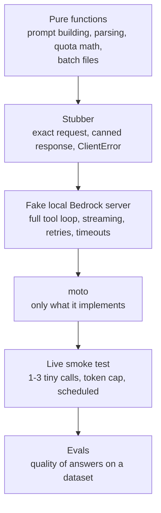

# Bedrock — Testing & Production

What makes Bedrock code hard to test: the answers are **non-deterministic**, calls are **slow and billed per token**, quotas throttle you, and the interesting failures (throttling, truncation, a guardrail block, a mid-stream error) are rare in a real account. The strategy is to push as much as possible into layers that need no AWS and no model, and keep one tiny live check.

The generic boto3 test setup (fake credentials, `AWS_CONFIG_FILE=/dev/null`, Stubber and moto basics) is in [AWS Foundations](../foundations/02-credentials-iam-local-testing.md); this page adds what is specific to Bedrock.

## What to Test Where



| Level | Tool | Needs | Catches | Cannot catch |
|-------|------|-------|---------|--------------|
| Pure logic | plain pytest | nothing | Prompt/schema building, parsing, token and quota math, batch JSONL | Anything about the service |
| Request and error handling | `botocore.stub.Stubber` | nothing | Wrong parameter names or types (validated against the service model), your handling of `ThrottlingException`, `stopReason` branches | Real retry behaviour, streaming, HTTP |
| Flows | Fake HTTP server (`endpoint_url`) | nothing (stdlib) | Tool loops, event-stream parsing, botocore retry behaviour, timeouts, headers (API key), request bodies | Real model behaviour; your fake can disagree with AWS |
| Emulator | moto | nothing | Control-plane calls it implements | Almost all inference (below) |
| Live | pytest marker, real account | model access, small budget | IAM, Marketplace access, Region/profile availability, real latency and token use | Quality at scale, rare errors |
| Quality | Eval framework | usually a judge model | Wrong answers, hallucinations, wrong tool arguments | Plumbing bugs |

Most tests belong in the first three rows. The general split is in the [Testing Pyramid](../../testing-pyramid/index.md).

## Design for Testability

Keep Bedrock behind a thin layer: pure functions that build requests and read responses, and one function that takes the **client as an argument**.

```python
# bedrock_chat.py (excerpt)
def make_client(region="us-east-1", endpoint_url=None, **creds):
    cfg = Config(retries={"mode": "standard", "total_max_attempts": 4}, read_timeout=120, connect_timeout=5, tcp_keepalive=True)
    return boto3.client("bedrock-runtime", region_name=region, endpoint_url=endpoint_url, config=cfg, **creds)

def reply_text(response): ...                     # pure
def consume_stream(stream, on_text=None): ...     # pure over an event iterator (page 02)
def run_tool_loop(client, model_id, messages, tool_config, handlers, **kwargs): ...   # client injected (page 02)
def estimate_quota_tokens(...): ...               # pure (page 01)
```

Never create the client at import time, never read the model ID inside the function (take it from config or a fixture), and keep `maxTokens` and `temperature` parameters visible.

## Stubber: Exact Requests and Errors

```python
import boto3
import pytest
from botocore.stub import Stubber

MODEL = "global.anthropic.claude-haiku-5-5"

def stub_client():
    return boto3.client("bedrock-runtime", region_name="us-east-1", aws_access_key_id="x", aws_secret_access_key="x")

def test_request_shape_and_reply():
    client = stub_client()
    with Stubber(client) as stub:
        stub.add_response("converse",
            {"output": {"message": {"role": "assistant", "content": [{"text": "Paris"}]}}, "stopReason": "end_turn",
             "usage": {"inputTokens": 12, "outputTokens": 4, "totalTokens": 16}, "metrics": {"latencyMs": 100}},
            expected_params={"modelId": MODEL, "system": [{"text": "Answer in one word."}],
                             "messages": [{"role": "user", "content": [{"text": "Capital of France?"}]}],
                             "inferenceConfig": {"maxTokens": 50, "temperature": 0.0}})
        resp = client.converse(modelId=MODEL, system=[{"text": "Answer in one word."}],
                               messages=[{"role": "user", "content": [{"text": "Capital of France?"}]}],
                               inferenceConfig={"maxTokens": 50, "temperature": 0.0})
        assert resp["output"]["message"]["content"][0]["text"] == "Paris"
        stub.assert_no_pending_responses()

def test_service_error():
    client = stub_client()
    with Stubber(client) as stub:
        stub.add_client_error("converse", service_error_code="ThrottlingException",
                              service_message="Too many requests", http_status_code=429)
        with pytest.raises(client.exceptions.ThrottlingException):
            client.converse(modelId=MODEL, messages=[{"role": "user", "content": [{"text": "hi"}]}])
```

Stubber validates **requests** against the service model even without `expected_params`: passing `content` as a plain string raises

```text
ParamValidationError: Invalid type for parameter messages[0].content, value: plain string, type: <class 'str'>, valid types: <class 'list'>, <class 'tuple'>
```

This is the cheapest way to catch typos in new fields such as `outputConfig`, `cachePoint.ttl` or `serviceTier`. Limits: **canned responses are validated too** (`add_response` without `usage` raises `Missing required parameter in input: "usage"`), Stubber has no HTTP, no retries (a stubbed error is raised once), so use the fake server for streaming and retries.

## A Fake Local Bedrock Server

A 130-line standard-library HTTP server that speaks the Bedrock Runtime wire format: JSON for `converse`, the binary **AWS event-stream** framing for `converse-stream`, error responses with `x-amzn-ErrorType`, and `apply`. You script replies in order and inspect every request. boto3 talks to it through `endpoint_url` (or, with no code change, `AWS_ENDPOINT_URL_BEDROCK_RUNTIME`).

```python
# fake_bedrock.py
"""A tiny local Bedrock Runtime: scripted replies for Converse, ConverseStream and ApplyGuardrail."""
import binascii
import json
import struct
import threading
from http.server import BaseHTTPRequestHandler, ThreadingHTTPServer
from urllib.parse import unquote


# ---- reply builders --------------------------------------------------------------------------
def text_reply(text, *, stop="end_turn", usage=None):
    return {"kind": "message", "content": [{"text": text}], "stop": stop, "usage": usage}


def tool_reply(name, tool_input, *, tool_use_id="tooluse_abc123", usage=None):
    return {"kind": "message", "content": [{"toolUse": {"toolUseId": tool_use_id, "name": name, "input": tool_input}}],
            "stop": "tool_use", "usage": usage}


def error_reply(status, error_type, message="simulated"):
    return {"kind": "error", "status": status, "type": error_type, "message": message}


def midstream_error_reply(text_before="Your order ", exc_type="modelStreamErrorException"):
    return {"kind": "midstream_error", "content": [{"text": text_before}], "stop": "end_turn", "exc_type": exc_type}


def guardrail_reply(blocked_text="Sorry, I can't help with that."):
    return {"kind": "message", "content": [{"text": blocked_text}], "stop": "guardrail_intervened",
            "usage": {"inputTokens": 0, "outputTokens": 0, "totalTokens": 0},
            "trace": {"guardrail": {"inputAssessment": {"abc123": {"topicPolicy": {"topics": [
                {"name": "Investment advice", "type": "DENY", "action": "BLOCKED", "detected": True}]}}}}}}


# ---- AWS event-stream encoding (what ConverseStream returns) -----------------------------------
def _header(name, value):
    n, v = name.encode(), value.encode()
    return struct.pack("B", len(n)) + n + b"\x07" + struct.pack(">H", len(v)) + v


def event_frame(event_type, payload, message_type="event"):
    headers = (_header(":message-type", message_type)
               + _header(":event-type" if message_type == "event" else ":exception-type", event_type)
               + _header(":content-type", "application/json"))
    body = json.dumps(payload).encode()
    total = 12 + len(headers) + len(body) + 4
    prelude = struct.pack(">II", total, len(headers))
    prelude += struct.pack(">I", binascii.crc32(prelude) & 0xFFFFFFFF)
    msg = prelude + headers + body
    return msg + struct.pack(">I", binascii.crc32(msg) & 0xFFFFFFFF)


def stream_frames(reply, chunk=4):
    yield event_frame("messageStart", {"role": "assistant"})
    for i, block in enumerate(reply["content"]):
        if "text" in block:
            text = block["text"]
            for j in range(0, len(text), chunk):
                yield event_frame("contentBlockDelta", {"contentBlockIndex": i, "delta": {"text": text[j:j + chunk]}})
        else:
            tu = block["toolUse"]
            yield event_frame("contentBlockStart", {"contentBlockIndex": i, "start": {"toolUse": {
                "toolUseId": tu["toolUseId"], "name": tu["name"]}}})
            raw = json.dumps(tu["input"])
            for j in range(0, len(raw), 5):              # the tool input arrives as JSON string fragments
                yield event_frame("contentBlockDelta", {"contentBlockIndex": i, "delta": {"toolUse": {"input": raw[j:j + 5]}}})
        yield event_frame("contentBlockStop", {"contentBlockIndex": i})
    yield event_frame("messageStop", {"stopReason": reply["stop"]})
    usage = reply.get("usage") or {"inputTokens": 10, "outputTokens": 5, "totalTokens": 15}
    yield event_frame("metadata", {"usage": usage, "metrics": {"latencyMs": 12}})


# ---- the server -------------------------------------------------------------------------------
class FakeBedrock:
    def __init__(self):
        self.script: list[dict] = []          # replies, consumed in order by Converse/ConverseStream
        self.requests: list[dict] = []        # every request: {"path", "headers", "body"}
        self.apply_guardrail_reply = {"action": "NONE", "outputs": [], "assessments": [{}],
                                      "usage": {"topicPolicyUnits": 1, "contentPolicyUnits": 1, "wordPolicyUnits": 0,
                                                "sensitiveInformationPolicyUnits": 0, "sensitiveInformationPolicyFreeUnits": 0,
                                                "contextualGroundingPolicyUnits": 0}}
        outer = self

        class Handler(BaseHTTPRequestHandler):
            def log_message(self, *a):
                pass

            def _send(self, status, body: bytes, ctype="application/json", extra=None):
                self.send_response(status)
                self.send_header("Content-Type", ctype)
                self.send_header("Content-Length", str(len(body)))
                for k, v in (extra or {}).items():
                    self.send_header(k, v)
                self.end_headers()
                self.wfile.write(body)

            def do_POST(self):
                body = self.rfile.read(int(self.headers.get("Content-Length", 0)))
                path = unquote(self.path)
                req = {"path": path, "headers": {k.lower(): v for k, v in self.headers.items()},
                       "body": json.loads(body) if body else {}}
                outer.requests.append(req)
                if path.endswith("/apply"):
                    return self._send(200, json.dumps(outer.apply_guardrail_reply).encode())
                reply = outer.script.pop(0) if outer.script else text_reply("(unscripted)")
                if reply["kind"] == "error":
                    return self._send(reply["status"], json.dumps({"message": reply["message"]}).encode(),
                                      extra={"x-amzn-ErrorType": reply["type"]})
                if reply["kind"] == "midstream_error":
                    frames = list(stream_frames(reply))[:3]          # messageStart + two text deltas, then the failure
                    frames.append(event_frame(reply["exc_type"], {"message": "model stream failed", "originalStatusCode": 500,
                                                                  "originalMessage": "upstream"}, "exception"))
                    return self._send(200, b"".join(frames), "application/vnd.amazon.eventstream")
                if path.endswith("/converse-stream"):
                    return self._send(200, b"".join(stream_frames(reply)), "application/vnd.amazon.eventstream")
                out = {"output": {"message": {"role": "assistant", "content": reply["content"]}},
                       "stopReason": reply["stop"],
                       "usage": reply.get("usage") or {"inputTokens": 10, "outputTokens": 5, "totalTokens": 15},
                       "metrics": {"latencyMs": 12}}
                if "trace" in reply:
                    out["trace"] = reply["trace"]
                self._send(200, json.dumps(out).encode())

        self.httpd = ThreadingHTTPServer(("127.0.0.1", 0), Handler)
        self.url = f"http://127.0.0.1:{self.httpd.server_address[1]}"
        self._thread = threading.Thread(target=self.httpd.serve_forever, daemon=True)

    def __enter__(self):
        self._thread.start()
        return self

    def __exit__(self, *exc):
        self.httpd.shutdown()
        self.httpd.server_close()
```

```python
# conftest.py
import pytest

from bedrock_chat import make_client
from fake_bedrock import FakeBedrock


@pytest.fixture
def fake():
    """A local Bedrock Runtime. Script replies with fake.script.append(...), inspect fake.requests."""
    with FakeBedrock() as server:
        yield server


@pytest.fixture
def client(fake):
    # dummy credentials: nothing leaves the machine
    return make_client(endpoint_url=fake.url, aws_access_key_id="test", aws_secret_access_key="test")
```

The fake is a **contract you maintain**: botocore validates every response it parses against the service model (a wrong event name or missing field fails inside botocore), but it cannot tell you how real Bedrock chunks text or words its errors. Refresh it from the AWS API reference when you upgrade boto3, and let the live smoke test catch drift.

### A full tool loop, a guardrail block and a truncated answer

```python
from bedrock_chat import ToolLoopError, run_tool_loop
from fake_bedrock import guardrail_reply, text_reply, tool_reply

MODEL = "global.anthropic.claude-haiku-5-5"
TOOLS = {"tools": [{"toolSpec": {"name": "lookup_order", "description": "Look up an order by id",
    "inputSchema": {"json": {"type": "object", "properties": {"order_id": {"type": "string"}}, "required": ["order_id"]}}}}]}


def lookup_order(order_id: str):
    if order_id == "ord-404":
        raise KeyError(order_id)
    return {"order_id": order_id, "status": "shipped"}


def test_full_tool_loop(client, fake):
    fake.script += [tool_reply("lookup_order", {"order_id": "ord-42"}), text_reply("Order ord-42 has shipped.")]
    text, messages, usage = run_tool_loop(client, MODEL, [{"role": "user", "content": [{"text": "Status of ord-42?"}]}],
                                          TOOLS, {"lookup_order": lookup_order})
    assert text == "Order ord-42 has shipped." and usage.calls == 2
    second = fake.requests[1]["body"]["messages"]                        # what the model saw on turn 2
    assert second[1]["content"][0]["toolUse"]["name"] == "lookup_order"
    result = second[2]["content"][0]["toolResult"]
    assert result["toolUseId"] == "tooluse_abc123" and result["content"] == [{"json": {"order_id": "ord-42", "status": "shipped"}}]
    assert all(r["body"]["toolConfig"] == TOOLS for r in fake.requests)  # schema sent on every call


def test_tool_failure_is_reported_to_the_model(client, fake):
    fake.script += [tool_reply("lookup_order", {"order_id": "ord-404"}), text_reply("I could not find that order.")]
    run_tool_loop(client, MODEL, [{"role": "user", "content": [{"text": "ord-404?"}]}], TOOLS, {"lookup_order": lookup_order})
    result = fake.requests[1]["body"]["messages"][-1]["content"][0]["toolResult"]
    assert result["status"] == "error" and result["content"][0]["text"].startswith("KeyError")


def test_guardrail_block_is_detected_by_stop_reason(client, fake):
    fake.script.append(guardrail_reply())
    resp = client.converse(modelId=MODEL, messages=[{"role": "user", "content": [{"text": "Which stock should I buy?"}]}],
                           guardrailConfig={"guardrailIdentifier": "gr-abc123", "guardrailVersion": "1", "trace": "enabled"})
    assert resp["stopReason"] == "guardrail_intervened"
    topics = resp["trace"]["guardrail"]["inputAssessment"]["abc123"]["topicPolicy"]["topics"]
    assert [(t["name"], t["action"]) for t in topics] == [("Investment advice", "BLOCKED")]
```

Retry behaviour (`total_max_attempts=4`, standard mode): `429 ThrottlingException`, `503 ServiceUnavailableException`, `500 InternalServerException` and `429 ModelNotReadyException` are retried; `408 ModelTimeoutException` is raised after one request; `ValidationException`, `AccessDeniedException` and `ServiceQuotaExceededException` are not retried; persistent throttling gives up after 4 requests with `RetryAttempts: 3` and `MaxAttemptsReached: True`. Retries sleep with backoff, so the retry tests take seconds: use a small `total_max_attempts` in the test client when you do not need to prove the budget.

## What moto Covers (and Does Not)

moto behaviour:

| Call | Result |
|------|--------|
| `bedrock-runtime.invoke_model` | Works but returns an **empty JSON body** `{}` regardless of input and ignores the model: a connectivity stub, useless for output |
| `bedrock-runtime.converse` / `converse_stream` | `NotImplementedError: The converse action has not been implemented` |
| `bedrock.create_guardrail`, `list_guardrails`, `list_foundation_models` | `NotImplementedError` |
| `bedrock.put/get/delete_model_invocation_logging_configuration` | Works |
| `bedrock` model customization and custom model jobs; `bedrock-agent` agents and knowledge bases (create, list, get, delete) | Implemented; no runtime `retrieve` |

```python
@mock_aws
def test_logging_configuration_roundtrip():
    br = boto3.client("bedrock", region_name="us-east-1")
    br.put_model_invocation_logging_configuration(loggingConfig={
        "cloudWatchConfig": {"logGroupName": "/bedrock/invocations", "roleArn": "arn:aws:iam::123456789012:role/bedrock-logs"},
        "textDataDeliveryEnabled": True, "imageDataDeliveryEnabled": False})
    cfg = br.get_model_invocation_logging_configuration()["loggingConfig"]
    assert cfg["cloudWatchConfig"]["logGroupName"] == "/bedrock/invocations"
```

Use moto for the **infrastructure around** Bedrock (S3 buckets for batch and logs, SQS queues in front of workers, IAM roles, CloudWatch log groups): see [SQS](../sqs/index.md). Do not use it to test model calls. A moto test that passes only proves your code can call `invoke_model` and ignore the answer.

## Asserting on Non-Deterministic Output

`temperature=0` reduces variation but does not guarantee identical text across calls or model versions. Assert on **properties**, not strings:

| Property | Assertion | Works without a model? |
|----------|-----------|------------------------|
| Request is well formed | `Stubber` `expected_params`, or `fake.requests[i]["body"]` | Yes |
| Control flow | `stopReason`, number of calls, which tools were called, in what order | Yes (scripted), and live |
| Structure | `json.loads` + `jsonschema.validate` against the schema you sent | Yes (scripted), and live |
| Tool arguments | Types, enums, ids exist in the test data | Yes, and live |
| Safety | `stopReason == "guardrail_intervened"`; `apply_guardrail` `action` per dataset row | Plumbing offline; policy live |
| Bounds | `usage.totalTokens < N`, `metrics.latencyMs < N`, output length range | Live |
| Content | Contains required facts or ids, avoids forbidden phrases (substring or regex, case-insensitive) | Live |
| Grounding | `citations` non-empty; cited text supports the claim | Live |
| Semantic quality | LLM-as-judge or similarity metrics over a dataset with a pass-rate threshold | Live + judge: [DeepEval](../../llm-evaluation/index.md) |

Pytest-level tactics: run N samples and assert a pass **rate**; pin the model ID and prompt version in the test name or marker; keep failing outputs in the assertion message. Systematic evaluation, datasets and metrics belong in the [LLM evaluation guide](../../llm-evaluation/index.md); for a gateway that fans out to many providers see [LiteLLM observability & testing](../../libs/litellm/05-observability-testing.md).

## Token and Cost Budgets

Put a hard budget on every test run: a runaway tool loop is a billing event.

```python
# budget.py: counts tokens of every Converse call on a client, tags requests, stops at the cap
class BudgetExceeded(AssertionError):
    pass


class TokenBudget:
    def __init__(self, client, max_total_tokens: int, request_metadata: dict | None = None):
        self.max_total_tokens, self.used, self.calls = max_total_tokens, 0, 0
        self.request_metadata = request_metadata or {}
        events = client.meta.events
        events.register("provide-client-params.bedrock-runtime.Converse", self._tag)
        events.register("after-call.bedrock-runtime.Converse", self._count)

    def _tag(self, params, **kwargs):
        if self.request_metadata:
            params.setdefault("requestMetadata", {}).update(self.request_metadata)    # shows up in invocation logs
        if self.used >= self.max_total_tokens:
            raise BudgetExceeded(f"token budget exhausted: {self.used}/{self.max_total_tokens} after {self.calls} calls")

    def _count(self, parsed, **kwargs):
        self.used += parsed["usage"]["totalTokens"]
        self.calls += 1
```

With each scripted reply reporting 15 tokens and a cap of 40, the 4th call raises `token budget exhausted: 45/40 after 3 calls` **before** leaving the process, and the first request carries `requestMetadata == {"suite": "nightly", "test": "budget"}`. Register `ConverseStream` hooks separately (its usage arrives in the last `metadata` event).

| Lever | How |
|-------|-----|
| Cheapest adequate model in tests | Config value per environment; Haiku-class or Nova Lite-class for smoke tests |
| Small `maxTokens` | 20 for a smoke test; also keeps the reserved TPM small |
| Bounded loops | `max_turns` in the tool loop |
| Attribution | `requestMetadata` per test; **application inference profiles** with cost-allocation tags per team or environment; IAM principal per pipeline (`identity.arn` in logs) |
| Pre-flight estimates | `count_tokens` where the model supports it; otherwise log `usage` |
| Alarms | CloudWatch alarm on `OutputTokenCount` and `InvocationThrottles`, AWS Budgets on the test account |
| Caching in tests | Not worth it: the cache TTL and 512-1,024+ token minimums make small tests miss |

## A Live Smoke Test

A single test, skipped unless explicitly enabled, runs on a schedule or before release in a **separate test account**, with a role that can invoke only the test model.

```python
import os

import pytest

from bedrock_chat import make_client


@pytest.mark.skipif(not os.environ.get("RUN_BEDROCK_SMOKE"), reason="live Bedrock smoke test: set RUN_BEDROCK_SMOKE=1")
def test_live_smoke():
    client = make_client()
    resp = client.converse(modelId=os.environ.get("BEDROCK_MODEL_ID", "global.anthropic.claude-haiku-5-5"),
                           messages=[{"role": "user", "content": [{"text": "Reply with the single word: pong"}]}],
                           inferenceConfig={"maxTokens": 20})
    assert "pong" in resp["output"]["message"]["content"][0]["text"].lower()
    assert resp["usage"]["totalTokens"] < 200
```

Without the variable the test is skipped (`SKIPPED (live Bedrock smoke test: set RUN_BEDROCK_SMOKE=1)`). Add checks that the offline layers cannot make: `get_foundation_model_availability` is `AVAILABLE`, the profile ID appears in `list_inference_profiles`, one `converse_stream` call yields events and a `metadata` event, one `apply_guardrail` dataset row blocks.

```yaml
# .github/workflows/bedrock-smoke.yml
name: bedrock-smoke
on:
  schedule: [{cron: "0 4 * * *"}]
  workflow_dispatch:
permissions: {id-token: write, contents: read}
jobs:
  smoke:
    runs-on: ubuntu-latest
    steps:
      - uses: actions/checkout@v4
      - uses: aws-actions/configure-aws-credentials@v6
        with: {role-to-assume: "arn:aws:iam::123456789012:role/bedrock-smoke", aws-region: us-east-1}
      - run: uv sync && uv run pytest tests/live
        env: {RUN_BEDROCK_SMOKE: "1", BEDROCK_MODEL_ID: "global.anthropic.claude-haiku-5-5"}
```

The everyday CI job needs **no AWS credentials at all**: `uv run pytest tests/unit` with fake credentials, Stubber and the fake server. Pin boto3 in the lockfile and upgrade it on purpose: the Bedrock service model changes quickly (fields such as `outputConfig` are missing from older boto3 versions).

## Logging and Metrics in Production

### Model invocation logging

Off by default, configured per Region on the control plane. It records full prompts and responses (plus token counts) to CloudWatch Logs, S3, or both, for `Converse`, `ConverseStream`, `InvokeModel` and `InvokeModelWithResponseStream` on **`bedrock-runtime` only** (not `bedrock-mantle`).

```python
bedrock.put_model_invocation_logging_configuration(loggingConfig={
    "cloudWatchConfig": {"logGroupName": "/bedrock/invocations", "roleArn": "arn:aws:iam::123456789012:role/bedrock-logs",
                         "largeDataDeliveryS3Config": {"bucketName": "my-bedrock-logs", "keyPrefix": "large/"}},
    "s3Config": {"bucketName": "my-bedrock-logs", "keyPrefix": "invocations/"},
    "textDataDeliveryEnabled": True, "imageDataDeliveryEnabled": False,
    "embeddingDataDeliveryEnabled": False, "videoDataDeliveryEnabled": False, "audioDataDeliveryEnabled": False,
})
```

- Destinations must be in the **same account and Region**. Bodies over 100 KB and binary data (images, documents) go to S3 as separate objects.
- Each record has `requestId`, `operation`, `modelId` (the profile ID you called), `identity.arn`, optional `requestMetadata`, `input.inputTokenCount`, `output.outputTokenCount` and the bodies. A Logs Insights query can attribute tokens by caller without extra tagging:

```text
fields identity.arn as principal, input.inputTokenCount as inTokens, output.outputTokenCount as outTokens
| stats sum(inTokens) as totalInput, sum(outTokens) as totalOutput, count() as calls by principal
| sort totalInput desc
```

- **The logs contain user data.** Decide per modality what to enable, encrypt the bucket (SSE-KMS needs a key policy for `bedrock.amazonaws.com`), set retention, restrict who can read the log group, and keep the setting identical in test and production so tests exercise it.

### CloudWatch metrics (namespace `AWS/Bedrock`)

| Metric | Meaning | Use |
|--------|---------|-----|
| `Invocations` | Requests accepted for processing (includes later failures; excludes throttled and validation-rejected requests) | Traffic |
| `InvocationLatency` | Request sent to last token received (ms) | p95 alarms; compare to output tokens |
| `TimeToFirstToken` | Streaming only (ms) | UX latency |
| `InvocationClientErrors`, `InvocationServerErrors` | 4xx and 5xx; quota-exceeded rejections count as client errors | Error rate |
| `InvocationThrottles` | Throttled requests; depends on your SDK retries | Capacity alarm |
| `InputTokenCount`, `OutputTokenCount` | Tokens; input excludes cache reads | Cost |
| `CacheReadInputTokenCount`, `CacheWriteInputTokenCount` | Prompt cache activity | Cache hit rate |
| `EstimatedTPMQuotaUsage` | Approximate quota use; AWS says not to use it alone for capacity planning | Trend only |
| `LegacyModelInvocations` | Calls to models in Legacy state | Migration alert |
| `ModelInvocationLogs*DeliverySuccess/Failure` | Log delivery health | Alarm on failure |

Dimensions: `ModelId` (also `ModelId + ContextWindow` for long-context requests, a subset of the plain `ModelId` series; `ServiceTier` and `ResolvedServiceTier` for tiers). Requests that fail before the model is known are published **without** the `ModelId` dimension, so a per-model error alarm can undercount: also alarm on the dimensionless series. Guardrails and Agents publish their own metrics. CloudTrail records every call (not the API key); for cross-Region profiles the source-Region event has `additionalEventData.inferenceRegion`.

## IAM, Network and Governance Checklist

| Control | How |
|---------|-----|
| Least privilege | `bedrock:InvokeModel*` on **named profile and model ARNs** (page 01), not `bedrock:*`; separate roles for CI smoke tests, services and operators; runtime roles do not need control-plane actions |
| Restrict Regions and routing | SCP on Regions; remember profiles route to every destination Region, and global profiles need `aws:RequestedRegion` = `unspecified` allowed |
| Block unapproved models | Deny `bedrock:InvokeModel*` on their ARNs. Denying only `aws-marketplace:Subscribe` does not stop the first-call auto-subscription |
| API keys | Prefer roles; if keys are allowed, allow only short-term keys; deny `bedrock:CallWithBearerToken` to identities that must not use them |
| Network | Interface VPC endpoints (PrivateLink) for `bedrock-runtime` keep traffic off the NAT gateway; set TCP keep-alive for idle connections (page 02) |
| Data handling | Bedrock does not store request content (per the Converse docs); invocation logs are your copy: classify and protect them |
| Prompt-injection and output handling | Treat model output and tool arguments as untrusted input; see [OWASP LLM guide](../../owasp-llm-security/index.md) and [Agentic AI Architecture](../../agentic-ai-architecture/index.md) |

## Quick Rules

1. **Test in layers:** pure functions, Stubber, a fake HTTP server, then **one** live smoke test. moto has no Converse and returns `{}` from `invoke_model`.
2. **Inject the client** and keep model ID, `maxTokens` and region in configuration.
3. **Assert on properties** (stop reason, schema, tool calls, bounds, citations), and put semantic quality in an eval suite with thresholds.
4. **Script the rare paths in the fake:** throttling, `ModelTimeoutException`, a mid-stream `EventStreamError`, `max_tokens`, a guardrail block.
5. **Cap tokens in every test run** and tag requests with `requestMetadata`; alarm on `OutputTokenCount` in the test account.
6. **Skip live tests by default** and run them on a schedule with OIDC credentials and a role limited to the test model.
7. **Enable invocation logging deliberately**, with encryption, retention and restricted access: it stores prompts.
8. **Alarm on throttles, server errors, time-to-first-token and `LegacyModelInvocations`;** watch the dimensionless error series too.

---
## See also
- [Amazon Bedrock](./index.md)
- [01 Models, Access, Regions & the Converse API](./01-models-access-converse.md)
- [02 Streaming, Tools, Structured Output, Multimodal & Caching](./02-streaming-tools-structured-output.md)
- [03 Guardrails, Knowledge Bases, Agents & Batch](./03-guardrails-knowledge-bases-agents-batch.md)
- [AWS Foundations: Credentials, IAM & Local Testing](../foundations/02-credentials-iam-local-testing.md)
- [Amazon SQS](../sqs/index.md)
- [Amazon SNS](../sns/index.md)
- [Pytest](../../libs/pytest/index.md)
- [Testing Pyramid](../../testing-pyramid/index.md)
- [DeepEval — LLM Testing Guide](../../llm-evaluation/index.md)
- [LiteLLM: Observability & Testing](../../libs/litellm/05-observability-testing.md)
- [OWASP Top 10 for LLM Applications](../../owasp-llm-security/index.md)
- [Agentic AI Architecture](../../agentic-ai-architecture/index.md)
