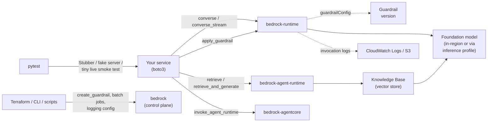

# Amazon Bedrock — Foundation Models, Converse API & Guardrails

**Amazon Bedrock** is AWS's managed service for calling foundation models (Anthropic Claude, Amazon Nova, OpenAI open-weight and GPT models, Meta, Mistral, DeepSeek, Qwen and others) through one API, with IAM authentication, CloudTrail, quotas, Guardrails, Knowledge Bases and batch processing around it. There is no server to run and no GPU to size. You pay per token (or for committed capacity) and the provider models are billed through AWS.

This guide is written for building and testing Python services that call Bedrock with **boto3**. Credentials, `Config`, generic retries and the Stubber/moto basics are in [AWS Foundations](../foundations/index.md); this section covers Bedrock itself.

## Which Bedrock API? Six Clients, Two HTTP Endpoints

"Bedrock" is several services behind several boto3 clients. Picking the wrong one is the most common beginner error (`bedrock` has no `converse`).

| boto3 client | Plane | Use it for |
|--------------|-------|-----------|
| `bedrock-runtime` | Inference | `Converse`, `ConverseStream`, `InvokeModel`, `InvokeModelWithResponseStream`, `ApplyGuardrail`, `CountTokens`, async invoke (`StartAsyncInvoke`) |
| `bedrock` | Control plane | List models and inference profiles, model access agreements, **create guardrails**, batch jobs, invocation logging, provisioned throughput, custom models, evaluation jobs |
| `bedrock-agent` | Build time | Knowledge Bases, data sources and ingestion, Bedrock Agents (Classic), prompts, flows |
| `bedrock-agent-runtime` | Run time | `Retrieve`, `RetrieveAndGenerate`, `InvokeAgent`, `InvokeFlow`, `Rerank`, sessions |
| `bedrock-agentcore` / `bedrock-agentcore-control` | Agent platform | Hosted agent runtimes (`InvokeAgentRuntime`), memory, gateway, browser and code-interpreter tools; control plane to create them |

The `bedrock-mantle.{region}.api.aws` endpoint is separate: it speaks the **OpenAI-compatible** (Chat Completions, Responses) and **Anthropic Messages** protocols and has no boto3 client. The `bedrock-runtime` endpoint also serves those protocols on its `/openai/v1` paths, plus Converse and InvokeModel. AWS recommends `bedrock-runtime` for new applications.



## Section Map

| File | Topics |
|------|--------|
| [01 Models, Access, Regions & the Converse API](./01-models-access-converse.md) | Model catalog, how access works now, model IDs vs inference profiles (geo and global), Converse vs InvokeModel, request and response anatomy, `stopReason`, quotas and burndown, pricing dimensions, IAM, API keys |
| [02 Streaming, Tools, Structured Output, Multimodal & Caching](./02-streaming-tools-structured-output.md) | `ConverseStream` events, the tool loop, strict tools, JSON Schema output, images and documents, prompt caching, adaptive thinking, errors and retries |
| [03 Guardrails, Knowledge Bases, Agents & Batch](./03-guardrails-knowledge-bases-agents-batch.md) | Guardrail policies, `guardrailConfig`, `ApplyGuardrail`, traces, `Retrieve` and `RetrieveAndGenerate`, Agents Classic vs AgentCore, batch inference, evaluation jobs |
| [04 Testing & Production](./04-testing-production.md) | Test layers, Stubber, a fake local Bedrock server, moto limits, deterministic assertions, token budgets, live smoke tests, logging, CloudWatch, least-privilege IAM, CI |

## Minimal Example

```python
# hello_bedrock.py   (uv add boto3)
import os

import boto3

MODEL_ID = os.environ.get("BEDROCK_MODEL_ID", "global.anthropic.claude-haiku-5-5")   # an inference profile ID

client = boto3.client("bedrock-runtime", region_name="us-east-1")
response = client.converse(
    modelId=MODEL_ID,
    system=[{"text": "You are a terse QA assistant."}],
    messages=[{"role": "user", "content": [{"text": "Name one boundary value for an age field of 18-65."}]}],
    inferenceConfig={"maxTokens": 100, "temperature": 0},
)
print(response["output"]["message"]["content"][0]["text"])
print(response["stopReason"], response["usage"])
```

boto3 reads `AWS_ENDPOINT_URL_BEDROCK_RUNTIME`, so the same script runs unchanged against a local fake server (page 04) with no code change:

```text
17 (just below the lower bound).
end_turn {'inputTokens': 31, 'outputTokens': 9, 'totalTokens': 40}
sent to /model/global.anthropic.claude-haiku-5-5/converse
```

The reply text is scripted in the fake, so this output shows the request path and response handling, not model quality.

## When to Choose Bedrock

| Situation | Choose |
|-----------|--------|
| Workload already runs in AWS; you need IAM roles, CloudTrail, VPC endpoints (PrivateLink), one AWS bill, regional data controls | **Bedrock** |
| You want several model families behind one auth and one quota system, and managed Guardrails or Knowledge Bases | **Bedrock** |
| You need a provider feature the day it ships, or the provider's SDK-only features | The provider API directly (check first whether Bedrock already has it; on Bedrock, Claude features are also reachable through the Anthropic Messages protocol on the same endpoints) |
| Several providers behind one OpenAI-style interface with routing, fallbacks and spend tracking, Bedrock being one of them | [LiteLLM](../../libs/litellm/index.md) (`bedrock/<model-id>` prefix) in front of Bedrock |
| A full agent runtime to host (sessions, memory, tools, gateway) | AgentCore, or a framework such as [Pydantic AI](../../libs/pydantic-ai/index.md) calling Bedrock models |
| Quality of the answers themselves | Not a Bedrock question: use an evaluation tool ([LLM evaluation guide](../../llm-evaluation/index.md)) |

Rule of thumb: Bedrock is the **access, governance and capacity layer** for models. It does not make a prompt good; your tests and evals do.

## Quick Rules

1. **Use `bedrock-runtime` for inference and `bedrock` for setup.** Create guardrails, batch jobs and logging config with the control-plane client.
2. **Prefer Converse (`ConverseStream` for chat UIs)** over `InvokeModel`: one request shape for every model, and tools, guardrails, caching and structured output share it.
3. **Pass an inference profile ID, not a bare model ID**, for current models (`global.…`, `us.…`, `eu.…`). Many new models have no in-region option.
4. **Always read `stopReason`.** `tool_use`, `max_tokens`, `guardrail_intervened` and `content_filtered` all arrive as HTTP 200.
5. **Set `maxTokens` close to what you need.** It is reserved against your tokens-per-minute quota before the call starts.
6. **Bound retries and timeouts** in `Config` (`total_max_attempts`, `read_timeout`). `ModelTimeoutException` is not retried by botocore.
7. **Test without AWS first:** pure functions, Stubber, a fake HTTP server. Keep one tiny, budget-capped live smoke test.
8. **Grant least privilege on model and profile ARNs**, block unneeded Regions with SCPs, prefer short-term credentials or short-term API keys.

---
## See also
- [Digital Garden: Knowledge Base](../../index.md)
- [AWS Overview](../index.md)
- [AWS Foundations](../foundations/index.md)
- [Amazon SQS](../sqs/index.md): buffer Bedrock calls behind a queue to smooth bursts and retry throttling
- [Amazon SNS](../sns/index.md)
- [LiteLLM — One API for 100+ LLM Providers](../../libs/litellm/index.md)
- [DeepEval — LLM Testing Guide](../../llm-evaluation/index.md)
- [OWASP Top 10 for LLM Applications](../../owasp-llm-security/index.md)
- [Agentic AI Architecture](../../agentic-ai-architecture/index.md)
- [Pydantic AI — Type-Safe Agents](../../libs/pydantic-ai/index.md)
