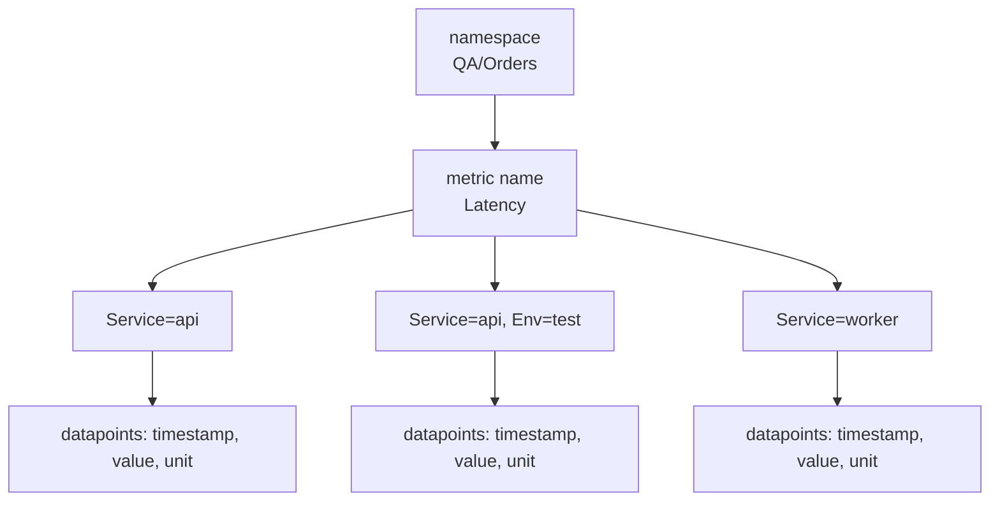

# Amazon CloudWatch — Metrics: Core Concepts

## Anatomy of a Metric

A **metric** is a time-ordered set of datapoints. It is uniquely defined by a **namespace**, a **metric name** and zero or more **dimensions**. Each datapoint adds a timestamp, a value (or a set of values) and an optional unit.

| Part | Rules |
|------|-------|
| **Namespace** | 1–255 ASCII characters: letters, digits, `.` `-` `_` `/` `#` `:` and space; must not start with `:`. There is no default. Do not start your own with `AWS/` (reserved for AWS services). Metrics in different namespaces never mix |
| **MetricName** | 1–255 characters |
| **Dimensions** | Name/value pairs that are part of the metric identity; up to **30** per metric. Name: 1–255 ASCII characters, not starting with `:`. Value: 1–1024 ASCII characters, at least one non-whitespace character |
| **Timestamp** | Up to **two weeks** in the past and up to **two hours** in the future; defaults to the time CloudWatch receives the datapoint. Send UTC |
| **Value / Values + Counts / StatisticValues** | One number, many numbers with how often each occurred, or a pre-aggregated set ([02](./02-boto3-python.md#publishing-with-put_metric_data)). Finite numbers between -2^360 and 2^360; NaN and ±Infinity are rejected |
| **Unit** | One of 27 units (`Seconds`, `Milliseconds`, `Bytes`, `Percent`, `Count`, `Count/Second`, `None`, ...). Default `None` |
| **StorageResolution** | `60` (standard, default) or `1` (high resolution) |

Metrics exist **only in the Region where they were created**, **cannot be deleted**, and expire on their own: a metric with no new datapoints for 15 months disappears, and datapoints older than 15 months are dropped on a rolling basis.

## Dimensions and Dimension Combinations

Each unique **combination** of dimensions is a **separate metric**, even with the same name. You can only read statistics for combinations you published.

| Published | Readable | Not readable |
|-----------|----------|--------------|
| `Server=Prod, Domain=Rio` | `Server=Prod, Domain=Rio` | `Server=Prod` alone, `Domain=Rio` alone, no dimensions |

- CloudWatch does **not** aggregate across dimensions for custom metrics. If you need a total, publish it as its own metric (no dimensions, or only `Service`), or sum several series with metric math.
- AWS services behave differently: for some (`AWS/EC2`) CloudWatch can aggregate across dimensions when you query without any.
- The metric math `SEARCH` function can fan out over many metrics in one expression.
- **High cardinality is the main cost and quota trap.** A request ID, user ID, order ID, pod name or timestamp as a dimension creates a new custom metric per value. Keep dimension values to a small, closed set (service, route template, status class, environment). Put identifiers in log fields instead.
- Several processes can publish to the same namespace, name and dimensions: CloudWatch treats them as one metric and aggregates their datapoints.

## Units, Statistics and Percentiles

Datapoints with a unit are aggregated **separately per unit**. A query without `Unit` returns all of them, each with its unit; a query with a unit that matches nothing returns null results. CloudWatch never converts units.

| Statistic | Meaning over one period |
|-----------|-------------------------|
| `SampleCount` | Number of datapoints (with `Counts`, the sum of the counts) |
| `Sum` | Total of the values: use for counters and error counts |
| `Average` | `Sum / SampleCount` |
| `Minimum`, `Maximum` | Extremes: use `Maximum` for ages and depths |
| `p50`, `p99`, `p99.9`, ... | Percentile with up to ten decimal places; asked through `ExtendedStatistic` in alarms and `GetMetricStatistics`, and as `Stat` in `GetMetricData` |

Alarms also accept `tm90`, `tc90`, `ts90`, `wm90`, `IQM` and `PR(n:m)` as extended statistics.

Percentiles need **raw datapoints**:

- A custom metric supports percentiles when you publish raw values (single `Value` or `Values`/`Counts`).
- A statistic set supports them only if `SampleCount` is 1 and `Min`, `Max`, `Sum` are equal, or `Min` equals `Max` and `Sum = Min × SampleCount`.
- Percentiles are **not available** if any value of the metric is negative.
- Not every AWS metric supports them; the concepts page lists API Gateway, Application Load Balancer, EC2, ELB, Kinesis, Lambda and RDS, and the Bedrock guide uses `p50` on `AWS/Bedrock` metrics.

## Periods, Resolution, Retention and Rollup

A **period** is the length of time one statistic covers. For high-resolution metrics a period can be **1, 5, 10, 20, 30** seconds or **any multiple of 60**; for standard-resolution metrics it must be a multiple of 60. Aggregated datapoints are stamped with the **start** of their period: data from 19:00 to 20:00 is stamped 19:00. A value for the current period can still change while samples keep arriving.

| Standard resolution | High resolution |
|---------------------|-----------------|
| Granularity of one minute | Granularity of one second (`StorageResolution=1`, custom metrics only) |
| AWS services publish this way by default | Retrievable with periods of 1, 5, 10, 30 seconds or any multiple of 60 |
| Alarm period is a multiple of 60 s | Alarm periods of 10 or 30 s are possible (higher alarm price); every `PutMetricData` call costs money, so frequent calls cost more |

| Datapoint period | Available for |
|------------------|---------------|
| Under 60 s (high-resolution) | 3 hours |
| 60 s | 15 days |
| 300 s (5 min) | 63 days |
| 3600 s (1 h) | 455 days (15 months) |

Data is **rolled up** as it ages: after 15 days one-minute data is only retrievable with a 5-minute period, after 63 days with a 1-hour period. `StartTime` is rounded down accordingly (to the minute for data newer than 15 days, to a 5-minute clock interval between 15 and 63 days, to the hour beyond 63 days), and a `GetMetricStatistics` request with a start time older than 3 hours must use a period that is a multiple of 60, 300 or 3600 respectively or it returns no datapoints.

## Delays and Missing Data

| Situation | What to expect |
|-----------|----------------|
| New metric after `PutMetricData` | Statistics readable after **up to 2 minutes**; visible in `list_metrics` after **up to 15 minutes** |
| Datapoint timestamped 3–24 hours ago | Can take **up to 2 hours** to become readable |
| Datapoint timestamped 24 hours ago or earlier | Can take **at least 48 hours** to become readable |
| Metric with no datapoints for two weeks | Not returned by `list_metrics`; still readable with `get_metric_data` |
| Custom datapoints with timestamps other than the current UTC time | Alarms can show `INSUFFICIENT_DATA` or fire late |
| Current period | Values change while more samples arrive; compare completed periods |
| Idle resources | No datapoints at all, not zeros (below) |

AWS services publish only while a resource is active, so "no data" is a normal state:

| Service | Rule |
|---------|------|
| SQS | Metrics are reported while the queue is active; some (`SentMessageSize`) appear only after the first message |
| SNS | A topic is active for up to six hours after the last API call on it |
| ECS | Metrics exist only for clusters and services with tasks in `RUNNING` |
| EC2 | Basic monitoring: 5-minute datapoints; detailed monitoring: 1-minute. Status checks: 1-minute at no charge |

Choose an alarm period **at least as long** as the metric resolution (300 s for basic EC2 monitoring). If your own metric is intermittent, publish `0` for quiet periods so alarms and averages see them ([03](./03-alarms-dashboards.md#treatmissingdata)).

## Vended Metrics for the Services in This Section

| Service | Namespace and dimensions | Metrics worth alarming on |
|---------|--------------------------|---------------------------|
| [SQS](../sqs/index.md) | `AWS/SQS`, `QueueName` | `ApproximateNumberOfMessagesVisible` (Count; backlog, and the metric AWS recommends for a **DLQ**), `ApproximateAgeOfOldestMessage` (Seconds), `ApproximateNumberOfMessagesNotVisible` (in flight), `NumberOfEmptyReceives`; counters `NumberOfMessagesSent`, `Received`, `Deleted` |
| [SNS](../sns/index.md) | `AWS/SNS`, `TopicName` | `NumberOfMessagesPublished`, `NumberOfNotificationsDelivered`, `NumberOfNotificationsFailed`, `NumberOfNotificationsFilteredOut`, `NumberOfNotificationsRedrivenToDlq` (all Count, statistic `Sum`) |
| [EC2](../ec2/index.md) | `AWS/EC2`, `InstanceId` or `AutoScalingGroupName` | `CPUUtilization` (Percent), `StatusCheckFailed` and `StatusCheckFailed_Instance` / `_System` / `_AttachedEBS` (0 or 1), `NetworkIn`, `NetworkOut`. **No memory or disk**: install the CloudWatch agent (namespace `CWAgent`, for example `mem_used_percent`, `disk_used_percent`) |
| [ECS](../ecs/index.md) | `AWS/ECS`, `ClusterName` + `ServiceName` | `CPUUtilization`, `MemoryUtilization` (service level, Fargate and EC2); with **Container Insights** (`ECS/ContainerInsights`): `RunningTaskCount`, `DesiredTaskCount`, `PendingTaskCount`, `CpuUtilized`, `MemoryUtilized` (labelled Megabytes, actually MiB) |
| [Bedrock](../bedrock/index.md) | `AWS/Bedrock`, `ModelId` | `Invocations`, `InvocationLatency` (ms, whole request), `InvocationClientErrors`, `InvocationServerErrors`, `InvocationThrottles`, `InputTokenCount`, `OutputTokenCount`, `TimeToFirstToken` (streaming APIs only), `EstimatedTPMQuotaUsage` (approximate) |

Notes that bite in tests and alarms:

- **SQS and the "visible" metrics are approximate** because of the distributed design. For a DLQ use `ApproximateNumberOfMessagesVisible`; `NumberOfMessagesSent` does not count messages moved there by redrive. `ApproximateNumberOfMessagesNotVisible` can briefly report non-zero on an empty queue, so alarm on several consecutive datapoints.
- **SNS `NumberOfNotificationsFailed`** counts differently per endpoint type: once per message for SQS, email, SMS and mobile push when delivery stops, and for every failed attempt (retries included) for HTTP/S.
- **EC2 alarms with stop, terminate, reboot or recover actions** should treat missing data as `missing` and fire only from `ALARM`.
- **Bedrock** publishes each metric both with and without `ModelId`; if a request fails before the model is known, only the series without the dimension counts it, so a per-model error alarm can undercount. Throttled requests are excluded from `Invocations` and from both error counts; how many throttles you see depends on SDK retry settings. Requests billed at a long-context rate also appear under `ModelId` + `ContextWindow`, as a subset of the `ModelId` series.
- **ECS Container Insights** needs setup per cluster, bills as custom metrics, and from 1 October 2026 does not bill `RunningTaskCount`.

## Quotas That Matter to Test Code

| Quota | Default |
|-------|---------|
| `PutMetricData`: metrics per request / payload / values per datum | 1000 / 1 MB (gzip accepted) / 150 |
| `PutMetricData` requests | 500 per second per Region (adjustable) |
| Dimensions per metric | 30 |
| `GetMetricData`: queries per request / datapoints per request | 500 / 100,800 (`MaxDatapoints` default) |
| `GetMetricData` requests; datapoints per second (last 3 hours / older) | 500 per second; 180,000 / 396,000 |
| `GetMetricStatistics`: datapoints per call / requests | 1,440 / 400 per second |
| `ListMetrics`: results per page / requests | 500 / 25 per second |
| `PutMetricAlarm`, `SetAlarmState`, `DeleteAlarms` | 3 requests per second each |
| `DescribeAlarms` / `DescribeAlarmHistory` | 9 / 20 requests per second |
| `PutDashboard` | 10 requests per second |
| Alarm evaluation range (`Period × EvaluationPeriods`) | 1 day for periods under 1 hour, 7 days otherwise |
| Alarm actions per state | 5 |

All quotas are per account and Region; the Service Quotas console (`--service-code monitoring`) shows the current values. A parallel test suite that creates alarms shares the 3-per-second limit with everyone else in the account.

## What You Pay For

| Item | Billing dimension |
|------|-------------------|
| Custom and detailed-monitoring metrics | Per metric per month, with volume tiers; **every unique dimension combination counts** |
| `PutMetricData` | Per request |
| `GetMetricData`, `GetMetricStatistics` | Per metrics requested / per request (the free tier does not cover them) |
| Alarms | Per alarm metric per month; high-resolution, composite, anomaly detection, Metrics Insights, PromQL and log alarms have their own rates |
| Dashboards | Per dashboard per month, prorated hourly; 3 are free (up to 50 metrics each) |
| Metrics extracted from logs (EMF, metric filters) | Billed as custom metrics, plus the log ingestion |
| Container Insights | Per custom metric (ECS) |
| OpenTelemetry metrics | Per GB ingested |

Free tier highlights per month: 10 custom metrics, 10 standard-resolution alarm metrics, 3 dashboards and 1 million metric API requests (`GetMetricData` and similar read calls are always charged). Check the pricing page before budgeting; it changes.

## Quick Rules

1. **Dimensions: few, closed, low-cardinality.** Identifiers belong in logs.
2. **Publish raw values (`Values`/`Counts`) when you will ask for percentiles.** A statistic set cannot answer them.
3. **Always set `Unit`,** and query with the same unit you published.
4. **Use `Maximum` for depths and ages, `Sum` for counters, `Average` only for rates and utilisation.**
5. **Never read the current period as final.** Query completed periods, or accept that the value moves.
6. **Choose an alarm period at least as long as the metric resolution,** and remember that standard EC2 metrics are 5 minutes.
7. **Idle means no data.** Decide `TreatMissingData` per metric; publish zeros for your own intermittent metrics.
8. **Remember retention.** One-minute data lives 15 days; a regression dashboard that looks back 30 days sees 5-minute data.
9. **Do not delete-and-recreate metrics in tests.** You cannot delete them; use a unique namespace or dimension value per run for isolation, and keep the number of those small.
10. **Respect the quotas in CI:** 3 alarm writes per second, 500 `GetMetricData` requests per second.

---
## See also
- [Amazon CloudWatch — Overview](./index.md)
- [Amazon CloudWatch — boto3 in Python](./02-boto3-python.md)
- [Amazon CloudWatch — Alarms & Dashboards](./03-alarms-dashboards.md)
- [Amazon SQS — Queues, Consumers & Testing](../sqs/index.md)
- [Amazon SNS — Topics, Subscriptions & Fan-out](../sns/index.md)
- [Amazon EC2](../ec2/index.md)
- [Amazon ECS — Containers on Fargate, Services & Testing](../ecs/index.md)
- [Amazon Bedrock](../bedrock/index.md)
- [AWS Foundations — boto3, Credentials & Local Testing](../foundations/index.md)
