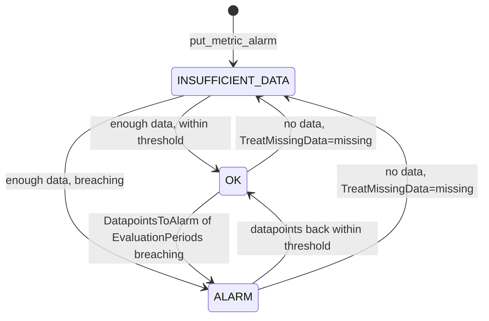

# Amazon CloudWatch — Alarms & Dashboards

## Alarm Types

| Type | Created with | Watches | Actions |
|------|--------------|---------|---------|
| **Metric, static threshold** | `put_metric_alarm` (`MetricName`, `Statistic` or `ExtendedStatistic`, `Period`, `Threshold`) | One metric | SNS, Lambda, EC2, Auto Scaling, Systems Manager, investigations |
| **Metric math** | `put_metric_alarm` with `Metrics` | One expression over up to 10 metrics (20 queries in total, exactly one with `ReturnData=True`) | Same |
| **Anomaly detection** | `put_anomaly_detector` + `put_metric_alarm` with `ThresholdMetricId` | A metric against a learned band (`ANOMALY_DETECTION_BAND`) | Same, **but no Auto Scaling** |
| **Metrics Insights query** | `put_metric_alarm` with a `SELECT ...` expression | Aggregated or per-series query results | SNS in the documented examples |
| **PromQL** | `put_metric_alarm` with `EvaluationCriteria` and `EvaluationInterval` | A PromQL instant query on OpenTelemetry metrics | SNS in the documented examples |
| **Log alarm** | `put_log_alarm` | A scheduled Logs Insights query; M of N recent executions | SNS in the documented examples |
| **Composite** | `put_composite_alarm` | A boolean rule over other alarms | SNS, Lambda, Systems Manager, investigations. **No EC2 or Auto Scaling actions** |

`put_metric_alarm` creates **or replaces**: an update keeps the current state and overwrites the whole configuration (tags passed on update are ignored; use `tag_resource`). A new alarm starts in `INSUFFICIENT_DATA`, is then evaluated and any action for the resulting state runs. You can create an alarm **before** the custom metric exists, but you must give the exact namespace, name and all dimensions.

## States and Evaluation



| Setting | Meaning |
|---------|---------|
| `Period` | Seconds per datapoint: 10, 20, 30 or a multiple of 60. 10/20/30 are **high-resolution alarms**, only sensible for metrics published with `StorageResolution=1` and priced higher |
| `EvaluationPeriods` (N) | How many of the most recent datapoints are looked at |
| `DatapointsToAlarm` (M) | How many of those N must breach, **not necessarily consecutive**. Omit it for an "N in a row" alarm; "3 out of 5" means `DatapointsToAlarm=3, EvaluationPeriods=5` |
| Evaluation cadence | Every minute for periods of 60 s or more (sliding window, advancing by a minute, not aligned to the wall clock); every 10 s for 10/20/30 s periods; **once per hour** when `Period × EvaluationPeriods` exceeds one day |
| Maximum range | `Period × EvaluationPeriods` at most 1 day for periods under an hour, 7 days otherwise |
| `EvaluationWindow` | `SlidingWindow` (default) or `WallClockWindow` for alarms on calendar days or weeks |
| `WarmUpConfiguration` | Delays evaluation after create or update so a new resource that has not published yet does not alarm |
| Actions | Run on **state changes**, not on every breaching datapoint. The exception: an **Auto Scaling** action repeats once per minute while the alarm stays in the state |

When some datapoints are missing, CloudWatch looks at a wider range than N so that real datapoints still count. It fills in only as many missing points as are needed to reach N, using the `TreatMissingData` rule, and it avoids "premature" `ALARM` transitions when data is intermittent.

### TreatMissingData

| Value | A missing datapoint is treated as | If **all** recent datapoints are missing, the alarm goes to |
|-------|-----------------------------------|-------------------------------------------------------------|
| `missing` (**default**) | Not there | `INSUFFICIENT_DATA` |
| `notBreaching` | Within the threshold | `OK` |
| `breaching` | Violating the threshold | `ALARM` |
| `ignore` | Not there | Keeps the **current state** |

| Metric kind | Choose |
|-------------|--------|
| Counter that exists only when something goes wrong (errors, throttles, DLQ depth, queue age of an idle queue) | `notBreaching` |
| Heartbeat or throughput that must always flow (`OrdersCreated` every minute, `RunningTaskCount`) | `breaching` |
| EC2 alarms with stop, terminate, reboot or recover actions | `missing`, and trigger only from `ALARM` |
| You want to hold the last state through gaps | `ignore` |

For percentile alarms, `EvaluateLowSampleCountPercentile="ignore"` keeps the state in periods with too few samples to be statistically meaningful.

## Actions

Each state (`AlarmActions`, `OKActions`, `InsufficientDataActions`) takes up to **5** ARNs.

| Action | ARN | Notes |
|--------|-----|-------|
| SNS topic | `arn:aws:sns:<region>:<account>:<topic>` | Standard or FIFO topic ([SNS guide](../sns/index.md)). The topic policy must allow `cloudwatch.amazonaws.com` to `sns:Publish`, ideally with `aws:SourceArn` (`arn:aws:cloudwatch:<region>:<account>:alarm:*`) and `aws:SourceAccount` |
| Auto Scaling | `arn:aws:autoscaling:<region>:<account>:scalingPolicy:<id>:autoScalingGroupName/<group>:policyName/<policy>` | Not for anomaly or composite alarms ([EC2 guide](../ec2/04-scaling-load-balancing-operations.md)) |
| EC2 | `arn:aws:automate:<region>:ec2:stop` / `terminate` / `reboot` / `recover` | Needs `iam:CreateServiceLinkedRole` the first time |
| Lambda | `arn:aws:lambda:<region>:<account>:function:<name>[:<version or alias>]` | |
| Systems Manager | `arn:aws:ssm:<region>:<account>:opsitem:<severity>#CATEGORY=<category>`, `arn:aws:ssm-incidents::<account>:responseplan/<plan>` | OpsItem or incident |
| Investigation | `arn:aws:aiops:<region>:<account>:investigation-group:<id>` | Only for `AlarmActions` |

**CloudWatch does not validate actions.** A mistyped topic ARN, a missing topic policy or a deleted scaling policy fails silently from the alarm's point of view: test the chain once with `set_alarm_state` ([06](./06-moto-gaps-smoke-ci.md#real-account-smoke-test)). SNS notifications carry `AlarmName`, `NewStateValue`, `OldStateValue`, `NewStateReason`, `StateChangeTime`, `Region`, `AlarmArn`, the three action lists and a `Trigger` block with metric, statistic, threshold and `TreatMissingData`.

## Creating Alarms from Python

The alarm definitions live in small pure functions that return `put_metric_alarm` keyword arguments, so the same dict is used for deployment, for review and for compliance tests ([05](./05-testing.md#alarm-compliance-checks)).

```python
# app/alarms.py (excerpt)
def dlq_depth(queue: str, topic: str) -> dict:
    """Any visible message in a dead-letter queue is an incident."""
    return dict(
        AlarmName=f"sqs-{queue}-dlq-not-empty", Namespace="AWS/SQS", MetricName="ApproximateNumberOfMessagesVisible",
        Dimensions=[{"Name": "QueueName", "Value": queue}], Statistic="Maximum", Period=60, EvaluationPeriods=1,
        Threshold=0, ComparisonOperator="GreaterThanThreshold",
        TreatMissingData="notBreaching",                  # an idle queue reports no data; that is not an incident
        AlarmActions=[topic], OKActions=[topic],
    )


def bedrock_latency_p99(model_id: str, topic: str, ms: int = 20_000) -> dict:
    return dict(
        AlarmName=f"bedrock-{model_id}-latency-p99", Namespace="AWS/Bedrock", MetricName="InvocationLatency",
        Dimensions=[{"Name": "ModelId", "Value": model_id}], ExtendedStatistic="p99", Period=300,
        EvaluationPeriods=3, DatapointsToAlarm=2, Threshold=ms, ComparisonOperator="GreaterThanThreshold",
        EvaluateLowSampleCountPercentile="ignore",        # do not alarm on a p99 computed from a handful of requests
        TreatMissingData="notBreaching", AlarmActions=[topic],
    )


def error_rate(namespace: str, errors: str, requests: str, topic: str, percent: float = 5) -> dict:
    """Metric math alarm: 100 * errors / requests over one-minute sums."""
    stat = lambda i, name: {"Id": i, "MetricStat": {"Metric": {"Namespace": namespace, "MetricName": name},
                                                    "Period": 60, "Stat": "Sum"}, "ReturnData": False}
    return dict(
        AlarmName=f"{namespace.replace('/', '-')}-error-rate", EvaluationPeriods=5, DatapointsToAlarm=3,
        Threshold=percent, ComparisonOperator="GreaterThanThreshold", TreatMissingData="notBreaching",
        Metrics=[stat("e", errors), stat("r", requests),
                 {"Id": "rate", "Expression": "100 * e / r", "Label": "error %", "ReturnData": True}],
        AlarmActions=[topic],
    )


cw.put_metric_alarm(**dlq_depth("orders-dlq", TOPIC))
```

Composite and anomaly-detection alarms, with the call shapes checked by Stubber in the test suite:

```python
# Composite: fire only when the queue is backing up AND the workers are saturated; page on this one, not on its children
cw.put_composite_alarm(
    AlarmName="orders-pipeline-unhealthy",
    AlarmRule='ALARM("sqs-orders-oldest-message-age") AND ALARM("ecs-prod-orders-worker-cpu-high")',
    AlarmActions=[TOPIC], AlarmDescription="queue is backing up and workers are saturated",
)

# Anomaly detection: train a model on the metric, then alarm when it drops below the band
cw.put_anomaly_detector(SingleMetricAnomalyDetector={
    "Namespace": "QA/Orders", "MetricName": "OrdersCreated", "Stat": "Sum",
    "Dimensions": [{"Name": "Service", "Value": "orders-api"}]})
cw.put_metric_alarm(
    AlarmName="orders-created-anomaly", ComparisonOperator="LessThanLowerThreshold",
    EvaluationPeriods=3, DatapointsToAlarm=3, ThresholdMetricId="band", TreatMissingData="notBreaching",
    Metrics=[{"Id": "m1", "ReturnData": True, "MetricStat": {"Period": 300, "Stat": "Sum", "Metric": {
                 "Namespace": "QA/Orders", "MetricName": "OrdersCreated",
                 "Dimensions": [{"Name": "Service", "Value": "orders-api"}]}}},
             {"Id": "band", "Expression": "ANOMALY_DETECTION_BAND(m1, 2)", "Label": "expected", "ReturnData": True}],
    AlarmActions=[TOPIC])
```

- **Composite rules** combine `ALARM("name")`, `OK("name")` and `INSUFFICIENT_DATA("name")` with `AND`, `OR`, `NOT` and parentheses. Cycles between composite alarms stop their evaluation and block deletion. An `ActionsSuppressor` (another alarm plus wait and extension periods) mutes a composite's actions during maintenance.
- **Anomaly detection** trains on up to two weeks of data (it can be enabled with less), is specific to one metric and statistic, and is billed. Start with a static threshold on new services. `ComparisonOperator` for bands: `GreaterThanUpperThreshold`, `LessThanLowerThreshold`, `LessThanLowerOrGreaterThanUpperThreshold`.
- **Anomaly detection is not in moto**; keep it behind a unit test that checks the request shape ([06](./06-moto-gaps-smoke-ci.md#what-moto-does-not-emulate)).

## Recipes for the Services in This Section

| Workload | Alarm | Metric and statistic | Why |
|----------|-------|----------------------|-----|
| [SQS worker](../sqs/index.md) | **DLQ not empty** | `AWS/SQS` `ApproximateNumberOfMessagesVisible` of the DLQ, `Maximum`, `> 0`, 1 period, `notBreaching` | Poison messages are an incident; alarm on the DLQ's own queue name |
| SQS worker | **Consumers are behind** | `ApproximateAgeOfOldestMessage`, `Maximum`, 3 of 5 minutes `> SLA seconds`, `notBreaching` | Age measures user-visible delay; depth alone does not |
| [ECS service](../ecs/index.md) | **CPU or memory pressure** | `AWS/ECS` `CPUUtilization`, `MemoryUtilization` with `ClusterName`+`ServiceName`, `Average`, 3 of 5 | Service-level metrics exist for Fargate and EC2 |
| ECS service | **Tasks missing** | Container Insights `RunningTaskCount`, `Minimum`, `< N`, **`breaching`** | With zero running tasks nothing is published, so only `breaching` catches a dead service |
| [EC2 fleet](../ec2/index.md) | **Instance unhealthy** | `StatusCheckFailed`, `Maximum`, `> 0`, 2 periods, `missing` | `0` or `1` per minute; `missing` is the recommended treatment when an alarm takes EC2 actions |
| EC2 fleet | **Load** | `CPUUtilization` by `AutoScalingGroupName`; memory and disk through the agent (`CWAgent`) | Basic monitoring is 5-minute: use a 300 s period |
| [Bedrock-calling service](../bedrock/index.md) | **Throttling** | `InvocationThrottles`, `Sum`, 3 of 5 `> 0`, `notBreaching` | Throttles are not in `Invocations` and depend on SDK retries |
| Bedrock | **Slow model** | `InvocationLatency`, `p99`, `EvaluateLowSampleCountPercentile=ignore` | Latency scales with output length: compare with output tokens per second |
| Bedrock | **Errors** | `InvocationClientErrors`, `InvocationServerErrors` **without** the `ModelId` dimension | Early failures are published only without the dimension |
| Bedrock | **Throughput drop** | Metric math `OutputTokenCount / (InvocationLatency - TimeToFirstToken) * 1000` (streaming APIs), `LessThanThreshold` | Separates a slower model from longer answers |

## Reading, Testing and Operating Alarms

```python
alarms = [a for page in cw.get_paginator("describe_alarms").paginate(AlarmNamePrefix="sqs-", StateValue="ALARM")
          for a in page["MetricAlarms"]]                                  # composite alarms are in page["CompositeAlarms"]

cw.set_alarm_state(AlarmName="sqs-orders-dlq-dlq-not-empty", StateValue="ALARM", StateReason="drill")
cw.disable_alarm_actions(AlarmNames=["sqs-orders-dlq-dlq-not-empty"])      # keep evaluating, stop notifying
```

| Operation | Notes |
|-----------|-------|
| `describe_alarms` | Filters: `AlarmNames`, `AlarmNamePrefix`, `AlarmTypes` (`MetricAlarm`, `CompositeAlarm`, `LogAlarm`), `StateValue`, `ActionPrefix`, `ChildrenOfAlarmName`, `ParentsOfAlarmName`. Returns `MetricAlarms` and `CompositeAlarms`; 9 requests per second per Region |
| `describe_alarms_for_metric` | Alarms that watch a given metric |
| `set_alarm_state` | **Temporary**: the next evaluation puts the alarm back, often within seconds. Actions for the new state run **if it differs from the previous one**. Alarms with Auto Scaling actions need `StateReasonData`. A composite alarm returns to its real state only when a child changes |
| `describe_alarm_history` | Item types `ConfigurationUpdate`, `StateUpdate`, `Action`; kept **30 days**. `HistoryData` is a JSON string with `oldState` and `newState` (`stateValue`, `stateReason`), `HistorySummary` reads "Alarm updated from OK to ALARM" |
| `enable_alarm_actions` / `disable_alarm_actions` | Switch actions without changing the definition |
| Waiter `alarm_exists` | Waits until `describe_alarms` finds the alarm |

Because a forced state flips back quickly, assert on **history**, not on `describe_alarms` a few seconds later:

```python
# app/alarm_history.py
def wait_for_state_update(cw, alarm_name, new_state, *, timeout=60, interval=2, sleep=time.sleep, clock=time.monotonic):
    deadline = clock() + timeout
    while True:
        response = cw.describe_alarm_history(AlarmName=alarm_name, HistoryItemType="StateUpdate",
                                             ScanBy="TimestampDescending", MaxRecords=20)
        for item in response["AlarmHistoryItems"]:
            if json.loads(item["HistoryData"])["newState"]["stateValue"] == new_state:
                return item
        if clock() >= deadline:
            raise AssertionError(f"{alarm_name} never entered {new_state} within {timeout}s")
        sleep(interval)
```

### Alarm State Changes in EventBridge

Every state change and every create, update or delete is published to EventBridge, and delivery of state-change events is guaranteed. Use a rule to route them to a Lambda, a queue or a chat integration.

```json
{"source": ["aws.cloudwatch"], "detail-type": ["CloudWatch Alarm State Change"],
 "detail": {"alarmName": ["sqs-orders-dlq-dlq-not-empty"], "previousState": {"value": ["OK"]}, "state": {"value": ["ALARM"]}}}
```

The event `detail` holds `alarmName`, `state` and `previousState` (`value`, `reason`, `reasonData`, `timestamp`) and the alarm `configuration`; configuration changes use `detail-type` `CloudWatch Alarm Configuration Change` with `operation` `create`, `update` or `delete`. Multi-series alarms emit `CloudWatch Alarm Contributor State Change` events.

## Dashboards

A dashboard is a JSON body with a `widgets` array on a **24-column grid**. Dashboards are **global** (not per Region); `put_dashboard` **replaces** the whole body, so the code is the source of truth and a text widget at the top should say so.

| Widget `type` | Shows | Key properties |
|---------------|-------|----------------|
| `metric` | Metrics or metric math as a graph | `metrics` (arrays: namespace, name, dimension name, value, ...), `stat`, `period`, `region`, `view` (`timeSeries`, `singleValue`, `gauge`, `bar`, `pie`, `table`), `yAxis`, `annotations` |
| `log` | A Logs Insights query result | `query` (`SOURCE '<group>' \| ...`), `region`, `view` (`table`, `timeSeries`, `bar`, `pie`) |
| `alarm` | Alarm status list or a graph of alarms | `alarms` (ARNs), `states`, `sortBy` |
| `text` | Markdown | `markdown` |
| `explorer`, `chart` | Metrics explorer, and a chart widget with its own `view` values (`line`, `bar`, `pie`, `number`, ...) | See the dashboard body reference |

Limits: up to 500 widgets, 25 variables, `width` 1–24, `height` 1–1000, 10 `put_dashboard` requests per second. A dashboard whose log widgets auto-refresh starts a Logs Insights query on every refresh, which costs per GB scanned.

```python
# app/dashboards.py (excerpt)
def metric_widget(title, x, y, metrics, *, stat="Average", period=60, region="us-east-1", width=12, height=6):
    return {"type": "metric", "x": x, "y": y, "width": width, "height": height,
            "properties": {"title": title, "region": region, "stat": stat, "period": period,
                           "metrics": metrics, "view": "timeSeries"}}

body = orders_dashboard("us-east-1", "123456789012", "orders")        # text, 2 metric widgets, alarm status, log query
assert problems(body) == []                                           # structural checks, no AWS call
result = cw.put_dashboard(DashboardName="orders", DashboardBody=dumps(body))   # the body is a JSON string
assert result["DashboardValidationMessages"] == []                    # warnings: some widgets may not render; errors: not saved
```

## Quick Rules

1. **Alarm on symptoms people feel:** queue age, p99 latency, error rate, missing tasks. Use resource metrics (CPU) for capacity alarms.
2. **Set `TreatMissingData` explicitly** and match it to how the metric behaves when idle.
3. **Use `DatapointsToAlarm` < `EvaluationPeriods`** (3 of 5) to ignore single spikes without delaying real incidents.
4. **Every alarm needs an action,** and the action must be tested once end to end: CloudWatch does not validate it.
5. **Every queue with a redrive policy gets a DLQ-depth alarm,** and every ECS service gets CPU and running-task alarms.
6. **Page on composite alarms,** keep the child alarms silent.
7. **Keep alarm definitions in code** (pure functions returning `put_metric_alarm` kwargs) and check them with Stubber and compliance tests.
8. **Never assert on a forced alarm state with `describe_alarms`;** read `describe_alarm_history`.
9. **Mind the write quota:** 3 alarm writes per second per Region; do not create alarms from parallel test workers.
10. **Treat dashboards as build artifacts:** generate, validate offline, `put_dashboard`, never edit by hand.

---
## See also
- [Amazon CloudWatch — Overview](./index.md)
- [Amazon CloudWatch — Metrics: Core Concepts](./01-metrics-core-concepts.md)
- [Amazon CloudWatch — Testing CloudWatch-Based Systems](./05-testing.md)
- [Amazon CloudWatch — moto Gaps, Smoke Tests & CI](./06-moto-gaps-smoke-ci.md)
- [Amazon SNS — Topics, Subscriptions & Fan-out](../sns/index.md)
- [Amazon SQS — Queues, Consumers & Testing](../sqs/index.md)
- [Amazon ECS — Containers on Fargate, Services & Testing](../ecs/index.md)
- [Amazon EC2: Scaling, Load Balancing & Operations](../ec2/04-scaling-load-balancing-operations.md)
- [Amazon Bedrock](../bedrock/index.md)
- [Pytest — Python Testing Framework](../../libs/pytest/index.md)
