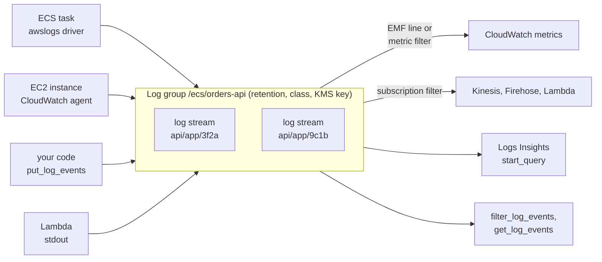

# Amazon CloudWatch — Logs, Logs Insights & Metric Filters

## Concepts



| Term | Meaning |
|------|---------|
| **Log event** | A timestamp (epoch milliseconds) and a message (up to 1 MB) |
| **Log stream** | Events from one source, in order: one per container task, instance or process |
| **Log group** | Streams that share retention, class, encryption, access control, metric filters and subscriptions. Name: up to 512 characters of letters, digits and `. - _ / #` |
| **Retention** | How long events are kept. **The default is forever** |
| **Class** | Standard or Infrequent Access; fixed at creation |

Logs are regional like everything else in CloudWatch. Log groups are not "create on write": `put_log_events` fails with `ResourceNotFoundException` when the group or the stream is missing.

## Retention and Log Classes

```python
logs.create_log_group(logGroupName="/qa/orders", logGroupClass="STANDARD", tags={"env": "test"})
logs.put_retention_policy(logGroupName="/qa/orders", retentionInDays=14)    # delete_retention_policy = never expire
```

- Allowed `retentionInDays`: 1, 3, 5, 7, 14, 30, 60, 90, 120, 150, 180, 365, 400, 545, 731, 1096, 1827, 2192, 2557, 2922, 3288, 3653. Anything else is rejected by the service (`app/logs.py` validates before calling).
- Expired events are **marked** for deletion when retention passes, stop adding to storage cost, but may physically remain for up to **72 hours**.
- A group created implicitly, for example by the `awslogs` driver (`awslogs-create-group`) or by the agent without `retention_in_days`, has **no retention** until you set one. Set it in code or infrastructure, and add a check ([05](./05-testing.md#alarm-compliance-checks)):

```python
# app/logs.py (excerpt)
def groups_without_retention(client, prefix=None) -> list[str]:
    kwargs = {"logGroupNamePrefix": prefix} if prefix else {}
    pages = client.get_paginator("describe_log_groups").paginate(**kwargs)
    return sorted(g["logGroupName"] for page in pages for g in page["logGroups"] if "retentionInDays" not in g)
```

| Feature | Standard | Infrequent Access |
|---------|----------|-------------------|
| Ingestion price | Standard | Lower |
| Storage and Logs Insights price | Same | Same |
| Logs Insights | All commands | All except `pattern`, `diff`, `unmask`; no `filterIndex` |
| `filter_log_events`, `get_log_events` | Yes | **No**: use Logs Insights |
| Metric filters, subscription filters, **EMF** | Yes | **No** |
| Live Tail, anomaly detection, field indexing | Yes | No |
| Export to S3, KMS encryption, data protection masking, cross-account | Yes | Yes |

The class **cannot be changed** after creation. A third class, `Delivery`, exists only to deliver Lambda logs to S3 or Firehose and keeps events for two days.

## Structured Logging from Python

One JSON object per line makes every field discoverable in Logs Insights (`level`, `latency_ms`, `request_id` need no parsing) and keeps a multi-line traceback inside one event.

```python
# app/jsonlog.py
_RESERVED = set(logging.LogRecord("", 0, "", 0, "", (), None).__dict__) | {"message", "asctime"}

class JsonFormatter(logging.Formatter):
    def format(self, record: logging.LogRecord) -> str:
        payload = {
            "timestamp": datetime.fromtimestamp(record.created, tz=timezone.utc).isoformat(timespec="milliseconds"),
            "level": record.levelname, "logger": record.name, "message": record.getMessage(),
        }
        payload.update({k: v for k, v in record.__dict__.items() if k not in _RESERVED})   # extra={...} fields
        if record.exc_info:
            payload["exception"] = self.formatException(record.exc_info)    # the traceback stays inside one event
        return json.dumps(payload, default=str)

def configure(level=logging.INFO, stream=None) -> None:
    handler = logging.StreamHandler(stream or sys.stdout)       # stdout: the awslogs driver and the agent read it
    handler.setFormatter(JsonFormatter())
    logging.getLogger().handlers[:] = [handler]
    logging.getLogger().setLevel(level)
```

```python
log.warning("order %s failed", order_id, extra={"order_id": order_id, "latency_ms": 412, "request_id": rid})
```

```text
{"timestamp": "2026-10-22T12:00:03.114+00:00", "level": "WARNING", "logger": "orders", "message": "order o-1 failed", "order_id": "o-1", "latency_ms": 412, "request_id": "r-77"}
```

- Log to **stdout** and let the platform ship it; set `PYTHONUNBUFFERED=1` in containers.
- Keep field names stable (`request_id`, `level`, `latency_ms`): dashboards and alarms depend on them.
- Put identifiers in log fields, not in metric dimensions.
- Plain-text multi-line tracebacks arrive as one event per line unless you configure the driver or agent with a multi-line pattern; JSON avoids that.

## Getting Logs There

**ECS**: the `awslogs` driver ([ECS guide](../ecs/index.md)). The driver creates streams per container task under the prefix you set; `mode: non-blocking` with `max-buffer-size` keeps a slow CloudWatch from stalling stdout writes.

```json
"logConfiguration": {
  "logDriver": "awslogs",
  "options": {"awslogs-create-group": "true", "awslogs-group": "/ecs/orders-api",
              "awslogs-region": "eu-west-1", "awslogs-stream-prefix": "api",
              "mode": "non-blocking", "max-buffer-size": "25m"}
}
```

**EC2**: the unified **CloudWatch agent** ([EC2 guide](../ec2/index.md)) tails files and also collects memory and disk metrics (namespace `CWAgent`):

```json
{
  "metrics": {"append_dimensions": {"InstanceId": "${aws:InstanceId}"},
              "metrics_collected": {"mem": {"measurement": ["used_percent"]}, "disk": {"measurement": ["used_percent"]}}},
  "logs": {"logs_collected": {"files": {"collect_list": [
    {"file_path": "/var/log/orders/app.log", "log_group_name": "/ec2/orders",
     "log_stream_name": "{instance_id}", "retention_in_days": 14}]}}}
}
```

**Lambda** sends stdout to CloudWatch Logs without an agent. **Anything else** can call `put_log_events`.

## The `logs` Client

### `put_log_events`

| Limit | Value |
|-------|-------|
| Events per batch | up to **10,000** |
| Batch size | up to **1,048,576 bytes**: the UTF-8 message bytes of all events **plus 26 bytes per event** |
| One event | up to 1 MB |
| Order | Events in a batch must be in **chronological order** |
| Time span | First to last event in a batch: at most 24 hours |
| Age | Older than 14 days (or older than the group's retention) or more than 2 hours ahead: **rejected** while the rest is processed |
| Sequence token | **Ignored**: parallel writers to one stream are fine; `InvalidSequenceTokenException` and `DataAlreadyAcceptedException` are never returned |
| Rate | 5,000 requests per second per account and Region (adjustable); no per-stream limit |

**Rejected events do not raise.** The response is HTTP 200 with `rejectedLogEventsInfo` (`tooOldLogEventEndIndex`, `tooNewLogEventStartIndex`, `expiredLogEventEndIndex`), so check it.

```python
# app/logs.py (excerpt)
def batches(events):
    """Split events (sorted here) into PutLogEvents batches that respect size, count and time-span limits."""
    current, size = [], 0
    for event in sorted(events, key=lambda e: e["timestamp"]):
        if current and (size + event_size(event) > MAX_BATCH_BYTES or len(current) >= MAX_BATCH_EVENTS
                        or event["timestamp"] - current[0]["timestamp"] > MAX_SPAN_MS):
            yield current
            current, size = [], 0
        current.append(event)
        size += event_size(event)
    if current:
        yield current

def put_events(client, group, stream, events) -> int:
    sent = 0
    for batch in batches(events):
        response = client.put_log_events(logGroupName=group, logStreamName=stream, logEvents=batch)
        if response.get("rejectedLogEventsInfo"):
            raise RejectedEvents(response["rejectedLogEventsInfo"])      # HTTP 200 does not mean accepted
        sent += len(batch)
    return sent
```

### Reading: `filter_log_events` and `get_log_events`

```python
start = int((time.time() - 3600) * 1000)                                     # Logs APIs take MILLISECONDS
pages = logs.get_paginator("filter_log_events").paginate(
    logGroupName="/ecs/orders-api", filterPattern='{ $.level = "ERROR" }', startTime=start)
errors = [e["message"] for page in pages for e in page["events"]]


def read_stream(logs, group, stream):
    """get_log_events has no paginator: follow nextForwardToken until the service returns the token you sent."""
    events, token = [], None
    while True:
        kwargs = {"logGroupName": group, "logStreamName": stream, "startFromHead": True}
        if token:
            kwargs["nextToken"] = token
        page = logs.get_log_events(**kwargs)
        events += page["events"]
        if page["nextForwardToken"] == token:
            return events
        token = page["nextForwardToken"]
```

- A page holds up to 1 MB or 10,000 events and **may be partially full or even empty while a `nextToken` is still present**: stop only when there is no `nextToken` (`filter_log_events`) or the forward token comes back unchanged (`get_log_events`). Set `startTime` to reduce empty pages.
- `filter_log_events` searches **across streams** (`logStreamNames` up to 100 or `logStreamNamePrefix`); `get_log_events` reads **one stream**. Tokens expire after 24 hours.
- `startFromHead` defaults to `true` for `filter_log_events` and to `false` for `get_log_events`.
- Both are rate-limited per account (roughly 5 to 30 requests per second, depending on the Region) and are unavailable for Infrequent Access groups.
- For anything beyond "show me the last errors", use Logs Insights.

### Logs Insights: `start_query` and `get_query_results`

```python
# app/logs.py (excerpt)
def run_query(client, groups, query, start, end, *, timeout=60, interval=1.0, sleep=time.sleep, clock=time.monotonic):
    query_id = client.start_query(logGroupNames=groups, startTime=int(start.timestamp()),      # SECONDS here
                                  endTime=int(end.timestamp()), queryString=query)["queryId"]
    deadline = clock() + timeout
    while True:
        response = client.get_query_results(queryId=query_id)
        if response["status"] == "Complete":
            return [{f["field"]: f["value"] for f in row if f["field"] != "@ptr"} for row in response["results"]]
        if response["status"] in {"Failed", "Cancelled", "Timeout", "Unknown"}:
            raise QueryFailed(response["status"])
        if clock() >= deadline:                                  # Scheduled or Running for too long
            client.stop_query(queryId=query_id)
            raise TimeoutError(f"query {query_id} still {response['status']} after {timeout}s")
        sleep(interval)
```

| Fact | Value |
|------|-------|
| Time arguments | `start_query`: epoch **seconds**. `put_log_events`, `filter_log_events`, `get_log_events`: epoch **milliseconds** |
| Log groups per query | Up to 50 by name or ARN (`SOURCE` selects by prefix and more) |
| Query string | Up to 10,000 characters |
| Status | `Scheduled`, `Running` (partial results), `Complete`, `Failed`, `Cancelled`, `Timeout`, `Unknown` |
| Results | `limit` up to 100,000 rows; each `get_query_results` page up to 10,000 rows; follow `nextToken` (expires after 1 hour). **No paginator** in boto3 |
| Runtime | Queries time out after 60 minutes |
| Concurrency | Up to 100 concurrent queries per Region, shared with dashboards and scheduled queries |
| Rate | `StartQuery` 10 requests per second, `GetQueryResults` 10 per second |
| Languages | `CWLI` (Logs Insights QL, default), `PPL`, `SQL` |
| Price | Per GB scanned: narrow the time range and the groups |

### Query Cookbook (Logs Insights QL)

Fields from JSON logs are used by name; `@timestamp`, `@message` and `@logStream` are always available. Commands are chained with `|`; `sort` and `limit` come after the last `stats`.

```text
# 1. Errors per 5 minutes (time series)
filter level = "ERROR" | stats count(*) as errors by bin(5m)

# 2. Latest 20 errors with context
fields @timestamp, message, order_id, request_id | filter level = "ERROR" | sort @timestamp desc | limit 20

# 3. Latency percentiles per route, worst first
filter ispresent(latency_ms) | stats count(*) as n, avg(latency_ms) as avg_ms, pct(latency_ms, 50) as p50, pct(latency_ms, 95) as p95, pct(latency_ms, 99) as p99 by route | sort p99 desc

# 4. Most frequent error messages
filter level = "ERROR" | stats count(*) as n by message | sort n desc | limit 10

# 5. Follow one request across streams
filter request_id = "r-77" | fields @timestamp, @logStream, level, message | sort @timestamp asc

# 6. Extract fields from unstructured lines with parse
parse @message "user=* action=*" as user, action | stats count(*) as n by action | sort n desc

# 7. How many distinct orders were touched
filter ispresent(order_id) | stats countDistinct(order_id) as orders

# 8. Where does the ingestion volume come from (cost)
fields strlen(@message) as bytes | stats sum(bytes) / 1024 / 1024 as mb by @logStream | sort mb desc | limit 10
```

Other commands: `display`, `dedup`, `pattern`, `diff`, `unnest`, `lookup`, `join`, `anomaly`, `filterIndex`. A query can contain up to 10 `stats` commands. Queries on groups of the Infrequent Access class do not support `pattern`, `diff` and `unmask`.

## Metric Filters

A **metric filter** watches a log group and publishes a metric for every matching event. It is the way to alarm on text in logs that you cannot change.

```python
logs.put_metric_filter(
    logGroupName="/ecs/orders-api", filterName="errors", filterPattern='{ $.level = "ERROR" }',
    metricTransformations=[{"metricName": "ErrorCount", "metricNamespace": "QA/Orders",
                            "metricValue": "1",        # or "$.latency_ms" for JSON, "$size" for space-delimited
                            "defaultValue": 0,         # emitted when the pattern does not match, so the metric is not empty
                            "unit": "Count"}])
```

| Pattern kind | Example | Notes |
|--------------|---------|-------|
| Term | `ERROR` | Case-sensitive; several terms must all match: `ERROR ARGUMENTS` |
| Any of | `?ERROR ?ARGUMENTS` | Cannot be mixed with other terms (the `?` terms are then ignored) |
| Phrase / exclude / all | `"INTERNAL SERVER ERROR"`, `ERROR -ARGUMENTS`, `" "` | Quote phrases and terms with symbols |
| JSON | `{ $.level = "ERROR" }`, `{ $.latency_ms > 500 }`, `{ ($.a = 1) && ($.b = "x") }` | `=`, `!=`, `<`, `>`, `<=`, `>=`, `&&`, `\|\|`, parentheses; array index `$.items[0]`, one wildcard `[*]`; `IS NULL`, `NOT EXISTS` |
| Space-delimited | `[ip, user, ts, request, status_code = 4*, bytes]`, `[..., status_code = 404 \|\| status_code = 410, bytes]` | Brackets and quotes group one field; `...` skips fields |
| Regex | `%colou?r%`, `{ $.event = %Trail% }` | At most 2 per pattern and 5 per log group; no parentheses |

- **One transformation per filter**, up to **100 filters per log group**, pattern up to 1,024 characters. Standard class only.
- Extracted metrics are billed as **custom metrics**. A dimension from a high-cardinality field (IP, request ID) creates a metric per value, and CloudWatch Logs may disable a filter that produces 1,000 different dimension name/value pairs in one hour.
- `test_metric_filter` checks a pattern against sample messages (it is not in moto, so run it in the smoke job or keep patterns in a reviewed constant).
- If you control the code, prefer **EMF** ([02](./02-boto3-python.md#embedded-metric-format-emf)): richer, no pattern to maintain.

## Subscription Filters

A **subscription filter** streams matching events in near real time (usually within three minutes) to Kinesis Data Streams, Amazon Data Firehose or Lambda. Payloads are base64-encoded and gzip-compressed.

```python
logs.put_subscription_filter(
    logGroupName="/ecs/orders-api", filterName="to-firehose", filterPattern="",
    destinationArn="arn:aws:firehose:eu-west-1:123456789012:deliverystream/logs",
    roleArn="arn:aws:iam::123456789012:role/cwl-to-firehose")
```

Up to 5 per log group plus one account-level filter per Region; Standard class only; at-least-once delivery (duplicates happen); retryable destination errors are retried for up to 24 hours, while `AccessDenied` or `ResourceNotFound` disable the filter for up to 10 minutes and **skip the logs in that window**.

## Data Protection (Overview)

A **data protection policy** (`put_data_protection_policy`) detects and masks sensitive data (personal, financial, credentials) in ingested events for both log classes; queries and reads show masked values unless the caller has `logs:Unmask` and asks for `unmask`. It is billed per GB scanned. Treat it as a safety net, not a reason to log secrets.

## Cost Pitfalls

| Pitfall | Why | Fix |
|---------|-----|-----|
| Ingestion dominates the bill | Logs are billed per GB ingested; DEBUG logging and verbose JSON multiply it | INFO by default, sample or drop debug, shorten field names only if volume is extreme |
| Default retention is forever | Storage grows monthly | Set retention at creation; compliance check on `groups_without_retention` |
| Insights scans | Billed per GB scanned, including dashboard refreshes | Narrow time range and groups, avoid auto-refreshing log widgets, use `filterIndex` on indexed fields |
| Metric filters and EMF | Each unique dimension combination is a billed custom metric | Few, closed dimensions; identifiers as properties |
| Infrequent Access chosen late | Class cannot change | Pick the class when the group is created; use IA only for logs you query, not alarm on |
| Vended logs, Live Tail, data protection | Own price dimensions | Check the pricing page before enabling at scale |

The free tier includes 5 GB of logs per month (ingestion, storage and Insights scans).

## Quick Rules

1. **Log JSON to stdout,** one object per line, with stable field names and a request ID.
2. **Set retention on every log group** the day it is created; check with `groups_without_retention`.
3. **Check `rejectedLogEventsInfo`:** HTTP 200 does not mean every event was accepted.
4. **Respect the batch limits:** 10,000 events, 1 MiB including 26 bytes per event, chronological, within 24 hours.
5. **Mind the time units:** milliseconds for log events, seconds for `start_query`.
6. **Paginate until there is no token,** not until a page is empty.
7. **Poll Logs Insights with a deadline** and stop the query on timeout.
8. **Prefer EMF or metric filters with a `defaultValue`** over scanning logs from a script.
9. **Never put an identifier in a metric filter dimension.**
10. **Use the Standard class** for anything you alarm on or subscribe to.

---
## See also
- [Amazon CloudWatch — Overview](./index.md)
- [Amazon CloudWatch — boto3 in Python](./02-boto3-python.md)
- [Amazon CloudWatch — Alarms & Dashboards](./03-alarms-dashboards.md)
- [Amazon CloudWatch — Testing CloudWatch-Based Systems](./05-testing.md)
- [Amazon ECS — Containers on Fargate, Services & Testing](../ecs/index.md)
- [Amazon EC2](../ec2/index.md)
- [AWS Foundations — Clients, Config, Retries & Errors](../foundations/01-clients-config-errors.md)
- [OpenTelemetry — Metrics & Logs](../../libs/opentelemetry/03-metrics-logs.md)
- [Pytest — Python Testing Framework](../../libs/pytest/index.md)
