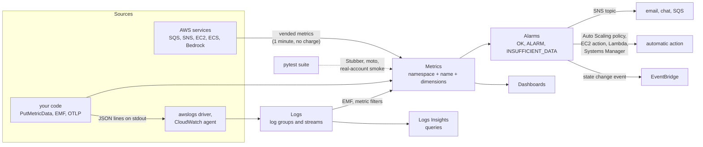

# Amazon CloudWatch — Metrics, Alarms, Logs & Testing

**Amazon CloudWatch** is the monitoring service of AWS. It stores **metrics** (time series such as `CPUUtilization`), **logs** (log groups and streams you can search and query), evaluates **alarms** on top of metrics, and draws **dashboards**. Almost every AWS service publishes metrics to it for free; your own code adds *custom* metrics and logs. Other products in the family — traces, synthetic checks, real-user monitoring, service-level objectives — build on the same data.

This guide is for Python developers and QA engineers who **emit, read, alarm on and test with** CloudWatch data, not for people designing an organisation-wide monitoring strategy. It covers the metric model and its limits, the boto3 API (including the embedded metric format), alarms and dashboards, CloudWatch Logs and Logs Insights, and how to test all of it with and without an AWS account. Sessions, credentials, retries and `ClientError` handling are in [AWS Foundations](../foundations/index.md) and are not repeated here.

## Where CloudWatch Fits



- **Metrics are pushed, not pulled.** CloudWatch never scrapes your application; it only receives what is sent. AWS services push their own metrics; your code calls `PutMetricData`, writes EMF log lines, or sends OTLP.
- **A metric is identified by namespace, name and the exact set of dimensions.** Another dimension value creates another metric ([01](./01-metrics-core-concepts.md#dimensions-and-dimension-combinations)).
- **Alarms watch one metric (or an expression)** and act on *state changes*, not on every breaching datapoint ([03](./03-alarms-dashboards.md)).
- **Logs and metrics meet in two places:** the embedded metric format and metric filters turn log events into metrics; Logs Insights turns log events into query results ([04](./04-logs.md)).
- **Data arrives late and is aggregated.** Tests that read CloudWatch need deadlines and tolerant assertions ([05](./05-testing.md), [06](./06-moto-gaps-smoke-ci.md)).

### Neighbouring Features (One Line Each)

| Feature | What it adds |
|---------|--------------|
| Container Insights | Task, service and cluster metrics and performance logs for ECS and EKS ([ECS guide](../ecs/index.md)) |
| Application Signals | A service-level view of an application, with service level objectives (SLOs) |
| X-Ray and Transaction Search | Distributed traces and indexed spans |
| Synthetics | Canaries: scripted checks that run on a schedule |
| RUM | Real-user monitoring events from web applications |
| Contributor Insights | Top-N contributors and unique-contributor counts, for example the noisiest tenant of a queue |
| Live Tail | Interactive real-time view of log events as they arrive |

## Section Map

| File | Topics |
|------|--------|
| [01 Metrics: Core Concepts](./01-metrics-core-concepts.md) | Namespaces, names, dimensions and dimension combinations, units, timestamps, statistics and percentiles, periods, standard vs high resolution, retention and rollup, metric delays, vended metrics for SQS, SNS, EC2, ECS and Bedrock, quotas, pricing dimensions |
| [02 boto3 in Python](./02-boto3-python.md) | `put_metric_data` forms and limits, a batching `MetricsEmitter`, `get_metric_data` with metric math and pagination, `get_metric_statistics`, `list_metrics`, embedded metric format and `aws-embedded-metrics`, exceptions |
| [03 Alarms & Dashboards](./03-alarms-dashboards.md) | Alarm types, evaluation periods and datapoints to alarm, `TreatMissingData`, actions, `put_metric_alarm`, composite and anomaly alarms, `set_alarm_state`, alarm history, EventBridge events, recipes for SQS, ECS, EC2 and Bedrock, `put_dashboard` |
| [04 CloudWatch Logs](./04-logs.md) | Log groups and streams, retention, log classes, JSON logging from Python, `awslogs` and the CloudWatch agent, `put_log_events` limits, filtering and reading, Logs Insights queries and cookbook, metric filters, subscription filters, cost |
| [05 Testing CloudWatch-Based Systems](./05-testing.md) | What to test where, pure payload tests, Stubber, moto fixtures, asserting emitted datapoints, alarm compliance checks, server mode |
| [06 moto Gaps, Smoke Tests & CI](./06-moto-gaps-smoke-ci.md) | What moto does not emulate, a real-account smoke test, IAM for the test role, GitHub Actions with OIDC, flakiness traps, QA checklist |

## Minimal Working Example

```python
# uv add boto3 "moto[cloudwatch]"
import datetime as dt

import boto3
from moto import mock_aws

with mock_aws():                                             # in-process fake CloudWatch; no account, no network
    cw = boto3.client("cloudwatch", region_name="eu-west-1")
    now = dt.datetime.now(dt.timezone.utc)

    cw.put_metric_data(                                      # publish: a custom metric needs a namespace, a name, a value
        Namespace="QA/Orders",
        MetricData=[{
            "MetricName": "OrdersCreated", "Unit": "Count", "Value": 3, "Timestamp": now,
            "Dimensions": [{"Name": "Service", "Value": "orders-api"}],
        }],
    )

    result = cw.get_metric_data(                             # read: one query, one statistic, one period
        MetricDataQueries=[{
            "Id": "orders",                                  # your label for the result: lowercase first letter, letters, digits, _
            "MetricStat": {
                "Metric": {"Namespace": "QA/Orders", "MetricName": "OrdersCreated",
                           "Dimensions": [{"Name": "Service", "Value": "orders-api"}]},
                "Period": 60, "Stat": "Sum",
            },
        }],
        StartTime=now - dt.timedelta(minutes=5), EndTime=now + dt.timedelta(minutes=1),
    )["MetricDataResults"][0]
    print(result["Id"], result["StatusCode"], result["Values"])
```

```text
orders Complete [3.0]
```

Against a real account the same code works with `mock_aws()` removed and credentials from the usual chain ([Foundations](../foundations/02-credentials-iam-local-testing.md)); the datapoint then takes up to a couple of minutes to be readable, so poll with a deadline ([02](./02-boto3-python.md#reading-with-get_metric_data)).

## CloudWatch vs OpenTelemetry vs Prometheus vs Jaeger

| | CloudWatch metrics (classic) | CloudWatch with OpenTelemetry | Prometheus | Jaeger |
|---|------------------------------|-------------------------------|------------|--------|
| Signal | Metrics | Metrics (plus logs and traces through the same collector) | Metrics | Traces |
| How data arrives | `PutMetricData`, EMF log lines, AWS services | OTLP endpoint with OTel SDKs or a collector | Server scrapes `/metrics` endpoints | Spans sent by SDKs or a collector |
| Identity | Namespace, name, up to 30 dimensions | Open-source metric names, up to 150 labels per data point | Metric name and labels | Trace and span IDs |
| Query | `GetMetricData`, metric math, Metrics Insights | PromQL | PromQL | Trace search by service, operation, tags |
| Alarms | Metric, composite, anomaly alarms | PromQL alarms | Alertmanager | None built in |
| You operate it | No | No | Yes (server, storage, upgrades) | Yes (collector, storage, UI) |
| Use when | AWS resources are the main target and you want alarms and dashboards with zero servers | New AWS workloads that want vendor-neutral instrumentation or high cardinality | Kubernetes-heavy or multi-cloud estate with existing PromQL | You need to see one request across services |

The CloudWatch documentation recommends OpenTelemetry for **new** custom-metric implementations; `PutMetricData` and EMF remain supported. Instrumentation concepts, the SDK and the collector are in [OpenTelemetry](../../libs/opentelemetry/index.md); trace viewing is in [Jaeger](../../tools/jaeger/index.md); general monitoring practice for load tests is in [Monitoring & Observability](../../performance-testing/03-bottlenecks-monitoring/02-monitoring-observability.md).

## What to Know About the Current Service

Older tutorials and answers often describe a smaller or different CloudWatch. As of October 2026 (AWS documentation and the current botocore model):

| Topic | Now | Note |
|-------|-----|------|
| Custom metrics | OpenTelemetry is the recommended path for new work | OTLP ingestion and PromQL querying; classic `PutMetricData` and EMF still work |
| Alarm types | Metric, composite, **Metrics Insights**, **PromQL** and **log alarms** (`put_log_alarm`) | Log alarms evaluate a scheduled Logs Insights query |
| Alarm options | `EvaluationWindow` (wall-clock windows) and `WarmUpConfiguration` | Both are `put_metric_alarm` parameters; `put_alarm_mute_rule` also exists |
| `PutMetricData` size | Up to **1000** metrics and 1 MB per request | Values/Counts arrays: up to 150 values |
| `PutLogEvents` | The **sequence token is ignored**; no per-stream request limit | `InvalidSequenceTokenException` is never returned; the quota is per account |
| Logs Insights | Up to 100 concurrent queries, up to 100,000 rows by paging, query languages `CWLI`, `SQL`, `PPL` | Results page 10,000 rows at a time |
| Container Insights for ECS | Enhanced observability since 2 December 2024 | From 1 October 2026 `RunningTaskCount` is not billed |
| Wire protocol | The `cloudwatch` client in boto3 1.43 speaks Smithy RPC v2 CBOR | Catch the modeled exception classes ([02](./02-boto3-python.md#exceptions-and-retries)) |
| Bedrock metrics | Published with and without the `ModelId` dimension | Throttled requests are not counted in `Invocations` |

## Quick Rules

1. **Dimensions are identity.** Every new dimension value is a new billable metric. Never use a request ID, user ID or timestamp as a dimension.
2. **Pick one namespace per application** (`Company/App`) and never start it with `AWS/`.
3. **Always send a `Unit`.** Datapoints with different units are aggregated separately, and an alarm with the wrong `Unit` stays in `INSUFFICIENT_DATA`.
4. **Batch and aggregate before sending.** One request can carry up to 1000 metrics, and a `Values`/`Counts` array keeps percentiles working with 150 values per datum.
5. **Expect delay.** A new metric is readable after up to two minutes and appears in `list_metrics` after up to fifteen. Read with a deadline, never a sleep.
6. **Set `TreatMissingData` on every alarm on purpose.** Idle SQS queues, ECS services without tasks and quiet SNS topics report no data at all.
7. **Alarm on percentiles and rates, not averages of spikes:** `p99` latency, errors divided by requests, queue age instead of queue length.
8. **Log JSON to stdout and set a retention period** on every log group. The default is to keep logs forever.
9. **Test in layers:** pure payload builders, Stubber for request shape, moto for behaviour, a small real-account smoke test for alarms, delays and IAM. moto never evaluates alarms.
10. **Keep the smoke test tiny and tagged:** one unique value, one forced alarm state, teardown in `finally`, a role limited to a test namespace.

---
## See also
- [Digital Garden: Knowledge Base](../../index.md)
- [AWS — Service Guides for Python & Test Automation](../index.md)
- [AWS Foundations — boto3, Credentials & Local Testing](../foundations/index.md)
- [Amazon SQS — Queues, Consumers & Testing](../sqs/index.md)
- [Amazon SNS — Topics, Subscriptions & Fan-out](../sns/index.md)
- [Amazon EC2](../ec2/index.md)
- [Amazon ECS — Containers on Fargate, Services & Testing](../ecs/index.md)
- [Amazon Bedrock](../bedrock/index.md)
- [OpenTelemetry](../../libs/opentelemetry/index.md)
- [Jaeger](../../tools/jaeger/index.md)
- [Monitoring & Observability](../../performance-testing/03-bottlenecks-monitoring/02-monitoring-observability.md)
- [Pytest — Python Testing Framework](../../libs/pytest/index.md)
