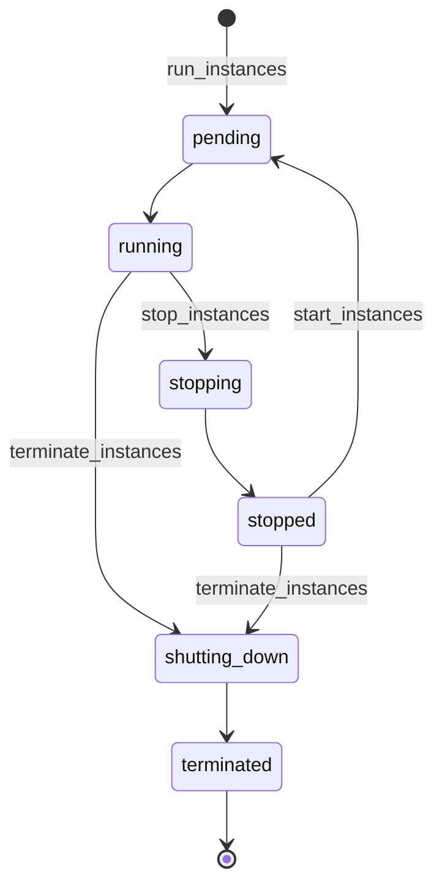

# Amazon EC2 — Core Concepts

The building blocks you meet in every EC2 task: where instances run, how to choose a type, what an AMI is, what survives a stop, what is billed in each state, and which quotas bite first. Code samples here run against moto; the next page covers the network, [02 Networking, Security & IAM](./02-networking-security-iam.md).

## Regions and Availability Zones

| Concept | Meaning | Consequence for you |
|---------|---------|---------------------|
| **Region** | An independent set of data centres (`eu-west-1`) with its own endpoint | Instances, AMIs, key pairs, security groups and quotas are **per Region**. A client in the wrong Region sees an empty account |
| **Availability Zone (AZ)** | One or more isolated data centres in a Region | A subnet lives in exactly one AZ; an instance lives in its subnet's AZ. Spread a fleet over at least two AZs |
| **AZ name vs AZ ID** | `us-east-1a` is a name, `use1-az6` is an ID | AWS maps names to physical zones per account (accounts created from November 2025 get a common mapping in the Regions AWS lists). Use the **AZ ID** when two accounts must agree on a location |
| **Capacity** | An AZ can run out of a given type | `InsufficientInstanceCapacity`: retry later, try another type or AZ (see [03](./03-boto3-python.md#errors-dryrun-and-idempotency)) |

```python
zones = ec2.describe_availability_zones(Filters=[{"Name": "state", "Values": ["available"]}])["AvailabilityZones"]
print([(z["ZoneName"], z["ZoneId"]) for z in zones][:3])     # name is per-account (older accounts); ZoneId is the stable one
```
```python
offers = ec2.describe_instance_type_offerings(LocationType="availability-zone", Filters=[{"Name": "instance-type", "Values": ["t4g.small"]}])
print("t4g.small offered in", sorted(o["Location"] for o in offers["InstanceTypeOfferings"])[:3], "...")   # is the type available in my AZ?
```

## Instance Types

The name is a code: `c7gn.xlarge` = series **c** (compute), generation **7**, options **gn** (Graviton, network-optimized), size **xlarge**.

| Part | Examples | Meaning |
|------|----------|---------|
| Series | `M` general purpose, `C` compute, `R` memory, `T` burstable, `I`/`D` storage, `G`/`P` GPU, `Inf`/`Trn` AWS ML chips, `Hpc`, `Mac` | The CPU-to-memory shape |
| Generation | `5`, `6`, `7`, `8`, `9` | Higher is newer and usually cheaper per unit of work |
| Options | `a` AMD, `i` Intel, `g` **Graviton (arm64)**, `d` local NVMe instance store, `n` network-optimized, `b` EBS-optimized, `e` extra storage or memory, `z` high clock, `flex` flex | Same family, different hardware |
| Size | `nano`, `micro`, `small`, `medium`, `large`, `xlarge`, `2xlarge` ... `metal` | vCPU and memory double per step; `metal` is bare metal |

**Choosing a type, in this order:**

1. **Architecture.** The AMI and the instance type must match: an `arm64` AMI needs a Graviton type (`m8g`, `c8g`, `t4g`), an `x86_64` AMI needs an Intel or AMD type. AWS positions Graviton as the better price-performance option; pure-Python code and most popular wheels work on `aarch64`, but benchmark your workload and keep an `x86_64` option for native dependencies without Arm wheels. Amazon Linux 2023 on Arm needs Graviton2 or later.
2. **Series.** General purpose (`M`) for most services, compute (`C`) for CPU-bound load generators and CI runners, memory (`R`) for caches and big test data, `T` for idle-most-of-the-time dev and test hosts.
3. **Generation.** Pick a **current-generation** type. The EC2 docs list `A1`, `M1`-`M4`, `C1`, `C3`, `C4`, `R3`, `R4`, `T1`, `I2` as previous generation: still sold, but not recommended for new work.
4. **Size.** Start small, measure, then resize (stop, change type, start). AWS Compute Optimizer recommends sizes from CloudWatch data.
5. **Availability.** Check `describe_instance_type_offerings` for your AZ before you hard-code a type in a test.

```python
resp = ec2.describe_instance_types(Filters=[
    {"Name": "processor-info.supported-architecture", "Values": ["arm64"]},
    {"Name": "instance-type", "Values": ["t4g.*"]},
])
for t in sorted(resp["InstanceTypes"], key=lambda t: t["MemoryInfo"]["SizeInMiB"])[:3]:
    print(t["InstanceType"], t["VCpuInfo"]["DefaultVCpus"], "vCPU", t["MemoryInfo"]["SizeInMiB"], "MiB", t["ProcessorInfo"]["SupportedArchitectures"], "burstable:", t["BurstablePerformanceSupported"])
```

### Burstable and flex

| Kind | Types | How it works |
|------|-------|--------------|
| **Burstable** | `T8i`, `T4g`, `T3a`, `T3` (and previous generation `T2`) | A baseline CPU share plus **CPU credits**: credits accrue below the baseline and are spent above it. `T3`, `T3a`, `T4g`, `T8i` launch in **unlimited** mode (bursting beyond credits is allowed; sustained load above baseline adds a surplus-credit charge). `T2` launches in standard mode |
| **Flex** | `C7i-flex`, `C8i-flex`, `M7i-flex`, `M8i-flex`, `R8i-flex` | 40 % baseline CPU, up to 100 % for 95 % of a 24-hour window, no credit accounting |
| **Fixed performance** | Everything else (`M`, `C`, `R`, ...) | Full CPU all the time |

A CI runner or load generator that runs hot for an hour is a bad fit for a `T` type: use a `C` or `M` type and stop it afterwards. Watch `CPUCreditBalance` and `CPUSurplusCreditBalance` in CloudWatch.

## Purchasing Options

| Option | Commitment | Use for |
|--------|------------|---------|
| **On-Demand** | None; per-second billing, one-minute minimum | Tests, spiky work, anything you start and stop |
| **Savings Plans** | A commitment of USD per hour for 1 or 3 years, not tied to one configuration | Steady baseline usage |
| **Reserved Instances** | A specific configuration for 1 or 3 years | Steady usage when you also want an AZ capacity reservation |
| **Spot** | None; capacity can be reclaimed | Fault-tolerant, restartable test fleets, batch and load generators (see [03](./03-boto3-python.md#spot-instances)) |
| **Capacity Reservations** | Reserve capacity in one AZ (billed whether used or not) | Guaranteed capacity for a launch event or a game day |
| **Dedicated Hosts / Instances** | Single-tenant hardware | Per-socket licences and compliance |

For test automation the practical rule: **On-Demand plus a janitor** for ad hoc tests, **Spot** for fleets that can be restarted, **Savings Plans** only for the always-on baseline someone else owns.

## AMIs

An **Amazon Machine Image (AMI)** is the template for the root volume (plus launch permissions and a device mapping). It is **Region-specific** and has an architecture (`x86_64` or `arm64`). Never hard-code an AMI ID: IDs differ per Region and the AWS-provided ones are replaced regularly (each Amazon Linux 2023 release is deprecated 90 days after publication).

| How to pick the AMI | Example |
|---------------------|---------|
| AWS public **SSM parameter** (always the latest) | `/aws/service/ami-amazon-linux-latest/al2023-ami-kernel-default-x86_64` |
| Same, Arm | `/aws/service/ami-amazon-linux-latest/al2023-ami-kernel-default-arm64` |
| Minimal image (smaller, no extras) | `.../al2023-ami-minimal-kernel-default-x86_64` and `...-arm64` |
| A pinned kernel | `.../al2023-ami-kernel-6.1-x86_64`, `...-6.12-...`, `...-6.18-...` |
| Resolve at launch | `ImageId="resolve:ssm:<parameter name>"`; the caller needs `ssm:GetParameters` |
| Your own golden image | `describe_images(Owners=["self"], Filters=[tag:app=...])`, newest `CreationDate` |

Details of the calls are in [03](./03-boto3-python.md#resolving-an-ami). To bake your own, see EC2 Image Builder in [04](./04-scaling-load-balancing-operations.md#image-builder-and-patching).

## Storage: EBS vs Instance Store

| | **EBS volume** | **Instance store** |
|---|----------------|--------------------|
| What | Network-attached block storage, independent of the instance | Disks physically in the host (types with a `d` in the name) |
| Survives stop/start | **Yes** | **No** — erased on stop, terminate and some failures |
| Survives reboot | Yes | Yes |
| Root volume | The usual case; `DeleteOnTermination` defaults to **true** for the root volume | Instance-store-backed AMIs cannot be stopped |
| Other volumes | Preserved on terminate by default | Gone |
| Use for | OS, application data, anything you want back | Scratch space, caches, temp build output |

Stopped instances **stop billing for compute, not for EBS**: volumes (and their snapshots) are charged until deleted. Create volumes with `Encrypted: True` and tag them at creation (a `volume` entry in `TagSpecifications`); untagged orphan volumes are the most common leftover of failed tests.

## IP Addresses and Network Interfaces

| Item | Behaviour |
|------|-----------|
| **Private IPv4** | Assigned from the subnet; kept across stop/start; released on terminate |
| **Public IPv4** | Optional, assigned at launch from the subnet's setting; **changes on stop/start**; billed per hour |
| **Elastic IP** | A static public IPv4 you keep; stays associated across stop/start; billed per hour, also when idle |
| **IPv6** | Kept across stop/start when the subnet has an IPv6 range |
| **ENI** | The virtual network card: private IPs, public mapping, security groups, MAC. The primary ENI is created with the instance; extra ENIs can be moved between instances in one AZ |
| **DNS** | `ip-10-0-1-5.eu-west-1.compute.internal` inside the VPC; a public DNS name only when a public IP exists |

Test code that stores an instance's public IP must re-read it after any stop/start. In a private subnet there is no public IP at all: reach the instance with Session Manager or from inside the VPC ([02](./02-networking-security-iam.md#session-manager-instead-of-ssh)).

## Access: Key Pairs vs Session Manager

| Method | How | Notes |
|--------|-----|-------|
| **SSM Session Manager** | IAM-authorized shell through the SSM Agent; no inbound port | The default choice. Needs a role with `AmazonSSMManagedInstanceCore` and a path to the SSM endpoints |
| **EC2 key pair + SSH** | Public key injected by cloud-init (`KeyName`) | Needs port 22 reachable and key hygiene; avoid for fleets |
| **EC2 Instance Connect Endpoint** | SSH/RDP to private instances without a public IP | An alternative when SSM is not an option |

## User Data and cloud-init

**User data** is a blob (shell script starting with `#!`, or `#cloud-config` YAML) handed to the instance; cloud-init runs it.

| Fact | Detail |
|------|--------|
| Size | **16 KB raw**, before base64 |
| When it runs | **Only on the first boot** by default, not on every start |
| As whom | **root**: no `sudo` in the script |
| Where to look | `/var/log/cloud-init-output.log` on the instance |
| Credentials | Calling AWS from the script needs an **instance profile** |
| Editing | Only while the instance is **stopped**; editing does not re-run it |
| Encoding | EC2 wants base64; boto3 encodes `UserData` for `run_instances` for you but **not** in launch templates ([03](./03-boto3-python.md#launch-templates-and-user-data)) |
| Not in AMIs | User data is an instance attribute; an AMI created from the instance does not contain it. Delete `/var/lib/cloud/instances/<id>/` scripts before baking an image |
| Needs IMDS | User data is served by the metadata service: launching with `HttpEndpoint=disabled` also turns it off |

Slow user data makes "running" a poor readiness signal: a test should wait for the application (a health check, an SSM command, a log line), not for the instance state. Rendering and validating user data is a pure-function problem, tested in [05](./05-testing.md#user-data-tests).

## Lifecycle and Billing



| State | Instance usage billed? | Notes |
|-------|------------------------|-------|
| `pending` | No | Preparing; billing starts when it becomes `running` |
| `running` | **Yes**, per second, one-minute minimum per start | Billed even if idle or unreachable |
| `stopping` | No (hibernation: **yes**) | |
| `stopped` | No | **EBS volumes and Elastic IPs still bill.** A new public IP on start |
| `shutting-down` | No | |
| `terminated` | No | Visible for a short while, then gone; tags disappear gradually. Reserved Instances keep billing to the end of the term |

- **Reboot** keeps the host, public IP and instance store, and does not start a new billing minute. Stop/start usually moves the instance to another host.
- `InstanceInitiatedShutdownBehavior` decides what `shutdown -h` inside the guest does: default `stop`; set `terminate` for disposable test instances (our launch helper does).
- **Termination protection** (`DisableApiTermination`) blocks `terminate_instances` until you clear it; a protected instance is a janitor-job trap.

## Tags

| Rule | Value |
|------|-------|
| Max tags per resource | 50 |
| Key / value length | 128 / 256 characters (UTF-8); case-sensitive |
| Reserved prefix | `aws:` (set by AWS, cannot be edited, does not count toward 50) |
| Tag at creation | `TagSpecifications` on `run_instances` (`instance`, `volume`, `network-interface`, ...); if the tags cannot be applied the launch is rolled back |
| Cost allocation | A tag key must be **activated** in Billing before it shows in cost reports (up to 24 hours to appear, up to 24 hours to activate) |
| Metadata | Instance tags are visible in IMDS only if you enable `InstanceMetadataTags` |
| Do not | Put secrets in tags: they are returned by many Describe calls |

A minimal tagging policy for tests: `owner`, `env`, `run-id` (unique per test run), plus `Name`. The `run-id` tag is what makes cleanup safe ([05](./05-testing.md#cleanup-guarantees)).

## Quotas and Throttling

| Limit | Default | Notes |
|-------|---------|-------|
| Running On-Demand **Standard** (A, C, D, H, I, M, R, T, Z) | **5 vCPUs** | EC2 raises quotas automatically with usage; or request an increase. Quota code `L-1216C47A` |
| Running On-Demand G/VT, P, Inf, Trn, X, F, DL, HPC, High Memory | **0** | Request before the first launch |
| Spot, Standard | 5 vCPUs (`L-34B43A08`) | Separate from On-Demand |
| Security groups per Region | 2,500 | |
| Rules per security group | 60 inbound and 60 outbound (IPv4 and IPv6 counted separately) | Per-ENI product with groups-per-ENI must stay at most 1,000 |
| Security groups per ENI | 5 (adjustable up to 16) | |
| Tags per resource | 50 | Fixed |
| Elastic IPs per Region | 5 | |
| NACL rules | 20 per direction | |
| Network interfaces per instance | Depends on the type | |

Errors for exceeded quotas: `VcpuLimitExceeded`, `InstanceLimitExceeded`, `MaxSpotInstanceCountExceeded`, `SecurityGroupsPerInstanceLimitExceeded`. A launch of 20 `m5.24xlarge` (1,920 vCPUs) in a new account fails on real EC2 and **succeeds on moto** ([07](./07-moto-gaps-smoke-ci.md)).

```python
sq = boto3.client("service-quotas", region_name="us-east-1")
with Stubber(sq) as stub:                                 # scripted response; the request is checked by Stubber
    stub.add_response("get_service_quota", {"Quota": {"QuotaName": "Running On-Demand Standard (A, C, D, H, I, M, R, T, Z) instances", "Value": 5.0, "Unit": "None"}},
                      expected_params={"ServiceCode": "ec2", "QuotaCode": "L-1216C47A"})
    quota = sq.get_service_quota(ServiceCode="ec2", QuotaCode="L-1216C47A")["Quota"]
    print(quota["QuotaName"], "=", quota["Value"], "vCPUs")
```

```text
[('us-east-1a', 'use1-az6'), ('us-east-1b', 'use1-az1'), ('us-east-1c', 'use1-az2')]
t4g.nano 2 vCPU 512 MiB ['arm64'] burstable: True
t4g.micro 2 vCPU 1024 MiB ['arm64'] burstable: True
t4g.small 2 vCPU 2048 MiB ['arm64'] burstable: True
t4g.small offered in ['us-east-1a', 'us-east-1b', 'us-east-1c'] ...
Running On-Demand Standard (A, C, D, H, I, M, R, T, Z) instances = 5.0 vCPUs
```

The first four lines come from moto's bundled instance-type data (the AZ IDs and offerings are moto's, not a real Region's). The last line is the Stubber response, not a value from AWS.

### API throttling

EC2 throttles per account and Region with a **token bucket per API**: a bucket size (burst) and a refill rate (sustained), and a second **resource** bucket for `RunInstances`, `StartInstances`, `StopInstances` and `TerminateInstances`. Exceeding it returns `RequestLimitExceeded`.

| Category | Bucket / refill per second |
|----------|----------------------------|
| Non-mutating (`Describe*`, `Get*`, `List*`) | 100 / 20 |
| Unfiltered **and** unpaginated `DescribeInstances`, `DescribeSecurityGroups`, `DescribeVolumes`, ... | 50 / 10 |
| Mutating (most `Create*`, `Modify*`, `Delete*`) | 50 / 5 |
| `RunInstances` requests | 5 / 2 |
| `RunInstances` resource bucket (instances) | 1,000 / 2 |
| `TerminateInstances` requests | 100 / 5 |

Always call `Describe*` with **filters and pagination** (it draws from the larger bucket) and use waiters or EventBridge instead of tight polling. Retry throttling with backoff: boto3's `standard` retry mode already does.

## Quick Rules

1. **Match architecture**: `arm64` AMI with Graviton types, `x86_64` AMI with Intel or AMD types.
2. **Use a current-generation type** and check `describe_instance_type_offerings` for the AZ.
3. **Resolve AMIs from SSM parameters** or tags; never paste IDs.
4. **Stopped is not free**: EBS volumes, snapshots and Elastic IPs still bill.
5. **Instance store is scratch**: it is wiped on stop and terminate.
6. **Public IPs change on stop/start**; re-read them or use an Elastic IP or DNS.
7. **User data runs once, as root, within 16 KB**; wait for the application, not for `running`.
8. **Tag at creation** with `owner`, `env` and `run-id`; activate cost-allocation tags once.
9. **Know your vCPU quota** before a fleet test; new accounts start at 5 vCPUs.
10. **Filter and paginate `Describe*` calls** and let the retry mode handle `RequestLimitExceeded`.

---
## See also
- [Amazon EC2 — Instances, Networking & Testing](./index.md)
- [Amazon EC2 — Networking, Security & IAM](./02-networking-security-iam.md)
- [Amazon EC2 — boto3 in Python](./03-boto3-python.md)
- [AWS Foundations — Clients, Config, Retries & Errors](../foundations/01-clients-config-errors.md)
- [AWS Foundations — Credentials, IAM & Local Testing](../foundations/02-credentials-iam-local-testing.md)
- [Linux Terminal — Essential Commands](../../tools/linux-terminal/index.md)
