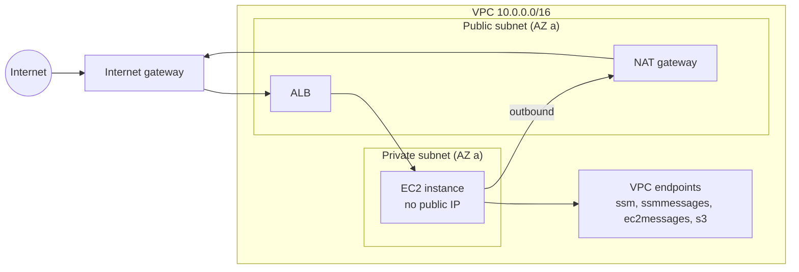

# Amazon EC2 — Networking, Security & IAM

What decides whether an instance can be reached, what it can reach, and what it may do in AWS: subnets and routes, security groups, the instance profile, the metadata service (IMDS) and how to get a shell without SSH.

## VPC Basics for EC2

| Piece | What it does | Test-relevant detail |
|-------|--------------|----------------------|
| **VPC** | Your private network (a CIDR block) in one Region | A new account has a **default VPC** with one public subnet per AZ; moto creates one too |
| **Subnet** | A slice of the VPC in **one AZ** | The subnet fixes the AZ of the instance. Quota: 200 subnets per VPC |
| **Route table** | Where traffic for each CIDR goes | **Public subnet** = a route `0.0.0.0/0` to an internet gateway. **Private subnet** = no such route |
| **Internet gateway** | Two-way internet for instances that have a public IP | Public IPv4 addresses are billed per hour |
| **NAT gateway** | Outbound-only internet for private subnets | Billed per hour and per GB; one per AZ for resilience. A common hidden cost of test environments |
| **VPC endpoints** | Private path to AWS services | **Gateway** endpoints (S3, DynamoDB) are route-table entries; **interface** endpoints (SSM, ECR, STS, ...) are ENIs in your subnets |
| **Network ACL** | Stateless firewall on the subnet | Numbered allow and deny rules, both directions; the default NACL allows everything. Leave it alone unless you need an explicit deny |



For test fleets prefer **private subnets with interface endpoints for SSM** (and a gateway endpoint for S3) over NAT gateways: no public IPs, no NAT hourly charge, no inbound ports.

## Security Groups

A security group is a **stateful, allow-only** firewall attached to the instance's network interface.

| Property | Behaviour |
|----------|-----------|
| Default | A new group has **no inbound rules** and one outbound rule allowing all traffic (confirmed on moto below) |
| Stateful | A reply to an allowed request is allowed back automatically, in both directions |
| Allow only | There are no deny rules; anything not allowed is dropped. Use a NACL for denies |
| Sources | A CIDR, an IPv6 CIDR, a prefix list, or **another security group** |
| Referencing a group | `UserIdGroupPairs` means "any instance in that group": the right way to say "the web tier may reach the database" without IP lists |
| Changes | Apply to running instances without a restart |
| Quotas | 60 rules per direction, 5 groups per ENI (up to 16), 2,500 groups per Region |
| Protocol `-1` | "All traffic": the rule has **no** `FromPort`/`ToPort`; checks that read ports must handle it |
| Deleting | Fails with `DependencyViolation` while an instance or another group's rule uses it |

```python
vpc_id = ec2.describe_vpcs(Filters=[{"Name": "isDefault", "Values": ["true"]}])["Vpcs"][0]["VpcId"]
sg = ec2.create_security_group(GroupName="fresh", Description="fresh group", VpcId=vpc_id)["GroupId"]
group = ec2.describe_security_groups(GroupIds=[sg])["SecurityGroups"][0]
print("inbound rules:", group["IpPermissions"], "| outbound:", [(p["IpProtocol"], p["IpRanges"]) for p in group["IpPermissionsEgress"]])
```

Creating, authorizing and referencing groups from Python is in [03](./03-boto3-python.md#security-groups). The compliance check "no `0.0.0.0/0` on port 22" is in [06](./06-compliance-imds-scaling-tests.md#compliance-checks-on-describe-output).

## Instance Profiles and Roles

Code on an instance must never hold access keys. Attach a **role** through an **instance profile**.

| Concept | Meaning |
|---------|---------|
| **Role** | The permissions, plus a **trust policy** saying `ec2.amazonaws.com` may assume it |
| **Instance profile** | The container EC2 attaches (holds one role). The console creates it silently; **the API does not**: `create_instance_profile` + `add_role_to_instance_profile` |
| **Attach** | `IamInstanceProfile={"Name": ...}` in `run_instances`, or `associate_iam_instance_profile` for a running instance |
| **`iam:PassRole`** | The *caller* of `run_instances` needs it for that role, ideally restricted with `iam:PassedToService = ec2.amazonaws.com` |
| **Credentials** | Short-lived, rotated automatically, served by IMDS |

Trust policy:

```json
{
  "Version": "2012-10-17",
  "Statement": [{
    "Effect": "Allow",
    "Principal": {"Service": "ec2.amazonaws.com"},
    "Action": "sts:AssumeRole"
  }]
}
```

Permissions for the application running on the instance (least privilege: actions and ARNs, no wildcards):

```json
{
  "Version": "2012-10-17",
  "Statement": [
    {
      "Sid": "ReadArtifacts",
      "Effect": "Allow",
      "Action": ["s3:GetObject"],
      "Resource": "arn:aws:s3:::acme-test-artifacts/builds/*"
    },
    {
      "Sid": "WriteResultsQueue",
      "Effect": "Allow",
      "Action": ["sqs:SendMessage"],
      "Resource": "arn:aws:sqs:eu-west-1:123456789012:test-results"
    }
  ]
}
```

```python
# A role is not enough: EC2 attaches an INSTANCE PROFILE (a container for one role). The console hides this step; the API does not.
iam.create_role(RoleName="smoke-instance-role", AssumeRolePolicyDocument=(POLICIES / "trust.json").read_text())
iam.put_role_policy(RoleName="smoke-instance-role", PolicyName="app", PolicyDocument=(POLICIES / "instance-role.json").read_text())
iam.attach_role_policy(RoleName="smoke-instance-role", PolicyArn="arn:aws:iam::aws:policy/AmazonSSMManagedInstanceCore")   # Session Manager, Run Command
iam.create_instance_profile(InstanceProfileName="smoke-instance-profile")
iam.add_role_to_instance_profile(InstanceProfileName="smoke-instance-profile", RoleName="smoke-instance-role")

resp = ec2.run_instances(
    ImageId="ami-0123456789abcdef0", InstanceType="t3.micro", MinCount=1, MaxCount=1,
    IamInstanceProfile={"Name": "smoke-instance-profile"},
    MetadataOptions={"HttpTokens": "required", "HttpEndpoint": "enabled", "HttpPutResponseHopLimit": 1},
)
```

Attach `AmazonSSMManagedInstanceCore` for Session Manager and Run Command. (moto only knows AWS managed policies when `MOTO_IAM_LOAD_MANAGED_POLICIES=true`; the run below had it set.)

## IMDSv2 and How boto3 Gets Credentials on EC2

The **Instance Metadata Service** answers on `169.254.169.254` (and `fd00:ec2::254` if enabled) from inside the instance. It serves the instance ID, user data, tags (opt-in) and the role credentials.

| | IMDSv1 | IMDSv2 |
|---|--------|--------|
| Request | A plain `GET` | A `PUT /latest/api/token` (TTL up to 6 hours), then `GET` with `X-aws-ec2-metadata-token` |
| Weakness | Any SSRF bug that can make the server issue a `GET` can steal the role credentials | A `PUT` with the TTL header, rejected if it carries `X-Forwarded-For`; the token response has IP TTL (hop limit) 1 by default |
| Setting | `HttpTokens=optional` | `HttpTokens=required` |

| Option (`MetadataOptions`) | Values | Notes |
|----------------------------|--------|-------|
| `HttpTokens` | `optional` \| `required` | `required` turns IMDSv1 off; `MetadataNoTokenRejected` counts rejected v1 calls, `MetadataNoToken` counts accepted v1 calls |
| `HttpPutResponseHopLimit` | 1 to 64 | Default **1**. A container on the host (a bridge network is one more hop) cannot reach the token: use **2** for containers |
| `HttpEndpoint` | `enabled` \| `disabled` | `disabled` also removes **user data** and the SSH public key |
| `InstanceMetadataTags` | `enabled` \| `disabled` | Tags in IMDS are off by default; tag keys then may not contain spaces or `/` |
| `HttpProtocolIpv6` | `enabled` \| `disabled` | The IPv6 endpoint is off by default |

**Defaults.** Out of the box an instance allows **both** versions. The effective default for a new instance depends on the order: launch request, then the launch template, then the **account default** for the Region (`modify_instance_metadata_defaults`), then the **AMI** (`ImdsSupport: v2.0` makes it `required` with hop limit 2). AWS documents that Amazon Linux 2023 disables IMDSv1 by default; check `describe_images` → `ImdsSupport` for your AMI. The account default applies to **new** launches in one Region only; with `HttpTokensEnforced="enabled"` launches that would allow IMDSv1 fail. Do not rely on any of these: **set `HttpTokens=required` explicitly** in your launch code (our `build_run_params` does) and test that it is there.

```python
# Fix a running instance: require IMDSv2, allow one more hop for containers on the host, expose tags in IMDS (off by default).
# Send the complete set of options every time (see the moto note below).
ec2.modify_instance_metadata_options(
    InstanceId=inst["InstanceId"], HttpTokens="required", HttpPutResponseHopLimit=2, HttpEndpoint="enabled",
    InstanceMetadataTags="enabled",
)
```

**How boto3 finds credentials on EC2.** The last two entries of the [credential chain](../foundations/02-credentials-iam-local-testing.md#the-credential-provider-chain) apply: container credentials, then the **instance metadata** provider. botocore first sends the IMDSv2 `PUT` for a token, then reads `/latest/meta-data/iam/security-credentials/` (the role name) and the role's credentials, and refreshes them before they expire. If the token request fails (a timeout caused by a hop limit of 1 in a container, or a proxy), botocore **falls back to IMDSv1**; on an instance with `HttpTokens=required` that answers 401 and you get `NoCredentialsError`. Knobs (environment variables or shared config):

| Setting | Env var | Default |
|---------|---------|---------|
| Timeout per request | `AWS_METADATA_SERVICE_TIMEOUT` | 1 s |
| Attempts | `AWS_METADATA_SERVICE_NUM_ATTEMPTS` | 1 |
| Disable IMDS lookups | `AWS_EC2_METADATA_DISABLED=true` | off (set it on laptops and CI to avoid 1 s stalls) |
| Forbid the v1 fallback | `AWS_EC2_METADATA_V1_DISABLED=true` | off |
| Custom endpoint (tests) | `AWS_EC2_METADATA_SERVICE_ENDPOINT` | `http://169.254.169.254/` |

All four behaviours (token first, role discovery, 401 on the v1 fallback, explicit failure with v1 disabled) are covered by tests against a fake IMDS in [06](./06-compliance-imds-scaling-tests.md#testing-the-credential-path-with-a-fake-imds).

## Session Manager Instead of SSH

**AWS Systems Manager Session Manager** gives an IAM-authorized shell (or port forward) with **no inbound port, no key pair, no bastion**, and session logs in CloudTrail, S3 or CloudWatch Logs.

| Requirement | Detail |
|-------------|--------|
| SSM Agent | Version 2.3.68.0 or later; check the AWS list of AMIs with the agent preinstalled for your image |
| Instance role | `AmazonSSMManagedInstanceCore` (or an equivalent custom policy) |
| Network | Outbound **HTTPS 443** to `ssm`, `ssmmessages` and `ec2messages` in the Region: via NAT/internet **or** three interface VPC endpoints |
| Caller | IAM permission `ssm:StartSession` on the instance and document; the AWS CLI needs the Session Manager plugin |
| Verify | The instance appears in `ssm.describe_instance_information()` ("managed node") within a few minutes |

```bash
aws ssm start-session --target i-0123456789abcdef0          # interactive shell
aws ssm start-session --target i-0123456789abcdef0 \
    --document-name AWS-StartPortForwardingSession \
    --parameters '{"portNumber":["8080"],"localPortNumber":["8080"]}'   # reach a private web port from your laptop
```

For automation use **Run Command** (`send_command`, [04](./04-scaling-load-balancing-operations.md#run-command-and-patch-manager)) instead of an interactive session. **EC2 Instance Connect Endpoint** is the option for SSH/RDP to private instances when SSM is not available.

## Least-Privilege Policies

A CI role that may launch, tag and clean up **only its own** small instances with IMDSv2 (replace the placeholders):

```json
{
  "Version": "2012-10-17",
  "Statement": [
    {
      "Sid": "ReadOnlyDescribe",
      "Effect": "Allow",
      "Action": "ec2:Describe*",
      "Resource": "*"
    },
    {
      "Sid": "ResolveAmiAlias",
      "Effect": "Allow",
      "Action": "ssm:GetParameters",
      "Resource": "arn:aws:ssm:eu-west-1::parameter/aws/service/ami-amazon-linux-latest/*"
    },
    {
      "Sid": "LaunchSharedParts",
      "Effect": "Allow",
      "Action": "ec2:RunInstances",
      "Resource": [
        "arn:aws:ec2:eu-west-1::image/*",
        "arn:aws:ec2:eu-west-1:123456789012:subnet/subnet-0123456789abcdef0",
        "arn:aws:ec2:eu-west-1:123456789012:security-group/sg-0123456789abcdef0",
        "arn:aws:ec2:eu-west-1:123456789012:network-interface/*"
      ]
    },
    {
      "Sid": "LaunchInstancesWithTagsAndImdsV2",
      "Effect": "Allow",
      "Action": "ec2:RunInstances",
      "Resource": "arn:aws:ec2:eu-west-1:123456789012:instance/*",
      "Condition": {
        "StringEquals": {
          "aws:RequestTag/owner": "qa-smoke",
          "ec2:MetadataHttpTokens": "required"
        }
      }
    },
    {
      "Sid": "LaunchVolumesWithTags",
      "Effect": "Allow",
      "Action": "ec2:RunInstances",
      "Resource": "arn:aws:ec2:eu-west-1:123456789012:volume/*",
      "Condition": {
        "StringEquals": {
          "aws:RequestTag/owner": "qa-smoke"
        }
      }
    },
    {
      "Sid": "TagOnlyAtCreation",
      "Effect": "Allow",
      "Action": "ec2:CreateTags",
      "Resource": "arn:aws:ec2:eu-west-1:123456789012:*/*",
      "Condition": {
        "StringEquals": {
          "ec2:CreateAction": "RunInstances"
        }
      }
    },
    {
      "Sid": "ManageOnlyOwnInstances",
      "Effect": "Allow",
      "Action": [
        "ec2:TerminateInstances",
        "ec2:StopInstances",
        "ec2:StartInstances"
      ],
      "Resource": "arn:aws:ec2:eu-west-1:123456789012:instance/*",
      "Condition": {
        "StringEquals": {
          "aws:ResourceTag/owner": "qa-smoke"
        }
      }
    },
    {
      "Sid": "PassOnlyTheSmokeRoleToEc2",
      "Effect": "Allow",
      "Action": "iam:PassRole",
      "Resource": "arn:aws:iam::123456789012:role/smoke-instance-role",
      "Condition": {
        "StringEquals": {
          "iam:PassedToService": "ec2.amazonaws.com"
        }
      }
    }
  ]
}
```

Design notes (the pattern follows the AWS example policies for `RunInstances`):

- `RunInstances` is authorized **per resource type**: image, subnet, security group, network interface, instance, volume. Tag and IMDS conditions go on the `instance` and `volume` statements.
- `ec2:CreateTags` with `ec2:CreateAction = RunInstances` allows tagging **only at creation**; the role cannot retag existing resources to escape the `owner` condition.
- `Describe*` actions do not support resource-level permissions, so they need `Resource: "*"`.
- `TerminateInstances` is limited by `aws:ResourceTag/owner`, so a bug cannot kill someone else's instance.
- `iam:PassRole` names one role and one service.
- A company-wide guard (Service Control Policy or IAM) that **denies `RunInstances` unless IMDSv2 is required** (AWS example):

```json
{
  "Version": "2012-10-17",
  "Statement": [{
    "Sid": "RequireImdsV2",
    "Effect": "Deny",
    "Action": "ec2:RunInstances",
    "Resource": "arn:aws:ec2:*:*:instance/*",
    "Condition": {"StringNotEquals": {"ec2:MetadataHttpTokens": "required"}}
  }]
}
```

```python
for path in sorted(POLICIES.glob("*.json")):
    if "trust" not in path.name:
        json.loads(path.read_text())                 # at least: valid JSON
        iam.create_policy(PolicyName=path.stem, PolicyDocument=path.read_text())    # moto's IAM validator also accepts it
print([p["PolicyName"] for p in iam.list_policies(Scope="Local")["Policies"]])
```

```text
profile: smoke-instance-profile
IMDS: {'HttpTokens': 'required', 'HttpPutResponseHopLimit': 1, 'HttpEndpoint': 'enabled'}
after modify: required 2 enabled
inbound rules: [] | outbound: [('-1', [{'CidrIp': '0.0.0.0/0'}])]
['ci-launcher', 'deny-imdsv1', 'instance-role']
```

## Common Security Mistakes

| Mistake | Why it hurts | Fix |
|---------|--------------|-----|
| `0.0.0.0/0` on 22, 3389 or a database port | Internet scanners find it in minutes | Session Manager; reference security groups; a [compliance test](./06-compliance-imds-scaling-tests.md#compliance-checks-on-describe-output) |
| Protocol `-1` (all traffic) from `0.0.0.0/0` | Same, for every port | Allow only the ports you serve |
| IMDSv1 left enabled | SSRF steals role credentials | `HttpTokens=required`, account default, SCP |
| Admin or `*` role on the instance | One compromised process owns the account | Least-privilege role per workload |
| Access keys in user data or AMIs | Both are readable and copied around | Instance profile |
| Secrets in user data or tags | Both are returned by Describe calls | Secrets Manager or SSM parameters, fetched with the role |
| Public subnet "because it was easier" | Public IPv4 cost and exposure | Private subnet plus endpoints |
| Hop limit 1 with containers | Credentials silently unavailable in the container | `HttpPutResponseHopLimit=2` |
| Unencrypted volumes | Snapshots and copies stay readable | `Encrypted: True` (or encryption by default) |
| Forgotten test instances with a powerful role | A standing foothold | Run-id tags, `terminate` on shutdown, a janitor ([07](./07-moto-gaps-smoke-ci.md#janitor-job)) |

## Quick Rules

1. **Private subnets, no public IPs** for test fleets; reach them with Session Manager.
2. **Security groups reference groups**, not IP lists; never `0.0.0.0/0` on admin ports.
3. **One role per workload**, attached through an instance profile; never keys on disk.
4. **Set `HttpTokens=required` in code**, hop limit 1 (2 for containers), and assert it in tests.
5. **boto3 on EC2 needs no configuration**: set `AWS_EC2_METADATA_V1_DISABLED=true` if you want a hard failure instead of a v1 fallback.
6. **Create the instance profile with the API** (role, profile, `add_role_to_instance_profile`) and give the launcher `iam:PassRole` for that role only.
7. **Scope launcher roles by tag conditions** (`aws:RequestTag`, `aws:ResourceTag`) and allow tagging only at creation.
8. **Gateway endpoint for S3, interface endpoints for SSM** keep traffic off the NAT gateway.
9. **Test the denies**: a policy that "works" in a test account but allows too much is the usual failure.

---
## See also
- [Amazon EC2 — Instances, Networking & Testing](./index.md)
- [Amazon EC2 — Core Concepts](./01-core-concepts.md)
- [Amazon EC2 — boto3 in Python](./03-boto3-python.md)
- [AWS Foundations — Credentials, IAM & Local Testing](../foundations/02-credentials-iam-local-testing.md)
- [Linux Terminal — Network Basics](../../tools/linux-terminal/04-network-ssh-downloads.md)
- [Code Security](../../code-security/index.md)
