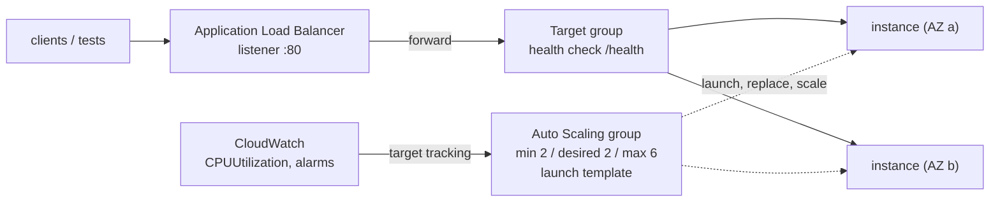

# Amazon EC2 — Scaling, Load Balancing & Operations

One instance is a test fixture; a fleet needs something that launches, replaces and balances it. This page is an overview with runnable boto3 for the pieces a developer or QA engineer touches: Auto Scaling groups, load balancers, CloudWatch, Systems Manager, image baking, cost control and EC2 as a CI or load-generation host.



## Auto Scaling Groups

An **Auto Scaling group (ASG)** keeps `DesiredCapacity` instances running from a **launch template**, spread over your subnets (AZs), and replaces unhealthy ones.

| Concept | Detail |
|---------|--------|
| Launch template | Use one (launch configurations are the old mechanism). `Version`: `$Latest`, `$Default` or a number; pin a number in production |
| Sizes | `MinSize`, `MaxSize`, `DesiredCapacity` (defaults to `MinSize`) |
| `VPCZoneIdentifier` | Comma-separated **subnet IDs**, one per AZ you want |
| Health checks | `EC2` (default, instance status) and optionally `ELB` (target group health) |
| `HealthCheckGracePeriod` | Seconds after `InService` before health is checked. **API default 0**: set it above your boot time or the group kills instances that are still starting |
| Tags | `PropagateAtLaunch: True` copies a group tag to instances; propagated tags do not reach EBS volumes (tag volumes in the launch template) |
| Mixed instances | `MixedInstancesPolicy` for several types and On-Demand/Spot mixes; `CapacityRebalance` replaces Spot instances that get a rebalance recommendation |
| Termination | `TerminationPolicies` (`Default`, `OldestInstance`, ...); `NewInstancesProtectedFromScaleIn` for scale-in protection |
| Deletion | `delete_auto_scaling_group(ForceDelete=True)` also terminates the instances |

### Scaling policies

| Type | Idea | Use |
|------|------|-----|
| **Target tracking** | "Keep average CPU at 50 %" (`ASGAverageCPUUtilization`), request count per target, network | The default choice; creates and manages the alarms for you |
| **Step / simple** | Alarm breaches map to capacity steps | When you need explicit steps; simple scaling uses `DefaultCooldown` (300 s) |
| **Scheduled** | Capacity at set times | Known load windows, scale-to-zero outside office hours |
| **Predictive** | Forecasts from history | Recurring daily patterns |
| **Warm pools** | Pre-initialized stopped instances | Long boot times |

`DefaultInstanceWarmup` tells the group when a new instance's metrics count; set it (even to 0) rather than leaving it unset.

### Lifecycle hooks

A **lifecycle hook** pauses an instance in `Pending:Wait` (launch) or `Terminating:Wait` (terminate) so your code can finish work: register with a service, drain connections, upload logs. The instance waits until you call `complete_lifecycle_action` or the `HeartbeatTimeout` ends (default one hour); `DefaultResult` (`CONTINUE` or `ABANDON`) decides what happens on timeout. Extend a wait with `record_lifecycle_action_heartbeat`.

### Instance refresh

To roll out a new AMI or launch template version, start an **instance refresh**: the group replaces instances in batches while keeping `MinHealthyPercentage` (default 90) in service, waits `InstanceWarmup` after each, and can roll back automatically when an alarm fires (`AutoRollback`). `SkipMatching` skips instances that already match the new configuration.

```python
ec2.create_launch_template(LaunchTemplateName="web", LaunchTemplateData={
    "ImageId": "resolve:ssm:/aws/service/ami-amazon-linux-latest/al2023-ami-kernel-default-arm64",
    "InstanceType": "t4g.small", "SecurityGroupIds": [app_sg],
    "MetadataOptions": {"HttpTokens": "required", "HttpPutResponseHopLimit": 1}})
asg.create_auto_scaling_group(
    AutoScalingGroupName="web", LaunchTemplate={"LaunchTemplateName": "web", "Version": "$Latest"},
    MinSize=2, MaxSize=6, DesiredCapacity=2, VPCZoneIdentifier=",".join(subnets),   # one subnet per AZ
    TargetGroupARNs=[tg["TargetGroupArn"]], HealthCheckType="ELB", HealthCheckGracePeriod=120,
    Tags=[{"Key": "owner", "Value": "qa", "PropagateAtLaunch": True}],
)
asg.put_scaling_policy(                               # target tracking: keep average CPU near 50 %
    AutoScalingGroupName="web", PolicyName="cpu-50", PolicyType="TargetTrackingScaling",
    TargetTrackingConfiguration={"PredefinedMetricSpecification": {"PredefinedMetricType": "ASGAverageCPUUtilization"}, "TargetValue": 50.0},
)
asg.put_lifecycle_hook(                               # hold terminating instances for up to 5 minutes so they can drain
    AutoScalingGroupName="web", LifecycleHookName="drain", LifecycleTransition="autoscaling:EC2_INSTANCE_TERMINATING",
    HeartbeatTimeout=300, DefaultResult="CONTINUE",
)
```

```python
asg_stub = boto3.client("autoscaling")                # a second client, scripted with Stubber: moto has no instance refresh
prefs = {"MinHealthyPercentage": 90, "InstanceWarmup": 120, "AutoRollback": True, "SkipMatching": True}
with Stubber(asg_stub) as stub:
    stub.add_response("start_instance_refresh", {"InstanceRefreshId": "11111111-2222-3333-4444-555555555555"},
                      expected_params={"AutoScalingGroupName": "web", "Strategy": "Rolling", "Preferences": prefs})
    stub.add_response("describe_instance_refreshes",
                      {"InstanceRefreshes": [{"InstanceRefreshId": "11111111-2222-3333-4444-555555555555", "Status": "InProgress", "PercentageComplete": 50}]})
    stub.add_response("complete_lifecycle_action", {}, expected_params={
        "AutoScalingGroupName": "web", "LifecycleHookName": "drain", "InstanceId": "i-0123456789abcdef0", "LifecycleActionResult": "CONTINUE"})
    rid = asg_stub.start_instance_refresh(AutoScalingGroupName="web", Strategy="Rolling", Preferences=prefs)["InstanceRefreshId"]
    status = asg_stub.describe_instance_refreshes(AutoScalingGroupName="web", InstanceRefreshIds=[rid])["InstanceRefreshes"][0]
    asg_stub.complete_lifecycle_action(AutoScalingGroupName="web", LifecycleHookName="drain",
                                       InstanceId="i-0123456789abcdef0", LifecycleActionResult="CONTINUE")
```

moto has **no instance refresh** and never evaluates policies, so refresh requests are tested with Stubber only ([07](./07-moto-gaps-smoke-ci.md)).

## Load Balancing

| Type | Layer | Use |
|------|-------|-----|
| **Application Load Balancer (ALB)** | 7 (HTTP/HTTPS) | Web services and APIs: host/path routing, redirects, WebSockets, gRPC |
| **Network Load Balancer (NLB)** | 4 (TCP/UDP/TLS) | Raw TCP, static IPs, very high connection rates |
| Gateway Load Balancer | 3 | Virtual appliances (not covered) |

A load balancer has **listeners** (port and protocol) whose rules forward to **target groups**; a target group holds instances (by ID, `TargetType="instance"`), IPs or Lambda functions and runs the **health checks**. With an ASG, pass `TargetGroupARNs` and the group registers and deregisters instances for you.

| Target group setting | Default for HTTP | Note |
|----------------------|------------------|------|
| `HealthCheckPath` | `/` | Use a cheap `/health` that checks dependencies lightly |
| `HealthCheckIntervalSeconds` | 30 (range 5 to 300) | |
| `HealthCheckTimeoutSeconds` | 6 for HTTP | Must be shorter than the interval |
| `HealthyThresholdCount` | 5 (2 to 10) | Consecutive successes to become healthy |
| `UnhealthyThresholdCount` | 2 (2 to 10) | Consecutive failures to become unhealthy |
| `Matcher` | `200` | Accepted HTTP codes |
| `deregistration_delay.timeout_seconds` | 300 | Draining time; lower it for test environments |

The defaults mean a new target needs about 5 x 30 s = **2.5 minutes** before it is `healthy`: tests that hit the load balancer straight after scale-out see 502/503. Lower the interval and healthy threshold for test stacks, and poll `describe_target_health` with a deadline.

```python
lb = elb.create_load_balancer(Name="web", Subnets=subnets, SecurityGroups=[alb_sg], Scheme="internet-facing", Type="application")["LoadBalancers"][0]
tg = elb.create_target_group(
    Name="web-tg", Protocol="HTTP", Port=8080, VpcId=vpc_id, TargetType="instance",
    HealthCheckPath="/health", HealthCheckIntervalSeconds=15, HealthyThresholdCount=2, UnhealthyThresholdCount=2,
    Matcher={"HttpCode": "200"},
)["TargetGroups"][0]
elb.create_listener(LoadBalancerArn=lb["LoadBalancerArn"], Protocol="HTTP", Port=80,
                    DefaultActions=[{"Type": "forward", "TargetGroupArn": tg["TargetGroupArn"]}])
```

Target states: `initial`, `healthy`, `unhealthy`, `unused`, `draining`, `unavailable`. **moto reports `healthy` immediately** and never runs a health check.

## CloudWatch: Metrics, Alarms, Status Checks

| Fact | Detail |
|------|--------|
| Default metrics | `AWS/EC2`: `CPUUtilization`, `NetworkIn/Out`, `DiskRead*`/`DiskWrite*` (**instance store only**), `EBSRead*`/`EBSWrite*`, credit metrics for `T` types |
| Interval | **5 minutes** by default; **1 minute** with detailed monitoring (extra cost). Status-check metrics are 1 minute at no charge |
| Not included | **Memory and filesystem usage**: install the CloudWatch agent |
| Status checks | `StatusCheckFailed`, `StatusCheckFailed_Instance` (OS/network of the guest), `StatusCheckFailed_System` (host hardware), `StatusCheckFailed_AttachedEBS` |
| IMDS | `MetadataNoToken` (IMDSv1 calls that succeeded), `MetadataNoTokenRejected` |
| Per-group | `AWS/AutoScaling` metrics and the `AutoScalingGroupName` dimension on EC2 metrics |
| Quotas | `AWS/Usage` `ResourceCount` (`Resource=vCPU`) lets you alarm before you hit a vCPU quota |

For a failed **system** check, an alarm can **recover** the instance (same ID, same IPs, memory lost) with the action `arn:aws:automate:<region>:ec2:recover`; AWS recommends two one-minute evaluation periods. Instance-check failures usually need a reboot or replacement (an ASG with `ELB` health does the latter).

```python
cw.put_metric_alarm(
    AlarmName=f"{ids[0]}-system-status", Namespace="AWS/EC2", MetricName="StatusCheckFailed_System",
    Dimensions=[{"Name": "InstanceId", "Value": ids[0]}], Statistic="Maximum", Period=60, EvaluationPeriods=2,
    Threshold=0, ComparisonOperator="GreaterThanThreshold", TreatMissingData="notBreaching",
    AlarmActions=["arn:aws:automate:us-east-1:ec2:recover"],          # CloudWatch action: recover the instance onto healthy hardware
)
```

Reading statistics: `cloudwatch.get_metric_statistics(Namespace="AWS/EC2", MetricName="CPUUtilization", Dimensions=[{"Name": "AutoScalingGroupName", "Value": "web"}], StartTime=..., EndTime=..., Period=300, Statistics=["Average", "Maximum"])`. For load tests, assert on these metrics with a deadline, because datapoints arrive minutes late ([07](./07-moto-gaps-smoke-ci.md)).

## Run Command and Patch Manager

**Run Command** runs a document (a script) on managed instances without SSH; **Patch Manager** applies patch baselines on a schedule through maintenance windows. Both need the SSM Agent, the instance role and the network path from [02](./02-networking-security-iam.md#session-manager-instead-of-ssh).

```python
ids = [i["InstanceId"] for i in g["Instances"]]
cmd = ssm.send_command(InstanceIds=ids, DocumentName="AWS-RunShellScript",
                       Parameters={"commands": ["systemctl is-active app"]}, Comment="check app", TimeoutSeconds=60)["Command"]
inv = ssm.get_command_invocation(CommandId=cmd["CommandId"], InstanceId=ids[0])      # per-instance status, stdout, ResponseCode
```

| Fact | Detail |
|------|--------|
| Targets | `InstanceIds`, or `Targets=[{"Key": "tag:app", "Values": ["web"]}]` |
| Rate control | `MaxConcurrency` and `MaxErrors` (counts or percentages) |
| Per instance | `get_command_invocation` has `Status`, `ResponseCode`, `StandardOutputContent`; statuses `Pending`, `InProgress`, `Success`, `Failed`, `TimedOut`, `Cancelled` |
| Output | Large output goes to S3 or CloudWatch Logs, not the API |
| Testing | **moto marks every command `Success` without running it**: the `exit 1` case is only testable on a real instance |

## Image Builder and Patching

**EC2 Image Builder** builds, tests and distributes AMIs from a recipe (base image such as the AL2023 SSM parameter, plus components) on a schedule, so new instances start patched. An ASG then picks the new AMI up by instance refresh. For a small QA setup a nightly job that launches the AL2023 parameter image, runs the install script and calls `create_image` is enough; Image Builder is the managed version. Not covered further here.

## Cost Control

| Lever | How |
|-------|-----|
| **Tag everything** | `owner`, `env`, `run-id`; activate the keys as cost-allocation tags (hours to appear), then group costs by tag |
| **Janitor** | A scheduled job terminates instances older than N hours unless tagged `keep=true` ([07](./07-moto-gaps-smoke-ci.md#janitor-job)) |
| **Stop schedules** | Stop dev/test instances at night; EventBridge Scheduler can call `StopInstances`/`StartInstances` directly, no Lambda (see the Scheduler docs for the target format) |
| **Right-size** | AWS Compute Optimizer, CloudWatch CPU and memory (agent) over two weeks |
| **Pick cheaper hardware** | Graviton (`arm64`), current generation, `T`/flex for idle-heavy hosts |
| **Spot** | Restartable fleets ([03](./03-boto3-python.md#spot-instances)) |
| **Hunt leftovers** | Unattached EBS volumes, old snapshots and AMIs, idle Elastic IPs and **public IPv4 addresses**, NAT gateways |
| **Guardrails** | Billing alarms and budgets; low vCPU quotas on sandbox accounts; `InstanceInitiatedShutdownBehavior=terminate` |

```python
def expired(instances, now, max_age=dt.timedelta(hours=8), keep_tag="keep"):
    """Instance IDs older than max_age, unless tagged keep=true. Pure: feed it describe_instances output."""
    out = []
    for inst in instances:
        tags = {t["Key"]: t["Value"] for t in inst.get("Tags", [])}
        if tags.get(keep_tag) != "true" and now - inst["LaunchTime"] > max_age:
            out.append(inst["InstanceId"])
    return out
```

```text
ASG min/desired/max: 2 2 6 | health check: ELB | instances: 2
target health: ['healthy', 'healthy']
refresh: InProgress 50% | hook completed
command: Success | invocation: Success 0
alarm actions: ['arn:aws:automate:us-east-1:ec2:recover']
expired: ['i-old']
```

## EC2 as a CI Runner or Load-Generator Host

| Use | Why EC2 | Notes |
|-----|---------|-------|
| **Self-hosted GitHub Actions runner** | Bigger machines, GPUs, VPC access to private services, caches on local disks | Use **ephemeral** runners (`--ephemeral`: one job, then deregistered) and autoscale them; GitHub recommends ephemeral runners for autoscaling. Never attach a self-hosted runner to a public repository that accepts forks. Kubernetes shops use Actions Runner Controller |
| **Load-generator host** | Stable CPU and network away from your laptop and from shared CI | Use a `C`/`M` type, not `T`; put it in the same Region (ideally the same AZ) as the target; Locust or k6 workers are interchangeable instances; see [Performance Testing](../../performance-testing/index.md) |
| **Test environment per PR** | Full OS control, a database on the box | `run-id` tag per PR, `terminate` on shutdown, TTL janitor |

Outline of the user data for an ephemeral runner (needs a GitHub registration token; fetch the token at boot from the GitHub API with a short-lived secret, never bake it into the image):

```bash
#!/bin/bash
set -euo pipefail
# runner software is baked into the AMI at /opt/actions-runner
cd /opt/actions-runner
./config.sh --unattended --ephemeral --url "https://github.com/acme/app" --token "$RUNNER_TOKEN" --labels ec2,arm64
./run.sh                      # exits after one job
shutdown -h now               # InstanceInitiatedShutdownBehavior=terminate ends the instance (and the billing)
```

The load-generator pattern in miniature: launch N workers with the `build_run_params` request, wait for `instance_status_ok`, start the workers with Run Command, collect results into S3, terminate by `run-id` in `finally`.

## Quick Rules

1. **Use launch templates and pin a version** in production; `$Latest` is for dev.
2. **Set `HealthCheckGracePeriod` above boot time** and `HealthCheckType="ELB"` behind a load balancer.
3. **Target tracking first**; add scheduled scaling for known windows.
4. **Roll out AMIs with instance refresh**, keeping `MinHealthyPercentage` and `AutoRollback` on.
5. **Tune health checks for tests**: a default target group needs about 2.5 minutes to turn healthy.
6. **Alarm on `StatusCheckFailed_System` with the recover action**, and on credit balance for `T` types.
7. **Install the CloudWatch agent** if you need memory or disk metrics.
8. **Use Run Command or Session Manager**, not SSH, for operations.
9. **Make runners ephemeral and the janitor mandatory**; unattended EC2 is the quiet source of bills.
10. **Test scaling logic as pure functions** (desired capacity from a metric) and prove the real scaling in a staging environment.

---
## See also
- [Amazon EC2 — Instances, Networking & Testing](./index.md)
- [Amazon EC2 — Networking, Security & IAM](./02-networking-security-iam.md)
- [Amazon EC2 — boto3 in Python](./03-boto3-python.md)
- [Amazon EC2 — Testing](./05-testing.md)
- [Amazon ECS — Containers on Fargate, Services & Testing](../ecs/index.md)
- [Performance Testing](../../performance-testing/index.md)
- [CI/CD](../../ci-cd-approaches/index.md)
