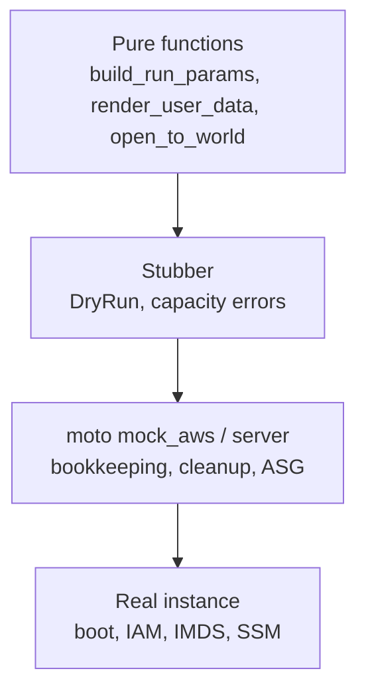

# Amazon EC2 — Testing EC2-Based Systems

## What to Test Where

| Level | What | EC2 needed |
|-------|------|------------|
| **Pure** | Request builders, user-data rendering, compliance rules over `describe_*` dicts, cost and expiry helpers | None: call the function with a dict |
| **Client contract** | The exact `run_instances` request, `DryRun` outcomes, capacity and quota errors, ASG and refresh requests | `botocore.stub.Stubber` ([Foundations](../foundations/02-credentials-iam-local-testing.md#stubber-exact-requests-and-errors)) |
| **Integration** | Launch, tag, filter, stop/start/terminate bookkeeping, security-group rules, ASG capacity, target groups | **moto** `mock_aws`, or moto server for other processes |
| **Credential path** | How code gets credentials on an instance (IMDSv2 flow, v1 fallback) | A **fake IMDS** HTTP server, no AWS |
| **Smoke** | Boot, user data, IAM, IMDS, SSM agent, real networking and quotas | A tiny real instance, one tagged test ([07](./07-moto-gaps-smoke-ci.md#real-account-smoke-test)) |



moto stores objects and answers API calls; **no instance runs, nothing boots, nothing is enforced** (full list in [07](./07-moto-gaps-smoke-ci.md#what-moto-does-not-emulate)). So the useful moto tests check what **your code asks for and how it reacts**, and the real-instance test checks what AWS does with it.

The project layout used in this guide:

```text
app/        launch.py  userdata.py  compliance.py
tests/
  conftest.py  fake_imds.py
  test_userdata.py  test_launch_params.py  test_launch_moto.py  test_cleanup.py  test_compliance.py
  test_imds_credentials.py  test_asg_elb.py  test_server_mode.py  test_moto_gaps.py
  smoke/test_ec2_smoke.py
```

## Fixtures: Fake Credentials, Network, Guaranteed Cleanup

The autouse fake-credential fixture is the one from [Foundations](../foundations/02-credentials-iam-local-testing.md#a-safe-conftestpy); the EC2-specific parts are the `net` fixture (moto ships a default VPC like a new account) and `run_id`, whose `finally` terminates anything that still carries the test's tag.

```python
import uuid

import boto3
import pytest
from botocore.config import Config
from moto import mock_aws

from app.launch import terminate_run

AMI = "ami-0123456789abcdef0"                      # placeholder: moto accepts any ID, real EC2 does not
CFG = Config(retries={"mode": "standard", "max_attempts": 3}, connect_timeout=3, read_timeout=10)


@pytest.fixture(autouse=True)
def aws_env(monkeypatch):
    """Fake credentials, a fixed region, no ~/.aws: a test cannot reach a real account by accident."""
    monkeypatch.setenv("AWS_ACCESS_KEY_ID", "testing")
    monkeypatch.setenv("AWS_SECRET_ACCESS_KEY", "testing")
    monkeypatch.setenv("AWS_SESSION_TOKEN", "testing")
    monkeypatch.setenv("AWS_DEFAULT_REGION", "us-east-1")
    monkeypatch.delenv("AWS_PROFILE", raising=False)
    monkeypatch.setenv("AWS_CONFIG_FILE", "/dev/null")
    monkeypatch.setenv("AWS_SHARED_CREDENTIALS_FILE", "/dev/null")
    monkeypatch.delenv("AWS_ENDPOINT_URL", raising=False)


@pytest.fixture
def aws():
    with mock_aws():                               # fresh in-memory backend per test
        yield


@pytest.fixture
def ec2(aws):
    return boto3.client("ec2", config=CFG)


@pytest.fixture
def net(ec2):
    """moto ships a default VPC with one subnet per AZ, like a new real account."""
    vpc_id = ec2.describe_vpcs(Filters=[{"Name": "isDefault", "Values": ["true"]}])["Vpcs"][0]["VpcId"]
    subnet_id = ec2.describe_subnets(Filters=[{"Name": "vpc-id", "Values": [vpc_id]}])["Subnets"][0]["SubnetId"]
    sg_id = ec2.create_security_group(GroupName=f"test-{uuid.uuid4().hex[:8]}", Description="test", VpcId=vpc_id)["GroupId"]
    return {"vpc": vpc_id, "subnet": subnet_id, "sg": sg_id}


@pytest.fixture
def run_id(ec2):
    """Unique tag value per test. Teardown terminates anything still carrying it, even after a failed assert."""
    rid = f"t-{uuid.uuid4().hex[:10]}"
    try:
        yield rid
    finally:
        terminate_run(ec2, rid)
```

## Request-Shape Tests (No AWS)

```python
def params(**over):
    base = dict(ami_id=AMI, instance_type="t3.micro", subnet_id="subnet-0123456789abcdef0",
                security_group_ids=["sg-0123456789abcdef0"], tags={"owner": "qa", "env": "test"},
                run_id="t-1", name="worker-1")
    return build_run_params(**{**base, **over})


def test_policy_is_in_the_request():
    p = params()
    assert p["MetadataOptions"]["HttpTokens"] == "required"             # IMDSv2 only
    assert p["BlockDeviceMappings"][0]["Ebs"]["Encrypted"] is True
    assert p["InstanceInitiatedShutdownBehavior"] == "terminate"
    kinds = {ts["ResourceType"] for ts in p["TagSpecifications"]}
    assert kinds == {"instance", "volume"}                              # volumes are tagged too, so they are findable
    tags = {t["Key"]: t["Value"] for t in p["TagSpecifications"][0]["Tags"]}
    assert tags == {"owner": "qa", "env": "test", "Name": "worker-1", "run-id": "t-1"}


def test_client_token_is_stable_and_valid():
    assert client_token("t-1", "a") == client_token("t-1", "a")
    assert client_token("t-1", "a") != client_token("t-1", "b")
    assert len(client_token("t-1", "a")) <= 64 and client_token("t-1", "a").isascii()


def test_request_passes_botocore_validation_without_any_network():
    ec2 = boto3.client("ec2", region_name="us-east-1")
    with Stubber(ec2) as stub:                                           # Stubber validates the request against the model
        stub.add_response("run_instances", {"Instances": [{"InstanceId": "i-0123456789abcdef0"}]}, expected_params=params())
        assert ec2.run_instances(**params())["Instances"][0]["InstanceId"] == "i-0123456789abcdef0"


def test_optional_parts_are_only_present_when_asked():
    assert "UserData" not in params() and "IamInstanceProfile" not in params()
    p = params(user_data="#!/bin/bash\n", profile_name="app-profile")
    assert p["IamInstanceProfile"] == {"Name": "app-profile"} and p["UserData"].startswith("#!")

```

`Stubber` validates the request against the EC2 service model, so a typo in a parameter name or a wrong type fails here, offline.

## User Data Tests

User data is code that runs once, as root, with no second chance. Render it with a strict template (a missing variable is an error, not a literal `${x}`), validate the shebang and the 16 KB byte limit, and test it like any function.

```python
"""Render and validate EC2 user data. Pure functions: no AWS needed to test them."""
from string import Template

MAX_USER_DATA_BYTES = 16 * 1024          # EC2 limit for raw (not base64) user data

TEMPLATE = """#!/bin/bash
set -euo pipefail
echo "role=${role}" > /etc/app-role
dnf install -y ${packages}
systemctl enable --now ${service}
"""


def render_user_data(template: str, **values: str) -> str:
    """Strict rendering: a missing variable raises KeyError instead of leaving '${x}' in the script."""
    text = Template(template).substitute(**values)
    if not text.startswith(("#!", "#cloud-config")):
        raise ValueError("user data must start with a shebang or '#cloud-config'")
    size = len(text.encode("utf-8"))
    if size > MAX_USER_DATA_BYTES:
        raise ValueError(f"user data is {size} bytes; the limit is {MAX_USER_DATA_BYTES}")
    return text
```

```python
import base64

import pytest

from app.userdata import MAX_USER_DATA_BYTES, TEMPLATE, render_user_data


def test_renders_all_variables():
    text = render_user_data(TEMPLATE, role="worker", packages="git jq", service="amazon-ssm-agent")
    assert 'echo "role=worker"' in text
    assert "dnf install -y git jq" in text
    assert "${" not in text


def test_missing_variable_is_an_error_not_a_literal():
    with pytest.raises(KeyError, match="service"):
        render_user_data(TEMPLATE, role="worker", packages="git")


def test_requires_shebang_or_cloud_config():
    with pytest.raises(ValueError, match="shebang"):
        render_user_data("echo hi\n")
    assert render_user_data("#cloud-config\npackages: [git]\n").startswith("#cloud-config")

```

What a unit test cannot show is whether the script **works** (package names, service names, a reachable mirror): that is the smoke test's job. For shell logic, run the rendered script through `bash -n` (syntax check) or `shellcheck` in CI.

## Stubber: DryRun and Capacity Errors

Errors that are hard or expensive to provoke on a real account are free to script.

```python
def _ec2_stub():
    return boto3.client("ec2", region_name="us-east-1")


def test_dry_run_success_and_denied():
    ec2 = _ec2_stub()
    with Stubber(ec2) as stub:
        stub.add_client_error("run_instances", "DryRunOperation", "Request would have succeeded, but DryRun flag is set.", 412)
        stub.add_client_error("run_instances", "UnauthorizedOperation", "You are not authorized to perform this operation.", 403)
        assert can_launch(ec2, **params()) is True
        assert can_launch(ec2, **params()) is False


def test_dry_run_other_errors_are_not_swallowed():
    ec2 = _ec2_stub()
    with Stubber(ec2) as stub:
        stub.add_client_error("run_instances", "InvalidParameterValue", "bad", 400)
        with pytest.raises(ClientError) as ei:
            can_launch(ec2, **params())
        assert ei.value.response["Error"]["Code"] == "InvalidParameterValue"


def test_capacity_error_falls_back_to_the_next_instance_type():
    ec2 = _ec2_stub()
    ok = {"Instances": [{"InstanceId": "i-0123456789abcdef0", "InstanceType": "t3.small"}]}
    with Stubber(ec2) as stub:
        stub.add_client_error("run_instances", "InsufficientInstanceCapacity", "no capacity", 500)
        stub.add_response("run_instances", ok)
        inst = launch_with_fallback(ec2, params(), ["t3.micro", "t3.small"])
        assert inst["InstanceType"] == "t3.small"
        stub.assert_no_pending_responses()


def test_other_errors_do_not_trigger_the_fallback():
    ec2 = _ec2_stub()
    with Stubber(ec2) as stub:
        stub.add_client_error("run_instances", "VcpuLimitExceeded", "quota", 400)
        with pytest.raises(ClientError) as ei:
            launch_with_fallback(ec2, params(), ["t3.micro", "t3.small"])
        assert ei.value.response["Error"]["Code"] == "VcpuLimitExceeded"
```

## moto Integration Tests

```python
import pytest
from botocore.exceptions import ClientError, WaiterError

from app.launch import build_run_params, instances_by_run_id, launch_and_wait, terminate_run
from app.userdata import TEMPLATE, render_user_data
from tests.conftest import AMI


@pytest.fixture
def req(net, run_id):
    return build_run_params(
        ami_id=AMI, instance_type="t3.micro", subnet_id=net["subnet"], security_group_ids=[net["sg"]],
        tags={"owner": "qa", "env": "test"}, run_id=run_id, name="worker-1",
        user_data=render_user_data(TEMPLATE, role="worker", packages="git", service="amazon-ssm-agent"),
    )


def test_launch_tags_and_settings_round_trip(ec2, req, run_id):
    iid = launch_and_wait(ec2, req, timeout_s=10)
    inst = ec2.describe_instances(InstanceIds=[iid])["Reservations"][0]["Instances"][0]
    assert inst["State"]["Name"] == "running"
    assert inst["MetadataOptions"]["HttpTokens"] == "required"
    tags = {t["Key"]: t["Value"] for t in inst["Tags"]}
    assert tags["run-id"] == run_id and tags["owner"] == "qa"
    volume = ec2.describe_volumes(VolumeIds=[inst["BlockDeviceMappings"][0]["Ebs"]["VolumeId"]])["Volumes"][0]
    assert (volume["VolumeType"], volume["Size"], volume["Encrypted"]) == ("gp3", 20, True)
    assert {t["Key"]: t["Value"] for t in volume["Tags"]}["run-id"] == run_id          # volume tagged at creation


def test_user_data_is_stored_base64_even_though_we_passed_text(ec2, req):
    import base64
    iid = launch_and_wait(ec2, req, timeout_s=10)
    stored = ec2.describe_instance_attribute(InstanceId=iid, Attribute="userData")["UserData"]["Value"]
    assert base64.b64decode(stored).decode() == req["UserData"]          # botocore encoded it once, not twice


```

| Pattern | Why |
|---------|-----|
| `launch_and_wait(..., timeout_s=10)` | On moto the waiter passes on the first poll; keep the same code path as production with a short deadline |
| Assert volumes and tags, not only the instance | Leftover volumes are the usual leak |
| `run_id` in every request | Parallel tests (`-n 4`) never see each other's instances |
| `describe_instance_attribute(..., "userData")` and decode | Verifies the single base64 encoding |

## Cleanup Guarantees

Three layers, because each one fails sometimes:

| Layer | Mechanism | Covers |
|-------|-----------|--------|
| 1. **Fixture teardown** | `run_id` fixture: `terminate_run(ec2, run_id)` in `finally` | A failing assertion, an exception in the test |
| 2. **Self-limiting instances** | `InstanceInitiatedShutdownBehavior=terminate` plus a user-data `shutdown -h +60` for smoke tests | A killed CI job that never reaches teardown |
| 3. **Janitor** | Scheduled job terminating tagged instances older than N hours ([07](./07-moto-gaps-smoke-ci.md#janitor-job)) | Everything else |

```python
import pytest

from app.launch import build_run_params, instances_by_run_id, terminate_run
from tests.conftest import AMI


def launch(ec2, net, run_id, name):
    p = build_run_params(ami_id=AMI, instance_type="t3.micro", subnet_id=net["subnet"], security_group_ids=[net["sg"]],
                         tags={"owner": "qa", "env": "test"}, run_id=run_id, name=name)
    return ec2.run_instances(**p)["Instances"][0]["InstanceId"]


def test_sweeper_terminates_only_its_own_run(ec2, net):
    mine = [launch(ec2, net, "run-a", f"a{i}") for i in range(2)]
    theirs = launch(ec2, net, "run-b", "b0")
    assert sorted(terminate_run(ec2, "run-a")) == sorted(mine)
    assert terminate_run(ec2, "run-a") == []                              # idempotent: second sweep finds nothing
    assert [i["InstanceId"] for i in instances_by_run_id(ec2, "run-b")] == [theirs]


def test_failed_test_still_cleans_up(ec2, net, run_id):
    """try/finally is what the `run_id` fixture does for every test; shown here without the fixture."""
    created = []
    with pytest.raises(AssertionError):
        try:
            created.append(launch(ec2, net, run_id, "doomed"))
            assert False, "the test body failed after the instance was created"
        finally:
            terminate_run(ec2, run_id)
    state = ec2.describe_instances(InstanceIds=created)["Reservations"][0]["Instances"][0]["State"]["Name"]
    assert state in ("shutting-down", "terminated")


def test_fixture_teardown_leaves_nothing_behind(ec2, net):
    """Simulates the fixture: an instance outlives the test body, the finally block removes it."""
    rid = "run-fixture-sim"
    gen = (lambda: (yield rid))()
    next(gen)
    launch(ec2, net, rid, "leftover")
    try:
        next(gen)
    except StopIteration:
        pass
    terminate_run(ec2, rid)
    assert instances_by_run_id(ec2, rid) == []
```

## Running the Suite

```bash
uv run pytest -n 4                          # parallel: unique run IDs and per-test backends keep tests independent
uv run pytest -m "not slow"                 # skip waiter-timeout tests locally
RUN_AWS_SMOKE=1 uv run pytest -m aws_smoke  # the real-account test (07); skipped otherwise
```

`-m "not aws_smoke"` deselects the real-account smoke test; without the option it is collected and skipped.

## Cost Guardrails for Tests

| Guardrail | How |
|-----------|-----|
| No accidental real calls | Autouse fake credentials, `AWS_CONFIG_FILE=/dev/null`, `AWS_EC2_METADATA_DISABLED=true` in CI (avoids 1 s IMDS stalls) |
| Real tests are opt-in | `RUN_AWS_SMOKE=1` plus a `SMOKE_ACCOUNT_ID` check that refuses to run in the wrong account |
| Tiny instances, short life | `t4g.nano`/`t3.nano`, `terminate` on shutdown, `shutdown -h +60` in user data |
| One launch call | `MaxCount=N`, not N calls; the `RunInstances` bucket is small |
| Everything tagged | `owner`, `env`, `run-id`; a janitor deletes by age |
| Quotas as a brake | A sandbox account with a low vCPU quota fails a runaway fleet with `VcpuLimitExceeded` |
| Budgets | A budget alarm on the sandbox account |

## Quick Rules

1. **Test the request, not the cloud**: build requests in pure functions and assert on them.
2. **Fake credentials and no `~/.aws`** in an autouse fixture; real-account tests override it explicitly and check the account ID.
3. **Give every test a unique `run-id`** and terminate by that tag in `finally`.
4. **Stub the scary errors** (`InsufficientInstanceCapacity`, `UnauthorizedOperation`, quotas) with `Stubber`.
5. **Write compliance rules over plain dicts** so tests and real audits share code; test the edge cases (IPv6, ranges, protocol `-1`).
6. **Test user data as a function**: strict variables, shebang, byte limit; test that it *works* in the smoke test.
7. **Use a fake IMDS** to test the credential path and the v1 fallback.
8. **Do not test idempotency, quotas, IAM or boot on moto**; it ignores them.
9. **Use moto server mode** when another process must see the same instances.
10. **Keep one real-instance smoke test** and make it opt-in.

---
## See also
- [Amazon EC2 — Instances, Networking & Testing](./index.md)
- [Amazon EC2 — boto3 in Python](./03-boto3-python.md)
- [Amazon EC2 — moto Gaps, Smoke Tests & CI](./07-moto-gaps-smoke-ci.md)
- [AWS Foundations — Credentials, IAM & Local Testing](../foundations/02-credentials-iam-local-testing.md)
- [Amazon SQS — Testing SQS-Based Systems](../sqs/05-testing.md)
- [Pytest — Python Testing Framework](../../libs/pytest/index.md)
