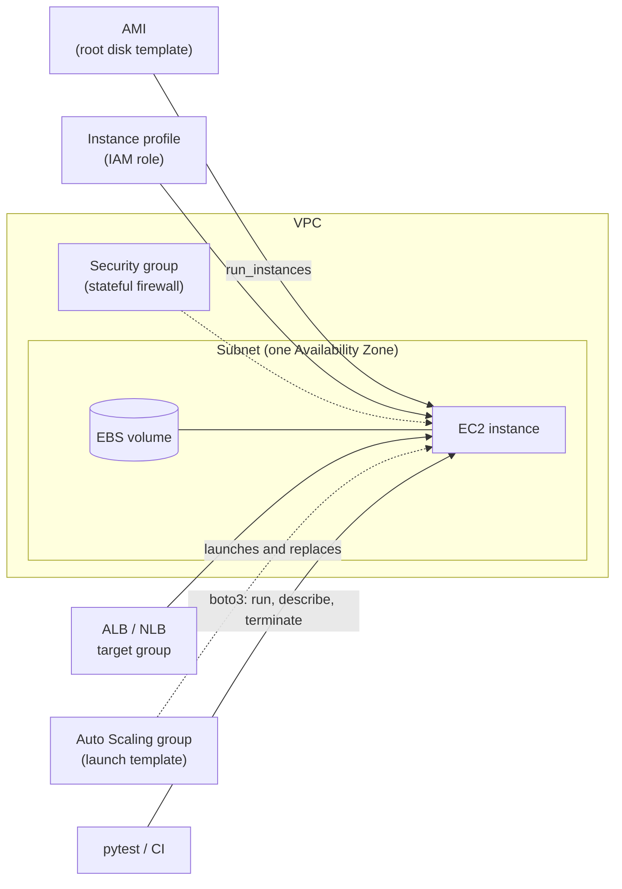

# Amazon EC2 — Instances, Networking & Testing

**Amazon Elastic Compute Cloud (EC2)** rents virtual machines by the second. You pick an **AMI** (the disk image), an **instance type** (CPU, memory, network), a **subnet** and **security groups** (where it lives and who may talk to it), and an **IAM role** (what it may call). EC2 boots the machine; everything above the hypervisor — OS patches, the application, scaling, replacement of failed machines — is yours. Many other services (ECS on EC2, EKS nodes, RDS, EMR) are EC2 under the hood.

This guide is for Python developers and QA engineers who **run, deploy to, or test against** EC2: launching and cleaning up instances from code, giving them the right network and IAM, putting them behind a load balancer, and testing all of that without surprise bills. It does not cover VPC design or multi-account architecture. Sessions, `Config`, retries, `ClientError` and the credential chain are in [AWS Foundations](../foundations/index.md) and are not repeated here. If your workload is a container, read [Amazon ECS](../ecs/index.md) first.

The examples use **boto3**, **moto** (extras `ec2`, `autoscaling`, `elbv2`, `ssm`, `iam`, `sts`, `server`), **pytest** and **pytest-xdist**.

## Where EC2 Fits



- **An instance is disposable.** Build it from an AMI plus user data, give it a role, and be ready to replace it. Anything that must survive goes on EBS, S3 or a database.
- **Networking is per instance, not per OS.** The security group is a firewall outside the VM; the subnet decides the Availability Zone and whether a public IP is possible. See [02 Networking, Security & IAM](./02-networking-security-iam.md).
- **Credentials come from the instance profile.** Code on the instance gets short-lived keys from the metadata service (IMDS), with no key files. See [02](./02-networking-security-iam.md#imdsv2-and-how-boto3-gets-credentials-on-ec2).
- **Tests** run against moto for request shape and bookkeeping, and against a tiny real instance for what an emulator cannot do (boot, user data, IAM, the metadata service). See [05 Testing](./05-testing.md).

## Section Map

| File | Topics |
|------|--------|
| [01 Core Concepts](./01-core-concepts.md) | Regions and AZ IDs, instance type names and families, Graviton (arm64) vs x86, burstable and flex, purchasing options, AMIs and SSM parameters, EBS vs instance store, IPs and ENIs, user data and cloud-init, lifecycle states and what is billed, tags, quotas and API throttling |
| [02 Networking, Security & IAM](./02-networking-security-iam.md) | Subnets, routes, NAT and VPC endpoints, security groups vs NACLs, instance profiles and `PassRole`, IMDSv2 (`HttpTokens`, hop limit, account defaults), how boto3 finds credentials on EC2, Session Manager instead of SSH, least-privilege policies, common mistakes |
| [03 boto3 in Python](./03-boto3-python.md) | Client vs resource, resolving AMIs, `run_instances` and launch templates, user data encoding, waiters, filters and pagination, start/stop/terminate, security groups, tags, Spot, error codes, `DryRun`, `ClientToken`, throttling |
| [04 Scaling, Load Balancing & Operations](./04-scaling-load-balancing-operations.md) | Auto Scaling groups, scaling policies, health checks, lifecycle hooks, instance refresh, ALB/NLB and target groups, CloudWatch metrics and alarms, Run Command and Patch Manager, Image Builder, cost control, EC2 as a CI runner or load-generator host |
| [05 Testing EC2-Based Systems](./05-testing.md) | What to test where, fixtures with fake credentials and guaranteed cleanup, request-shape tests, user-data tests, Stubber for `DryRun` and capacity errors, moto integration tests, cost guardrails |
| [06 Compliance, Credential-Path & Scaling Tests](./06-compliance-imds-scaling-tests.md) | Open-SSH, tag and IMDSv1 checks over `describe_*` output, a fake IMDS for the credential path, Auto Scaling and target-group tests, moto server mode |
| [07 moto Gaps, Smoke Tests & CI](./07-moto-gaps-smoke-ci.md) | What moto does not emulate, a real-account smoke test, GitHub Actions with OIDC, a janitor job, cost guardrails, QA checklist |

## Minimal Working Example

```python
# uv add boto3 "moto[ec2,ssm]"
import boto3
from moto import mock_aws

with mock_aws():                                              # in-process fake EC2; no account, no network
    ec2 = boto3.client("ec2", region_name="us-east-1")
    ssm = boto3.client("ssm", region_name="us-east-1")

    # Never hard-code AMI IDs: resolve the current Amazon Linux 2023 image from the public SSM parameter.
    ami = ssm.get_parameter(Name="/aws/service/ami-amazon-linux-latest/al2023-ami-kernel-default-x86_64")["Parameter"]["Value"]

    resp = ec2.run_instances(
        ImageId=ami,
        InstanceType="t3.micro",
        MinCount=1,
        MaxCount=1,
        MetadataOptions={"HttpTokens": "required"},            # IMDSv2 only
        TagSpecifications=[{"ResourceType": "instance",
                            "Tags": [{"Key": "Name", "Value": "demo"}, {"Key": "owner", "Value": "qa"}]}],
    )
    instance_id = resp["Instances"][0]["InstanceId"]
    print("launched, state in the response:", resp["Instances"][0]["State"]["Name"])

    ec2.get_waiter("instance_running").wait(InstanceIds=[instance_id])        # polls DescribeInstances until "running"

    inst = ec2.describe_instances(InstanceIds=[instance_id])["Reservations"][0]["Instances"][0]
    print("state:", inst["State"]["Name"], "| type:", inst["InstanceType"], "| tags:", {t["Key"]: t["Value"] for t in inst["Tags"]})

    ec2.terminate_instances(InstanceIds=[instance_id])
    ec2.get_waiter("instance_terminated").wait(InstanceIds=[instance_id])
    print("state after terminate:", ec2.describe_instances(InstanceIds=[instance_id])["Reservations"][0]["Instances"][0]["State"]["Name"])
```

```text
launched, state in the response: pending
state: running | type: t3.micro | tags: {'Name': 'demo', 'owner': 'qa'}
state after terminate: terminated
```

Against a real account the same code works with `mock_aws()` removed, a real AMI from SSM and credentials from the usual chain (see [Foundations](../foundations/02-credentials-iam-local-testing.md)); the instance then needs about a minute to reach `running`, and **it bills until you terminate it**.

## EC2 vs Containers vs Lambda

| | EC2 | ECS / Fargate | Lambda |
|---|-----|---------------|--------|
| You manage | OS, patching, runtime, scaling, capacity | Container image; Fargate also hides the host | Function code only |
| Start time | Tens of seconds to minutes | Seconds to a minute | Milliseconds to seconds (cold start) |
| Max run time | Unlimited | Unlimited | 15 minutes per invocation |
| Pick it for | GPUs, custom kernels or AMIs, licences tied to hosts, long-lived stateful hosts, self-hosted CI runners, load generators | Services and batch jobs packaged as images, no host management | Event handlers, glue code, spiky traffic |
| Test it with | moto for requests, a real instance for boot and IAM | [ECS guide](../ecs/index.md) | Handler unit tests, moto for triggers |

Rule of thumb: start with Lambda or Fargate; use EC2 when you need something they cannot give (hardware, OS control, long-lived hosts) or when a fleet of always-busy machines is cheaper.

## Facts That Changed Recently

Older tutorials get these wrong. As of October 2026 (AWS documentation):

| Topic | Now | Note |
|-------|-----|------|
| Amazon Linux 2023 kernel | The `kernel-default` AMIs move from 6.1 to **6.18** on **August 17, 2026** | Pin with `al2023-ami-kernel-6.1-*` SSM parameters if you need the old kernel; running instances keep their kernel |
| AL2023 on Arm | Graviton2 or later only | `A1` instances are not supported |
| Burstable family | **T8i** (Intel), T4g (Graviton2), T3a, T3; T2 is previous generation | T3, T3a, T4g and T8i launch in **unlimited** CPU-credit mode, T2 in standard |
| Free tier | Accounts created on or after **July 15, 2025**: `t3.micro`, `t3.small`, `t4g.micro`, `t4g.small`, `t8i.micro`, `t8i.small` for 6 months or until credits run out | Older accounts: `t2.micro` (or `t3.micro`) for 12 months |
| Public IPv4 addresses | Charged per hour, **in use or idle**, since February 1, 2024 | Prefer private subnets, IPv6 and VPC endpoints for test fleets |
| IMDSv2 | Account-level defaults per Region and an enforcement switch (`HttpTokensEnforced`) | Plain instances still allow IMDSv1 unless the AMI, the account default or the launch request says otherwise |
| Instance families | 8th generation (`M8g`, `C8i`, `R8i`, ...) and Graviton 9th generation (`M9g`, `C9g`, `R9g`) are current | The EC2 docs list `A1`, `M1`-`M4`, `C1`, `C3`, `C4`, `R3`, `R4`, `T1`, `I2` as previous generation |
| Quotas | vCPU-based per family group; a new account starts at **5 vCPUs** for Standard (A, C, D, H, I, M, R, T, Z) instances | EC2 raises quotas automatically with usage, or you request an increase |

## Quick Rules

1. **Tag every resource at creation** (`TagSpecifications`) with at least an owner, an environment and a run ID. Untagged instances cannot be found, billed or cleaned up.
2. **Require IMDSv2** (`MetadataOptions={"HttpTokens": "required"}`) on every instance you launch; use `HttpPutResponseHopLimit=2` only when containers on the host need the metadata service.
3. **Resolve AMIs from SSM parameters** (`resolve:ssm:/aws/service/...`) or by tag. Never paste AMI IDs: they are Region-specific and AWS-provided images are replaced regularly (each Amazon Linux 2023 release is deprecated after 90 days).
4. **No SSH keys and no `0.0.0.0/0` on port 22 or 3389.** Use Session Manager (SSM) and a role with `AmazonSSMManagedInstanceCore`.
5. **Give every instance a role (instance profile), never access keys.** Scope the role to the resources it uses.
6. **Wait with waiters and deadlines**, not `sleep`. `instance_running` is not `instance_status_ok`: the second one means the OS booted.
7. **Pass a `ClientToken` and catch `ClientError` codes.** EC2 has no modeled exception classes; `RequestLimitExceeded` and `InsufficientInstanceCapacity` need different handling.
8. **Always clean up in `finally` or fixture teardown**, keyed on a unique run tag, and run a scheduled janitor for what slips through.
9. **Use `DryRun=True`** to check permissions and parameters before an expensive launch: success is the `DryRunOperation` error.
10. **Keep a tiny real-instance smoke test** (a `t4g.nano` for minutes, in a sandbox account); moto proves requests, not boot, IAM or networking.

---
## See also
- [Digital Garden: Knowledge Base](../../index.md)
- [AWS — Service Guides for Python & Test Automation](../index.md)
- [AWS Foundations — boto3, Credentials & Local Testing](../foundations/index.md)
- [Amazon ECS — Containers on Fargate, Services & Testing](../ecs/index.md)
- [Amazon SQS — Queues, Consumers & Testing](../sqs/index.md)
- [Amazon SNS — Topics, Subscriptions & Fan-out](../sns/index.md)
- [Amazon Bedrock — Foundation Models, Converse API & Guardrails](../bedrock/index.md)
- [Docker & Docker Compose — Overview](../../tools/docker/index.md)
- [Linux Terminal — Essential Commands](../../tools/linux-terminal/index.md)
- [CI/CD](../../ci-cd-approaches/index.md)
- [Performance Testing](../../performance-testing/index.md)
- [Pytest — Python Testing Framework](../../libs/pytest/index.md)
