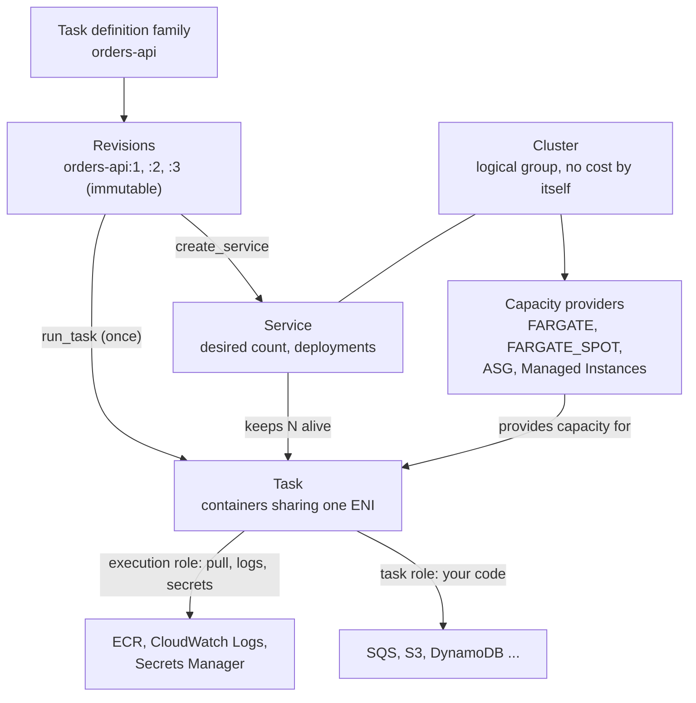

# Amazon ECS — Core Concepts

## The Object Model



| Object | What it is | Identity |
|--------|-----------|----------|
| **Cluster** | A namespace for services, tasks and capacity | Name; ARN `arn:aws:ecs:<region>:<account>:cluster/<name>` |
| **Task definition** | Versioned blueprint: containers, size, roles, logging | `family:revision`, for example `orders-api:8`; the bare family means the latest ACTIVE revision |
| **Task** | One running instantiation of a task definition (all its containers) | Task ARN `.../task/<cluster>/<id>` |
| **Service** | Scheduler that keeps `desiredCount` tasks running and rolls out new revisions | Name unique per cluster |
| **Capacity provider** | Where tasks run: `FARGATE`, `FARGATE_SPOT`, an Auto Scaling group, or ECS Managed Instances | Name |
| **Container instance** | An EC2 host registered to a cluster (EC2 capacity only) | Container instance ARN |

Task definitions are **immutable**: you cannot edit revision 3, you register revision 4. A deregistered revision becomes `INACTIVE`, stays discoverable, and cannot start new tasks (existing ones keep running). Registering and deregistering is cheap; deleting needs a deregister first (`delete_task_definitions`).

## Capacity: Launch Types vs Capacity Providers

AWS recommends **capacity providers** for placing work and keeping the launch type mainly to declare compatibility (`requiresCompatibilities`) in the task definition. A service or `run_task` call then names a **capacity provider strategy**.

| Provider | You manage | Typical use |
|----------|------------|-------------|
| `FARGATE` | Nothing: no hosts, one isolation boundary per task | Default for web services, workers, QA jobs |
| `FARGATE_SPOT` | Nothing; tasks can be interrupted with a **two-minute warning** (SIGTERM, plus a task state change event) | Interruption-tolerant batch and test jobs |
| Auto Scaling group | EC2 AMI, patching, scaling, instance types | GPUs, host access, steady high utilization; see [EC2](../ec2/index.md) |
| ECS Managed Instances | Instance type choice only; AWS provisions and patches the hosts | EC2 flexibility without running the fleet |

Strategy rules (AWS documentation):

- A strategy has at most **20** providers, **cannot mix provider types** (Fargate with Auto Scaling group), and at least one provider needs `weight` above 0 when several are listed. The API default weight is 0 (the console uses 1).
- Only **one** provider may set `base` (tasks that must run there first); the rest are split by `weight`.
- AWS requires a provider to be **associated with the cluster** before a strategy can name it: pass `capacityProviders=[...]` to `create_cluster` or call `put_cluster_capacity_providers`. `FARGATE` and `FARGATE_SPOT` are provided by ECS on every cluster (you do not create them), but a cluster created through the API still has to list them.
- `run_task` takes **either** `launchType` **or** `capacityProviderStrategy`. With neither, the cluster's default strategy applies.
- A service can change strategy later; moving from a launch type to a strategy needs a forced new deployment.

```python
# 1 task always on-demand, the rest 3:1 on Spot
strategy = [
    {"capacityProvider": "FARGATE", "base": 1, "weight": 1},
    {"capacityProvider": "FARGATE_SPOT", "weight": 3},
]
```

Fargate runs Linux on **platform version 1.4.0** (`LATEST` resolves to it; Windows has its own numbering with `LATEST` = 1.0.0). You rarely set it; a new task always lands on the newest revision of that platform version.

## Fargate Task Size

CPU and memory are set **per task** and must be one of the valid pairs. CPU is a string of CPU units (1024 = 1 vCPU); memory is MiB.

| `cpu` | vCPU | Allowed `memory` (MiB) |
|-------|------|------------------------|
| `256` | 0.25 | 512, 1024, 2048 |
| `512` | 0.5 | 1024 to 4096 in steps of 1024 |
| `1024` | 1 | 2048 to 8192 in steps of 1024 |
| `2048` | 2 | 4096 to 16384 in steps of 1024 |
| `4096` | 4 | 8192 to 30720 in steps of 1024 |
| `8192` | 8 | 16384 to 61440 in steps of 4096 (Linux, platform 1.4.0+) |
| `16384` | 16 | 32768 to 122880 in steps of 8192 (Linux, platform 1.4.0+) |

The AWS table also lists a 32 vCPU size; check it before relying on sizes above 16 vCPU. Windows tasks support only the 1, 2 and 4 vCPU rows. The unit test `test_every_documented_size_is_accepted` in the [testing guide](./05-testing.md) encodes this table.

- **Ephemeral storage** defaults to 20 GiB per task; set `ephemeralStorage={"sizeInGiB": N}` (21 to 200) for more. The image layers count against it.
- **Container-level `cpu`/`memory`** are optional on Fargate. `memory` is a hard limit (the container is killed when it exceeds it), `memoryReservation` a soft one. A container killed for memory shows exit code **137**.
- **ARM64**: `runtimePlatform={"operatingSystemFamily": "LINUX", "cpuArchitecture": "ARM64"}`. All task definitions of one service must agree on the architecture, and the image must be built for it (a mismatch usually fails at start with an exec format error).

## Task Definition Anatomy

The builder used throughout this guide (`app/taskdef.py`, excerpt) returns the keyword arguments for `register_task_definition`:

```python
def build_task_definition(family, image, *, cpu=256, memory=512, execution_role_arn, task_role_arn,
                          region="us-east-1", log_group=None, command=None, environment=None,
                          secrets=None, port=None, health_cmd=None, stop_timeout=30, arm64=False) -> dict:
    container = {
        "name": "app", "image": image, "essential": True,
        "stopTimeout": stop_timeout,                      # seconds between SIGTERM and SIGKILL (max 120 on Fargate)
        "logConfiguration": {"logDriver": "awslogs", "options": {
            "awslogs-group": log_group or f"/ecs/{family}",
            "awslogs-region": region,
            "awslogs-stream-prefix": "app"}},
    }
    # ... command, environment, secrets, portMappings, healthCheck are added when given
    return {
        "family": family,
        "requiresCompatibilities": ["FARGATE"],
        "networkMode": "awsvpc",                          # the only mode Fargate supports
        "cpu": str(cpu), "memory": str(memory),           # strings, not integers
        "executionRoleArn": execution_role_arn,           # ECS agent: pull image, write logs, fetch secrets
        "taskRoleArn": task_role_arn,                     # your code: boto3 calls inside the container
        "runtimePlatform": {"operatingSystemFamily": "LINUX", "cpuArchitecture": "ARM64" if arm64 else "X86_64"},
        "containerDefinitions": [container],
        "tags": [{"key": "managed-by", "value": "tests"}],
    }
```

| Field | Meaning | Gotcha |
|-------|---------|--------|
| `family` | Name; up to 255 letters, digits, hyphens, underscores | Each register call creates a new revision, even when nothing changed |
| `requiresCompatibilities` | `FARGATE`, `EC2`, `MANAGED_INSTANCES`, `EXTERNAL`: what ECS validates the definition against | A Fargate-compatible definition **requires** task-level `cpu` and `memory` and `awsvpc` |
| `networkMode` | `awsvpc`, `bridge`, `host`, `none`; Fargate allows only `awsvpc` | Default is `bridge` when omitted: set it explicitly |
| `cpu`, `memory` | Task size, strings | `"256"` not `256` (the botocore validator rejects integers) |
| `containerDefinitions[].essential` | If an essential container stops, **all** containers in the task are stopped. Omitted means essential | A task needs at least one essential container; mark short-lived init or sidecar helpers `false` |
| `image` | Registry path with tag or digest | Pin it; `:latest` makes revisions meaningless |
| `command`, `entryPoint` | Override the image's `CMD` and `ENTRYPOINT` | Arrays of strings, no shell parsing unless you start `sh -c` |
| `portMappings` | `containerPort` (and `name` and `appProtocol` for Service Connect) | With `awsvpc` the host port equals the container port |
| `environment` / `secrets` | Plain values / values fetched at start from Secrets Manager or SSM | Secrets are resolved **once, when the task starts** |
| `healthCheck` | `command` (`CMD` or `CMD-SHELL`), `interval` 5 to 300 (default 30), `timeout` 2 to 60 (5), `retries` 1 to 10 (3), `startPeriod` 0 to 300 (off) | Runs **inside** the container, so the image needs the tool (`curl`, `python`) |
| `dependsOn` | Start order: `START`, `COMPLETE`, `SUCCESS`, `HEALTHY` | `COMPLETE` and `SUCCESS` cannot be set on an essential container; `HEALTHY` needs a `healthCheck` |
| `startTimeout`, `stopTimeout` | Seconds to wait for a dependency / before SIGKILL | Both max 120 on Fargate; `stopTimeout` default 30 |
| `logConfiguration` | Usually `awslogs` with `awslogs-group`, `awslogs-region`, `awslogs-stream-prefix` | The log group must exist unless `awslogs-create-group` is `"true"` (and then someone needs `logs:CreateLogGroup`) |
| `user`, `readonlyRootFilesystem` | Run as non-root; read-only root filesystem | A read-only root filesystem breaks ECS Exec and any code that writes to `/tmp` unless you mount a volume |
| `linuxParameters.initProcessEnabled` | Adds a tiny init as PID 1 that reaps zombie processes | Recommended with ECS Exec |
| `ephemeralStorage` | Task-wide scratch space, 21 to 200 GiB | Image layers are stored there too |
| `tags` | Up to 50 per resource | Tag test definitions so a janitor can find them |

`awslogs` also accepts `mode` (`non-blocking` with `max-buffer-size`): with Docker log-driver semantics, the default blocking mode can stall your application's writes to stdout when CloudWatch is slow, while non-blocking mode buffers in memory and drops lines when the buffer is full.

A registered example; its container definition looks like this:

```json
{
  "name": "app",
  "image": "123456789012.dkr.ecr.us-east-1.amazonaws.com/orders:1.4.2",
  "essential": true,
  "stopTimeout": 30,
  "logConfiguration": {"logDriver": "awslogs", "options": {"awslogs-group": "/ecs/orders-api", "awslogs-region": "us-east-1", "awslogs-stream-prefix": "app"}},
  "environment": [{"name": "LOG_LEVEL", "value": "info"}],
  "secrets": [{"name": "DB_PASSWORD", "valueFrom": "arn:aws:secretsmanager:us-east-1:123456789012:secret:orders/db-AbCdEf:password::"}],
  "portMappings": [{"containerPort": 8000, "protocol": "tcp"}]
}
```

## Task Role vs Execution Role

The most common ECS permission bug: the two roles have different jobs, different principals of use and different failure symptoms.

| | **Execution role** (`executionRoleArn`) | **Task role** (`taskRoleArn`) |
|---|------------------------------------------|-------------------------------|
| Used by | The ECS container agent / Fargate agent, **before and around** your code | Your application code, through the SDK credential chain |
| Typical permissions | Pull from private ECR, write to CloudWatch Logs, read `secrets` from Secrets Manager or SSM, read an S3 config file | `sqs:ReceiveMessage`, `s3:GetObject`, `dynamodb:*Item`, `ssmmessages:*` for ECS Exec |
| Managed policy | `AmazonECSTaskExecutionRolePolicy`: `ecr:GetAuthorizationToken`, `ecr:BatchCheckLayerAvailability`, `ecr:GetDownloadUrlForLayer`, `ecr:BatchGetImage`, `logs:CreateLogStream`, `logs:PutLogEvents` | None: write a least-privilege policy per service |
| Not included by default | `secretsmanager:GetSecretValue`, `ssm:GetParameters`, `kms:Decrypt`, `logs:CreateLogGroup` | Everything |
| Trust policy principal | `ecs-tasks.amazonaws.com` | `ecs-tasks.amazonaws.com` |
| Failure symptom | Task stops before the app starts: `CannotPullContainerError`, `ResourceInitializationError` (secret or log setup), no logs at all | App starts, then `AccessDeniedException` / `AccessDenied` from boto3 inside the container |
| How code sees it | It does not | The SDK finds credentials through the container credential provider (see the chain in [Foundations](../foundations/02-credentials-iam-local-testing.md#the-credential-provider-chain), row "Container credentials") |

The trust policy for both roles names the service and, as AWS recommends, pins the account to prevent the confused-deputy problem:

```json
{
  "Version": "2012-10-17",
  "Statement": [{
    "Effect": "Allow",
    "Principal": {"Service": "ecs-tasks.amazonaws.com"},
    "Action": "sts:AssumeRole",
    "Condition": {
      "ArnLike": {"aws:SourceArn": "arn:aws:ecs:us-east-1:123456789012:*"},
      "StringEquals": {"aws:SourceAccount": "123456789012"}
    }
  }]
}
```

Rules of thumb: **one task role per service**, scoped to the queue, bucket or table it uses (policy shape in [Foundations](../foundations/02-credentials-iam-local-testing.md#iam-in-five-minutes)); a shared execution role per account is fine. On Fargate there is no instance profile, so a missing task role means **no AWS credentials in the container**. On EC2-backed capacity several tasks share a host, so containers are not a security boundary there; use Fargate when isolation matters.

## Secrets and Configuration

| Source | Task definition | Execution role needs |
|--------|-----------------|----------------------|
| Plain config | `environment: [{name, value}]` | Nothing |
| Secrets Manager | `secrets: [{name, valueFrom: "arn:aws:secretsmanager:<region>:<account>:secret:<name>-<suffix>"}]`; a JSON key can be selected by appending `:json-key::` | `secretsmanager:GetSecretValue` (plus `kms:Decrypt` for a customer managed key) |
| SSM Parameter Store | `valueFrom` is the parameter ARN or, in the same Region, its name | `ssm:GetParameters` (plus `kms:Decrypt` for SecureString with a custom key) |
| Files | `environmentFiles` from S3, or a volume | `s3:GetObject` and `s3:GetBucketLocation` |

The agent injects the value as an environment variable **once, at task start**. Rotating a secret does not change running tasks; start new ones (`forceNewDeployment`). If your code needs the live value, read it from Secrets Manager with the task role instead.

## Tasks, Services and Scheduled Tasks

| | **Standalone task** | **Service** | **Scheduled task** |
|---|---------------------|-------------|--------------------|
| Started by | `run_task` (or `start_task` on EC2) | `create_service` | EventBridge Scheduler or a rule calling `RunTask` |
| Restart on failure | No | Yes: the scheduler replaces stopped tasks | No (the next schedule tick starts a new one) |
| Load balancer | No | Yes | No |
| Ends when | Its essential container exits | Never, unless scaled to 0 or deleted | Same as a standalone task |
| Use for | Migrations, batch jobs, test harnesses | APIs, workers | Nightly reports, cleanups |

### Task lifecycle

`PROVISIONING` (network interface being created) → `PENDING` (waiting for the agent) → `ACTIVATING` (image pull, container creation, load balancer registration) → `RUNNING` → `DEACTIVATING` (deregistering from target groups) → `STOPPING` (stop signal, then SIGKILL after `stopTimeout`) → `DEPROVISIONING` (network interface detached) → `STOPPED`. Every task has `lastStatus` (what the agent reports) and `desiredStatus` (what ECS wants). Stopped tasks stay visible to `describe_tasks` for **at least one hour**.

| `stopCode` | Meaning | Read next |
|------------|---------|-----------|
| `TaskFailedToStart` | The task never ran: image pull, secret or log setup, capacity | `stoppedReason`, `containers[].reason` |
| `EssentialContainerExited` | An essential container exited; its `exitCode` says why | `containers[].exitCode` (0 normal, 1 error, 137 SIGKILL or out of memory, 143 SIGTERM) |
| `UserInitiated` | You (or your code) called `stop_task` | `stoppedReason` you passed |
| `ServiceSchedulerInitiated` | The service stopped it: scale-in, deployment, failed health check | Service events |
| `SpotInterruption` | Fargate Spot took the capacity back | Event stream |
| `TerminationNotice`, `InfrastructureHealth` | Other platform-initiated stops (see the stopped task error pages) | `stoppedReason` |

Error-message categories in `stoppedReason` include `ResourceInitializationError`, `CannotPullContainer`, `OutOfMemoryError`, `ContainerRuntimeError` and `SpotInterruptionError`. The full table is on the AWS page "Amazon ECS stopped tasks error messages". How to turn these fields into a pass or fail in Python is in [03](./03-boto3-python.md#detecting-failure).

## Networking: awsvpc

Fargate tasks always use `awsvpc`: **every task gets its own elastic network interface** in your subnet, with its own private IP and the security groups you pass. Consequences:

- Security groups apply per task, not per host. Open only the container port to the load balancer's group, and let the load balancer's group be the source: `sg-alb` to `sg-app` on 8000.
- A `networkConfiguration.awsvpcConfiguration` takes up to **16 subnets** and **5 security groups**. Spread subnets across Availability Zones.
- `assignPublicIp` is `DISABLED` by default for services. A task in a **private** subnet needs a NAT gateway or VPC endpoints (ECR API and DKR, S3 gateway, CloudWatch Logs, plus Secrets Manager or SSM and `ssmmessages` if you use them) to pull images and write logs. A task in a **public** subnet needs `ENABLED`. "Task stuck in PENDING then `CannotPullContainerError`" is nearly always this.
- Inside the task, containers share the network namespace: they reach each other on `localhost`.

## ECR Basics

**Amazon Elastic Container Registry (ECR)** stores your images. A repository URI looks like `123456789012.dkr.ecr.us-east-1.amazonaws.com/orders`.

| Topic | What to know |
|-------|--------------|
| Tags | Use immutable tags (`imageTagMutability`: `IMMUTABLE`; the model also has `MUTABLE_WITH_EXCLUSION` and `IMMUTABLE_WITH_EXCLUSION`). Tag with the Git SHA so a revision always means the same image |
| Pull permissions | Fargate pulls with the **execution role** (the managed policy above covers it) |
| Lifecycle policy | JSON rules that expire images; images that match expire within 24 hours; **preview before applying** |
| Scanning | **Basic** (OS packages, on push or manual) or **enhanced** (Amazon Inspector, OS and language packages, continuous). Read basic scan results with `describe_image_scan_findings`; switching type invalidates earlier scans |
| Non-ECR registries | A private Docker Hub or Quay image needs `repositoryCredentials` pointing at a Secrets Manager secret |

```json
{
  "rules": [{
    "rulePriority": 1,
    "description": "keep the last 30 images",
    "selection": {"tagStatus": "any", "countType": "imageCountMoreThan", "countNumber": 30},
    "action": {"type": "expire"}
  }]
}
```

Push from CI after `aws-actions/amazon-ecr-login` ([06](./06-moto-gaps-smoke-ci.md#github-actions)); locally `aws ecr get-login-password | docker login --username AWS --password-stdin <registry>`. moto stores repositories, lifecycle policy text and images but does not expire or scan anything.

## Quotas That Affect Tests and Deploys

| Quota (per Region) | Default | Adjustable |
|--------------------|---------|------------|
| Tasks per `run_task` call | 10 | No |
| Containers per task definition | 10 | No |
| Task definition size | 64 KiB | No |
| Revisions per family | 1,000,000 | No |
| Services per cluster / tasks per service | 5,000 / 5,000 | No |
| Clusters per account | 10,000 | Yes |
| Capacity providers per cluster | 20 | No |
| Subnets / security groups per `awsvpcConfiguration` | 16 / 5 | No |
| Target groups per service | 5 | No |
| Tags per resource | 50 | No |
| Tasks launched per service per minute on Fargate | 500 (125 in Regions launched after 20 May 2025) | No |
| **Fargate On-Demand vCPU** and **Fargate Spot vCPU** | **6 each** | Yes |
| Fargate On-Demand launch rate | burst 100, sustained 20 tasks per second (25 and 5 in newer Regions) | Yes |
| `run_task` `overrides` size | 8,192 characters including JSON | No |

The 6-vCPU default is the one that surprises test suites: a new account can run only **24 tasks of 0.25 vCPU at once**; further tasks fail to start (look at `failures` and `stoppedReason`). Parallel smoke tests must stay far below it, and ECS API calls are throttled by token buckets per category (for example 100 burst and 20 per second sustained for `DescribeTasks` and `ListTasks`). Quotas are listed under Amazon ECS and AWS Fargate in Service Quotas.

## Quick Rules

1. **Declare `requiresCompatibilities` and use `awsvpc`**, and give every Fargate definition a valid `cpu`/`memory` pair as strings.
2. **Use capacity providers**, not launch types, to place tasks; set a `base` of on-demand capacity if you also use Spot.
3. **Keep the two roles separate**: execution role for ECS, task role for your code, one task role per service.
4. **Pin images immutably** (Git SHA tag, immutable ECR tags) and add an ECR lifecycle policy.
5. **Mark exactly the right containers `essential`.** A crashing sidecar marked essential takes the whole task down.
6. **Resolve secrets with `secrets`**, remember they are read at start, and grant the execution role only those ARNs.
7. **Plan the path to the registry**: public subnet with a public IP, NAT, or VPC endpoints.
8. **Read `stopCode`, `stoppedReason`, `containers[].exitCode` and `containers[].reason`** together; no single field explains a stop.
9. **Count vCPU against the Fargate quota** before you parallelize tests.

---
## See also
- [Amazon ECS — Overview](./index.md)
- [Amazon ECS — Services, Deployments & Networking](./02-services-deployments-networking.md)
- [Amazon ECS — boto3 in Python](./03-boto3-python.md)
- [AWS Foundations — Credentials, IAM & Local Testing](../foundations/02-credentials-iam-local-testing.md)
- [Amazon EC2](../ec2/index.md)
- [Docker & Docker Compose](../../tools/docker/index.md)
