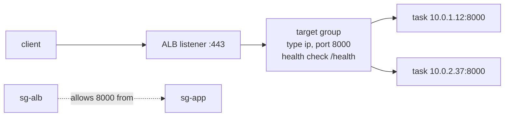

# Amazon ECS — Services, Deployments & Networking

A **service** is the scheduler that keeps a task definition running: it holds `desiredCount` tasks, replaces failed ones, registers them with a load balancer and rolls out new revisions. This page covers how a service is wired, how deployments behave and fail, how traffic reaches the tasks, how to scale them and how to look inside a running container.

## A Production-Shaped Service

```python
# moto accepts the call when the subnets and security group exist in its VPC. A real account needs your own cluster, subnets and target group.
ecs.create_service(
    cluster="prod", serviceName="orders-api", taskDefinition="orders-api:8", desiredCount=2,
    capacityProviderStrategy=[{"capacityProvider": "FARGATE", "weight": 1}],        # not launchType: see 01
    networkConfiguration={"awsvpcConfiguration": {
        "subnets": ["subnet-aaa", "subnet-bbb"],                                    # two Availability Zones
        "securityGroups": ["sg-app"], "assignPublicIp": "DISABLED"}},
    loadBalancers=[{"targetGroupArn": TARGET_GROUP_ARN, "containerName": "app", "containerPort": 8000}],
    healthCheckGracePeriodSeconds=60,                                               # ignore unhealthy results while the app boots
    deploymentConfiguration={
        "strategy": "ROLLING", "minimumHealthyPercent": 100, "maximumPercent": 200,
        "deploymentCircuitBreaker": {"enable": True, "rollback": True},             # stop and undo a failing rollout
    },
    enableExecuteCommand=True, propagateTags="SERVICE",
    tags=[{"key": "service", "value": "orders-api"}],
    clientToken="orders-api-create-2026-10-21",                                     # idempotency: up to 36 ASCII characters
)
```

| Parameter | Notes |
|-----------|-------|
| `schedulingStrategy` | `REPLICA` (default): keeps `desiredCount` tasks, spread across Availability Zones. `DAEMON`: exactly one task per active container instance; **not supported on Fargate**, needs no desired count or auto scaling |
| `desiredCount` | Required for `REPLICA`. Auto scaling may change it; do not hard-code it in IaC that re-applies |
| `deploymentController` | `ECS` (default, native strategies), `CODE_DEPLOY` (legacy blue/green through CodeDeploy), `EXTERNAL` |
| `healthCheckGracePeriodSeconds` | Default **0**. Period after a task starts during which the scheduler ignores unhealthy load balancer, VPC Lattice and container health checks. Used only when one of those checks exists |
| `availabilityZoneRebalancing` | Defaults to `ENABLED` on create; ECS moves tasks to even out zones |
| `enableExecuteCommand`, `propagateTags` | Turn on ECS Exec; copy tags from `SERVICE` or `TASK_DEFINITION` to tasks |
| `clientToken` | Makes the create call idempotent |

## Rolling Updates

With the default `ROLLING` strategy the scheduler replaces tasks in place, bounded by two percentages of `desiredCount`:

- `minimumHealthyPercent` (default **100** for replica services): the floor of tasks that must stay healthy, rounded **up**.
- `maximumPercent` (default **200**): the ceiling of RUNNING plus PENDING tasks, rounded **down**.

| `desiredCount` | min / max % | Tasks allowed during rollout | Behaviour |
|----------------|-------------|------------------------------|-----------|
| 4 | 100 / 200 | 4 to 8 | Starts up to 4 new tasks, then stops old ones: no capacity dip, double the cost briefly |
| 4 | 100 / 125 | 4 to 5 | One extra task at a time: slow, no dip |
| 4 | 50 / 100 | 2 to 4 | Stops 2 old tasks first, then starts 2 new: cheap, capacity halves for a moment |
| 1 | 100 / 200 | 1 to 2 | Always start the new task first; with `0 / 100` the service is briefly down |

A task counts as healthy when its essential containers pass their container health checks, and, with a load balancer, when the target group health check also passes. Without a load balancer and without any health check the scheduler waits 40 seconds after RUNNING before counting a task.

### Deployment circuit breaker

The circuit breaker marks a rolling deployment `FAILED` and, with `rollback: true`, returns the service to the **last `COMPLETED` deployment**.

| Setting | Meaning |
|---------|---------|
| `enable`, `rollback` | Turn the breaker on; roll back automatically |
| `thresholdConfiguration.type` | `BOUNDED_PERCENT` (default, value 50): `ceil(value/100 x desiredCount)` clamped to **3..200**; `UNBOUNDED_PERCENT`: same without bounds; `COUNT`: a fixed number |
| `resetOnHealthyTask` | Default `true`: only consecutive failures count; `false`: failures accumulate for the whole deployment |

| Desired count | Default threshold (50 percent, clamped 3 to 200) |
|---------------|-----------------------------------------------|
| 1 | 3 |
| 25 | 13 |
| 400 | 200 |

Two stages are checked. **Stage 1**: tasks that never reach `RUNNING` (image pull failure, crash at start) add one failure each. **Stage 2** (once at least one task runs): tasks replaced because the load balancer, Cloud Map or container health check failed add one each. Facts that matter to tests:

- The breaker needs the **`ECS` deployment controller**; it is not available with `CODE_DEPLOY` or `EXTERNAL`. The blue/green, linear and canary strategies add CloudWatch alarms and lifecycle hooks as further rollback triggers.
- `describe_services` shows `deployments[].rolloutState` (`IN_PROGRESS`, `COMPLETED`, `FAILED`) and `rolloutStateReason`. A `FAILED` deployment launches no new tasks.
- If there is no earlier `COMPLETED` deployment, there is nothing to roll back to and the deployment stalls: the first failing deployment of a brand-new service cannot roll back.
- **`services_stable` also succeeds after a rollback**, because the service is stable on the old revision. Always compare `service["taskDefinition"]` with what you deployed ([06](./06-moto-gaps-smoke-ci.md#deploy-then-verify)).
- ECS emits a service deployment state change event; alarm on `SERVICE_DEPLOYMENT_FAILED` in EventBridge.

## Blue/Green, Linear and Canary

`deploymentConfiguration.strategy` accepts `ROLLING`, `BLUE_GREEN`, `LINEAR` and `CANARY` with the `ECS` controller; CodeDeploy is no longer required. All three new strategies run the new revision (green) next to the current one (blue) and shift traffic between them.

| Strategy | Traffic | Strategy-specific settings |
|----------|---------|----------------------------|
| `BLUE_GREEN` | All at once after validation | `bakeTimeInMinutes` (**required**): both revisions run after the shift, so you can roll back instantly |
| `LINEAR` | Equal steps | `linearConfiguration.stepPercent` (3.0 to 100.0, default 10), `stepBakeTimeInMinutes` |
| `CANARY` | A small slice, then the rest | `canaryConfiguration.canaryPercent` (0.1 to 100.0, default 5), `canaryBakeTimeInMinutes` |

Common pieces: `alarms` (`alarmNames`, `enable`, `rollback`) for CloudWatch-alarm rollback; `lifecycleHooks` that call a Lambda function (or `PAUSE` for manual approval) at stages such as `PRE_SCALE_UP`, `POST_SCALE_UP`, `TEST_TRAFFIC_SHIFT`, `POST_TEST_TRAFFIC_SHIFT`, `PRODUCTION_TRAFFIC_SHIFT`, `POST_PRODUCTION_TRAFFIC_SHIFT`; and `StopServiceDeployment` (`ROLLBACK`) or `ContinueServiceDeployment` to act on a deployment paused at a hook. Managed traffic shifting needs a load balancer (ALB or NLB, with an alternate target group and listener rule in `loadBalancers[].advancedConfiguration`) or Service Connect.

```python
# Canary: 10 percent for 5 minutes, then the rest, with alarm-based rollback.
deploymentConfiguration = {
    "strategy": "CANARY",
    "canaryConfiguration": {"canaryPercent": 10.0, "canaryBakeTimeInMinutes": 5},
    "bakeTimeInMinutes": 10,
    "alarms": {"alarmNames": ["orders-api-5xx"], "enable": True, "rollback": True},
}
loadBalancers = [{
    "targetGroupArn": BLUE_TG, "containerName": "app", "containerPort": 8000,
    "advancedConfiguration": {
        "alternateTargetGroupArn": GREEN_TG,
        "productionListenerRule": LISTENER_RULE_ARN,       # the rule ECS rewires to shift traffic
        "roleArn": "arn:aws:iam::123456789012:role/ecs-infrastructure-lb",   # lets ECS call Elastic Load Balancing
    },
}]
```

Use rolling with the circuit breaker for most internal services; use canary or linear when a bad release must reach few users first and you have alarms that mean something. `describe_service_deployments` and `list_service_deployments` give a per-deployment view (`status` such as `IN_PROGRESS`, `SUCCESSFUL`, `ROLLBACK_SUCCESSFUL`); moto does not implement them ([06](./06-moto-gaps-smoke-ci.md#what-moto-does-not-emulate)).

## Load Balancer Wiring



| Piece | Rule |
|-------|------|
| Target type | **`ip`** for `awsvpc` (every task has its own IP); the service registers and deregisters tasks itself |
| `loadBalancers[]` | `targetGroupArn`, `containerName` and `containerPort` must match a container and port mapping in the task definition; up to 5 target groups per service |
| Health check path | A cheap, dependency-free `/health` that returns 200. Do not make it call the database or a downstream service on every probe |
| Grace period | Set `healthCheckGracePeriodSeconds` above your slowest start (migrations, model load, warm-up). Too small: the breaker sees "unhealthy" and replaces tasks that were only booting. Too large: real failures are tolerated for that long |
| Two health checks | The ALB target group check decides routing; the container `healthCheck` (inside the task) decides task health. With both defined the scheduler waits for both |
| Stopping | The task is deregistered from the target group (`DEACTIVATING`), then the containers get SIGTERM (`STOPPING`). Keep the app serving until SIGTERM and finish in-flight requests ([04](./04-python-workload-patterns.md#graceful-shutdown)) |
| Security groups | Allow the container port from the load balancer's security group to the task's security group only |

## Service Discovery and Service Connect

| | **Service Connect** | **Cloud Map service discovery** (`serviceRegistries`) |
|---|---------------------|--------------------------------------------------------|
| Mechanism | ECS-managed proxy sidecar in each task; clients call a short name and port (`http://orders:8000`) | DNS records (or API discovery) pointing at task IPs |
| Load balancing, retries | In the proxy: round-robin with outlier detection, connection metrics | DNS round-robin; your client does the rest |
| Configure | `serviceConnectConfiguration`: `namespace`, `services[]` with `portName`, `clientAliases` (`port`, `dnsName`); the container's `portMappings[].name` must match `portName` | `serviceRegistries[]`: `registryArn`, optionally `port` and container |
| Scope | Services in the same namespace; clients outside it cannot resolve the names | Anything that can query the namespace's DNS |
| Limit | Needs a Cloud Map namespace in the same Region | 1,000 tasks per service (Cloud Map instance quota) |

No additional charge applies for Service Connect itself; you pay for the CPU and memory the proxy uses inside your task. Use a load balancer for traffic from outside ECS and Service Connect for service-to-service calls between ECS services.

## Auto Scaling

ECS service auto scaling is **Application Auto Scaling**: register the service's desired count as a scalable target, then attach policies.

```python
aas = boto3.client("application-autoscaling")
resource = "service/prod/orders-api"                               # service/<cluster>/<service>
aas.register_scalable_target(ServiceNamespace="ecs", ResourceId=resource,
                             ScalableDimension="ecs:service:DesiredCount", MinCapacity=2, MaxCapacity=10)

aas.put_scaling_policy(                                            # keep average CPU near 60 percent
    PolicyName="cpu60", ServiceNamespace="ecs", ResourceId=resource, ScalableDimension="ecs:service:DesiredCount",
    PolicyType="TargetTrackingScaling",
    TargetTrackingScalingPolicyConfiguration={
        "TargetValue": 60.0, "ScaleOutCooldown": 60, "ScaleInCooldown": 120,
        "PredefinedMetricSpecification": {"PredefinedMetricType": "ECSServiceAverageCPUUtilization"}})
```

| Policy metric | Use for |
|---------------|---------|
| `ECSServiceAverageCPUUtilization`, `ECSServiceAverageMemoryUtilization` | CPU- or memory-bound services (the model also lists `...HighResolution` variants) |
| `ALBRequestCountPerTarget` (needs `ResourceLabel`: `app/<lb>/<id>/targetgroup/<tg>/<id>`) | Web APIs where request rate drives load |
| Custom metric math | Queue workers: backlog per task |

**Queue workers** scale on backlog per task, not queue length. AWS's documented recipe divides `ApproximateNumberOfMessagesVisible` (`AWS/SQS`, `Sum`) by `RunningTaskCount` (`ECS/ContainerInsights`, `Average`, which needs Container Insights on the cluster):

```python
aas.put_scaling_policy(
    PolicyName="sqs-backlog", ServiceNamespace="ecs", ResourceId=resource, ScalableDimension="ecs:service:DesiredCount",
    PolicyType="TargetTrackingScaling",
    TargetTrackingScalingPolicyConfiguration={"TargetValue": 100.0,        # acceptable messages per task
        "CustomizedMetricSpecification": {"Metrics": [
            {"Id": "m1", "Label": "queue depth", "ReturnData": False, "MetricStat": {"Stat": "Sum", "Metric": {
                "Namespace": "AWS/SQS", "MetricName": "ApproximateNumberOfMessagesVisible",
                "Dimensions": [{"Name": "QueueName", "Value": "orders"}]}}},
            {"Id": "m2", "Label": "running tasks", "ReturnData": False, "MetricStat": {"Stat": "Average", "Metric": {
                "Namespace": "ECS/ContainerInsights", "MetricName": "RunningTaskCount",
                "Dimensions": [{"Name": "ClusterName", "Value": "prod"}, {"Name": "ServiceName", "Value": "orders-api"}]}}},
            {"Id": "e1", "Label": "backlog per task", "Expression": "m1 / m2", "ReturnData": True}]}})
```

moto's Application Auto Scaling accepts both policies but does not scale anything. The target value is `acceptable latency / seconds per message`: 10 s and 0.1 s give 100 messages per task, the same arithmetic as in [SQS: Scaling Consumers](../sqs/04-lambda-scaling-integrations.md#scaling-consumers).

- Scale-in is **suspended while a deployment runs**; scale-out continues. Set `MinCapacity=0` for scale to zero (the first scale-out then waits for one data point).
- A task stopped by scale-in gets SIGTERM; messages it was handling return after the visibility timeout. For long jobs use **task scale-in protection** ([04](./04-python-workload-patterns.md#task-scale-in-protection)).
- Auto scaling can overwrite the `desiredCount` set by IaC or `update_service`; manage it in one place.

## Scheduled Tasks

Use **EventBridge Scheduler** to call `RunTask` on a schedule. The schedule target is the **cluster ARN** plus the task parameters; its role needs `ecs:RunTask` and `iam:PassRole` for the task and execution roles.

```python
scheduler = boto3.client("scheduler")
scheduler.create_schedule(
    Name="nightly-report", ScheduleExpression="cron(0 2 * * ? *)", ScheduleExpressionTimezone="UTC",
    FlexibleTimeWindow={"Mode": "OFF"},
    Target={
        "Arn": "arn:aws:ecs:us-east-1:123456789012:cluster/prod",                 # the cluster, not the task definition
        "RoleArn": "arn:aws:iam::123456789012:role/scheduler-run-ecs-task",
        "EcsParameters": {
            "TaskDefinitionArn": "arn:aws:ecs:us-east-1:123456789012:task-definition/report-job:5",
            "TaskCount": 1,
            "CapacityProviderStrategy": [{"capacityProvider": "FARGATE", "weight": 1}],
            "NetworkConfiguration": {"awsvpcConfiguration": {"Subnets": ["subnet-1"], "SecurityGroups": ["sg-1"], "AssignPublicIp": "DISABLED"}},
            "PropagateTags": "TASK_DEFINITION",
        },
        "RetryPolicy": {"MaximumRetryAttempts": 2, "MaximumEventAgeInSeconds": 3600},
    },
)
```

moto validates and stores the schedule but nothing fires. A scheduled task is a normal standalone task: no restart on failure, so alarm on a non-zero exit code or on a missing run (EventBridge rules on `ECS Task State Change` with `stopCode` work for that). Pin `report-job:5`, not the bare family, so a new revision is a deliberate change.

## ECS Exec

ECS Exec opens a shell or runs a command in a running container through AWS Systems Manager Session Manager, with no open inbound port and no SSH keys. Use it for debugging; audit it with CloudTrail (`ExecuteCommand`) and optional session logging.

| Requirement | Detail |
|-------------|--------|
| Turn it on | `enableExecuteCommand=True` on `create_service`, `update_service`, `run_task` or `start_task`. **Existing tasks are not changed**: force a new deployment |
| Task role | `ssmmessages:CreateControlChannel`, `CreateDataChannel`, `OpenControlChannel`, `OpenDataChannel` (plus log or KMS permissions if you log sessions) |
| Network | Reach the `ssmmessages` endpoint: internet/NAT or an interface VPC endpoint |
| Container | Writable root filesystem (`readonlyRootFilesystem` is unsupported); commands run as **root**; add `linuxParameters.initProcessEnabled` to avoid zombie processes |
| Client | AWS CLI with the Session Manager plugin; idle timeout 20 minutes; not supported on IPv6-only tasks |
| Who may run it | IAM `ecs:ExecuteCommand`, restrictable by cluster, task, container name and tags; deny `ssm:StartSession` on tasks so nobody bypasses the audit trail |

```bash
# Is the agent ready? lastStatus must be RUNNING.
aws ecs describe-tasks --cluster prod --tasks <task-id> \
  --query 'tasks[0].containers[].managedAgents[?name==`ExecuteCommandAgent`].lastStatus'
aws ecs execute-command --cluster prod --task <task-id> --container app --interactive --command "/bin/sh"
```

```python
# boto3 returns session details for the Session Manager plugin; there is no output stream to read in Python.
session = ecs.execute_command(cluster="prod", task=task_arn, container="app", interactive=True, command="/bin/sh")["session"]
# keys: sessionId, streamUrl, tokenValue
```

Prefer non-interactive checks in automation (`--command "python -c ..."`) and keep the interactive shell for humans. moto does not implement `execute_command`.

## Logs and Metrics

| Signal | Where | Notes |
|--------|-------|-------|
| Container stdout and stderr | CloudWatch Logs through `awslogs`: group `/ecs/<family>`, stream `<prefix>/<container>/<task-id>` | Set retention on the group; log JSON lines; log the task ID and version |
| Service events | `describe_services()["services"][0]["events"]` | Human-readable: "unable to place a task", "has reached a steady state", "task failed ELB health checks" |
| Task and deployment events | EventBridge: `ECS Task State Change`, and service deployment state change events (event name `SERVICE_DEPLOYMENT_FAILED`) | Event-driven alternative to polling; task events carry `stopCode` and Spot interruptions |
| CPU and memory | `AWS/ECS` metrics `CPUUtilization`, `MemoryUtilization` per service and cluster | One-minute resolution; the signals auto scaling uses |
| Task-level detail | **Container Insights**: cluster setting `containerInsights` = `enabled` or `enhanced` (`disabled` default); metrics in `ECS/ContainerInsights` such as `RunningTaskCount` | Needed for queue-backlog scaling; CloudWatch charges apply |
| From inside the task | Task metadata endpoint v4 (`ECS_CONTAINER_METADATA_URI_V4`) | Task ARN, ephemeral storage use; avoids calling `DescribeTasks` from every task |

```python
ecs.update_cluster_settings(cluster="prod", settings=[{"name": "containerInsights", "value": "enhanced"}])
```

## Quick Rules

1. **Use two subnets in two zones, one security group per tier**, and let the load balancer's group be the only source for the app port.
2. **Set `healthCheckGracePeriodSeconds`** above your start-up time and keep `/health` cheap.
3. **Enable the circuit breaker with rollback** on every rolling service, and confirm the live revision after `services_stable`.
4. **Choose `minimumHealthyPercent`/`maximumPercent` on purpose**: 100/200 for no dip, 50/100 for cost, and remember a single-task service needs surge room.
5. **Use canary or linear only with alarms and bake times you trust**; they need a load balancer or Service Connect.
6. **Scale queue workers on backlog per task**, set `MinCapacity` deliberately and protect long jobs from scale-in.
7. **Pin the task definition revision in schedules** and alarm on failed runs.
8. **Enable ECS Exec per service, restrict it by IAM, and deny `ssm:StartSession`.**
9. **Send logs to CloudWatch with retention** and react to EventBridge deployment events instead of polling blindly.

---
## See also
- [Amazon ECS — Overview](./index.md)
- [Amazon ECS — Core Concepts](./01-core-concepts.md)
- [Amazon ECS — boto3 in Python](./03-boto3-python.md)
- [Amazon ECS — Patterns for Python Workloads](./04-python-workload-patterns.md)
- [Amazon SQS — Lambda, Scaling & Integrations](../sqs/04-lambda-scaling-integrations.md)
- [Docker & Docker Compose](../../tools/docker/index.md)
- [Kubernetes — Services & Networking](../../tools/kubernetes/03-services-networking.md)
