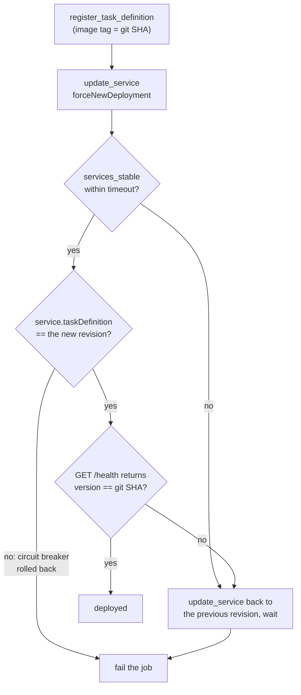

# Amazon ECS — moto Gaps, Smoke Tests & CI

[05 Testing ECS-Based Systems](./05-testing.md) shows what moto does well. This page is about its limits and what to use instead: a catalogue of the differences, a real-account Fargate smoke test, GitHub Actions with OIDC, a deploy-then-verify pipeline with rollback, pitfalls and a QA checklist.

## What moto Does Not Emulate

moto's ECS backend is a **bookkeeper**: it stores clusters, task definitions, services and tasks and returns plausible JSON. It never runs a container, never schedules a service's tasks, and is lenient where ECS is strict. Pin these gaps in a small test module (see below): if one of those tests fails after an upgrade, moto improved, so update the test and your expectations. The "real ECS" column is from the AWS documentation and the botocore model.

| Area | moto | Real ECS (documented) |
|------|------------|-----------------------|
| Task definition validation | Accepts `cpu 256 / memory 4096`, Fargate with `bridge`, `stopTimeout 500`, a `latest` image, plaintext secrets, a family with a space | Size table, `awsvpc` for Fargate, `stopTimeout` at most 120, family naming and more are enforced. Use `validate_task_definition` ([05](./05-testing.md#validating-task-definitions)) |
| `run_task` on Fargate without container-level `memory` | **Crashes**: `TypeError` in-process, HTTP 500 on the server | Container-level memory is optional on Fargate |
| `securityGroups` in `awsvpcConfiguration` | Required: `KeyError` | Optional: the VPC's default group is used |
| `count` and `clientToken` | `count=11` starts 11 tasks; the same `clientToken` twice starts two tasks | At most 10 per call; the token makes the call idempotent |
| Unknown task in `describe_tasks` | `tasks: []`, `failures: []` | `failures: [{"reason": "MISSING"}]` (the waiters rely on it) |
| `stop_task` of an unknown task | A bare `Exception` ("Could not find task" or "has no registered tasks") | An ECS error response, not a Python `Exception` from the server |
| Services | `create_service` records the service; **no task is ever started**: `runningCount` 0, `pendingCount` = desired, `list_tasks` empty, `services_stable` cannot succeed | The scheduler places and replaces tasks |
| `deploymentConfiguration`, `healthCheckGracePeriodSeconds`, `enableExecuteCommand` | Accepted, **not returned** by `describe_services` | Returned as configured |
| `forceNewDeployment` | One `PRIMARY` deployment, no draining `ACTIVE` one, no rollout states | A new deployment with rollout state transitions and a circuit breaker |
| `INACTIVE` task definitions | Can still run tasks and create services | Cannot start new tasks (up to a short propagation window) |
| Task fields | `lastStatus` advances one state per `describe_tasks`; `desiredStatus` stays `RUNNING`; no `stopCode`, `stoppedAt`, `cpu`, `memory`, `platformVersion`; every container has `exitCode: 0` and `lastStatus: PENDING` | Real status, stop code, exit codes, resource fields |
| Containers, images, roles, logs | Never pulled, started or assumed: an image on a nonexistent registry and missing IAM roles "run"; no log group or stream appears | Image pull, role assumption, `awslogs` delivery |
| Tags | `propagateTags` does not copy tags; creating a cluster again **replaces** it and drops its tags | Tags propagate; create is idempotent |
| Pagination | `maxResults` ignored by `list_clusters`, `list_tasks` and `list_services` (everything in one page, no `nextToken`) | Pages of at most `maxResults` with a token |
| `delete_cluster` | Succeeds with active services and running tasks | `ClusterContainsServicesException` / `ClusterContainsTasksException` |
| EC2 launch type, empty cluster | A bare `Exception` ("No instances found in cluster") | HTTP 200 with `failures` (`RESOURCE:*`, `AGENT`, `ATTRIBUTE`, ...) |
| Newer APIs | `execute_command`, `describe_service_deployments`, `stop_service_deployment`, `create_express_gateway_service`: `NotImplementedError` (HTTP 500 in server mode) | Implemented |
| Managed Instances capacity provider | `TypeError` for `managedInstancesProvider`; `describe_capacity_providers` of `FARGATE` returns a `MISSING` failure | Supported provider types, built-in Fargate providers |
| Quotas and metrics | 200 tasks of 0.25 vCPU start without a failure (a new account allows 24); `cloudwatch.list_metrics()` is empty | 6 vCPU default Fargate quota; `AWS/ECS` and Container Insights metrics |
| IAM enforcement, load balancer registration and health, auto scaling effects, Service Connect, EventBridge task and deployment events, Spot interruptions, ECS Exec, circuit breaker | Not emulated | Enforced and observable |

What moto **does** match: cluster, task definition and service CRUD with the right `ACTIVE`/`INACTIVE` states and revision numbering, the modeled `ClusterNotFoundException`, `ServiceNotFoundException` and `InvalidParameterException` for the common mistakes (`awsvpc` without a network configuration, `launchType` plus a strategy, deleting a scaled service), `describe_services` returning a `MISSING` failure for an unknown service, `startedBy` and tag filters, `FARGATE_SPOT` strategies, and the **task lifecycle names**.

```python
# tests/test_moto_gaps.py (excerpt)
def test_run_task_crashes_when_no_container_has_memory(ecs, cluster, network, unique):
    family = unique("nomem")
    ecs.register_task_definition(family=family, requiresCompatibilities=["FARGATE"], networkMode="awsvpc", cpu="256", memory="512", containerDefinitions=PLAIN)
    with pytest.raises(TypeError):                                                    # moto sums container-level memory; Fargate does not need it
        ecs.run_task(cluster=cluster, taskDefinition=family, launchType="FARGATE", networkConfiguration=awsvpc(network))


def test_services_never_start_tasks(ecs, cluster, taskdef, network):
    ecs.create_service(cluster=cluster, serviceName="api", taskDefinition=taskdef, desiredCount=2, launchType="FARGATE", networkConfiguration=awsvpc(network))
    svc = ecs.describe_services(cluster=cluster, services=["api"])["services"][0]
    assert (svc["desiredCount"], svc["runningCount"], svc["pendingCount"]) == (2, 0, 2)
    assert ecs.list_tasks(cluster=cluster)["taskArns"] == []
    with pytest.raises(WaiterError, match="Max attempts"):                            # services_stable can never succeed
        ecs.get_waiter("services_stable").wait(cluster=cluster, services=["api"], WaiterConfig={"Delay": 0, "MaxAttempts": 2})


def test_task_state_is_thin(ecs, cluster, taskdef, network):
    arn = ecs.run_task(cluster=cluster, taskDefinition=taskdef, launchType="FARGATE", networkConfiguration=awsvpc(network))["tasks"][0]["taskArn"]
    for _ in range(5):
        task = ecs.describe_tasks(cluster=cluster, tasks=[arn])["tasks"][0]
    assert task["lastStatus"] == "STOPPED" and task["desiredStatus"] == "RUNNING"     # desiredStatus is never updated
    assert task["containers"][0]["exitCode"] == 0                                      # every task "succeeds"
```

Whatever in that table matters to you (exit codes, image pulls, IAM, networking, rollouts, scaling, quotas) belongs in the Stubber tests for the **handling code** and in the smoke test for the **real thing**.

## Alternatives to moto

| Tool | Use | Notes |
|------|-----|-------|
| `Stubber` | Scripted responses and errors, exact request checks | No behaviour, no state; the right tool for exit codes and `failures` |
| Local container run | `docker run` / Compose: the image, SIGTERM, health check, environment | Proves the container, not the ECS configuration |
| **LocalStack** and similar emulators | Another ECS emulation with its own gaps | Check the licence, account requirement and ECS coverage of the **current** version before relying on it |
| ECS Local Container Endpoints | Emulates the task metadata and credentials endpoints for a local container | An AWS-provided project |
| **Real account** | The only proof of IAM, networking, image pulls, deployments, scaling and quotas | Sandbox account, unique names, tags, cleanup |

## Real-Account Smoke Test

One small marked test that registers a throwaway task definition, runs a tiny Fargate task, checks the **exit code** for success and for failure, and always cleans up. It is skipped unless `RUN_AWS_SMOKE=1`. It needs a sandbox cluster with `FARGATE` associated (`capacityProviders=["FARGATE"]`), a network (passed in as environment variables) and an execution role; `assign_public_ip="ENABLED"` assumes public subnets (use a NAT gateway or VPC endpoints and `DISABLED` otherwise).

```python
# tests/smoke/test_ecs_smoke.py (excerpt)
pytestmark = [pytest.mark.aws_smoke, pytest.mark.skipif(os.environ.get("RUN_AWS_SMOKE") != "1", reason="set RUN_AWS_SMOKE=1 in the sandbox account")]
TAGS = {"purpose": "smoke", "owner": "qa-automation"}

@pytest.fixture
def taskdef(ecs, cfg):
    family = f"smoke-{uuid.uuid4().hex[:8]}"                      # unique: never reuse a fixed name
    td = build_task_definition(family, "public.ecr.aws/docker/library/busybox:1.37", cpu=256, memory=512,
                               execution_role_arn=cfg["execution_role"], task_role_arn=cfg["execution_role"], log_group="/ecs/smoke")
    td["containerDefinitions"][0].update(entryPoint=["sh", "-c"], memory=256)
    td["tags"] = [{"key": k, "value": v} for k, v in TAGS.items()]
    arn = ecs.register_task_definition(**td)["taskDefinition"]["taskDefinitionArn"]
    try:
        yield arn
    finally:
        ecs.deregister_task_definition(taskDefinition=arn)
        ecs.delete_task_definitions(taskDefinitions=[arn])       # deregister first; deletion needs an INACTIVE revision

def test_task_runs_and_exits_zero(ecs, cfg, taskdef):
    assert run(ecs, cfg, taskdef, "echo smoke-ok").ok

def test_nonzero_exit_code_is_reported(ecs, cfg, taskdef):
    with pytest.raises(TaskFailedError) as ei:
        run(ecs, cfg, taskdef, "exit 3")
    assert ei.value.result.exit_codes == {"app": 3}
```

`run_and_wait` (a 300-second timeout here) stops the task if it hangs. The pair of tests is a deliberate check of the **result handling**: the same code that passed against Stubber must see real exit codes from real ECS.

To see why a smoke test is still needed, the file was also executed against moto (with the environment variables filled from moto's default VPC): **the first test passes and the second fails**, because moto reports exit code 0 for every task and `TaskFailedError` is never raised. That failure is what moto cannot give you.

Extend the smoke job with the checks only a real cluster can make:

| Check | How |
|-------|-----|
| Image pull and roles | The tiny task above exits 0 only if the execution role and network work |
| Logs delivered | `logs.filter_log_events` on `/ecs/smoke`, stream prefix `app/app/<task-id>`, for the marker you echoed |
| Task role permissions | A task that calls `sts.get_caller_identity` and one denied action, assert `AccessDenied` for the denied one |
| Service rollout | Create a one-task service from the smoke definition, `services_stable`, then deploy a deliberately failing revision and assert the **circuit breaker rolls back** (`rolloutState`, live revision) |
| Quota and cost | Keep tasks at 0.25 vCPU and the count low; the default Fargate quota is 6 vCPU per Region |

### Cleanup: a janitor

`finally` blocks do not run when a runner is killed. Tag everything and sweep:

```python
# app/janitor.py (excerpt)
def stop_leftover_tasks(ecs, cluster: str, started_by: str = "qa-harness") -> list[str]:
    arns = [a for page in ecs.get_paginator("list_tasks").paginate(cluster=cluster, startedBy=started_by) for a in page["taskArns"]]
    for arn in arns:
        ecs.stop_task(cluster=cluster, task=arn, reason="janitor: leftover from a test run")
    return arns

def delete_task_definitions(ecs, family_prefix: str = "smoke-") -> int:
    families = [f for page in ecs.get_paginator("list_task_definition_families").paginate(familyPrefix=family_prefix, status="ACTIVE") for f in page["families"]]
    arns = [a for fam in families                                      # list_task_definitions wants the FULL family name, not a prefix
            for page in ecs.get_paginator("list_task_definitions").paginate(familyPrefix=fam, status="ACTIVE") for a in page["taskDefinitionArns"]]
    for arn in arns:
        ecs.deregister_task_definition(taskDefinition=arn)
    for i in range(0, len(arns), 10):                                  # delete_task_definitions takes up to 10 INACTIVE revisions
        ecs.delete_task_definitions(taskDefinitions=arns[i:i + 10])
    return len(arns)
```

Both functions can be tested against moto. Run the janitor on a schedule in the sandbox account, and set a budget alarm on it. `list_task_definitions(familyPrefix=...)` needs the **full family name**; use `list_task_definition_families` for prefix matching.

## GitHub Actions

Moto and Stubber tests need no AWS access. The image build and deploy jobs use short-lived credentials from OIDC ([Foundations](../foundations/02-credentials-iam-local-testing.md#the-credential-provider-chain) explains why): the job's identity token is exchanged for an IAM role session, so no access key is stored.

```yaml
# .github/workflows/ecs.yml
name: ecs
on:
  push:
    branches: [main]
  pull_request:

permissions:
  contents: read

jobs:
  tests:                                         # unit, Stubber, moto, container tests: no AWS credentials
    runs-on: ubuntu-latest
    steps:
      - uses: actions/checkout@v4
      - uses: astral-sh/setup-uv@v4
      - run: uv sync --locked
      - run: docker pull python:3.13-slim-bookworm            # the SIGTERM tests skip themselves when this image is missing
      - run: uv run pytest -n 4 -m "not aws_smoke"          # includes the Docker tests: Docker is available on ubuntu-latest

  deploy:
    if: github.ref == 'refs/heads/main'
    needs: tests
    runs-on: ubuntu-latest
    environment: staging
    permissions:
      id-token: write                             # lets the job request an OIDC token
      contents: read
    env:
      AWS_REGION: us-east-1
      CLUSTER: staging
      HEALTH_URL: https://staging.example.com/health
      EXECUTION_ROLE_ARN: arn:aws:iam::123456789012:role/ecsTaskExecutionRole     # placeholders
      TASK_ROLE_ARN: arn:aws:iam::123456789012:role/orders-task
    steps:
      - uses: actions/checkout@v4
      - uses: aws-actions/configure-aws-credentials@v6
        with:
          role-to-assume: arn:aws:iam::123456789012:role/github-ecs-deploy
          aws-region: ${{ env.AWS_REGION }}
      - id: ecr
        uses: aws-actions/amazon-ecr-login@v2         # outputs the registry host
      - name: Build and push (immutable tag = commit SHA)
        run: |
          IMAGE="${{ steps.ecr.outputs.registry }}/orders:${{ github.sha }}"
          docker build -t "$IMAGE" .
          docker push "$IMAGE"
          echo "IMAGE=$IMAGE" >> "$GITHUB_ENV"
      - uses: astral-sh/setup-uv@v4
      - run: uv sync --locked
      - name: Register, deploy, verify, roll back on failure
        run: uv run python -m scripts.deploy
      - name: Smoke test (real Fargate task)
        run: RUN_AWS_SMOKE=1 uv run pytest tests/smoke -m aws_smoke
        env:
          SMOKE_CLUSTER: ${{ env.CLUSTER }}
          SMOKE_SUBNETS: ${{ vars.SMOKE_SUBNETS }}
          SMOKE_SECURITY_GROUPS: ${{ vars.SMOKE_SECURITY_GROUPS }}
          SMOKE_EXECUTION_ROLE_ARN: ${{ env.EXECUTION_ROLE_ARN }}
```

The role `github-ecs-deploy` trusts GitHub's OIDC provider and only your repository and branch:

```json
{
  "Version": "2012-10-17",
  "Statement": [{
    "Effect": "Allow",
    "Principal": {"Federated": "arn:aws:iam::123456789012:oidc-provider/token.actions.githubusercontent.com"},
    "Action": "sts:AssumeRoleWithWebIdentity",
    "Condition": {
      "StringEquals": {"token.actions.githubusercontent.com:aud": "sts.amazonaws.com"},
      "StringLike": {"token.actions.githubusercontent.com:sub": "repo:your-org/your-repo:ref:refs/heads/main"}
    }
  }]
}
```

Its permissions policy needs (review and narrow to your ARNs): the ECR push actions on the one repository (`ecr:GetAuthorizationToken` on `*`, plus `BatchCheckLayerAvailability`, `InitiateLayerUpload`, `UploadLayerPart`, `CompleteLayerUpload`, `PutImage`); `ecs:RegisterTaskDefinition`, `ecs:DescribeServices`, `ecs:UpdateService`, `ecs:DescribeTaskDefinition`, `ecs:RunTask`, `ecs:StopTask`, `ecs:DescribeTasks`; and **`iam:PassRole` on the execution and task roles** (`Condition: iam:PassedToService = ecs-tasks.amazonaws.com`). A missing `iam:PassRole` is a common cause of `AccessDeniedException` when registering a task definition or updating a service. For workflows beyond this one see [CI/CD approaches](../../ci-cd-approaches/index.md).

## Deploy-then-Verify

"The API call returned" is not "the new version is serving". The pipeline registers a revision, updates the service, waits, then checks **three things**: the service is stable **on the new revision**, the endpoint reports the **new version**, and otherwise it **rolls back**.



```python
# app/deploy.py (the core)
def deploy_and_verify(ecs, *, cluster, service, task_definition_arn, health_check, timeout_s=600, poll_s=15) -> DeployResult:
    previous = _service(ecs, cluster, service)["taskDefinition"]
    ecs.update_service(cluster=cluster, service=service, taskDefinition=task_definition_arn, forceNewDeployment=True)

    def roll_back(reason: str):
        ecs.update_service(cluster=cluster, service=service, taskDefinition=previous, forceNewDeployment=True)
        try:
            _wait_stable(ecs, cluster, service, timeout_s, poll_s)
        except WaiterError:
            reason += " (rollback did not stabilise either)"
        raise DeployFailed(reason, previous) from None

    try:
        _wait_stable(ecs, cluster, service, timeout_s, poll_s)
    except WaiterError as exc:
        roll_back(f"service did not become stable: {exc}")

    svc = _service(ecs, cluster, service)
    if svc["taskDefinition"] != task_definition_arn:                  # circuit breaker rolled back; "stable" then means "stable on the OLD revision"
        raise DeployFailed("deployment circuit breaker rolled the service back", svc["taskDefinition"])
    if not health_check():
        roll_back("health check failed after the deployment completed")
    return DeployResult(previous=previous, current=task_definition_arn)
```

```python
# app/verify.py: the endpoint must answer with the version we just deployed
def wait_for_version(url, expected_version, *, timeout_s=120, interval_s=3) -> bool:
    deadline = time.monotonic() + timeout_s
    while True:
        try:
            with urllib.request.urlopen(url, timeout=5) as resp:
                if resp.status == 200 and json.load(resp).get("version") == expected_version:
                    return True
        except (urllib.error.URLError, TimeoutError, ValueError):
            pass                                                       # not up yet, or a 5xx during the switch-over
        if time.monotonic() >= deadline:
            return False
        time.sleep(interval_s)
```

`scripts/deploy.py` ties them together for CI: it derives `version` from the image tag (the Git SHA), registers the revision through `build_task_definition` with `APP_VERSION` set, calls `deploy_and_verify` with `health_check=lambda: wait_for_version(HEALTH_URL, version)` and exits 1 on `DeployFailed`.

| Tests | What they prove |
|-------|-----------------|
| Stubber tests of the deploy script | Success; breaker rollback detected through the live revision; failed health check triggers `update_service` back to the previous revision; unstable service times out and rolls back; a missing service is a `MISSING` failure |
| Tests of the verify step against a local HTTP server | An old version never passes; a new version passes after two 503 responses; a refused connection is retried until the deadline |

What only a real run proves: the circuit breaker thresholds, grace periods, load balancer health and `stopTimeout` behaviour. Run one real rollback drill in staging (deploy a revision whose container exits 1) and keep it as a scheduled job.

## Pitfalls

| Pitfall | Why tests flake or mislead | Fix |
|---------|---------------------------|-----|
| Ignoring `failures` in `run_task` | A capacity or quota problem looks like a task that never appears | `TaskStartError` on any failure; `RESOURCE:*` means capacity, not a retry loop |
| `tasks_running` waiter on moto with default progression | The task is `STOPPED` after a few polls | `state_manager.set_transition("ecs::task", {... "times": 1000})` and undo it |
| `services_stable` as proof of a good deploy | It also succeeds after a rollback | Compare `taskDefinition` with the revision you deployed, then check the version endpoint |
| Missing `exitCode` treated as 0 or skipped | An image pull failure passes silently | `c.get("exitCode") == 0` and `stopCode` |
| Shell-form `CMD` | SIGTERM never arrives: 137 after `stopTimeout` on every deploy | Exec form; test with `docker stop` |
| Task definition accepted by moto | Passes locally, rejected by ECS | `validate_task_definition` in CI |
| Forgotten Fargate tasks | Billing and the 6 vCPU quota | `finally: stop_task`, tags, `startedBy`, a janitor |
| Task in a private subnet without NAT or endpoints | `CannotPullContainerError`, stuck `PENDING` | Provide the path to ECR, S3 and CloudWatch Logs |
| `latest` tag | A revision does not pin the image | Git SHA tag, immutable ECR tags |
| Fixed names in the sandbox | Parallel runs collide | `uuid` suffix per run |
| Polling `describe_tasks` in a tight loop | `ThrottlingException` across parallel tests | Waiters with a delay, batch IDs, `retries.mode=standard` |
| Secret rotation expected to reach running tasks | Secrets are read at task start | `forceNewDeployment`, or read the secret in code |

## QA Checklist

- [ ] Task definitions are built by one function, validated by rules (size pair, roles, logging, pinned image, no plaintext secrets) and by botocore's shape validator, for every file and plan in the repository
- [ ] Result handling is tested with Stubber: `failures`, exit 1, exit 137, no exit code, a task that never stops, throttling
- [ ] The container is tested without AWS: non-root user, `/health`, `docker stop` exits 0 quickly (exec form), environment validation
- [ ] moto tests use fake credentials, a fresh backend per test and unique names; the state-machine override is always undone
- [ ] No test relies on moto for exit codes, service scheduling, rollouts, IAM or quotas
- [ ] The deploy script waits for `services_stable`, checks the live revision **and** the reported version, and rolls back; both paths are tested with Stubber
- [ ] A small real-account smoke test runs a Fargate task, checks a success and a non-zero exit code, and cleans up in `finally`
- [ ] A janitor stops leftover tasks and removes smoke task definitions on a schedule
- [ ] CI uses OIDC (`configure-aws-credentials@v6`), a role limited to the repository and branch, and `iam:PassRole` only for the two ECS roles
- [ ] Service settings that need AWS (circuit breaker, grace period, alarms, auto scaling) are exercised in staging, not asserted against moto
- [ ] `stopTimeout`, the SQS visibility timeout and the worker's poll wait are consistent; boto3 and moto versions are pinned and upgraded on purpose

---
## See also
- [Amazon ECS — Overview](./index.md)
- [Amazon ECS — Testing ECS-Based Systems](./05-testing.md)
- [Amazon ECS — Patterns for Python Workloads](./04-python-workload-patterns.md)
- [Amazon ECS — boto3 in Python](./03-boto3-python.md)
- [AWS Foundations — Credentials, IAM & Local Testing](../foundations/02-credentials-iam-local-testing.md)
- [Amazon SQS — moto Gaps, Smoke Tests, Load & CI](../sqs/06-moto-gaps-smoke-load-ci.md)
- [CI/CD Approaches](../../ci-cd-approaches/index.md)
- [Docker & Docker Compose](../../tools/docker/index.md)
