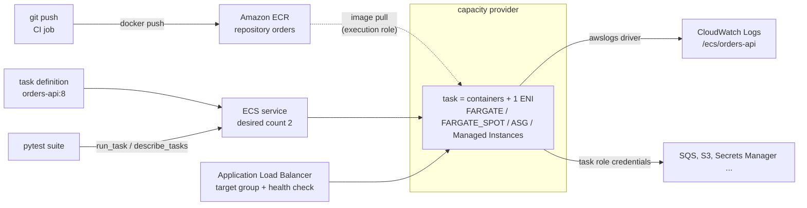

# Amazon ECS — Containers on Fargate, Services & Testing

**Amazon Elastic Container Service (ECS)** is AWS's own container orchestrator. You describe a container in a **task definition**, then either run it once (a **task**: a migration, a batch job, a test harness) or keep N copies alive behind a load balancer (a **service**). The compute underneath comes from **capacity providers**: Fargate and Fargate Spot (serverless, you never see a host), Auto Scaling groups of EC2 instances you manage, or ECS Managed Instances (EC2 that AWS manages for you). There is no cluster software to install or upgrade.

This guide is for Python developers and QA engineers who **deploy containers to ECS, call it from code, and test against it**, not for people designing VPCs. It covers the objects and the vocabulary, services and deployments, the boto3 API with its surprises (HTTP 200 with `failures`), patterns for FastAPI and queue-worker containers, and how to test all of it without an AWS account. Sessions, credentials, retries and `ClientError` handling are in [AWS Foundations](../foundations/index.md) and are not repeated here. Docker basics are in the [Docker guide](../../tools/docker/index.md).

## Where ECS Fits



- **Task definition** is an immutable, versioned blueprint (`family:revision`): images, CPU and memory, roles, ports, logging. Registering the same family again creates a new revision.
- **Task** is one running copy of a task definition (one or more containers that start and stop together). A standalone task runs once; a **service** replaces its tasks when they die and rolls out new revisions.
- **Two IAM roles** are involved and are not interchangeable: the **execution role** (ECS pulls the image, writes logs, reads secrets) and the **task role** (your code calls AWS). See [01](./01-core-concepts.md#task-role-vs-execution-role).
- **Tests** run against moto for control-plane logic and against the container image itself for behaviour; a small real-account smoke job covers the rest ([05](./05-testing.md), [06](./06-moto-gaps-smoke-ci.md)).

## Section Map

| File | Topics |
|------|--------|
| [01 Core Concepts](./01-core-concepts.md) | Clusters and capacity providers, Fargate task sizes, task definition anatomy, task role vs execution role, secrets, tasks vs services vs scheduled tasks, task lifecycle and stop codes, `awsvpc` networking, ECR (tags, lifecycle, scanning), quotas |
| [02 Services, Deployments & Networking](./02-services-deployments-networking.md) | Replica vs daemon services, rolling updates and the circuit breaker, blue/green, linear and canary, ALB wiring and the health check grace period, Service Connect, auto scaling (CPU, ALB requests, SQS backlog), scheduled tasks, ECS Exec, logs and Container Insights |
| [03 boto3 in Python](./03-boto3-python.md) | The `ecs` client, `register_task_definition`, `create_service`, `run_task` parameters, waiters, reading exit codes and stop reasons, `failures` vs exceptions, `update_service`, pagination and batch limits, throttling, idempotency, a reusable `run_and_wait` |
| [04 Patterns for Python Workloads](./04-python-workload-patterns.md) | FastAPI and worker images with uv, non-root and healthcheck, SIGTERM and `stopTimeout`, exec form vs shell form, config and secrets, one-off migration tasks, task scale-in protection, sidecars, observability |
| [05 Testing ECS-Based Systems](./05-testing.md) | What to test where, validating task definitions, Stubber for `failures` and exit codes, moto fixtures and the task state machine, services, SIGTERM tests, moto server mode, running the suite |
| [06 moto Gaps, Smoke Tests & CI](./06-moto-gaps-smoke-ci.md) | What moto does not emulate, a real-account Fargate smoke test, GitHub Actions with OIDC, deploy-then-verify with rollback, pitfalls, QA checklist |

## Minimal Working Example

A one-off task end to end: register a definition, run it on Fargate, wait, read the exit code. Against moto it needs no account; against AWS the same calls need a real cluster, subnet and security group.

```python
# uv add boto3 "moto[ecs,ec2]"
import boto3
from moto import mock_aws

with mock_aws():                                             # in-process fake ECS and EC2; no account, no network
    ecs = boto3.client("ecs", region_name="us-east-1")
    ec2 = boto3.client("ec2", region_name="us-east-1")
    subnet = ec2.describe_subnets()["Subnets"][0]["SubnetId"]                       # moto ships a default VPC
    group = ec2.describe_security_groups()["SecurityGroups"][0]["GroupId"]

    ecs.create_cluster(clusterName="qa")
    task_def = ecs.register_task_definition(
        family="hello",
        requiresCompatibilities=["FARGATE"],
        networkMode="awsvpc",                                # the only mode Fargate supports
        cpu="256", memory="512",                             # task size: must be a valid Fargate pair
        containerDefinitions=[{
            "name": "app", "image": "public.ecr.aws/docker/library/busybox:1.37", "essential": True,
            "command": ["echo", "hello"],
            "memory": 256,                                   # optional on real Fargate; moto run_task needs it (see 06)
        }],
    )["taskDefinition"]
    print("registered", task_def["family"], "revision", task_def["revision"], task_def["status"])

    resp = ecs.run_task(
        cluster="qa", taskDefinition="hello:1", count=1,
        capacityProviderStrategy=[{"capacityProvider": "FARGATE", "weight": 1}],
        networkConfiguration={"awsvpcConfiguration": {"subnets": [subnet], "securityGroups": [group], "assignPublicIp": "DISABLED"}},
    )
    assert not resp["failures"], resp["failures"]            # HTTP 200 does not mean the task was placed
    task_arn = resp["tasks"][0]["taskArn"]
    print("started", resp["tasks"][0]["lastStatus"])

    ecs.get_waiter("tasks_stopped").wait(cluster="qa", tasks=[task_arn], WaiterConfig={"Delay": 1, "MaxAttempts": 20})
    task = ecs.describe_tasks(cluster="qa", tasks=[task_arn])["tasks"][0]
    print("stopped", task["lastStatus"], [(c["name"], c["exitCode"]) for c in task["containers"]])
```

```text
registered hello revision 1 ACTIVE
started RUNNING
stopped STOPPED [('app', 0)]
```

Against a real account remove `mock_aws()` and pass your own cluster, subnet and security group; the task needs a way to pull the image (a public IP in a public subnet, a NAT gateway or VPC endpoints) and an `executionRoleArn` once it logs or uses private ECR. A real task also takes tens of seconds to start; moto "runs" it instantly and always reports exit code 0 ([06](./06-moto-gaps-smoke-ci.md#what-moto-does-not-emulate)).

## ECS vs EC2 vs Kubernetes vs Lambda

| | **ECS on Fargate** | [EC2](../ec2/index.md) | [Kubernetes (EKS or self-run)](../../tools/kubernetes/index.md) | **Lambda** |
|---|--------------------|------------------------|------------------------|------------|
| Unit you deploy | Container image + task definition | A virtual machine | Pods from manifests or Helm | A function (zip or image) |
| Servers you patch | None | All of them | Nodes (unless managed) | None |
| Long-running processes, WebSockets | Yes | Yes | Yes | No: 15-minute cap per invocation |
| Scale to zero | Services: min capacity 0 with auto scaling; one-off tasks cost only while they run | No | With extra tooling | Yes, native |
| Cold start | Image pull and network interface attach: usually tens of seconds | Minutes (boot) | Seconds to minutes | Milliseconds to seconds |
| Portability | AWS-specific API and task definitions; the **image** is portable | VM images | Cluster-portable manifests | AWS-specific |
| Use when | Web services, queue workers, scheduled and one-off jobs with a container image | You need the host: custom kernel, GPUs on your terms, licensed software | You already run Kubernetes or need its ecosystem | Short event-driven work, glue code |

Pick **ECS on Fargate** when the work is "run this image, keep it healthy, scale it" and nobody wants to manage nodes. Pick **Lambda** when handlers are short and event-driven (see [SQS with Lambda](../sqs/04-lambda-scaling-integrations.md)); pick **Kubernetes** for portability and its tooling; pick **EC2** when you need the instance itself.

## What Changed Recently

Tutorials written before 2025 describe a smaller ECS. As of October 2026 (AWS documentation, AWS What's New and the current botocore model):

| Topic | Now | Note |
|-------|-----|------|
| Capacity | **Capacity providers** are the recommended way; the EC2/Fargate launch type is meant mainly for `requiresCompatibilities` | A strategy cannot mix provider types; services can be moved between them |
| ECS Managed Instances | A capacity provider type: EC2 you choose the instance types for, AWS provisions and patches | Introduced in 2025; `launchType` value `MANAGED_INSTANCES` exists in the API |
| Native deployment strategies | `deploymentConfiguration.strategy`: `ROLLING`, `BLUE_GREEN`, `LINEAR`, `CANARY` without CodeDeploy | Linear and canary announced 30 October 2025; traffic shifting needs a load balancer or Service Connect |
| Circuit breaker | `resetOnHealthyTask` and `thresholdConfiguration` (`BOUNDED_PERCENT`, `UNBOUNDED_PERCENT`, `COUNT`) | Default threshold: 50 percent of desired count, clamped to 3..200 |
| Express Mode | `create_express_gateway_service`: image + two roles gives a load-balanced Fargate service with a URL | Announced November 2025; stateless web apps and APIs; resources stay in your account |
| Managed daemons | Per-instance agents (logging, security) deployed by ECS on Managed Instances capacity | Announced April 2026 for Managed Instances capacity providers |
| Task scale-in protection | `update_task_protection` and an in-container endpoint | For queue workers that must finish a job before a scale-in |
| App Mesh | The App Mesh documentation announced end of support on **30 September 2026** | Use ECS Service Connect for service-to-service traffic |

The current botocore model also exposes `CreateGateway`, `CreateDaemon` and the `*ServiceDeployment*` operations; this guide covers the stable core and mentions the newer pieces only where a test or deployment touches them. moto implements none of the newer operations ([06](./06-moto-gaps-smoke-ci.md#what-moto-does-not-emulate)).

## Quick Rules

1. **Pin the image by tag or digest** (a Git SHA tag, immutable in ECR), never `latest`. A task definition revision should always mean the same bytes.
2. **Set both roles on purpose.** The execution role pulls the image, writes logs and reads secrets; the task role is what your code runs as. Missing the first fails before your code starts, missing the second fails with `AccessDenied` inside it.
3. **Treat `run_task` as "asked", not "started".** It returns HTTP 200 with a `failures` list; check it, then wait, then read `exitCode` and `stopCode`.
4. **Wait with waiters** (`tasks_running`, `tasks_stopped`, `services_stable`) and an explicit `WaiterConfig`, and stop the task in `finally`: a forgotten Fargate task is billed.
5. **Handle SIGTERM and set `stopTimeout`.** ECS sends SIGTERM, then SIGKILL after `stopTimeout` (default 30 s, maximum 120 s on Fargate). Use the exec form of `CMD` so your process is PID 1.
6. **Turn on the deployment circuit breaker with rollback**, give the service a health check grace period that covers your start-up time, and verify the new version after the deploy.
7. **Keep secrets out of `environment`.** Use `secrets` with a Secrets Manager or SSM `valueFrom`; the execution role needs read access.
8. **Log to stdout with the `awslogs` driver** and set a retention period on the log group.
9. **Validate task definitions in CI** (size pairs, roles, logging, no plaintext secrets) before they reach ECS, and unit-test the failure paths with Stubber.
10. **Trust moto for control-plane logic only.** It never runs a container, never schedules service tasks and never validates a task definition; keep a small smoke test on a real cluster.

---
## See also
- [Digital Garden: Knowledge Base](../../index.md)
- [AWS — Service Guides for Python & Test Automation](../index.md)
- [AWS Foundations — boto3, Credentials & Local Testing](../foundations/index.md)
- [Amazon EC2](../ec2/index.md)
- [Amazon SQS — Queues, Consumers & Testing](../sqs/index.md)
- [Amazon SNS — Topics, Subscriptions & Fan-out](../sns/index.md)
- [Docker & Docker Compose](../../tools/docker/index.md)
- [Kubernetes](../../tools/kubernetes/index.md)
- [CI/CD Approaches](../../ci-cd-approaches/index.md)
- [FastAPI](../../libs/fastapi/index.md)
- [Pytest — Python Testing Framework](../../libs/pytest/index.md)
