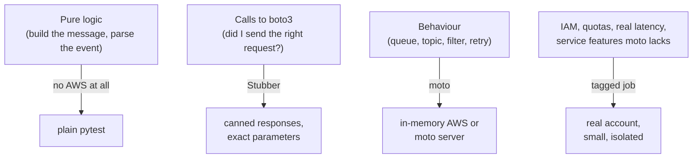

# AWS Foundations — Credentials, IAM & Local Testing

Where boto3 finds credentials, how to give a program only the permissions it needs, and how to test AWS code offline with `Stubber` and **moto**.

## The Credential Provider Chain

boto3 stops at the **first** source that returns credentials (order from the boto3 documentation):

| # | Source | Typical use |
|---|--------|-------------|
| 1–2 | Arguments to `boto3.client()` / `boto3.Session()` | Tests, explicit assume-role code. Avoid hard-coding keys |
| 3 | Environment: `AWS_ACCESS_KEY_ID`, `AWS_SECRET_ACCESS_KEY`, `AWS_SESSION_TOKEN` | CI, containers, test fixtures |
| 4 | **Assume role** from `~/.aws/config` (`role_arn` + `source_profile`) | Cross-account access |
| 5 | **Web identity** (`AWS_ROLE_ARN` + `AWS_WEB_IDENTITY_TOKEN_FILE`) | EKS service accounts, some CI OIDC setups |
| 6 | **IAM Identity Center (SSO)** profile | Developer laptops: `aws sso login --profile dev` |
| 7 | Shared credentials file `~/.aws/credentials` | Long-lived keys (avoid) |
| 8 | `aws login` console credentials | Local development (needs boto3 with CRT) |
| 9–10 | `~/.aws/config`, legacy Boto2 files | Legacy |
| 11 | **Container credentials** (ECS task role, EKS pod identity) | Containers on AWS |
| 12 | **Instance metadata** (EC2 instance profile) | EC2 |

`AWS_PROFILE` selects a profile, `AWS_CONFIG_FILE` and `AWS_SHARED_CREDENTIALS_FILE` move the files. Both a credential **and a region** are required.

```bash
aws sts get-caller-identity                    # who am I right now? run it before any destructive command
python -c "import boto3; print(boto3.client('sts').get_caller_identity()['Arn'])"
```

Rules of thumb:

- **On AWS compute use the attached role** (ECS task role, Lambda execution role, EC2 profile). Code stays free of keys.
- **On laptops use SSO** with short-lived sessions. Long-lived access keys are the most common cause of leaked-credential incidents.
- **In CI use OIDC federation**, so the job exchanges its identity token for a role session and no secret is stored:

```yaml
# .github/workflows/aws-smoke.yml
permissions:
  id-token: write          # lets the job request an OIDC token
  contents: read

jobs:
  smoke:
    runs-on: ubuntu-latest
    steps:
      - uses: actions/checkout@v4
      - uses: aws-actions/configure-aws-credentials@v6
        with:
          role-to-assume: arn:aws:iam::123456789012:role/ci-smoke-tests
          aws-region: eu-west-1
      - run: uv run pytest -m aws_smoke
```

## IAM in Five Minutes

| Concept | Meaning |
|---------|---------|
| **Principal** | Who calls: a user, a role session, a service |
| **Identity policy** | JSON attached to the principal: *allow/deny these actions on these resources* |
| **Resource policy** | JSON attached to the resource (queue, topic, bucket): *who may use me*. Needed for cross-account and for **services that call you** (SNS → SQS) |
| **Action** | `service:Operation`, for example `sqs:SendMessage`, `sns:Publish`, `bedrock:InvokeModel` |
| **Resource** | The ARN the action touches |
| **Condition** | Extra rule on the request: `aws:SourceArn`, `aws:PrincipalOrgID`, region, tags |
| **Evaluation** | Default deny. An explicit `Deny` always wins. Otherwise an `Allow` is needed (in the identity policy, the resource policy or both, depending on the account boundary). Permission boundaries and organization SCPs can only narrow |

A least-privilege policy for a service that publishes to one queue and consumes another:

```json
{
  "Version": "2012-10-17",
  "Statement": [
    {
      "Effect": "Allow",
      "Action": ["sqs:SendMessage"],
      "Resource": "arn:aws:sqs:eu-west-1:123456789012:orders-in"
    },
    {
      "Effect": "Allow",
      "Action": ["sqs:ReceiveMessage", "sqs:DeleteMessage", "sqs:ChangeMessageVisibility", "sqs:GetQueueAttributes"],
      "Resource": "arn:aws:sqs:eu-west-1:123456789012:orders-work"
    }
  ]
}
```

| Practice | Why |
|----------|-----|
| Name actions and ARNs, avoid `"Action": "*"` and `"Resource": "*"` | A bug or a leaked session can only do what the policy lists |
| One role per workload, a separate role for tests | The test role cannot touch production resources |
| Use `aws:SourceArn` / `aws:SourceAccount` conditions on resource policies that trust a service | Prevents the confused-deputy problem |
| Test denies too | A test that asserts `AccessDenied` for a forbidden action proves the policy is not too wide. IAM Access Analyzer and the policy simulator help review policies |
| Read the `AccessDenied` message | It names the principal, the action and the resource that failed |

## Three Ways to Test AWS Code



| Tool | What it is | Use for | Limit |
|------|-----------|---------|-------|
| **Stubber** (`botocore.stub`) | Replaces the HTTP layer of one client with a queue of canned responses and errors | Exact request parameters, error handling (`add_client_error`), code paths that are hard to trigger | It checks parameters against the service model, but there is no state: it will not tell you a message was delivered |
| **moto** `mock_aws` | A Python re-implementation of many services, patched into botocore in-process | Behaviour tests: send, receive, publish, subscribe, fan-out, DLQ | Not the real service: some features, timings and limits differ. Read the "what moto does not do" notes in each service guide |
| **moto server** | The same implementation as a local HTTP server (`moto_server -p 5000`) | Other processes or languages, Docker Compose, the real network path via `AWS_ENDPOINT_URL` | Needs reset between tests: `POST /moto-api/reset` |
| **Real account** | The actual service | IAM policies, KMS, quotas, cross-service integration, Bedrock model behaviour | Cost, speed, cleanup, secrets |

Other emulators exist (LocalStack, ElasticMQ for SQS). They are valid choices; check the licence and any account requirement of the **current** version before putting one into CI.

### A safe `conftest.py`

The first rule of AWS tests: **a test must not be able to reach a real account, even by mistake.**

```python
# conftest.py
import boto3
import pytest
from moto import mock_aws


@pytest.fixture(autouse=True)
def aws_env(monkeypatch):
    """Fake credentials, a fixed region, and no access to ~/.aws."""
    monkeypatch.setenv("AWS_ACCESS_KEY_ID", "testing")
    monkeypatch.setenv("AWS_SECRET_ACCESS_KEY", "testing")
    monkeypatch.setenv("AWS_SESSION_TOKEN", "testing")
    monkeypatch.setenv("AWS_DEFAULT_REGION", "us-east-1")
    monkeypatch.delenv("AWS_PROFILE", raising=False)            # a stale profile would break client creation
    monkeypatch.setenv("AWS_CONFIG_FILE", "/dev/null")          # ignore ~/.aws/config and credentials
    monkeypatch.setenv("AWS_SHARED_CREDENTIALS_FILE", "/dev/null")
    monkeypatch.delenv("AWS_ENDPOINT_URL", raising=False)


@pytest.fixture
def aws():
    with mock_aws():                       # every boto3 client created inside is served by moto
        yield


@pytest.fixture
def sqs(aws):
    return boto3.client("sqs")
```

Two traps found while testing this file:

- `AWS_PROFILE=""` does **not** disable profiles: botocore raises `ProfileNotFound: The config profile () could not be found`. Use `delenv` plus `AWS_CONFIG_FILE=/dev/null`.
- Running the suite with `AWS_PROFILE=prod` exported still passes with the fixture above, because the autouse fixture removes the variable. Without it, a developer's profile could silently be used.

A fake-credential call outside moto fails safely: `boto3.client("sts").get_caller_identity()` with `testing` / `testing` fails with `ClientError: InvalidClientTokenId`, so a forgotten mock produces a loud error and not a change in a real account.

### Stubber: exact requests and errors

```python
# orders.py
import json


def publish_order(sqs, queue_url: str, order_id: str, amount: float) -> str:
    body = json.dumps({"order_id": order_id, "amount": amount})
    return sqs.send_message(QueueUrl=queue_url, MessageBody=body)["MessageId"]
```

```python
# test_orders.py
import json

import boto3
import pytest
from botocore.exceptions import ClientError
from botocore.stub import Stubber

from orders import publish_order


def test_publish_sends_expected_request():
    sqs = boto3.client("sqs")
    url = "https://sqs.us-east-1.amazonaws.com/123456789012/orders"
    with Stubber(sqs) as stub:
        stub.add_response(
            "send_message",
            {"MessageId": "m-1", "MD5OfMessageBody": "x"},
            expected_params={"QueueUrl": url, "MessageBody": json.dumps({"order_id": "o-1", "amount": 9.5})},
        )
        assert publish_order(sqs, url, "o-1", 9.5) == "m-1"
        stub.assert_no_pending_responses()          # fails if a stubbed call was never made


def test_throttle_is_visible():
    sqs = boto3.client("sqs")
    with Stubber(sqs) as stub:
        stub.add_client_error("send_message", service_error_code="RequestThrottled", http_status_code=503)
        with pytest.raises(ClientError) as ei:
            publish_order(sqs, "https://sqs.us-east-1.amazonaws.com/123456789012/orders", "o-1", 1)
        assert ei.value.response["Error"]["Code"] == "RequestThrottled"
```

Stubber notes:

- `expected_params` is compared strictly; use `botocore.stub.ANY` for values you do not care about. **`ANY` is only for `expected_params`:** using it in a response fails with `ParamValidationError`.
- A second call with no queued response raises `UnStubbedResponseError`, and a mismatching parameter raises `StubAssertionError`.
- **Stubber never retries.** A stubbed throttling error is raised on the first call and the next queued response stays unused, even in `standard` mode, so Stubber cannot test retry behaviour. Use a fake HTTP server or a real account for that.

### moto: behaviour

```python
import json


def test_publish_is_delivered(sqs):
    url = sqs.create_queue(QueueName="orders")["QueueUrl"]
    publish_order(sqs, url, "o-1", 9.5)
    [msg] = sqs.receive_message(QueueUrl=url, WaitTimeSeconds=0)["Messages"]
    assert json.loads(msg["Body"]) == {"order_id": "o-1", "amount": 9.5}
```


```python
def test_identity_is_the_moto_account(aws):
    ident = boto3.client("sts").get_caller_identity()
    assert ident["Account"] == "123456789012"        # moto's default account
```

### moto server for other processes

```bash
uv run moto_server -p 5000 &                        # needs the "server" extra
export AWS_ACCESS_KEY_ID=x AWS_SECRET_ACCESS_KEY=x AWS_ENDPOINT_URL=http://localhost:5000
curl -s -X POST http://localhost:5000/moto-api/reset          # wipe all state between tests
```

An SQS queue and an SNS topic created through `AWS_ENDPOINT_URL` come back as `http://localhost:<port>/123456789012/q` and `arn:aws:sns:us-east-1:123456789012:t`, and after `/moto-api/reset` `list_queues()` returns no queues. Create queues **inside the fixture** and name them uniquely, so tests stay independent when run in parallel (`pytest-xdist` with one shared moto server).

Use `mock_aws` and the server mode for different jobs: in-process mocking cannot intercept another process (a Celery worker, a Docker service), so those need the server mode and a real network endpoint.

## What to Run Against a Real Account

| Run there | Why not in moto |
|-----------|-----------------|
| IAM policies and resource policies | moto does not enforce IAM by default |
| KMS key policies, encryption, cross-account access | Not faithfully emulated |
| Quotas, throttling, latency under load | Only the real service has them |
| Behaviour of new or recent features | moto lags behind the service |
| Model output (Bedrock) | Responses come from real models |

Keep these as a **small smoke job** marked `@pytest.mark.aws_smoke`, running on a schedule or before release in a dedicated test account, with an OIDC role limited to resources tagged for tests, unique names, a billing alarm and teardown in the fixture's `finally`.

## Quick Rules

1. Prefer the chain's **role-based** sources (SSO, OIDC, task roles) over access keys.
2. Print `get_caller_identity()` at the start of every manual script that changes anything.
3. Write least-privilege policies that name actions **and** resource ARNs; use `aws:SourceArn` for service principals.
4. Use an **autouse fixture** with fake credentials and `AWS_CONFIG_FILE=/dev/null`.
5. Choose the lightest tool: pure functions, then `Stubber`, then moto, then a real account.
6. Use moto's **server mode** when another process must see the same AWS state; reset it between tests.
7. Treat moto as an emulator, not a spec: confirm important behaviour with a smoke test on real AWS.

---
## See also
- [AWS Foundations](./index.md)
- [01 Clients, Config, Retries & Errors](./01-clients-config-errors.md)
- [Amazon SQS: Testing](../sqs/05-testing.md)
- [Amazon SNS: Testing](../sns/04-testing.md)
- [Pytest](../../libs/pytest/index.md)
- [Docker & Docker Compose](../../tools/docker/index.md)
- [Code Security](../../code-security/index.md)
