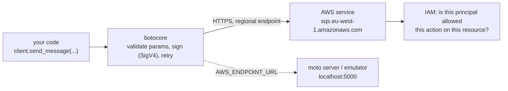

# AWS Foundations — boto3, Credentials & Local Testing

What every AWS service guide in this section assumes: how a Python program talks to AWS, how it gets credentials and a region, how requests are retried, how errors look, and how to test code that calls AWS **without touching a real account**.

Service guides: [Bedrock](../bedrock/index.md), [SNS](../sns/index.md), [SQS](../sqs/index.md). Read this part once; the service pages link back here instead of repeating it.

## Section Map

| File | Topics |
|------|--------|
| [01 Clients, Config, Retries & Errors](./01-clients-config-errors.md) | `Session`, `client` vs `resource`, `botocore.config.Config`, timeouts, retry modes, endpoint overrides, paginators, `ClientError`, modeled exceptions, service model introspection |
| [02 Credentials, IAM & Local Testing](./02-credentials-iam-local-testing.md) | Credential provider chain, roles in CI, least-privilege policies, `Stubber`, moto in-process and server mode, a safe pytest `conftest.py`, what to run against a real account |

## The Shape of an AWS Call

- Every call is an **HTTPS request signed with Signature Version 4** using temporary or long-lived credentials. The service evaluates **IAM** policies and answers with data or an error.
- boto3 builds clients from **JSON service models** shipped inside botocore. The Python API is generated from them, so parameter names are exactly the API names in PascalCase (`QueueUrl`, `MessageBody`).
- Services are **regional**. The client's region decides the endpoint; a queue created in `eu-west-1` does not exist in `us-east-1`.

## Quick Rules

1. **Create clients once** (module level or a factory) and reuse them: clients are thread-safe, sessions are not.
2. **Set the region explicitly** in code, `AWS_DEFAULT_REGION` or the profile. Never rely on whatever the laptop has.
3. **Never put keys in code or tests.** Locally use SSO/profiles; in CI use OIDC and a role; on AWS compute use the attached role.
4. **Set timeouts and the retry mode** (`standard`) on every production client; the defaults are lenient and legacy.
5. **Catch `ClientError` and read `response["Error"]["Code"]`**, or use the modeled `client.exceptions.<Name>`. Retry only what is safe to retry.
6. **Grant least privilege**: the action and the resource ARN, not `*`.
7. **Make the test suite unable to reach AWS**: fake credentials, `AWS_CONFIG_FILE=/dev/null`, mocked or local endpoints. A real-account smoke test is a separate, tagged job.
8. **Tag test resources and use unique names** (`test-{uuid}`), and clean them up in fixture teardown.

---
## See also
- [AWS Overview](../index.md)
- [Amazon SQS](../sqs/index.md)
- [Amazon SNS](../sns/index.md)
- [Amazon Bedrock](../bedrock/index.md)
- [Pytest](../../libs/pytest/index.md)
- [Resilience](../../libs/resilience/index.md)
- [Docker & Docker Compose](../../tools/docker/index.md)
