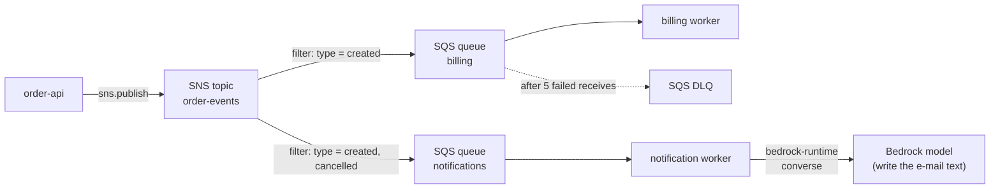

# AWS — Service Guides for Python & Test Automation

Practical guides to the AWS services (compute, messaging, observability and generative AI) that a Python backend and its test suite touch most often: how each service works, how to call it with **boto3**, and how to **test** code that depends on it without a real account. The focus is the developer and QA view, not account administration.

## Section Map

| Section | Topics |
|---------|--------|
| [Foundations](./foundations/index.md) | `Session` and `Config`, timeouts and retries, endpoint overrides, pagination, `ClientError`, the credential chain, least-privilege IAM, `Stubber` and moto, a safe pytest `conftest.py` |
| [Amazon EC2](./ec2/index.md) | Virtual machines: instance types and purchasing, AMIs, security groups, IMDSv2 and instance profiles, boto3 `run_instances` and waiters, Auto Scaling and load balancers, compliance tests, moto and smoke tests |
| [Amazon ECS](./ecs/index.md) | Containers on Fargate and EC2: task definitions, task role vs execution role, services and deployments, `run_task` and its `failures`, SIGTERM and SQS workers, testing, moto gaps |
| [Amazon CloudWatch](./cloudwatch/index.md) | Metrics, custom metrics and EMF, alarms and dashboards, Logs and Logs Insights, metric filters, alarm compliance tests, moto and smoke tests |
| [Amazon Bedrock](./bedrock/index.md) | Foundation models behind one API: Converse and streaming, tool use, structured output, prompt caching, Guardrails, Knowledge Bases, testing LLM calls |
| [Amazon SNS](./sns/index.md) | Pub/sub topics: standard and FIFO, subscriptions, message attributes and filter policies, fan-out to SQS, delivery retries and DLQs, testing |
| [Amazon SQS](./sqs/index.md) | Managed queues: standard and FIFO, visibility timeout, long polling, DLQ and redrive, idempotent consumers, partial batch failures, testing |

Start with **Foundations** if you have not used boto3 before; the service guides link back to it instead of repeating it.

## How the Services Fit Together

- **SNS** decides *who* gets an event (topic, subscriptions, filters). **SQS** gives every consumer its own durable buffer, with retries and a dead-letter queue. Together they are the standard **fan-out** pattern; a queue in front of a consumer lets it fail and recover without the publisher noticing.
- **Bedrock** is a request/response API with high latency and strict quotas. Putting it behind SQS smooths bursts and gives you retries on throttling; see [SQS consumer patterns](./sqs/03-consumer-patterns.md).

## Choosing Compute

| Need | Use |
|------|-----|
| A container image (API, queue worker, batch task) without managing servers | **ECS on Fargate** ([ECS guide](./ecs/index.md)) |
| Full control of the OS, special hardware, long-running or licensed software, a self-hosted CI runner or load generator | **EC2** ([EC2 guide](./ec2/index.md)) |
| Containers on Kubernetes | EKS ([Kubernetes guide](../tools/kubernetes/index.md)) |
| Short event-driven functions | Lambda (see [SQS and Lambda](./sqs/04-lambda-scaling-integrations.md)) |

## Choosing a Messaging Service

| Need | Use |
|------|-----|
| One producer, one consumer group, work distribution, buffering | **SQS** |
| One event for many independent consumers | **SNS** topic with one **SQS** queue per consumer |
| Routing by event content across AWS services and SaaS, schedules, schema discovery | EventBridge (not covered here) |
| Replayable ordered log, many readers, stream processing | Kafka ([Kafka guide](../tools/kafka/index.md)) or Kinesis |
| Rich routing (exchanges, priorities, RPC), portable broker | RabbitMQ ([RabbitMQ guide](../tools/rabbitmq/index.md)) |

General queue and idempotency theory is in [Queues vs Streams](../software-design-patterns/05-composition-architectural/04-queues-streams-messaging.md).

## Test Strategy in One Table

| Level | Tool | AWS needed |
|-------|------|------------|
| Pure logic: build a message, parse an event | plain pytest | No |
| Exact request and error handling | `botocore.stub.Stubber` | No |
| Behaviour: delivery, filters, redelivery, DLQ | moto (`mock_aws`, or moto server for other processes) | No |
| LLM call shape and tool loop | Stubber or a fake `bedrock-runtime` server | No |
| IAM, KMS, quotas, real model output | small tagged smoke job | Yes, a test account |

Details and a ready `conftest.py` are in [Foundations: Credentials, IAM & Local Testing](./foundations/02-credentials-iam-local-testing.md).

## Quick Rules

1. Treat **delivery as at-least-once** everywhere (SQS standard, SNS, retried API calls); make consumers idempotent.
2. **Never test against production.** Fake credentials and `AWS_CONFIG_FILE=/dev/null` in an autouse fixture.
3. Keep every policy **least-privilege** and name resources by ARN.
4. Put `Config(retries=..., connect_timeout=..., read_timeout=...)` on every client.
5. **Pin region and account** in tests; resources are regional.
6. Keep a **small real-account smoke job** for what emulators cannot prove.

---
## See also
- [Digital Garden: Knowledge Base](../index.md)
- [AWS Foundations](./foundations/index.md)
- [Queues vs Streams](../software-design-patterns/05-composition-architectural/04-queues-streams-messaging.md)
- [Apache Kafka](../tools/kafka/index.md)
- [RabbitMQ](../tools/rabbitmq/index.md)
- [Agentic AI Architecture](../agentic-ai-architecture/index.md)
- [LiteLLM](../libs/litellm/index.md)
