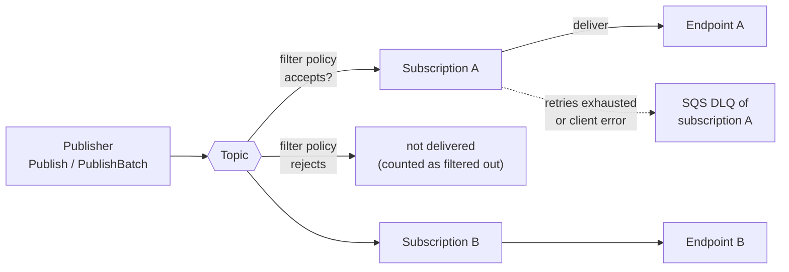

# Amazon SNS — Core Concepts

## The Model



- A **topic** is a named channel with an access policy and a few settings. It holds no messages for later.
- A **subscription** binds one endpoint to one topic and carries its own attributes: filter policy, raw delivery, retry policy, DLQ.
- A **publish** is evaluated per subscription: filter, then deliver with retries, then DLQ or discard. Failure on one subscription does not affect the others.
- Messages are **at-least-once** on standard topics. Duplicates and out-of-order delivery are normal; see [Queues vs Streams](../../software-design-patterns/05-composition-architectural/04-queues-streams-messaging.md) for idempotency patterns.

## Topics

| Property | Standard | FIFO |
|----------|----------|------|
| Name rule | 1 to 256 characters: ASCII letters, digits, `_`, `-` | Same, and must end in `.fifo` |
| Creation | `create_topic(Name=...)` | `create_topic(Name="x.fifo", Attributes={"FifoTopic": "true"})` |
| Type and name later | Cannot be changed | Cannot be changed |
| Ordering | None | Strict per `MessageGroupId`; groups run in parallel |
| Deduplication | None | By `MessageDeduplicationId`, 5-minute window |
| Supported subscribers | All protocols | SQS FIFO or standard queues; HTTP/S, email, SMS and mobile push are rejected |
| Lambda | Direct subscription | Not supported directly (docs: put an SQS queue in between and use it as event source) |
| X-Ray active tracing | `TracingConfig=Active` | The API reference says standard topics only; the documentation history lists FIFO support since May 2023. The docs disagree, so test it before relying on it |
| Max per account | 100,000 | 1,000 |

- `create_topic` is **idempotent**: calling it again with an existing name returns the same ARN.
- Do not put PII or secrets into topic names; the docs state names are visible to other AWS services such as CloudWatch Logs.
- Tags: up to 50 per topic (`TagLimitExceeded` otherwise), set at creation or with `tag_resource`.

### FIFO Specifics

| Concept | Behaviour |
|---------|-----------|
| `MessageGroupId` | Required on every publish; up to 128 alphanumeric and punctuation characters. Messages of one group are delivered in order; different groups have no relation |
| `MessageDeduplicationId` | Up to 128 characters. A second publish with the same ID inside the 5-minute window is **accepted but not delivered**. Required unless `ContentBasedDeduplication=true` |
| `ContentBasedDeduplication` | SNS hashes the message **body** (SHA-256); attributes are not part of the hash. An explicit `MessageDeduplicationId` overrides the hash |
| `FifoThroughputScope` | `Topic` (default): dedup across the whole topic, up to 3,000 messages/s or 20 MB/s. `MessageGroup`: dedup per group, higher throughput subject to regional quotas; max 300 messages/s per group. **Set at creation if you can: once `MessageGroup`, it cannot be reverted** |
| Filtering | Supported. Filtered-out messages mean at-most-once, not exactly-once, for that subscription |
| Exactly-once | The docs promise it only when the SQS FIFO queue exists and trusts SNS, the consumer deletes within the visibility timeout, **no filter policy** is used and no network disruption hides the acknowledgement |
| `SequenceNumber` | Returned by `publish` on FIFO topics; increases per group |
| FIFO topic to standard queue | Allowed: lower cost, best-effort ordering, at-least-once. `MessageGroupId` is not passed to standard queues |
| Standard topic with `MessageGroupId` | Optional; forwarded only to SQS **standard** subscriptions to enable SQS fair queues; same validation rules as on FIFO |
| Sudden traffic jumps | A large, sudden increase can cause temporary `Publish` throttling for up to the dedup window while partitions scale |
| Archive and replay | FIFO only; see [03 Filtering & Fan-out](./03-filtering-fanout.md#fifo-topics-archiving-and-replay) |

When high throughput is enabled, the docs recommend enabling high-throughput mode on the subscribed SQS FIFO queues too.

## Subscriptions and Confirmation

| Rule | Detail |
|------|--------|
| Who confirms | HTTP/S and email endpoints, and any endpoint in a **different account** than the topic, need `ConfirmSubscription` with the token from the subscription message. Tokens are valid for two days |
| SQS in the same account | Confirmed when you call `subscribe` |
| SQS in another account | Confirmed automatically if the **queue owner** creates the subscription (the topic owner must allow `sns:Subscribe` for that account). If the topic owner subscribes the queue, a confirmation message lands in the queue and the subscription stays pending until confirmed |
| Pending subscriptions | Up to 5,000 per account |
| `ReturnSubscriptionArn=True` | `subscribe` returns the real ARN even while pending; otherwise you get the string `pending confirmation` |
| Failed deliveries | Do not change a subscription's status; it stays active |

## Message Anatomy

| Field | Rules |
|-------|-------|
| `Message` | Required; UTF-8; must not be empty. Size limit applies to body **plus attributes** (default 262,144 bytes) |
| `Subject` | Optional; UTF-8 text, no line breaks or control characters, shorter than 100 characters. Used as the e-mail subject and included in the JSON envelope |
| `MessageAttributes` | Name, data type and value; none empty. Counted in the message size |
| `MessageStructure="json"` | `Message` is a JSON object with a mandatory `default` key plus one key per protocol (`sqs`, `email`, `http`, ...) to send different bodies to different protocols. Values must be strings |
| `MessageGroupId`, `MessageDeduplicationId` | FIFO (see above) |

### Message Attributes

| Data type | Value | Notes |
|-----------|-------|-------|
| `String` | UTF-8 text | Surrogate pairs (emoji written as surrogates) are rejected |
| `String.Array` | JSON array in a string, for example `["web", "mobile"]` | Values may be strings, numbers, `true`, `false`, `null`; not supported for Lambda subscriptions (passed as `String`) |
| `Number` | Digits as a string | Range -10^9 to 10^9 with 5 digits after the decimal point; leading and trailing zeros trimmed; passed as `String` to Lambda |
| `Binary` | Bytes | Ignored by filter policies |

- **Name**: letters, digits, `_`, `-`, `.`; up to 256 characters; case-sensitive; no leading or trailing dot, no consecutive dots; must not start with `AWS.` or `Amazon.` in any casing.
- **Filter-friendly values** must be valid JSON strings.
- For **SQS subscriptions with raw delivery**, at most **10** message attributes can be delivered. A message with more is discarded as a client-side error. Disable raw delivery to send more.
- Attributes are sent only when the message structure is a plain string, not `json`.
- Attributes are **not delivered** to HTTP/S and Firehose subscriptions when raw delivery is on, and are used only to build mobile push payloads.

## Envelope vs Raw Delivery

For `sqs`, `http`, `https` and `firehose`, SNS can deliver the body as published (raw) or wrapped in a JSON envelope. The attribute is `RawMessageDelivery` on the subscription (set with `subscribe` or `set_subscription_attributes`).

```json
{
  "Type": "Notification",
  "MessageId": "63a3f6b6-d533-4a47-aef9-fcf5cf758c76",
  "TopicArn": "arn:aws:sns:us-east-1:123456789012:order-events",
  "Subject": "order created",
  "Message": "{\"order_id\": \"o-1\"}",
  "Timestamp": "2026-10-21T12:40:11.265Z",
  "SignatureVersion": "1",
  "Signature": "EXAMPLE...",
  "SigningCertURL": "https://sns.us-east-1.amazonaws.com/SimpleNotificationService-....pem",
  "UnsubscribeURL": "https://sns.us-east-1.amazonaws.com/?Action=Unsubscribe&SubscriptionArn=...",
  "MessageAttributes": {
    "event_type": {"Type": "String", "Value": "created"}
  }
}
```

| | Envelope (default) | Raw |
|---|---|---|
| SQS body | The JSON above; your code does `json.loads(body)["Message"]` | Exactly the published `Message` |
| SQS message attributes | Inside the envelope under `MessageAttributes` as `{"Type", "Value"}` | Mapped to real SQS message attributes (`DataType`, `StringValue`); max 10 |
| Subject, MessageId, TopicArn, signature | Present | Gone |
| HTTP/S | JSON POST | Message body only, with header `x-amz-sns-rawdelivery: true`; attributes not sent |
| Use when | You need the SNS message ID, topic ARN or signature, or you have more than 10 attributes | Consumers should see the same payload whether they come from SNS or directly from SQS |

On moto, with raw delivery the SQS message carries the published body plus `event_type`, `n` (Number) and `arr` (String.Array) as SQS attributes; without it the same queue receives the envelope with `MessageAttributes` inside. The envelope fields that matter to code (`Type`, `Message`, `MessageAttributes`) are the same in moto and AWS; the signature values in moto are not real.

## Delivery Retries

SNS retries **server-side** failures (the endpoint is down or returns an error) and does not retry **client-side** failures (endpoint deleted, permission removed).

| Endpoint class | Protocols | Policy | Customisable |
|----------------|-----------|--------|--------------|
| AWS managed | SQS, Lambda | 3 immediate, 2 at 1 s, 10 with exponential backoff from 1 s to 20 s, then 100,000 at 20 s: **100,015 attempts over 23 days** | No |
| Customer managed | SMTP, SMS, mobile push | 2 at 10 s, 10 with exponential backoff from 10 s to 600 s, then 38 at 600 s: **50 attempts over 6 hours** | No |
| Customer managed | HTTP/S | Defined by you in a `DeliveryPolicy` (field defaults below) | **Yes**: topic or subscription level |
| Firehose | Firehose | AWS-managed policy, except throttling errors, which follow the customer-managed policy | No |

All policies use jitter. When the policy is exhausted SNS **discards the message unless the subscription has a DLQ**.

HTTP/S treats every 5xx and 429 as retryable; other status codes are permanent failures. A custom policy is a JSON object set as the `DeliveryPolicy` attribute:

```json
{
  "healthyRetryPolicy": {
    "minDelayTarget": 1, "maxDelayTarget": 60,
    "numRetries": 50, "numNoDelayRetries": 3, "numMinDelayRetries": 2, "numMaxDelayRetries": 35,
    "backoffFunction": "exponential"
  },
  "throttlePolicy": {"maxReceivesPerSecond": 10},
  "requestPolicy": {"headerContentType": "application/json"}
}
```

| Field | Range and default |
|-------|-------------------|
| `minDelayTarget` / `maxDelayTarget` | Seconds; 1 to max / min to 3,600; default 20 |
| `numRetries` | 0 to 100; default 3 |
| `numNoDelayRetries`, `numMinDelayRetries`, `numMaxDelayRetries` | 0 or more; default 0 |
| `backoffFunction` | `arithmetic`, `exponential`, `geometric`, `linear` (default `linear`) |
| `maxReceivesPerSecond` | 1 or more; default: no throttling; an average, not a hard cap |
| `headerContentType` | Default `text/plain; charset=UTF-8`; with raw delivery off only `application/json` and `text/plain` |

At topic level the same JSON is wrapped in `{"http": {"defaultHealthyRetryPolicy": ..., "defaultThrottlePolicy": ..., "defaultRequestPolicy": ..., "disableSubscriptionOverrides": false}}`.

## Subscription DLQ (Redrive Policy)

A DLQ is an ordinary **SQS queue** attached to a **subscription** (not to the topic) through the `RedrivePolicy` attribute:

```json
{"deadLetterTargetArn": "arn:aws:sqs:us-east-1:123456789012:billing-sns-dlq"}
```

| Rule | Detail |
|------|--------|
| What lands there | Messages SNS could not deliver: client-side errors immediately, server-side errors after the retry policy is exhausted |
| Same account and Region | The subscription and the DLQ must be in the same account and Region |
| Queue type | FIFO topic subscriptions use FIFO DLQs; standard topic subscriptions use standard DLQs |
| Queue policy | The DLQ needs a policy that lets `sns.amazonaws.com` do `sqs:SendMessage` (same shape as the delivery policy below) |
| Encrypted DLQ | Must use a **custom** KMS key whose key policy grants the SNS service principal |
| Retention | Set the DLQ retention to the 14-day maximum |
| Monitor | Alarm on the DLQ's `ApproximateNumberOfMessagesVisible`. `NumberOfMessagesSent` does not count messages SNS moved there. SNS also emits `NumberOfNotificationsRedrivenToDlq` and `NumberOfNotificationsFailedToRedriveToDlq` |
| Not the same as | The SQS **consumer** DLQ (`maxReceiveCount` on the queue): that catches messages the consumer failed to process. See [Amazon SQS](../sqs/index.md) |

## Access Control

Two policy types decide who can do what: **identity policies** on callers (IAM) and **resource policies** on topics and queues. By default only the topic owner can publish or subscribe. The topic policy is the `Policy` attribute; `add_permission` and `remove_permission` edit it for you.

```json
{
  "Version": "2012-10-17",
  "Statement": [
    {
      "Sid": "AllowOtherAccountToPublish",
      "Effect": "Allow",
      "Principal": {"AWS": "111122223333"},
      "Action": "sns:Publish",
      "Resource": "arn:aws:sns:us-east-1:123456789012:order-events"
    },
    {
      "Sid": "AllowS3EventsFromOneAccount",
      "Effect": "Allow",
      "Principal": {"Service": "s3.amazonaws.com"},
      "Action": "sns:Publish",
      "Resource": "arn:aws:sns:us-east-1:123456789012:order-events",
      "Condition": {"StringEquals": {"AWS:SourceAccount": "111122223333"}}
    }
  ]
}
```

| Case | What to write |
|------|---------------|
| **SNS to your SQS queue** | A **queue** policy: principal `sns.amazonaws.com`, action `sqs:SendMessage`, resource the queue ARN, condition `ArnEquals` on `aws:SourceArn` = topic ARN. Use `aws:SourceAccount` instead if one queue serves many topics. One statement per topic. Same policy on every DLQ |
| **Cross-account publish** | Topic policy with the other account as principal and `sns:Publish`; the other account's IAM must also allow it |
| **Cross-account SQS subscription** | Topic policy: allow `sns:Subscribe` for the queue owner's account. The queue owner subscribes (auto-confirmed) |
| **AWS service publishes into the topic** | Service principal in the topic policy with `aws:SourceArn` or `aws:SourceAccount` (`aws:SourceOwner` is deprecated) |
| **Organisation-wide publish** | `Principal: {"AWS": "*"}` with `aws:PrincipalOrgID` |
| **Only HTTPS subscriptions** | Condition `sns:Protocol` = `https` on the `sns:Subscribe` statement |
| **Lambda subscriber** | Lambda resource policy allowing `sns.amazonaws.com` to `lambda:InvokeFunction` with the topic as source ARN (`aws lambda add-permission`) |

Identity policies for publishers follow least privilege: `sns:Publish` on the topic ARN, plus `kms:GenerateDataKey*` and `kms:Decrypt` if the topic is encrypted. Concepts such as principals, `Sid` and condition keys are in [AWS Foundations: IAM](../foundations/02-credentials-iam-local-testing.md#iam-in-five-minutes).

## Encryption (SSE-KMS)

| Topic | Detail |
|-------|--------|
| Enable | `KmsMasterKeyId` topic attribute: `alias/aws/sns` (AWS managed) or your own symmetric key (ID, ARN or alias) |
| Scope | Encrypts the **message body**. Topic name and attributes, subject, message ID, timestamp and **message attributes** are not encrypted |
| Not retroactive | Only messages sent after enabling are encrypted |
| Transport | Requests to an encrypted topic must use HTTPS and Signature Version 4 |
| Publishers | Need `kms:GenerateDataKey*` and `kms:Decrypt` on the key |
| AWS services as publishers | Need a **customer managed** key whose key policy allows the service principal (`s3.amazonaws.com`, `events.amazonaws.com`, `cloudwatch.amazonaws.com`, ...) |
| Replay from an encrypted FIFO archive | The key policy must let `sns.amazonaws.com` do `kms:Decrypt` and `kms:GenerateDataKey` |
| Cost | KMS requests are billed; SNS reuses a data key for up to 5 minutes |

Key policies and IAM are not enforced by moto, so encryption setup is a real-account check (see [05 moto Limits, Pitfalls & CI](./05-moto-gaps-ci.md#what-moto-does-not-emulate)).

## Topic and Subscription Attributes

| Attribute | On | Purpose |
|-----------|----|---------|
| `DisplayName` | Topic | Sender name for SMS and e-mail |
| `Policy` | Topic | Access policy (JSON string) |
| `DeliveryPolicy` | Topic, subscription | HTTP/S retry, throttle and content type |
| `KmsMasterKeyId` | Topic | SSE |
| `TracingConfig` | Topic | `PassThrough` (default) or `Active` for X-Ray; standard topics only |
| `SignatureVersion` | Topic | Hash used to sign notifications; default `1` |
| `MaximumMessageSize` | Topic | 1,024 to 1,048,576 bytes; default 262,144 |
| `FifoTopic`, `ContentBasedDeduplication`, `FifoThroughputScope`, `ArchivePolicy` | FIFO topic | See FIFO table |
| `<Protocol>SuccessFeedbackRoleArn`, `<Protocol>SuccessFeedbackSampleRate`, `<Protocol>FailureFeedbackRoleArn` | Topic | CloudWatch Logs delivery status for `HTTP`, `Firehose`, `Lambda`, `Application`, `SQS` |
| `RawMessageDelivery` | Subscription | `true` for SQS, HTTP/S, Firehose |
| `FilterPolicy`, `FilterPolicyScope` | Subscription | See [03](./03-filtering-fanout.md) |
| `RedrivePolicy` | Subscription | Subscription DLQ |
| `SubscriptionRoleArn` | Subscription | Required for Firehose: role SNS assumes to write to the stream |
| `ReplayPolicy`, `ReplayStatus` | Subscription (FIFO) | Replay of archived messages |

## Limits and Quotas

Values from the AWS General Reference (October 2026). Many are soft limits that can be raised in Service Quotas.

| Limit | Value |
|-------|-------|
| Topics per account | Standard 100,000; FIFO 1,000 |
| Subscriptions per topic | Standard 12,500,000; FIFO 100; Firehose 5 per topic per subscription owner |
| Pending subscriptions | 5,000 per account |
| Filter policies | 200 per topic, 10,000 per account |
| Message size | 256 KiB (262,144 bytes) by default, body and attributes together; up to 1 MiB (1,048,576 bytes) with `MaximumMessageSize` |
| Topics with `MaximumMessageSize` above 256 KiB | At most 100 subscriptions, all SQS, Lambda or Firehose; the topic's value is the effective limit for SQS. Larger payloads: store in S3 and publish a reference (the Python extended client library does this, up to 2 GB) |
| `PublishBatch` | 10 entries; combined size under the topic's `MaximumMessageSize` |
| Message header | 16 KiB |
| Publish rate per account and Region (standard) | us-east-1 30,000 messages/s; us-west-2 and eu-west-1 9,000; eight Regions (us-east-2, us-west-1, ap-south-1, ap-northeast-2, ap-southeast-1, ap-southeast-2, ap-northeast-1, eu-central-1) 1,500; all other Regions 300 |
| Publish rate (FIFO) | us-east-1 30,000; us-west-2 and eu-west-1 9,000; every other Region 3,000; per topic 3,000/s or 20 MB/s with `Topic` scope; 300/s per message group |
| Subscribe / Unsubscribe | 100 requests/s each (hard) |
| `ListTopics`, `ListSubscriptions`, `ListSubscriptionsByTopic` | 30 requests/s each (hard); `ListTopics` returns up to 100 per page |
| Control-plane calls (`CreateTopic`, `SetTopicAttributes`, `GetTopicAttributes`, ...) | 3,000/s in us-east-1, 900 in us-west-2 and eu-west-1, 150 or 30 elsewhere |
| E-mail delivery | 10 messages/s per `email` or `email-json` subscription (hard) |
| SMS | Default spend threshold 1.00 USD per account; 20 messages/s for promotional and for transactional |

Publish limits combine `Publish` and `PublishBatch` message counts per account and Region. Exceeding them returns a throttling error (`Throttled`, HTTP 429). botocore's default `legacy` mode retries it; `standard` and `adaptive` modes did not in our test, so add your own retry (see [02 boto3 in Python](./02-boto3-python.md#throttling-is-not-retried-in-standard-mode)).

## Pricing Dimensions

No prices here (they vary by Region and change); the dimensions are what you plan around.

| Dimension | How it is counted |
|-----------|-------------------|
| API requests | Each `Publish`, `PublishBatch` and topic or subscription owner operation; each 64 KB chunk of published data counts as one request |
| Deliveries | Each 64 KB chunk of delivered data is one delivery; price depends on protocol. SNS does not charge per delivery to SQS and Lambda, but data transfer applies |
| FIFO | Published messages multiplied by subscriptions; filtered and delivered messages both count |
| Payload-based filtering | Outbound payload data scanned per subscription with an active body-scope filter, 1 KB minimum per message. Attribute-based filtering is free |
| Archive and replay | Data stored and for how long (1-day minimum); replay billed at FIFO request and payload rates |
| SMS | Billed through AWS End User Messaging |
| KMS | Separate KMS request charges for encrypted topics |

Body-scope filtering is billed per scanned byte, which makes attributes the cheaper default when the publisher can set them.

## Quick Rules

1. **Remember that topic type and name are permanent**; choose FIFO only when you need order or dedup, and set `FifoThroughputScope` at creation.
2. **Write the queue policy before subscribing** a queue; scope it with `aws:SourceArn`.
3. **Prefer raw delivery** for queues, and keep attributes at 10 or fewer when you do.
4. **Know your failure modes**: SQS and Lambda subscribers are retried for 23 days, e-mail and push for 6 hours, and anything not retried is lost without a DLQ.
5. **Put a DLQ on each important subscription**, with its own queue policy and 14-day retention, and alarm on it.
6. **Encrypt with a customer managed key** when AWS services publish into the topic.
7. **Never rely on `Subject` for logic**; it is optional, short and absent from raw deliveries.
8. **Check quotas for your Region** before load tests: a default account in most Regions publishes 300 (standard) messages per second.

---
## See also
- [Amazon SNS — Overview](./index.md)
- [Amazon SNS — boto3 in Python](./02-boto3-python.md)
- [Amazon SNS — Filtering & Fan-out Patterns](./03-filtering-fanout.md)
- [Amazon SQS](../sqs/index.md)
- [AWS Foundations — Credentials, IAM & Local Testing](../foundations/02-credentials-iam-local-testing.md)
- [Queues vs Streams: Message Delivery, Ordering & Reliability](../../software-design-patterns/05-composition-architectural/04-queues-streams-messaging.md)
