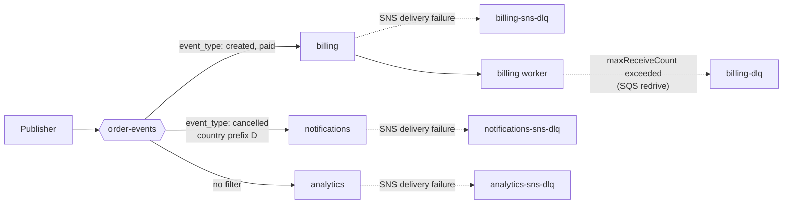

# Amazon SNS — Filtering & Fan-out Patterns

## Filter Policies

A **filter policy** is a JSON object on a subscription. A subscription without one receives every message. With one, SNS compares the policy to each published message and delivers only on a match; a rejected message is counted as *filtered out* and is not an error.

| Setting | `FilterPolicyScope=MessageAttributes` (default) | `FilterPolicyScope=MessageBody` |
|---------|-----------------------------------------------|-------------------------------|
| Matches against | Message attributes (`String`, `String.Array`, `Number`; `Binary` is ignored) | The JSON message body, which must be a well-formed JSON object |
| Nested keys | Not accepted | Accepted (`{"order": {"status": ["paid"]}}`); only leaf keys count toward the key limit |
| Cost | Free | Billed per scanned byte, 1 KB minimum per message |
| Publisher effort | Must set attributes | None: the body is the contract |
| Special characters | Double quotes and backslashes must be double-escaped in the policy | Normal JSON |

Combination rules:

| You want | Write | Example |
|----------|-------|---------|
| AND across properties | Several keys | `{"event_type": ["created"], "country": ["DE"]}` |
| OR across values of one key | Several values in the array | `{"event_type": ["created", "paid"]}` |
| OR across different keys | `$or` with at least 2 objects | `{"$or": [{"a": ["1"]}, {"b": ["2"]}]}` |
| AND on the same key | Not possible | Use one operator that expresses both, for example a numeric range |

`$or` is recognised only when its value is an array of at least two objects and none of the objects uses a reserved operator name (`numeric`, `prefix`, ...) as a field name; otherwise it is treated as an ordinary property called `$or`.

### Operators

All syntax below is from the AWS documentation. The last two columns show how **moto** handles each operator (`ok` means moto follows the documented behaviour).

| Operator | Policy fragment | Attributes scope (moto) | Body scope (moto) |
|----------|-----------------|------------------------|-------------------|
| Exact string | `"k": ["abc"]` | ok | ok |
| Prefix | `"k": [{"prefix": "ab"}]` | ok | ok |
| Suffix | `"k": [{"suffix": "bc"}]` | ok | ok |
| Equals ignore case | `"k": [{"equals-ignore-case": "abc"}]` | **never matches** | **never matches** |
| Anything-but (list) | `"k": [{"anything-but": ["a", "b"]}]` | ok | ok |
| Anything-but prefix | `"k": [{"anything-but": {"prefix": "ab"}}]` | ok | ok |
| Anything-but suffix | `"k": [{"anything-but": {"suffix": "bc"}}]` | **never matches** | **never matches** |
| Wildcard | `"k": [{"wildcard": "a*c"}]` | **rejected at subscribe** | **rejected at subscribe** |
| Anything-but wildcard | `"k": [{"anything-but": {"wildcard": "a*c"}}]` | **never matches** | **never matches** |
| Numeric equals | `"k": [{"numeric": ["=", 3]}]` | ok | ok |
| Numeric range | `"k": [{"numeric": [">", 1, "<=", 5]}]` (also `<`, `>=`) | ok | ok |
| Numeric anything-but | `"k": [{"anything-but": [100, 500]}]` | ok | ok |
| Key exists | `"k": [{"exists": true}]` | ok | ok |
| Key absent | `"k": [{"exists": false}]` | ok (see note) | ok |
| CIDR | `"k": [{"cidr": "10.0.0.0/24"}]` | **rejected at subscribe** | **rejected at subscribe** |
| `$or` | `{"$or": [{"a": ["1"]}, {"b": ["2"]}]}` | ok | **`TypeError` inside moto at publish** |

Notes on semantics (documented):

- `String.Array` and body arrays: each element is matched on its own. For `anything-but` the documentation contradicts itself (the text says no element may be listed, the examples match `["rugby", "baseball"]` against a policy excluding `rugby`), so verify array plus `anything-but` on a real account.
- Numbers are written without quotes in the policy; `Number` attributes and JSON numbers are accepted in exponent form (`3.015e2`). Range: -10^9 to 10^9 with five digits after the decimal point.
- Strings are **case-sensitive** unless you use `equals-ignore-case`.
- `exists` works only on leaf keys. `exists: true` requires a non-null, non-empty value. `exists: false` matches only if the message has at least one attribute at all: an attribute-less message does not match. moto matches an attribute-less message, so moto and the docs disagree.
- Wildcard operators (`wildcard`, `anything-but` with `wildcard`) were added in July 2025. Their complexity is limited: at most 100 points per policy and 3 wildcards per pattern.
- A body that is not valid JSON never matches a body-scope policy (CloudWatch counts it under `NumberOfNotificationsFilteredOut-InvalidMessageBody`; moto does not deliver it either).

### Limits

| Limit | Value |
|-------|-------|
| Keys per policy | 5 (in nested body policies only leaf keys count) |
| Value combinations | 150: multiply the number of values of each key (for nested keys also the nesting level). `$or` branches are summed |
| Policy size | 256 KB, valid UTF-8 JSON |
| Policies | 200 per topic, 10,000 per account. A queue subscription can still be created without a policy once the limit is reached; attaching the policy fails |
| Propagation | The docs say additions and changes can take **up to 15 minutes** to take effect completely (eventual consistency). moto applies them instantly |

moto also enforces the 5-key and 150-combination limits (`InvalidParameter`: "Filter policy can not have more than 5 keys" and "Filter policy is too complex") and rejects unknown operators. An invalid `FilterPolicyScope` makes moto raise a bare `CheckException` instead of a `ClientError`.

### Attributes or Body

| Choose attributes when | Choose body when |
|------------------------|------------------|
| You control the publisher and routing keys are stable | Events come from a producer you cannot change (AWS services, other teams) |
| Cost matters at high volume | You need nested fields or arrays of objects |
| Raw delivery with at most 10 attributes is acceptable | The same body must be both payload and routing source |
| You want policies that are easy to unit-test with plain dicts | You want the filter and the payload model to change together (pin both with the Pydantic model) |

Attribute filters are the default recommendation; use body scope when the contract is the payload, and pin it with the Pydantic model so the filter and the model cannot drift apart (see [04 Testing](./04-testing.md#contract-tests)).

## SNS to SQS Fan-out



Each consumer owns: a queue, a delivery DLQ for SNS failures, two queue policies (one on each queue trusting the topic), and one subscription with its filter and redrive policy. The helper below wires one set per consumer. The policies are what real AWS needs.

```python
# fanout.py
import json
from dataclasses import dataclass, field


@dataclass
class Consumer:
    name: str
    filter_policy: dict | None = None
    scope: str = "MessageAttributes"
    queue_url: str = field(default="", init=False)
    dlq_url: str = field(default="", init=False)


def _arn(sqs, url: str) -> str:
    return sqs.get_queue_attributes(QueueUrl=url, AttributeNames=["QueueArn"])["Attributes"]["QueueArn"]


def _allow_topic(topic_arn: str, queue_arn: str) -> str:
    return json.dumps({
        "Version": "2012-10-17",
        "Statement": [{
            "Sid": "AllowSnsTopic",
            "Effect": "Allow",
            "Principal": {"Service": "sns.amazonaws.com"},
            "Action": "sqs:SendMessage",
            "Resource": queue_arn,
            "Condition": {"ArnEquals": {"aws:SourceArn": topic_arn}},   # only THIS topic (confused-deputy guard)
        }],
    })


def wire_fanout(sns, sqs, topic_arn: str, consumers: list[Consumer]) -> None:
    """One queue + one SNS delivery DLQ per consumer; both queues trust the topic."""
    for c in consumers:
        c.queue_url = sqs.create_queue(QueueName=c.name)["QueueUrl"]
        c.dlq_url = sqs.create_queue(QueueName=f"{c.name}-sns-dlq",
                                     Attributes={"MessageRetentionPeriod": "1209600"})["QueueUrl"]   # 14 days
        queue_arn, dlq_arn = _arn(sqs, c.queue_url), _arn(sqs, c.dlq_url)

        # SNS must be allowed to write to the queue AND to the subscription DLQ
        sqs.set_queue_attributes(QueueUrl=c.queue_url, Attributes={"Policy": _allow_topic(topic_arn, queue_arn)})
        sqs.set_queue_attributes(QueueUrl=c.dlq_url, Attributes={"Policy": _allow_topic(topic_arn, dlq_arn)})

        attrs = {
            "RawMessageDelivery": "true",
            "RedrivePolicy": json.dumps({"deadLetterTargetArn": dlq_arn}),   # SNS -> queue delivery failures
        }
        if c.filter_policy is not None:
            attrs["FilterPolicy"] = json.dumps(c.filter_policy)
            attrs["FilterPolicyScope"] = c.scope
        sns.subscribe(TopicArn=topic_arn, Protocol="sqs", Endpoint=queue_arn, Attributes=attrs)
```

```python
consumers = [
    Consumer("billing", {"event_type": ["created", "paid"]}),
    Consumer("notifications", {"event_type": ["cancelled"], "country": [{"prefix": "D"}]}),
    Consumer("analytics"),                                           # no filter: everything
]
wire_fanout(sns, sqs, topic, consumers)
for et, country in [("created", "DE"), ("paid", "FR"), ("cancelled", "DE"), ("cancelled", "FR")]:
    sns.publish(TopicArn=topic, Message=f"{et}/{country}", MessageAttributes={
        "event_type": {"DataType": "String", "StringValue": et},
        "country": {"DataType": "String", "StringValue": country}})
```

```text
billing        ['created/DE', 'paid/FR']
notifications  ['cancelled/DE']
analytics      ['created/DE', 'paid/FR', 'cancelled/DE', 'cancelled/FR']
{'billing': 'billing-sns-dlq', 'notifications': 'notifications-sns-dlq', 'analytics': 'analytics-sns-dlq'}
```

### Two Different DLQs

| | SNS subscription DLQ | SQS consumer DLQ |
|---|---|---|
| Configured on | The **subscription** (`RedrivePolicy` = `{"deadLetterTargetArn": ...}`) | The **queue** (`RedrivePolicy` with `maxReceiveCount`) |
| Catches | SNS could not deliver to the queue (policy removed, queue deleted, KMS denied) | The consumer received the message too many times without deleting it |
| Who writes to it | SNS, so the DLQ policy trusts `sns.amazonaws.com` | SQS itself |
| Typical alarm | `ApproximateNumberOfMessagesVisible` on the DLQ, `NumberOfNotificationsFailed` on the topic | Same on the SQS DLQ |

Queue-side redrive, visibility timeout and poison-message handling are in [Amazon SQS](../sqs/index.md). A common first failure of this wiring is a missing queue policy: SNS then cannot deliver, which is a client-side error that is **not retried** and goes straight to the subscription DLQ if one exists, or is lost.

## FIFO Topics: Archiving and Replay

FIFO topics (and only FIFO topics) can store every published message and replay it to a subscription later: useful to rebuild a consumer's state or recover from a downstream bug.

```python
# moto accepts ArchivePolicy but does not store it, and rejects ReplayPolicy
import json

sns.set_topic_attributes(
    TopicArn=fifo_topic_arn, AttributeName="ArchivePolicy",
    AttributeValue=json.dumps({"MessageRetentionPeriod": "30"}),      # days, 1 to 365; "{}" disables and clears the archive
)

sns.set_subscription_attributes(                                      # replay a time window into one subscription
    SubscriptionArn=subscription_arn, AttributeName="ReplayPolicy",
    AttributeValue=json.dumps({
        "PointType": "Timestamp",
        "StartingPoint": "2026-10-20T10:00:00.000Z",
        "EndingPoint": "2026-10-20T12:00:00.000Z",                    # optional
    }),
)
print(sns.get_subscription_attributes(SubscriptionArn=subscription_arn)["Attributes"]["ReplayStatus"])
# Pending | In progress | Completed | Failed
```

| Fact | Detail |
|------|--------|
| Archive scope | One copy of every message on the topic, for all subscriptions; extra charges apply |
| Replayed message | Same content, `MessageId` and `Timestamp`; carries the boolean attribute `Replayed` |
| **`EndingPoint` pauses the subscription** | With an end point, live messages published after the replay are **not** delivered until you apply a new `ReplayPolicy` without `EndingPoint` |
| Filters | Replayed messages are checked against the subscription's `FilterPolicy` |
| Deleting the topic | Not possible while an archive policy is active; clearing the policy deletes the archive |
| Encrypted topics | `kms:Decrypt` and `kms:GenerateDataKey` for `sns.amazonaws.com` in the key policy |
| Limits | A replay start can fail with `ReplayLimitExceeded` when too many replays run; replay metrics: `NumberOfReplayedNotificationsDelivered`, `NumberOfReplayedNotificationsFailed`. Archive metrics: `ApproximateNumberOfMessagesArchived` and others |

For FIFO fan-out to SQS FIFO queues use the same wiring as above with `.fifo` names, `FifoQueue=true` queues, and publish with `MessageGroupId` and a dedup ID; the tested example is in [04 Testing](./04-testing.md#fifo-tests).

## SNS to Lambda

Lambda subscribes directly to **standard** topics only (FIFO needs a queue in between). SNS invokes the function **asynchronously**, so duplicates can occur and the function must be idempotent.

```bash
aws lambda add-permission --function-name example-function \
    --source-arn arn:aws:sns:us-east-1:123456789012:order-events \
    --statement-id function-with-sns --action "lambda:InvokeFunction" --principal sns.amazonaws.com

aws sns subscribe --protocol lambda --topic-arn arn:aws:sns:us-east-1:123456789012:order-events \
    --notification-endpoint arn:aws:lambda:us-east-1:123456789012:function:example-function
```

The handler receives a `Records` list whose items hold the SNS message under `Sns`. It is a plain function, so it is unit-tested with a dict:

```python
import json


def handler(event, context):
    processed = []
    for record in event["Records"]:
        sns = record["Sns"]
        payload = json.loads(sns["Message"])
        event_type = sns["MessageAttributes"]["event_type"]["Value"]      # "Value", not "StringValue"
        processed.append((sns["MessageId"], event_type, payload["order_id"]))
    return processed


event = {"Records": [{"EventSource": "aws:sns", "Sns": {
    "MessageId": "m-1", "Message": '{"order_id": "o-1"}',
    "MessageAttributes": {"event_type": {"Type": "String", "Value": "created"}}}}]}
print(handler(event, None))      # [('m-1', 'created', 'o-1')]
```

`Number` and `String.Array` attributes reach Lambda as plain `String`. What happens after a failed invocation is governed by Lambda's asynchronous invocation settings (retries, on-failure destination); check them for the function. Whether the function was actually invoked by SNS cannot be shown on moto here (moto's Lambda emulation needs Docker): that part is a real-account check.

## HTTP/S Subscribers

SNS POSTs the envelope with SNS-specific HTTP headers (`Content-Type: text/plain; charset=UTF-8` by default; configurable in the delivery policy). The endpoint first receives a `SubscriptionConfirmation` message whose `SubscribeURL` or `Token` must be used to confirm; later messages have type `Notification`; a final one is `UnsubscribeConfirmation`. Verify the signature of every message you act on. 5xx and 429 responses are retried per the delivery policy; other statuses are permanent failures. Test the receiver with plain `requests.post` of sample envelopes, and the confirmation handshake on a real topic.

## Observability

| Metric (`AWS/SNS`, dimension `TopicName`) | Meaning | Alarm on |
|------------------------------------------|---------|----------|
| `NumberOfMessagesPublished` | Messages published to the topic | Sudden drop to 0 |
| `NumberOfNotificationsDelivered` | Successful deliveries (filtered-out messages are not counted) | Ratio to published |
| `NumberOfNotificationsFailed` | Deliveries SNS gave up on; for HTTP/S every failed attempt counts | `>= 1` |
| `NumberOfNotificationsFilteredOut` | Rejected by filter policies; split by `-MessageAttributes`, `-MessageBody`, `-InvalidAttributes`, `-NoMessageAttributes`, `-InvalidMessageBody` | Unexpected jumps after a policy change |
| `NumberOfNotificationsRedrivenToDlq` | Moved to a subscription DLQ | `>= 1` |
| `NumberOfNotificationsFailedToRedriveToDlq` | Could not be moved to the DLQ: data loss | `>= 1` |
| `PublishSize` | Size of published messages (a batch counts as one data point) | Near the size limit |

Metrics are pushed once a minute and are free. A topic counts as active for up to six hours after its last API call.

```python
cw = boto3.client("cloudwatch")
cw.put_metric_alarm(
    AlarmName="order-events-delivery-failed", Namespace="AWS/SNS", MetricName="NumberOfNotificationsFailed",
    Dimensions=[{"Name": "TopicName", "Value": "order-events"}], Statistic="Sum", Period=60,
    EvaluationPeriods=1, Threshold=1, ComparisonOperator="GreaterThanOrEqualToThreshold",
    TreatMissingData="notBreaching",
)
```

moto accepts the call and returns the alarm, but it never emits `AWS/SNS` metrics (`list_metrics(Namespace="AWS/SNS")` stays empty after a publish), so alarm logic is a real-account check.

**Delivery status logging** writes per-delivery records to CloudWatch Logs: set `<Protocol>FailureFeedbackRoleArn` (all failures are logged) and optionally `<Protocol>SuccessFeedbackRoleArn` with `<Protocol>SuccessFeedbackSampleRate` (0 to 100) for `SQS`, `Lambda`, `HTTP`, `Firehose` or `Application`. moto accepts these attributes but stores nothing.

## Mobile Push and SMS (Overview)

| | Mobile push | SMS |
|---|-------------|-----|
| Model | Platform application (APNs, FCM, ...) holds credentials; each device is an **endpoint** with an ARN; subscribe the endpoint with protocol `application` or publish with `TargetArn` | Publish to a phone number (E.164) or subscribe it with protocol `sms` |
| Payload | Per-platform JSON through `MessageStructure="json"`; reserved attributes `AWS.SNS.MOBILE.*` set TTL, priority and similar | Up to 1,600 characters per `Publish`, split into several messages |
| Constraints | Retry policy 50 attempts over 6 hours; delivery status logging at application level | New accounts start in the SMS sandbox (verified numbers only); default account spend threshold 1.00 USD; 20 messages/s per type; billed through AWS End User Messaging |
| Testing | Real devices and credentials | Real numbers; do not automate against production senders |

Neither is emulated by a useful fake; keep them out of automated suites except for contract tests of the payload builder.

## SNS vs EventBridge vs Kafka vs RabbitMQ

| | SNS (+ SQS) | EventBridge | Kafka | RabbitMQ |
|---|------------|-------------|-------|----------|
| Model | Push pub/sub; queues add pull and buffering | Event bus: rules match events and route to targets | Persistent log, consumers pull and track offsets | Broker: exchanges route to queues |
| Stores messages | No (SQS queue per consumer does) | No | Yes, by retention; replay by offset | Until acked (streams excepted) |
| Ordering | FIFO topics per message group; standard none | None | Per partition | Per queue |
| Filtering and routing | Attribute or body filter per subscription | Rich content-based event patterns | Topic and key only | Exchange types and bindings |
| Delivery | At-least-once on standard; dedup on FIFO | At-least-once; default retries for 24 hours, up to 185 attempts | At-least-once, exactly-once with transactions | At-least-once with acks |
| Replay | FIFO archive and replay | See EventBridge docs | Native | Streams only |
| Targets | SQS, Lambda, HTTP/S, e-mail, SMS, push, Firehose | Many AWS services, API destinations, SaaS, other buses | Your consumers | Your consumers |
| Best fit | Fan-out of one event to several consumers, notifications | Reacting to AWS and SaaS events, cross-account event buses | Event log, many readers, stream processing, high volume | Task queues, per-message routing, RPC |

Rule of thumb: **SNS + SQS** when your own services need the same event with per-consumer buffering and AWS-managed operations; **EventBridge** when the source is AWS or a SaaS and routing rules are complex; **Kafka** ([guide](../../tools/kafka/index.md)) when events must be kept and re-read by many consumers; **RabbitMQ** ([guide](../../tools/rabbitmq/index.md)) for routing-heavy work queues and a portable broker. EventBridge figures come from the AWS decision guide; check current quotas before sizing.

## Quick Rules

1. **Wire three things per queue subscriber**: a queue policy, a subscription (with raw delivery and filter) and a delivery DLQ with its own policy.
2. **Filter on attributes by default**, on the body when the payload is the contract, and never expect `equals-ignore-case`, `wildcard`, `cidr` or anything-but `suffix` to work on moto.
3. **Test the policy with one positive and one negative message** per operator; a filter that matches everything also "works".
4. **Plan for propagation**: after changing a filter policy on a real account, poll with a deadline rather than assuming immediate effect.
5. **Keep keys under 5 and combinations under 150**, and count nested levels in body policies.
6. **Alarm on `NumberOfNotificationsFailed`, `NumberOfNotificationsFailedToRedriveToDlq` and the DLQ depth**.
7. **Use `EndingPoint` in a replay only on purpose**: it pauses live delivery.
8. **Make Lambda and standard-queue consumers idempotent**; FIFO helps only when no filter policy is in the way.

---
## See also
- [Amazon SNS — Overview](./index.md)
- [Amazon SNS — Core Concepts](./01-core-concepts.md)
- [Amazon SNS — Testing SNS-Based Systems](./04-testing.md)
- [Amazon SQS](../sqs/index.md)
- [Queues vs Streams: Message Delivery, Ordering & Reliability](../../software-design-patterns/05-composition-architectural/04-queues-streams-messaging.md)
- [Apache Kafka — Event Streaming, Producers & Consumers](../../tools/kafka/index.md)
- [RabbitMQ — Message Broker, Routing & Queues](../../tools/rabbitmq/index.md)
