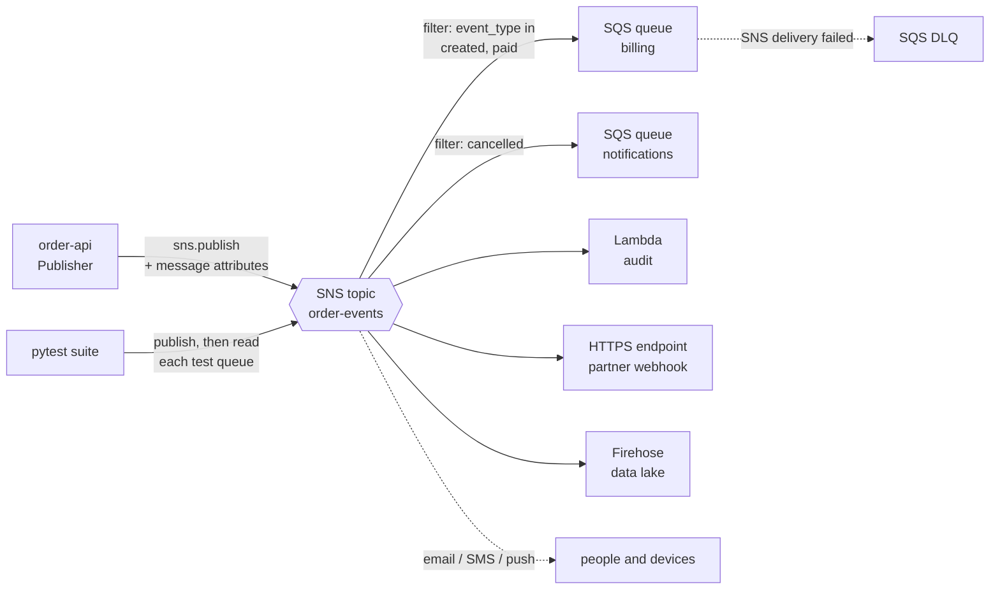

# Amazon SNS — Topics, Subscriptions & Fan-out

Amazon Simple Notification Service (SNS) is a managed **publish/subscribe** service. A publisher sends one message to a **topic**; SNS pushes a copy to every **subscription** whose filter accepts it. Subscribers can be SQS queues, Lambda functions, HTTP/S endpoints, email addresses, phone numbers, mobile push endpoints and Firehose streams. SNS does not store messages for later pickup: a subscriber that needs a buffer gets one by subscribing an SQS queue.

This guide covers the topic side of the pair SNS + SQS: topics, subscriptions, message attributes, filter policies, fan-out wiring, delivery retries and DLQs, and testing with Python. General pub/sub, delivery semantics and DLQ theory are in [Queues vs Streams](../../software-design-patterns/05-composition-architectural/04-queues-streams-messaging.md); the queue side (visibility timeout, redrive, consumers) is in [Amazon SQS](../sqs/index.md). Sessions, credentials, retries and `ClientError` handling are in [AWS Foundations](../foundations/index.md) and are not repeated here.

## Where SNS Fits



- **One publish, many independent consumers.** The publisher does not know who listens; each subscription gets its own copy, filtered by its own policy.
- **Push, not pull.** SNS calls the subscriber. For queues that is `sqs:SendMessage`, so the queue needs a policy that trusts the topic.
- **Retries and DLQs are per subscription.** A slow or broken subscriber does not block the others.
- **Tests** subscribe throw-away SQS queues to the topic and assert on what arrives — see [04 Testing](./04-testing.md) and [05 moto Limits, Pitfalls & CI](./05-moto-gaps-ci.md).

## Section Map

| File | Topics |
|------|--------|
| [01 Core Concepts](./01-core-concepts.md) | Standard and FIFO topics, naming, subscriptions and confirmation, message attributes, envelope vs raw delivery, retry policies, subscription DLQ, access policies, SSE-KMS, limits, pricing dimensions |
| [02 boto3 in Python](./02-boto3-python.md) | `create_topic`, `subscribe`, `publish`, `publish_batch`, attribute data types, FIFO group and dedup IDs, subscription and topic attributes, tags, pagination, error handling |
| [03 Filtering & Fan-out Patterns](./03-filtering-fanout.md) | Filter policy scopes and every operator, limits, SNS to SQS fan-out wiring, per-consumer DLQs, FIFO archiving and replay, Lambda subscriber, metrics and alarms, SNS vs EventBridge vs Kafka vs RabbitMQ |
| [04 Testing SNS-Based Systems](./04-testing.md) | What to test where, pure message builders, fixtures with unique names and test queues, delivery and filter tests, FIFO tests, Pydantic contracts, negative tests, moto server mode |
| [05 moto Limits, Pitfalls & CI](./05-moto-gaps-ci.md) | What moto does not emulate, real-account smoke test, flakiness pitfalls, GitHub Actions, QA checklist |

## Minimal Working Example

A topic, a queue that trusts it, a filtered raw-delivery subscription, two publishes, one delivery. The example uses moto; remove `mock_aws()` and use real credentials to run it on AWS.

```python
# uv add boto3 "moto[sns,sqs]"
import json

import boto3
from moto import mock_aws

with mock_aws():                                   # remove this line (and set real credentials) to use real AWS
    sns = boto3.client("sns", region_name="us-east-1")
    sqs = boto3.client("sqs", region_name="us-east-1")

    topic_arn = sns.create_topic(Name="order-events")["TopicArn"]
    queue_url = sqs.create_queue(QueueName="billing")["QueueUrl"]
    queue_arn = sqs.get_queue_attributes(QueueUrl=queue_url, AttributeNames=["QueueArn"])["Attributes"]["QueueArn"]

    # Real AWS: the queue must allow this topic to send to it (moto does not check this)
    sqs.set_queue_attributes(QueueUrl=queue_url, Attributes={"Policy": json.dumps({
        "Version": "2012-10-17",
        "Statement": [{
            "Effect": "Allow", "Principal": {"Service": "sns.amazonaws.com"},
            "Action": "sqs:SendMessage", "Resource": queue_arn,
            "Condition": {"ArnEquals": {"aws:SourceArn": topic_arn}},
        }],
    })})

    sns.subscribe(TopicArn=topic_arn, Protocol="sqs", Endpoint=queue_arn,
                  Attributes={"RawMessageDelivery": "true",
                              "FilterPolicy": json.dumps({"event_type": ["created"]})})

    for event_type in ("created", "cancelled"):
        sns.publish(TopicArn=topic_arn, Message=json.dumps({"order_id": "o-1", "type": event_type}),
                    MessageAttributes={"event_type": {"DataType": "String", "StringValue": event_type}})

    messages = sqs.receive_message(QueueUrl=queue_url, MaxNumberOfMessages=10, MessageAttributeNames=["All"])["Messages"]
    print(len(messages), "message(s):", messages[0]["Body"])
    print(messages[0]["MessageAttributes"]["event_type"]["StringValue"])
# 1 message(s): {"order_id": "o-1", "type": "created"}
# created
```

The `cancelled` message was published but filtered out by the subscription; only `created` reached the queue.

## Protocols

| Protocol | Endpoint | Confirmation | Raw delivery | On FIFO topics |
|----------|----------|--------------|--------------|----------------|
| `sqs` | Queue ARN | Automatic when the queue owner subscribes; otherwise a confirmation message in the queue | Yes | Yes (FIFO or standard queue) |
| `lambda` | Function ARN | Automatic in the same account | No (invoked asynchronously with an SNS event) | No (use a queue in between) |
| `firehose` | Delivery stream ARN + `SubscriptionRoleArn` | Automatic in the same account | Yes | Not stated on the FIFO delivery page; verify before relying on it |
| `http` / `https` | URL | `ConfirmSubscription` with the token SNS posts to the URL | Yes | No |
| `email` / `email-json` | Address | Link in the confirmation e-mail | No | No |
| `sms` | Phone number (E.164) | None | No | No |
| `application` | Mobile platform endpoint ARN | None | No | No |

`email`, `sms` and `application` (mobile push) are covered at overview level only: the SMS sandbox, origination numbers and push credentials need real accounts and devices, so they are out of scope for test automation. Cross-account subscriptions always need confirmation (see [01 Core Concepts](./01-core-concepts.md#subscriptions-and-confirmation)).

## Standard vs FIFO at a Glance

| | Standard topic | FIFO topic |
|---|---|---|
| Name | Letters, digits, `_`, `-`; 1 to 256 characters | Same, plus the `.fifo` suffix; created with `FifoTopic=true` |
| Ordering | Not guaranteed | Strict order within a `MessageGroupId` |
| Duplicates | Possible (at-least-once) | Dropped by `MessageDeduplicationId` within 5 minutes |
| Publish needs | `Message` | `Message`, `MessageGroupId`, and a dedup ID unless `ContentBasedDeduplication` is on |
| Subscribers | All protocols | SQS queues only (FIFO for ordering and dedup, standard allowed) |
| Topic limit per account | 100,000 | 1,000 |
| Subscriptions per topic | 12,500,000 | 100 |
| Throughput | Regional per-account publish quota (for example 30,000 messages/s in us-east-1) | 3,000 messages/s or 20 MB/s per topic with `FifoThroughputScope=Topic`; 300 messages/s per message group |
| Type and name after creation | Cannot be changed | Cannot be changed |

Details, sources and the quota exceptions are in [01 Core Concepts](./01-core-concepts.md#limits-and-quotas).

## Quick Rules

1. **Fan out through SQS**: subscribe one queue per consumer instead of letting consumers share a topic endpoint. Each consumer then has its own buffer, retries and DLQ.
2. **Allow the topic in the queue policy** with `aws:SourceArn` set to the topic ARN. Without it, deliveries fail silently from the publisher's point of view.
3. **Put routing data in message attributes** and filter with subscription policies; the publisher stays unaware of its consumers.
4. **Use raw message delivery** for queues unless the consumer needs the SNS envelope (message ID, topic ARN, signature).
5. **Attach a DLQ to every subscription** that matters (`RedrivePolicy`), keep 14 days of retention and alarm on the queue depth.
6. **Treat standard topics as at-least-once and unordered**; make consumers idempotent. Use FIFO topics only when order or dedup is part of the contract.
7. **Check `Failed` in every `publish_batch` response**; the HTTP call can succeed while entries fail.
8. **Keep tests isolated**: unique topic and queue names, a fake-credential fixture, and a bounded polling helper instead of `sleep`.
9. **Do not trust moto for filter operators, DLQ redrive, FIFO topic dedup or policies**; the exact gaps are listed in [05 moto Limits, Pitfalls & CI](./05-moto-gaps-ci.md#what-moto-does-not-emulate).

---
## See also
- [Digital Garden: Knowledge Base](../../index.md)
- [AWS — Service Guides for Python & Test Automation](../index.md)
- [AWS Foundations — boto3, Credentials & Local Testing](../foundations/index.md)
- [Amazon SQS](../sqs/index.md)
- [Amazon Bedrock](../bedrock/index.md)
- [Queues vs Streams: Message Delivery, Ordering & Reliability](../../software-design-patterns/05-composition-architectural/04-queues-streams-messaging.md)
- [Apache Kafka — Event Streaming, Producers & Consumers](../../tools/kafka/index.md)
- [RabbitMQ — Message Broker, Routing & Queues](../../tools/rabbitmq/index.md)
- [Pytest — Python Testing Framework](../../libs/pytest/index.md)
- [Pydantic — Data Validation & Settings](../../libs/pydantic/index.md)
