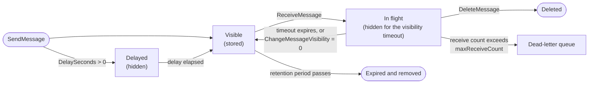

# Amazon SQS — Core Concepts

## Standard vs FIFO

| | Standard | FIFO |
|---|----------|------|
| Ordering | Best effort; messages can arrive out of order | First in, first out **within a message group**; groups are independent |
| Delivery | At least once; a message can be delivered more than once | Duplicate sends with the same deduplication ID inside **5 minutes** are accepted but not delivered |
| Throughput | Very high, "nearly unlimited" API calls per second per action | See below: 300 TPS per action, 3,000 messages/s with batching, more in high-throughput mode |
| `MessageGroupId` | Optional; enables **fair queues** (no ordering) | Required on every send; up to 128 characters |
| `MessageDeduplicationId` | Not used | Required unless `ContentBasedDeduplication` is on; up to 128 characters |
| Per-message `DelaySeconds` | Yes (0–900) | No — only the queue-level `DelaySeconds` |
| In-flight messages | About 120,000 (depends on traffic and backlog); short polling gets `OverLimit` beyond it | 120,000; no error, but processing can be affected |
| Type is fixed | Yes — you cannot convert a standard queue into a FIFO queue or back | Yes — create a new queue and migrate |
| Dead-letter queue | Must be a standard queue | Must be a FIFO queue |

Choose by the failure you cannot tolerate. Standard is the default for independent jobs. FIFO costs throughput and parallelism: while one message of a group is in flight, **no other message of that group is delivered**, so one hot `MessageGroupId` is a single-threaded lane. Use a fine-grained group key (customer ID, order ID), not a constant.

### FIFO details

- `MessageGroupId` decides ordering and parallelism: consumers can process different groups concurrently, never two messages of one group at once.
- **Deduplication**: if `MessageDeduplicationId` was already accepted in the last 5 minutes, the send succeeds but the message is not delivered. SQS keeps tracking the ID even after the message was received and deleted.
- **Content-based deduplication** (`ContentBasedDeduplication=true`) derives the ID from a SHA-256 hash of the **body only — message attributes are not included**. Send an explicit `MessageDeduplicationId` when bodies are identical but must stay distinct, or when the same logical event may have different bodies.
- Within one `SendMessageBatch`, messages are enqueued in the order they appear in the request.
- `ReceiveRequestAttemptId` lets you retry a `ReceiveMessage` whose response was lost, and get the same messages back, for 5 minutes, as long as none of them was deleted or had its visibility changed.
- A dead-letter queue breaks strict order for a group: do not use one when order is more important than progress. Without a DLQ, a poison message blocks its group until it is deleted or expires.

### High-throughput FIFO

Enable it with two queue attributes (both required; any other combination gives normal throughput):

```python
sqs.create_queue(QueueName="events.fifo", Attributes={
    "FifoQueue": "true",
    "DeduplicationScope": "messageGroup",          # deduplicate per group instead of per queue
    "FifoThroughputLimit": "perMessageGroupId",    # throughput quota applies per group, not per queue
})
```

FIFO limits are in API requests per second per action (`SendMessage`, `ReceiveMessage`, `DeleteMessage`), and batching multiplies the message rate by up to 10. Documented defaults in October 2026:

| Region group | High throughput, requests/s | With batches of 10, messages/s |
|--------------|-----------------------------|--------------------------------|
| US East (N. Virginia), US West (Oregon), Europe (Ireland) | 70,000 | 700,000 |
| US East (Ohio), Europe (Frankfurt) | 19,000 | 190,000 |
| Asia Pacific (Mumbai, Singapore, Sydney, Tokyo), Europe (Spain) | 9,000 | 90,000 |
| Europe (London), South America (São Paulo) | 4,500 | 45,000 |
| All other Regions | 2,400 | 24,000 |
| Normal throughput (any Region) | 300 per action | 3,000 |

These move over time; read the current numbers on the AWS "Quotas related to messages" page and in Service Quotas before sizing. Throughput scales with the **number of distinct message groups** (a group ID is hashed to a partition), and each partition tops out at 300 requests/s or 3,000 batched messages/s.

## Message Lifecycle



Three facts drive most consumer bugs:

1. **Receiving does not remove the message.** It only hides it. The message is gone only after `DeleteMessage` with a valid receipt handle.
2. **Every receive returns a new receipt handle.** The handle belongs to the receive, not to the message. Delete or extend with the most recently received handle; an older handle might not delete the message.
3. **The message ID never changes**, so it is a poor idempotency key if the producer can retry (a retry creates a new message with a new ID). Use a business key from the body or an attribute.

## Visibility Timeout

| Item | Value |
|------|-------|
| Default (queue attribute `VisibilityTimeout`) | 30 seconds |
| Range | 0 seconds to 12 hours (43,200) |
| Per receive | `ReceiveMessage(VisibilityTimeout=...)` overrides the queue value for the returned messages |
| Per message | `ChangeMessageVisibility` sets a **new** timeout counted from the moment of the call, not from the receive |
| Hard cap | 12 hours from the first receive; extending does not reset it, and asking for more than the time left returns an error |
| Not persistent | A value set with `ChangeMessageVisibility` applies once; on the next receive the queue default applies again |
| Release early | `ChangeMessageVisibility` with `0` makes the message visible immediately (still counts as a receive) |

Rules of thumb:

- Set the queue timeout to the longest **normal** processing time plus margin. Too short means duplicates; too long delays the retry after a crash.
- For jobs of unpredictable length, keep the queue default small and run a **heartbeat** that extends the timeout while the work runs (pattern in [03](./03-consumer-patterns.md#visibility-heartbeat-for-long-jobs)).
- Lambda: set the queue timeout to **at least six times the function timeout** (plus the batching window); the function timeout must not exceed the queue's timeout.
- A message that is not deleted before the timeout expires counts as a failed receive and moves you towards `maxReceiveCount`.

## Short and Long Polling

| | Short polling | Long polling |
|---|---------------|--------------|
| Trigger | `WaitTimeSeconds=0` (and queue `ReceiveMessageWaitTimeSeconds=0`) — the default | `WaitTimeSeconds` 1–20 on the call, or `ReceiveMessageWaitTimeSeconds` on the queue |
| Servers queried | A weighted random **subset**; may return fewer messages than exist or none at all | All servers |
| Response | Immediate, even if empty | When at least one message is available, or when the wait expires |
| Cost | Many empty receives, each billed | Far fewer empty receives |
| Use | Almost never | Always for consumers |

- The maximum wait is **20 seconds**. The call's `WaitTimeSeconds` wins over the queue default.
- With fewer than about 1,000 messages in the queue, a short poll often returns nothing even though messages exist; repeating the call eventually returns them. Tests written with short polling are flaky for this reason on real SQS.
- The HTTP client's read timeout must be longer than `WaitTimeSeconds`. botocore's default read timeout is 60 seconds, so the 20-second maximum is safe unless you lowered it.
- An empty response has **no `Messages` key** in boto3.

## Delay Queues and Message Timers

- **Delay queue**: `DelaySeconds` on the queue hides every new message for 0–900 seconds (15 minutes).
- **Message timer**: `DelaySeconds` on `SendMessage` or on a batch entry overrides the queue value for that message. **Not supported on FIFO queues.**
- Changing a queue's delay is not retroactive for standard queues and **is** retroactive for FIFO queues.
- Delay differs from visibility timeout: delay hides a message when it arrives, visibility timeout hides it after it is received.
- Longer schedules than 15 minutes: use EventBridge Scheduler, which AWS recommends for advanced scheduling.

## Retention

| Item | Value |
|------|-------|
| Default | 4 days (345,600 s) |
| Range | 60 seconds to 14 days (1,209,600 s) |
| Change propagation | Up to 15 minutes for `MessageRetentionPeriod`; lowering it below the age of existing messages deletes them |

**Dead-letter queue retention**: on a standard queue, expiry always counts from the **original enqueue time**, and moving a message to a DLQ does not reset it. A message that spent 1 day in the source queue has 3 days left in a DLQ with 4-day retention. On a FIFO queue the timestamp resets when the message moves. Always give the DLQ a longer retention than the source (set it to 14 days).

## Message Size, Content and Attributes

| Item | Limit |
|------|-------|
| Body size | 1 byte to **1 MiB** (1,048,576 bytes) — raised from 256 KiB in August 2025 |
| Queue attribute `MaximumMessageSize` | 1,024 bytes to 1 MiB; default 1 MiB |
| `SendMessageBatch` | Up to 10 entries; each message and the **sum of all entries** at most 1 MiB |
| Allowed characters | XML, JSON and plain text; Unicode `#x9`, `#xA`, `#xD`, `#x20`–`#xD7FF`, `#xE000`–`#xFFFD`, `#x10000`–`#x10FFFF`. Anything else is rejected with `InvalidMessageContents`. Binary data must be base64-encoded |
| Message attributes | At most **10** per message; all components count toward the 1 MiB limit; types `String`, `Number`, `Binary`, optionally with a custom label (`Number.int`); name up to 256 characters, no `AWS.` or `Amazon.` prefix |
| System attributes | Only `AWSTraceHeader` can be sent (X-Ray trace header); it does not count toward the size |
| Larger payloads | Store the payload in S3 and send a pointer (see [04](./04-lambda-scaling-integrations.md#large-payloads-through-s3)); the Python extended client library supports up to 2 GB |

On receive, the response has `MD5OfBody` and `MD5OfMessageAttributes`; the SDK checks them, so a corrupt response raises instead of returning bad data. Attributes you want back must be requested: `MessageAttributeNames=["All"]` (or names, or a `prefix.*`) and `MessageSystemAttributeNames` for `ApproximateReceiveCount`, `SentTimestamp`, `MessageGroupId`, `SequenceNumber`, `AWSTraceHeader`, `DeadLetterQueueSourceArn` and others. (The older `AttributeNames` parameter is deprecated.)

## Dead-Letter Queues and Redrive

A **redrive policy** on the source queue names the DLQ and `maxReceiveCount`:

```python
import json
sqs.set_queue_attributes(QueueUrl=source_url, Attributes={
    "RedrivePolicy": json.dumps({"deadLetterTargetArn": dlq_arn, "maxReceiveCount": 5}),   # a JSON string, not a dict
})
```

| Rule | Detail |
|------|--------|
| Same account and Region | The DLQ must live next to the source queue |
| Same type | Standard source → standard DLQ; FIFO source → FIFO DLQ |
| `maxReceiveCount` | Number of times a message can be received before it moves; default when the policy omits it is 10 |
| `RedriveAllowPolicy` | On the DLQ: `allowAll` (default), `denyAll`, or `byQueue` with up to 10 `sourceQueueArns` |
| Standard queue behaviour | With `maxReceiveCount` above 3, a message received 3 or more times without deletion is moved to the **back of the queue**; `ApproximateAgeOfOldestMessage` ignores it until it succeeds |
| Receive count | Visible as the system attribute `ApproximateReceiveCount` |
| Alarm | Alarm on `ApproximateNumberOfMessagesVisible` of the DLQ; `NumberOfMessagesSent` does **not** count messages moved by the redrive policy |

### Redrive from the DLQ

After fixing the bug, move messages back with the message-move APIs: `StartMessageMoveTask`, `ListMessageMoveTasks`, `CancelMessageMoveTask`.

| Item | Detail |
|------|--------|
| Source | The DLQ ARN. Only DLQs whose sources are **SQS queues** are accepted; DLQs of Lambda or SNS are not supported |
| Destination | Omit `DestinationArn` to return each message to its original source queue, or give any queue **of the same type** |
| Rate | `MaxNumberOfMessagesPerSecond` up to 500; omitted means the system picks a rate from the backlog |
| Limits | One active task per queue; a task runs at most 36 hours; up to 100 active tasks per account |
| Messages | Moved oldest first; they get a **new message ID and enqueue time** (retention restarts); no filtering or editing while moving |
| FIFO | Moving FIFO → FIFO replaces the deduplication ID with the original message ID |
| Cancel | Only a `RUNNING` task; messages already moved stay in the destination |
| Status values | `RUNNING`, `COMPLETED`, `CANCELLING`, `CANCELLED`, `FAILED` |
| IAM | `sqs:StartMessageMoveTask`, `ReceiveMessage`, `DeleteMessage`, `GetQueueAttributes` on the DLQ and `sqs:SendMessage` on the destination; with encryption `kms:Decrypt` (DLQ key) and `kms:GenerateDataKey` (destination key) |

Code and a test strategy for redrive are in [03](./03-consumer-patterns.md#redrive-from-the-dlq). moto does not implement these three APIs.

## Fair Queues

On a **standard** queue, set `MessageGroupId` to a tenant identifier when sending. SQS watches which groups have a disproportionate number of in-flight messages, calls them noisy, and returns messages of the other groups first. Consumers need no change, there is no throughput limit, and unlike FIFO the ID does **not** order or serialize anything. Use it when one queue serves many tenants, volume is high, and dwell time (time from arrival to processing) matters. Extra CloudWatch metrics: `ApproximateNumberOfNoisyGroups` and the `...InQuietGroups` family. Billing: requests that involve a message with a group ID are charged at both the fair-queue and standard rates.

## Encryption

| | SSE-SQS | SSE-KMS |
|---|---------|---------|
| Keys | SQS-owned, no key management | AWS managed key `alias/aws/sqs` or your own KMS key |
| Attribute | `SqsManagedSseEnabled=true` | `KmsMasterKeyId` (alias, key ID or ARN) |
| Default | **On for new queues** | Opt in |
| Extra cost and permissions | None | KMS requests are billed; callers need `kms:GenerateDataKey` (send) and `kms:Decrypt` (receive) on the key |
| Data key reuse | — | `KmsDataKeyReusePeriodSeconds` 60–86,400 s, default 300 |

Only the **message body** is encrypted; queue metadata, message IDs, timestamps and attributes are not. All requests to an encrypted queue must use HTTPS and Signature Version 4. A message is encrypted only if it was sent after encryption was enabled, and moving it to a DLQ does not change its encryption state. An encrypted queue using the default AWS managed key cannot invoke a Lambda function in another account.

## Queue Policies and IAM

A queue can carry a resource-based **queue policy** (attribute `Policy`) in addition to identity-based IAM policies. It is how another account, or an AWS service such as SNS or EventBridge, gets permission to call `sqs:SendMessage`. Limits: 8,192 bytes, 20 statements, 50 principals, 10 conditions. Always scope service principals with `aws:SourceArn` or `aws:SourceAccount` to avoid the confused-deputy problem. A policy example for SNS is in [04](./04-lambda-scaling-integrations.md#sns-to-sqs-from-the-queue-side).

| Role | Minimum actions |
|------|-----------------|
| Producer | `sqs:SendMessage` (+ `sqs:GetQueueUrl` if it looks the URL up by name) |
| Consumer | `sqs:ReceiveMessage`, `sqs:DeleteMessage`, `sqs:ChangeMessageVisibility`, `sqs:GetQueueAttributes` (+ `sqs:GetQueueUrl`) |
| Operator | `sqs:PurgeQueue`, `sqs:StartMessageMoveTask`, `sqs:SetQueueAttributes`, `sqs:ListQueues` |
| Test setup | `sqs:CreateQueue`, `sqs:DeleteQueue`, `sqs:TagQueue` — only in a sandbox account |

Attribute-based access control works on queue tags (`aws:ResourceTag/...`). Give a test role access to queues by name prefix or tag rather than `*`. Foundations covers [least-privilege IAM](../foundations/02-credentials-iam-local-testing.md).

## Quotas

| Item | Value |
|------|-------|
| Messages per queue (backlog) | Unlimited |
| In-flight messages | About 120,000 (standard), 120,000 (FIFO); raise through Service Quotas or Support |
| Message size | 1 MiB |
| Batch size | 10 entries for send, delete and change-visibility batches; batch entry `Id` up to 80 characters (alphanumeric, `-`, `_`) |
| Retention | 60 s – 14 days; default 4 days |
| Visibility timeout | 0 – 12 hours; default 30 s |
| Delay | 0 – 900 s |
| Long-poll wait | 0 – 20 s |
| `MaxNumberOfMessages` per receive | 1 – 10; default 1 |
| Message attributes | 10 |
| Queue name | 80 characters; alphanumeric, `-`, `_`; case-sensitive; FIFO needs `.fifo` |
| `ListQueues` page | Up to 1,000 queues per request |
| Tags | More than 50 per queue is not recommended; tagging calls are limited to 30 TPS per account |
| Re-creating a deleted queue | Wait at least 60 seconds after `DeleteQueue` before creating the same name (`QueueDeletedRecently`) |
| `PurgeQueue` | One purge per queue per 60 seconds; deletion takes up to 60 seconds and also removes in-flight messages |

## Pricing Dimensions

Prices differ by Region and change; check the SQS pricing page. The things that drive the bill:

| Dimension | Effect |
|-----------|--------|
| Requests | Billed per request: send, receive, delete and change-visibility, plus empty receives |
| Request size | Each **64 KB chunk** of a payload counts as one request; a 1 MiB message is 16 requests |
| Queue type | FIFO requests cost more than standard requests |
| Batching | A batch of up to 10 messages (max 1 MiB total) is one request — the main lever for cost |
| Long polling | Fewer empty receives, fewer billed requests |
| Fair queues | Requests with a message group ID on a standard queue are charged at the fair-queue rate and the standard rate |
| Data transfer | Free within a Region between SQS and other AWS resources; cross-Region and internet transfer is charged |
| KMS | With SSE-KMS, KMS API requests are billed separately |
| Free tier | 1 million requests per month |

## At-Least-Once Delivery in Practice

| Situation | What happens | What to do |
|-----------|--------------|------------|
| Consumer crashes after the work, before `DeleteMessage` | Message reappears after the timeout | Idempotent handler |
| Work takes longer than the visibility timeout | Another consumer gets the same message while the first still works; the first one's delete may not remove it | Heartbeat, or a longer timeout |
| `DeleteMessage` call fails or times out | Same as a crash | Retry the delete; accept duplicates |
| Standard queue, normal operation | Rare duplicates and reordering | Never rely on order or uniqueness |
| Producer retries after a lost response | Two messages with different IDs | Business-key idempotency; on FIFO a stable deduplication ID |
| Poison message | Received again and again | `maxReceiveCount` and a DLQ |

---
## See also
- [Amazon SQS — Overview](./index.md)
- [Amazon SQS — boto3 in Python](./02-boto3-python.md)
- [Amazon SQS — Consumer Patterns](./03-consumer-patterns.md)
- [Amazon SNS — Topics, Subscriptions & Fan-out](../sns/index.md)
- [AWS Foundations — boto3, Credentials & Local Testing](../foundations/index.md)
- [Queues vs Streams: Message Delivery, Ordering & Reliability](../../software-design-patterns/05-composition-architectural/04-queues-streams-messaging.md)
