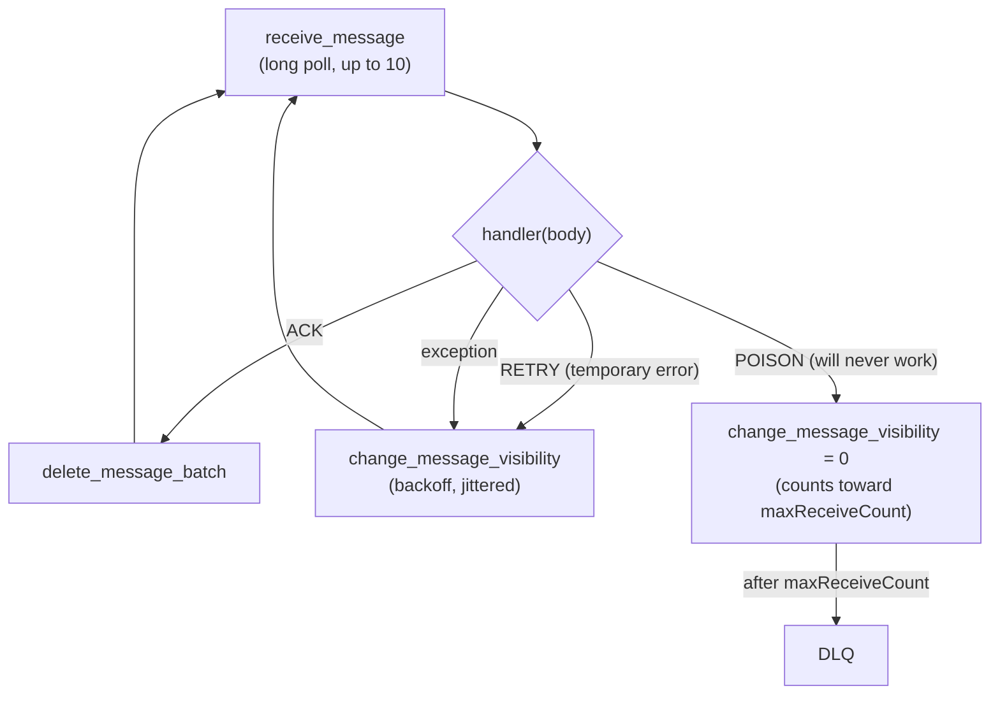

# Amazon SQS — Consumer Patterns

A consumer is a loop around one rule: **delete a message only after its work has succeeded**. Everything else — retries, backoff, DLQ, idempotency — follows from what you do with the messages you do *not* delete. The code in this page is one small project (`app/`) with a test suite ([05 Testing](./05-testing.md)). Lambda event source mappings, autoscaling, large payloads and SNS fan-out are in [04 Lambda, Scaling & Integrations](./04-lambda-scaling-integrations.md).



## The Handler Returns a Decision

Keep the business logic free of SQS. The handler gets the body and returns an **outcome**; the worker translates it into API calls. That makes the logic unit-testable without a queue.

```python
# app/handler.py
import json
import random
from enum import Enum

from pydantic import BaseModel, ValidationError

from app.idempotency import Claim, IdempotencyStore


class Outcome(Enum):
    ACK = "ack"          # delete the message
    RETRY = "retry"      # keep it, make it visible again after a backoff
    POISON = "poison"    # keep it, make it visible at once so it reaches the DLQ after maxReceiveCount


class TransientError(Exception):
    """Temporary failure: the same message may succeed later."""


class OrderCreated(BaseModel):
    order_id: str
    amount: float


def charge(event: OrderCreated) -> None:
    ...                  # calls the payment service; replaced in tests


def handle(body: str, store: IdempotencyStore) -> Outcome:
    try:
        event = OrderCreated.model_validate(json.loads(body))
    except (ValueError, ValidationError):
        return Outcome.POISON                      # retrying cannot fix a malformed body
    if event.amount <= 0:
        return Outcome.POISON
    claim = store.begin(event.order_id)
    if claim is Claim.DONE:
        return Outcome.ACK                         # duplicate delivery of finished work
    if claim is Claim.BUSY:
        return Outcome.RETRY                       # another consumer is working on it: acking now could lose the job
    try:
        charge(event)
    except TransientError:
        store.release(event.order_id)
        return Outcome.RETRY
    except Exception:
        store.release(event.order_id)
        raise                                      # unexpected: worker treats it as RETRY and logs it
    store.complete(event.order_id)
    return Outcome.ACK


def backoff_seconds(receive_count: int, base: int = 5, cap: int = 900) -> int:
    """Exponential backoff with full jitter: a random delay between 0 and min(cap, base * 2^(count-1)) seconds."""
    return random.randint(0, min(cap, base * 2 ** (receive_count - 1)))
```

| Outcome | Meaning | Worker action |
|---------|---------|---------------|
| `ACK` | Done, or a duplicate of finished work | `DeleteMessage` (batched) |
| `RETRY` | Temporary failure (timeout, 503), or the key is being processed by another consumer | Keep the message; `ChangeMessageVisibility` to a jittered backoff |
| `POISON` | Malformed or semantically invalid; retrying cannot help | Keep the message; `ChangeMessageVisibility(0)` so it reaches the DLQ after `maxReceiveCount` receives without waiting for timeouts |
| exception | Bug or unexpected error | Logged; treated as `RETRY` |

A permanent failure does not need a "send to DLQ" call: **not deleting** is enough, and the redrive policy does the move. Sending to a DLQ yourself is only worth it when you want to attach an error reason as a message attribute; then delete the original after the send succeeds.

## Idempotency

At-least-once delivery means the handler will see some messages twice. Make the second run harmless.

| Approach | Use when |
|----------|----------|
| Natural idempotency | The operation is `PUT`-like: set status to `paid`, upsert by key |
| **Idempotency key** in a store | The operation has side effects (charge a card, send an email) |
| Database unique constraint | The effect is a row insert; the constraint rejects the duplicate |
| Conditional write | DynamoDB `attribute_not_exists`, Redis `SET NX EX` |

The key must be a **business identifier** (`order_id`, an event ID the producer generates), not the SQS `MessageId`: if a producer retries a send, SQS stores two messages with two different IDs. The store below uses a **lease** so a crash between "start" and "done" does not block the retry forever: `begin` returns one of three states: `STARTED` (you own the key), `DONE` (acknowledge the duplicate) or `BUSY` (another consumer holds the lease, so **do not acknowledge** — deleting now would lose the job if that consumer crashes; answer `RETRY` instead). `complete` marks the key done and `release` frees it after a failure.

```python
# app/idempotency.py
import threading
import time
from enum import Enum


class Claim(Enum):
    STARTED = "started"      # you own the key: do the work, then complete() or release()
    DONE = "done"            # the work already finished: acknowledge the duplicate
    BUSY = "busy"            # someone else holds the lease: do NOT acknowledge, try again later


class IdempotencyStore:
    """In-memory store with a lease. Production: DynamoDB conditional put, Redis SET NX EX, or a DB unique key."""

    def __init__(self, lease_seconds: float = 60.0):
        self._lock = threading.Lock()
        self._done: set[str] = set()
        self._leases: dict[str, float] = {}
        self._lease_seconds = lease_seconds

    def begin(self, key: str) -> Claim:
        with self._lock:
            if key in self._done:
                return Claim.DONE
            if self._leases.get(key, 0) > time.monotonic():
                return Claim.BUSY
            self._leases[key] = time.monotonic() + self._lease_seconds
            return Claim.STARTED

    def complete(self, key: str) -> None:
        with self._lock:
            self._done.add(key)
            self._leases.pop(key, None)

    def release(self, key: str) -> None:
        with self._lock:
            self._leases.pop(key, None)
```

A store cannot make a non-idempotent call safe on its own: if the process dies after `charge` but before `complete`, the retry runs `charge` again once the lease expires. Pass the same key to the downstream API (payment providers accept an idempotency key), or record the effect and the key in one transaction.

For production, replace the in-memory sets with one atomic conditional write (DynamoDB `PutItem` with a condition, Redis `SET key value NX EX ttl`, or a unique index). Keep keys at least as long as the retention period of the queue plus the DLQ redrive window, otherwise a redriven old message runs twice.

## Worker Loop with Graceful Shutdown

```python
# app/worker.py
import logging
import signal
import threading
from collections.abc import Callable

from app.handler import Outcome, backoff_seconds

log = logging.getLogger("worker")


class VisibilityHeartbeat:
    """Extends the visibility timeout of one message while the with-block runs."""

    def __init__(self, sqs, queue_url: str, receipt_handle: str, *, extend_by: int = 30, every: float = 10.0):
        self._args = dict(QueueUrl=queue_url, ReceiptHandle=receipt_handle)
        self._extend_by, self._every = extend_by, every
        self._stop = threading.Event()
        self._sqs = sqs
        self._thread = threading.Thread(target=self._run, daemon=True)

    def _run(self) -> None:
        while not self._stop.wait(self._every):
            try:
                self._sqs.change_message_visibility(VisibilityTimeout=self._extend_by, **self._args)
            except Exception:                      # handle expired or message deleted: nothing left to extend
                log.warning("heartbeat failed, stopping", exc_info=True)
                return

    def __enter__(self):
        self._thread.start()
        return self

    def __exit__(self, *exc):
        self._stop.set()
        self._thread.join()


class Worker:
    def __init__(self, sqs, queue_url: str, handler: Callable[[str], Outcome], *, wait: int = 20, max_messages: int = 10):
        self.sqs, self.queue_url, self.handler = sqs, queue_url, handler
        self.wait, self.max_messages = wait, max_messages
        self.stopping = threading.Event()

    def install_signal_handlers(self) -> None:
        for sig in (signal.SIGINT, signal.SIGTERM):
            signal.signal(sig, lambda *_: self.stopping.set())

    def run(self) -> None:
        while not self.stopping.is_set():
            self.poll_once()

    def poll_once(self) -> int:
        resp = self.sqs.receive_message(
            QueueUrl=self.queue_url,
            MaxNumberOfMessages=self.max_messages,
            WaitTimeSeconds=self.wait,
            MessageSystemAttributeNames=["ApproximateReceiveCount"],
            MessageAttributeNames=["All"],
        )
        messages = resp.get("Messages", [])
        to_delete = []
        for msg in messages:
            count = int(msg["Attributes"]["ApproximateReceiveCount"])
            try:
                outcome = self.handler(msg["Body"])
            except Exception:
                log.exception("handler crashed on %s", msg["MessageId"])
                outcome = Outcome.RETRY
            if outcome is Outcome.ACK:
                to_delete.append({"Id": msg["MessageId"], "ReceiptHandle": msg["ReceiptHandle"]})
            else:
                timeout = backoff_seconds(count) if outcome is Outcome.RETRY else 0
                self.sqs.change_message_visibility(
                    QueueUrl=self.queue_url, ReceiptHandle=msg["ReceiptHandle"], VisibilityTimeout=timeout
                )
        if to_delete:
            result = self.sqs.delete_message_batch(QueueUrl=self.queue_url, Entries=to_delete)
            for failed in result.get("Failed", []):
                log.error("delete failed: %s", failed)   # message will be redelivered: handler must be idempotent
        return len(messages)
```

How it behaves:

- **Batching**: it receives up to 10 messages per call, handles them one by one, then deletes the successful ones in a single `delete_message_batch`. Entries that fail to delete are logged; the message will come back, and idempotency absorbs it.
- **Batch time budget**: all received messages share one visibility timeout that started at the receive. Ten messages at 5 seconds each need 50 seconds, so with the 30-second default the last ones are redelivered before the worker reaches them. Lower `max_messages`, raise the timeout, or process the batch concurrently.
- **Long polling**: `wait=20` in production. A SIGTERM sets `stopping`; the loop exits after the poll in progress and the messages already received. With `wait=20` that can take 20 seconds plus the handler time, so the container or instance stop timeout must be longer than that.
- **No lost work on shutdown**: messages already received are processed and deleted before the loop checks the flag. Messages you stop handling must not be deleted: they return after the visibility timeout (or release them at once with `ChangeMessageVisibility(0)`).
- **One thread, one client**: boto3 clients are thread-safe, sessions and resources are not. To process in parallel, run several worker processes or hand messages to a thread pool and delete from the polling thread after the futures finish.
- **Per-message handler failures never kill the loop**; a failure of `receive_message` itself should (let the process supervisor restart it) or be retried with backoff.

Starting it:

```python
# main.py
import logging

import boto3

from app.handler import handle
from app.idempotency import IdempotencyStore
from app.worker import Worker

logging.basicConfig(level=logging.INFO)
sqs = boto3.client("sqs")
queue_url = sqs.get_queue_url(QueueName="orders")["QueueUrl"]
store = IdempotencyStore()                       # replace with a shared store when you run more than one process

worker = Worker(sqs, queue_url, lambda body: handle(body, store), wait=20)
worker.install_signal_handlers()                 # SIGINT and SIGTERM request a clean stop
worker.run()
```

## Visibility Heartbeat for Long Jobs

When the duration of the work varies (a report that takes seconds or twenty minutes), a large queue-level timeout slows down failure recovery. Keep the default small and extend it while the work runs. `VisibilityHeartbeat` (in `app/worker.py` above) calls `ChangeMessageVisibility` every `every` seconds with a new `extend_by` timeout, which counts from each call:

```python
with VisibilityHeartbeat(sqs, queue_url, msg["ReceiptHandle"], extend_by=60, every=20):
    run_report(msg)                              # may take minutes
sqs.delete_message(QueueUrl=queue_url, ReceiptHandle=msg["ReceiptHandle"])
```

Rules: `every` must be well below `extend_by` (a third is a good ratio) so a late heartbeat does not let the message expire; the total cannot exceed 12 hours from the first receive, and you get an error rather than a clamp when you ask for more; a dead consumer stops extending, so the message returns after at most `extend_by` seconds. For work longer than hours, split it into steps or use Step Functions. Heartbeats cost one request each.

## Backoff with ChangeMessageVisibility

For a temporary error, make the message reappear later instead of hammering the failing dependency. `backoff_seconds` (in `app/handler.py`) is exponential with **full jitter**, derived from `ApproximateReceiveCount`:

| Receive count | Upper bound (base 5 s) |
|---------------|------------------------|
| 1 | 5 s |
| 2 | 10 s |
| 3 | 20 s |
| 5 | 80 s |
| 8 | 640 s |
| 9 and above | 900 s (the cap) |

The backoff only works if `maxReceiveCount` is high enough: with `maxReceiveCount=3` three quick failures send the message to the DLQ no matter how you back off. Size it as the number of attempts you are willing to make (Lambda's own guidance for its event source mapping is at least 5). A backoff longer than the retention period is pointless, and `ChangeMessageVisibility` is capped at 12 hours from the first receive.

## Poison Messages, DLQ and Redrive

A DLQ and a redrive policy come first; the worker above relies on them. The helper below is what the tests use, and it is a fine starting point for infrastructure scripts:

```python
# app/queues.py
import json

import boto3


def create_work_queue(sqs, name: str, *, max_receive: int = 3, visibility: int = 30) -> tuple[str, str]:
    """Create <name>-dlq and <name> with a redrive policy. Returns (queue_url, dlq_url)."""
    dlq_url = sqs.create_queue(
        QueueName=f"{name}-dlq",
        Attributes={"MessageRetentionPeriod": "1209600"},        # 14 days: longer than the source queue
    )["QueueUrl"]
    dlq_arn = sqs.get_queue_attributes(QueueUrl=dlq_url, AttributeNames=["QueueArn"])["Attributes"]["QueueArn"]
    queue_url = sqs.create_queue(
        QueueName=name,
        Attributes={                                              # every attribute value is a string
            "VisibilityTimeout": str(visibility),
            "ReceiveMessageWaitTimeSeconds": "20",                # long polling by default
            "RedrivePolicy": json.dumps({"deadLetterTargetArn": dlq_arn, "maxReceiveCount": max_receive}),
        },
    )["QueueUrl"]
    return queue_url, dlq_url


def queue_depth(sqs, queue_url: str) -> dict[str, int]:
    attrs = sqs.get_queue_attributes(
        QueueUrl=queue_url,
        AttributeNames=[
            "ApproximateNumberOfMessages",
            "ApproximateNumberOfMessagesNotVisible",
            "ApproximateNumberOfMessagesDelayed",
        ],
    )["Attributes"]
    return {
        "visible": int(attrs["ApproximateNumberOfMessages"]),
        "in_flight": int(attrs["ApproximateNumberOfMessagesNotVisible"]),
        "delayed": int(attrs["ApproximateNumberOfMessagesDelayed"]),
    }
```

Design points:

- The DLQ retention is 14 days (the maximum), longer than the source queue's default of 4: on standard queues a DLQ message expires relative to its **original** enqueue time.
- Alarm on the DLQ's `ApproximateNumberOfMessagesVisible` (`> 0` for one datapoint is a good rule) and page someone: a DLQ nobody watches is data loss with extra steps.
- Keep the failure reason. Redrive does not carry one, so log the `MessageId` and error at the moment of failure, or add the reason as a message attribute if you send to the DLQ yourself.

### Redrive from the DLQ

After the bug is fixed, move the messages back with `StartMessageMoveTask`. The call is asynchronous; poll `list_message_move_tasks`. moto does not implement these calls.

```python
import time

dlq_arn = "arn:aws:sqs:us-east-1:123456789012:orders-dlq"

task = sqs.start_message_move_task(
    SourceArn=dlq_arn,                       # the DLQ; omit DestinationArn to return messages to their original queues
    MaxNumberOfMessagesPerSecond=20,         # start low and watch the source queue; the maximum is 500
)
print(task["TaskHandle"])                    # needed for cancel_message_move_task

while True:
    result = sqs.list_message_move_tasks(SourceArn=dlq_arn)["Results"][0]       # up to 10 recent tasks; [0] assumed newest, confirm on your account
    print(result["Status"], result.get("ApproximateNumberOfMessagesMoved"), "/", result.get("ApproximateNumberOfMessagesToMove"))
    if result["Status"] in ("COMPLETED", "FAILED", "CANCELLED"):
        break
    time.sleep(5)
```

Checklist before redriving:

1. The consumer fix is deployed; otherwise the messages return to the DLQ after `maxReceiveCount` more receives.
2. The handler is idempotent: some messages may already have been partially processed.
3. The source queue can absorb the load; start with a low rate.
4. Messages come back with new IDs and enqueue times; correlate by business key.
5. Only DLQs whose sources are SQS queues can be redriven this way; Lambda and SNS dead-letter queues cannot.

## Quick Rules

1. **Ack after success, never before.** Deleting first turns a crash into data loss.
2. **The handler returns a decision**; the worker owns every SQS call.
3. **Idempotency key = business key**, with a lease, kept longer than queue retention plus the redrive window.
4. **Permanent errors: do not delete, release immediately** (`VisibilityTimeout=0`) and let `maxReceiveCount` move them to the DLQ.
5. **Temporary errors: jittered backoff** through `ChangeMessageVisibility`, with `maxReceiveCount` large enough for it.
6. **Heartbeat long jobs** instead of a huge default timeout; stay under the 12-hour cap.
7. **Check `Failed` in every batch response**, including the delete batch.
8. **Alarm on the DLQ** and on `ApproximateAgeOfOldestMessage`; a DLQ nobody reads is silent data loss.
9. **Handle SIGTERM** and make the platform's stop timeout longer than `WaitTimeSeconds` plus one handler run.

---
## See also
- [Amazon SQS — Overview](./index.md)
- [Amazon SQS — Core Concepts](./01-core-concepts.md)
- [Amazon SQS — boto3 in Python](./02-boto3-python.md)
- [Amazon SQS — Lambda, Scaling & Integrations](./04-lambda-scaling-integrations.md)
- [Amazon SQS — Testing SQS-Based Systems](./05-testing.md)
- [Resilience — Retries, Fallbacks, Semaphores & Race Conditions](../../libs/resilience/index.md)
- [Queues vs Streams: Message Delivery, Ordering & Reliability](../../software-design-patterns/05-composition-architectural/04-queues-streams-messaging.md)
