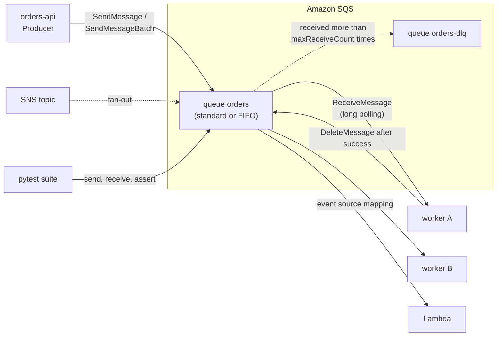

# Amazon SQS — Queues, Consumers & Testing

**Amazon Simple Queue Service (SQS)** is a fully managed message queue. Producers call `SendMessage`, consumers poll with `ReceiveMessage`, and a message stays in the queue until a consumer deletes it. There is no broker to run, patch or size: you create a queue and pay per request. Two queue types exist: **standard** (nearly unlimited throughput, at-least-once, best-effort ordering) and **FIFO** (strict order per message group, deduplication).

This guide covers the queue itself: how messages move, how to call SQS from Python with boto3, how to write safe consumers, and how to test them. The topic side of SNS → SQS fan-out is in [Amazon SNS](../sns/index.md). Sessions, credentials, retries and `ClientError` handling are in [AWS Foundations](../foundations/index.md) and are not repeated here. Queue vs stream concepts, delivery semantics and DLQ theory are in [Queues vs Streams](../../software-design-patterns/05-composition-architectural/04-queues-streams-messaging.md).

## Where SQS Fits



- **Pull model**: consumers ask for messages; the queue never calls them. Lambda's event source mapping is a managed poller that does the pulling for you.
- **Competing consumers**: a received message is hidden from other consumers for the **visibility timeout**. If it is not deleted by then, it becomes visible again and is delivered again.
- **At-least-once**: duplicates and (on standard queues) reordering are normal. Handlers must be idempotent — see [03 Consumer Patterns](./03-consumer-patterns.md).
- **Tests** run against moto for most checks and against a real queue for the few things moto does not emulate — see [05 Testing](./05-testing.md).

## Section Map

| File | Topics |
|------|--------|
| [01 Core Concepts](./01-core-concepts.md) | Standard vs FIFO, high-throughput FIFO, message lifecycle, visibility timeout, short and long polling, delay, retention, 1 MiB limit, attributes, DLQ and redrive (`StartMessageMoveTask`), fair queues, encryption, queue policies, quotas, pricing dimensions |
| [02 boto3 in Python](./02-boto3-python.md) | `create_queue` and attributes, send and batch send (partial failure), `receive_message` parameters, delete and visibility APIs, FIFO calls, tags, pagination, purge, errors, JSON vs query protocol |
| [03 Consumer Patterns](./03-consumer-patterns.md) | Worker loop with graceful shutdown, handler outcomes, idempotency, visibility heartbeat, jittered backoff, poison messages, DLQ and redrive (`StartMessageMoveTask`) |
| [04 Lambda, Scaling & Integrations](./04-lambda-scaling-integrations.md) | Event source mapping and `ReportBatchItemFailures`, event shape, scaling on backlog per consumer and CloudWatch signals, S3 pointer for big payloads, SNS fan-out from the queue side, Celery |
| [05 Testing SQS-Based Systems](./05-testing.md) | What to test where, pure handlers, Stubber for batch failures, moto fixtures, unique queue names, visibility, redelivery, DLQ, FIFO and long-polling tests, deadlines instead of sleeps, moto server mode |
| [06 moto Gaps, Smoke Tests, Load & CI](./06-moto-gaps-smoke-load-ci.md) | What moto does not emulate, ElasticMQ and Testcontainers, a real-account smoke test, CloudWatch metrics for load tests, GitHub Actions, pitfalls, QA checklist |

## Minimal Working Example

```python
# uv add boto3 "moto[sqs]"
import json

import boto3
from moto import mock_aws

with mock_aws():                                           # in-process fake SQS; no account, no network
    sqs = boto3.client("sqs", region_name="us-east-1")
    url = sqs.create_queue(QueueName="orders")["QueueUrl"]     # idempotent: same name and attributes returns the same URL

    sqs.send_message(QueueUrl=url, MessageBody=json.dumps({"order_id": "o-1", "amount": 9.5}))

    resp = sqs.receive_message(QueueUrl=url, MaxNumberOfMessages=10, WaitTimeSeconds=1)   # long poll
    for msg in resp.get("Messages", []):                   # no "Messages" key when the poll comes back empty
        order = json.loads(msg["Body"])
        print("got", order)
        sqs.delete_message(QueueUrl=url, ReceiptHandle=msg["ReceiptHandle"])             # ack only after the work succeeded

    attrs = sqs.get_queue_attributes(QueueUrl=url, AttributeNames=["All"])["Attributes"]
    print({k: attrs[k] for k in ("ApproximateNumberOfMessages", "ApproximateNumberOfMessagesNotVisible", "VisibilityTimeout")})
```

```text
got {'order_id': 'o-1', 'amount': 9.5}
{'ApproximateNumberOfMessages': '0', 'ApproximateNumberOfMessagesNotVisible': '0', 'VisibilityTimeout': '30'}
```

Against a real account the same code works with `mock_aws()` removed and credentials from the usual chain (see [Foundations](../foundations/02-credentials-iam-local-testing.md)).

## Standard vs FIFO at a Glance

| | Standard | FIFO |
|---|----------|------|
| Name | Any valid name | Must end in `.fifo` (the suffix counts toward the 80-character limit) |
| Ordering | Best effort, can be out of order | Strict **within a `MessageGroupId`**; groups are independent |
| Delivery | At least once, occasional duplicates | Deduplication on send inside a 5-minute window; consumers still need idempotency |
| Throughput | Nearly unlimited API calls per second | 300 transactions/s per API action without batching, 3,000 messages/s with batches of 10; **high-throughput mode** raises this per Region (see [01](./01-core-concepts.md#high-throughput-fifo)) |
| Required on send | `MessageBody` | `MessageBody`, `MessageGroupId`, and a `MessageDeduplicationId` unless content-based deduplication is on |
| Per-message `DelaySeconds` | Yes | **No**, queue-level delay only |
| In-flight limit | About 120,000 (depends on traffic and backlog) | 120,000 |
| Dead-letter queue | A standard queue | Must be a FIFO queue |
| Use when | Independent jobs, high volume, order does not matter | Per-entity ordering (one customer's events), no duplicate commands |

## What Changed Recently

Tutorials written before 2025 often state numbers that are no longer true. As of October 2026 (AWS documentation and the SQS 20-year retrospective on the AWS News Blog):

| Topic | Now | Note |
|-------|-----|------|
| Maximum message size | **1 MiB** (1,048,576 bytes) | Raised from 256 KiB in August 2025 for both queue types |
| Fair queues | Set `MessageGroupId` on a **standard** queue | July 2025; mitigates noisy neighbours without ordering |
| Wire protocol | **AWS JSON** | Default in boto3 and botocore since 1.28.82 / 1.31.82; errors still carry the old query-style code in `Error.Code` |
| Encryption | **SSE-SQS** is on by default for new queues | SSE-KMS stays available |
| DLQ redrive | `StartMessageMoveTask`, `ListMessageMoveTasks`, `CancelMessageMoveTask` | Standard queues since 2023; FIFO redrive was added in November 2023 |
| FIFO in-flight limit | 120,000 | Raised from 20,000 in November 2024 |

## Quick Rules

1. **Delete only after the work succeeded.** A message you do not delete comes back after the visibility timeout; that is the retry mechanism.
2. **Make handlers idempotent.** Standard queues deliver at least once, FIFO deduplication only covers the producer's 5-minute window, and a slow consumer gets its message redelivered.
3. **Use long polling** (`WaitTimeSeconds=20`, or `ReceiveMessageWaitTimeSeconds` on the queue). Short polling samples a subset of servers and bills empty receives.
4. **Set the visibility timeout above the longest realistic processing time**, and extend it with `ChangeMessageVisibility` for long jobs instead of setting a huge default.
5. **Every queue gets a DLQ** with a `maxReceiveCount` high enough to ride out transient errors (Lambda guidance: at least 5), a longer retention than the source queue, and an alarm on its depth.
6. **Check `Failed` in every batch response.** `SendMessageBatch`, `DeleteMessageBatch` and `ChangeMessageVisibilityBatch` return HTTP 200 even when entries failed.
7. **Choose FIFO only when you need order or dedup**, and spread load across many `MessageGroupId` values — one group is processed one message at a time.
8. **Catch modeled exceptions** (`sqs.exceptions.QueueDoesNotExist`), not code strings: `Error.Code` is the legacy query-style name.
9. **Never test against a shared real queue.** Use moto with a unique queue name per test, and keep a small smoke test for a real account.
10. **Assert with deadlines, not sleeps.** Visibility, delay and long polling are time-based; poll until a condition holds or a deadline passes.

---
## See also
- [Digital Garden: Knowledge Base](../../index.md)
- [AWS — Service Guides for Python & Test Automation](../index.md)
- [AWS Foundations — boto3, Credentials & Local Testing](../foundations/index.md)
- [Amazon SNS — Topics, Subscriptions & Fan-out](../sns/index.md)
- [Queues vs Streams: Message Delivery, Ordering & Reliability](../../software-design-patterns/05-composition-architectural/04-queues-streams-messaging.md)
- [RabbitMQ — Message Broker, Routing & Queues](../../tools/rabbitmq/index.md)
- [Apache Kafka — Event Streaming, Producers & Consumers](../../tools/kafka/index.md)
- [Celery — Distributed Task Queue for Python](../../libs/celery/index.md)
- [Pytest — Python Testing Framework](../../libs/pytest/index.md)
