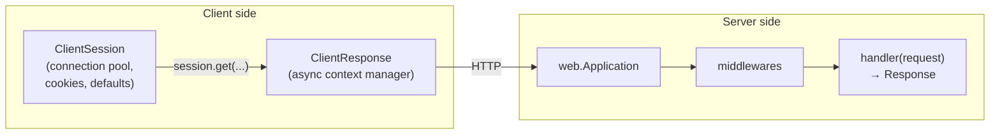

# aiohttp — Async HTTP Client & Server

aiohttp is an asyncio-native library with **both** an HTTP client (`ClientSession`) and an HTTP server (`aiohttp.web`), plus first-class WebSocket support on each side. It has no sync API: everything runs inside an event loop.

## Installation

```bash
uv add aiohttp                                   # client + server + WebSocket
uv add "aiohttp[speedups]"                       # aiodns, Brotli: faster DNS and compression
uv add --dev pytest pytest-asyncio pytest-aiohttp
```

Examples in this guide were run against **aiohttp 3.14.5** (yarl 1.25, multidict 7.1) with `pytest` 9.1, `pytest-asyncio` 1.4 and `pytest-aiohttp` 1.1.1 on Python 3.13. Every example was run against a local server on `127.0.0.1`, so no external network was needed.

## When to Use What

| Need | Choose |
|------|--------|
| Scripts and simple sync calls | `requests` — see [Requests / HTTP](../requests-http/index.md) |
| Async client with a requests-like API, HTTP/2, sync *and* async in one package | `httpx` — see [HTTPX](../httpx/index.md) |
| Async client with fine control of connection pool, tracing and streaming | **aiohttp** `ClientSession` |
| A small async HTTP service or a WebSocket server without a full framework | **aiohttp** `web` |
| Typed request/response models, dependency injection, OpenAPI docs | `FastAPI` — see [FastAPI](../fastapi/index.md) |
| WebSocket client (`ws_connect`) | **aiohttp** (httpx has no WebSocket client) |

Rule of thumb: pick aiohttp when you need its server, its WebSocket client, or the lowest-overhead client under high concurrency; pick httpx when you also need a sync client or HTTP/2.

## Section Map

| File | Topics |
|------|--------|
| [01 Client](./01-client.md) | `ClientSession` lifecycle, requests, params, JSON, forms, multipart, responses, errors, timeouts, redirects, cookies, auth, streaming, `TCPConnector`, concurrency limits, retries, `TraceConfig` |
| [02 Server & WebSockets](./02-server-websockets.md) | `web.Application`, routes, handlers, `AppKey`, `cleanup_ctx`, middleware, error responses, body limits, `WebSocketResponse`, shared client session, `run_app` |
| [03 Testing](./03-testing.md) | `pytest-aiohttp`, `aiohttp_client`, `aiohttp_server`, fake upstream server, testing retries and WebSockets, `aioresponses` compatibility, CI |

## Mental Model



- **`ClientSession`** — one per application (or per upstream), reused for many requests. It owns the connection pool and the cookie jar.
- **`ClientResponse`** — used as `async with session.get(...) as resp`. Leaving the block releases the connection.
- **`web.Application`** — routes, middlewares, shared state (`app[key]`) and startup/cleanup hooks.
- **Handler** — `async def handler(request: web.Request) -> web.StreamResponse`.

## Minimal Example

```python
import asyncio

import aiohttp
from aiohttp import web


async def hello(request: web.Request) -> web.Response:
    return web.json_response({"hello": request.query.get("name", "world")})


async def main() -> None:
    app = web.Application()
    app.add_routes([web.get("/hello", hello)])
    runner = web.AppRunner(app)
    await runner.setup()
    site = web.TCPSite(runner, "127.0.0.1", 8080)
    await site.start()

    async with aiohttp.ClientSession("http://127.0.0.1:8080") as session:
        async with session.get("/hello", params={"name": "Ann"}) as resp:
            print(resp.status, await resp.json())      # 200 {'hello': 'Ann'}

    await runner.cleanup()


asyncio.run(main())
```

In a real service you would call `web.run_app(app)` instead of `AppRunner` (see [02](./02-server-websockets.md)).

## Differences from `requests` and `httpx`

| Topic | `requests` | `httpx` | `aiohttp` |
|-------|-----------|---------|-----------|
| Sync / async | sync | both | **async only** |
| One-off call | `requests.get(url)` | `httpx.get(url)` | none — always `ClientSession` |
| Base URL | manual | `base_url=` | `ClientSession(base_url)` |
| Body | `resp.json()` | `resp.json()` | `await resp.json()` — a coroutine, and the content type is checked |
| Default timeout | none | 5 s | **300 s total** (`sock_connect=30`) |
| Status check | `raise_for_status()` | `raise_for_status()` | `raise_for_status=True` option, or `resp.raise_for_status()` (an HTTP 404 is **not** an error by default) |
| Redirects | followed | **not** followed by default | followed (`allow_redirects=True`) |
| WebSocket client | no | no | `session.ws_connect()` |

## Quick Rules

1. **One `ClientSession` per application or upstream**, created inside a running event loop and closed with `async with` or `await session.close()`. Creating a session per request defeats connection pooling.
2. **Always use `async with session.get(...) as resp`** — otherwise the connection is not returned to the pool until the response is read or garbage collected.
3. **Set an explicit `ClientTimeout`.** The default is 5 minutes in total.
4. **Check the status** (`raise_for_status=True`): a 404 or 500 response does not raise by itself.
5. **Bound concurrency** with an `asyncio.Semaphore` and `TCPConnector(limit=..., limit_per_host=...)` — `gather` over 10 000 URLs without a limit floods the server and your own file descriptors.
6. **Add retries yourself** (aiohttp has none) and retry only idempotent requests on 5xx, connection errors and timeouts.
7. **In a server, put shared clients and pools in `cleanup_ctx`** and read them with `request.app[key]`; do not use module-level globals.
8. **Test with `pytest-aiohttp`** (`aiohttp_client`, `aiohttp_server`) and a fake upstream server on a random port instead of mocking the HTTP layer.

---
## See also
- [Digital Garden: Knowledge Base](../../index.md)
- [Python Libraries](../index.md)
- [HTTPX — Modern Python HTTP Client](../httpx/index.md)
- [Requests / HTTP](../requests-http/index.md)
- [FastAPI](../fastapi/index.md)
- [Resilience](../resilience/index.md)
- [WebSocket](../../api-architectures/04-websocket/index.md)
