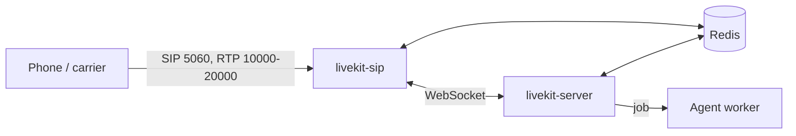

# LiveKit — Telephony, Egress, Ingress & Production

The pieces around the server and agents that a production deployment needs: **SIP** (phone calls), **egress** (recording and streaming out), **ingress** (RTMP/WHIP in), self-hosting layouts, scaling and draining agent workers, observability, latency tuning and security. All components are open source (Apache-2.0) and share one Redis with the server.

## SIP

`livekit/sip` is a separate service that bridges SIP/RTP to LiveKit rooms. A caller becomes a `SIP` participant; a **dispatch rule** decides which room the call joins and which agent is dispatched.



```yaml
# sip.yaml
api_key: APIexample
api_secret: <secret>
ws_url: ws://livekit:7880
redis:
  address: redis:6379          # the same Redis as the server
sip_port: 5060                 # signalling (UDP and TCP)
rtp_port: 10000-20000          # media (UDP)
use_external_ip: true
health_port: 8080
prometheus_port: 9090
log_level: info
```

```bash
docker run --rm --network host -e SIP_CONFIG_BODY="$(cat sip.yaml)" livekit/sip
```

Use host networking (a large RTP range is hard for Docker); `SIP_CONFIG_FILE` points at a file instead. Signalling `5060` and the RTP range must be reachable from the carrier. Without Redis the server's SIP APIs return `sip not connected (redis required)`.

| Object | Purpose |
|--------|---------|
| **Inbound trunk** | Accepts calls: `numbers` (called numbers), `allowed_numbers` and `allowed_addresses` (caller allow-lists), `auth_username` / `auth_password` |
| **Outbound trunk** | Places calls through a provider: `address`, `numbers`, `transport`, `auth_username` / `auth_password`, `destination_country` |
| **Dispatch rule** | Chooses the room for each inbound call and optionally dispatches agents (`room_config.agents`) |
| **SIP participant** | The caller in the room (`kind` SIP); created by inbound calls or `create_sip_participant` for outbound |

| Dispatch rule type | Room |
|--------------------|------|
| `dispatch_rule_individual` (`room_prefix`, `no_randomness`) | A new room per caller (prefix + caller number + random suffix) |
| `dispatch_rule_direct` (`room_name`, `pin`) | One shared room; optional PIN |
| `dispatch_rule_callee` (`room_prefix`, `randomize`) | Room named after the dialled number; `randomize=False` shares one room per number |

Create rules once and reuse them; creating a rule per call hurts reliability. Room names built from phone numbers are logged and not redacted.

```python
import asyncio

from livekit import api


async def main() -> None:
    async with api.LiveKitAPI() as lk:                                   # LIVEKIT_URL / KEY / SECRET
        trunk = await lk.sip.create_sip_inbound_trunk(
            api.CreateSIPInboundTrunkRequest(
                trunk=api.SIPInboundTrunkInfo(
                    name="support-in",
                    numbers=["+15105550100"],
                    allowed_numbers=["+13105550100"],
                    auth_username="trunk-user",
                    auth_password="trunk-pass",
                )
            )
        )
        await lk.sip.create_sip_dispatch_rule(
            api.CreateSIPDispatchRuleRequest(
                name="support-calls",
                trunk_ids=[trunk.sip_trunk_id],
                rule=api.SIPDispatchRule(dispatch_rule_individual=api.SIPDispatchRuleIndividual(room_prefix="call-")),
                room_config=api.RoomConfiguration(
                    agents=[api.RoomAgentDispatch(agent_name="support", metadata='{"queue":"support"}')]
                ),
            )
        )


asyncio.run(main())
```

CLI equivalents take JSON files: `lk sip inbound create trunk.json` (`{"trunk": {"name": ..., "numbers": [...]}}`), `lk sip dispatch create rule.json` (`{"dispatch_rule": {"name": ..., "rule": {"dispatchRuleIndividual": {"roomPrefix": "call-"}}, "roomConfig": {"agents": [{"agentName": "support"}]}}}`), `lk sip dispatch list`, `lk sip outbound create`.

Outbound calls: create an outbound trunk, then place the call into a room where the agent already runs (or dispatch the agent first):

```python
await lk.sip.create_sip_participant(
    api.CreateSIPParticipantRequest(
        sip_trunk_id="ST_xxx", sip_call_to="+15105550123",
        room_name="outbound-1", participant_identity="callee", participant_name="Customer",
        wait_until_answered=True,
    )
)
```

Inside an agent job, `ctx.add_sip_participant(call_to=..., trunk_id=..., participant_identity=...)` and `ctx.transfer_sip_participant(participant, transfer_to)` wrap the same server calls, and `AgentSession(ivr_detection=True)` turns on detection of IVR systems.

## Egress

`livekit/egress` records or streams room content out. Requests go to the server (`lk.egress.*`, needs the `roomRecord` grant), the server hands them to an egress service through Redis, and the service uploads to your storage.

| Type | Output |
|------|--------|
| **RoomComposite** | The room's layout rendered in headless Chrome: files (MP4, OGG, MP3), HLS segments, RTMP/SRT streams, image snapshots |
| **Web** | Any URL rendered the same way |
| **Participant** / **TrackComposite** | One participant, or chosen audio and video tracks, encoded |
| **Track** | A single track without transcoding (hundreds of video track jobs fit on one instance) |
| **Auto egress** | Starts with the room, set in the room configuration |

```python
from livekit import api

req = api.RoomCompositeEgressRequest(
    room_name="support-1",
    layout="speaker",
    audio_only=True,
    file_outputs=[api.EncodedFileOutput(
        file_type=api.EncodedFileType.OGG,
        filepath="recordings/{room_name}-{time}.ogg",
        s3=api.S3Upload(bucket="calls", region="eu-central-1", access_key="<key>", secret="<secret>"),
    )],
)
info = await lk.egress.start_room_composite_egress(req)       # then lk.egress.stop_egress(api.StopEgressRequest(egress_id=info.egress_id))
```

Track egress uses `api.TrackEgressRequest(room_name=..., track_id=..., file=api.DirectFileOutput(filepath="tracks/{track_id}"))` and `start_track_egress`. Storage targets: S3 and S3-compatible (set `force_path_style` for MinIO, R2), Google Cloud Storage, Azure Blob; the resolution order is output, then request, then service config.

```yaml
# egress.yaml
api_key: APIexample
api_secret: <secret>
ws_url: ws://livekit:7880
redis:
  address: redis:6379
health_port: 8081
prometheus_port: 9091
s3: { access_key: <key>, secret: <secret>, region: eu-central-1, bucket: calls }   # or gcp: / azure:
```

```bash
docker run --rm -e EGRESS_CONFIG_FILE=/out/config.yaml -v ~/livekit-egress:/out livekit/egress
```

Plan **4 CPUs and 4 GB per instance**; a RoomComposite job uses roughly 2 to 6 CPUs. Egress status arrives as `egress_started`, `egress_updated`, `egress_ended` webhooks. For a voice-agent recording that needs no video, an audio-only room composite or a participant egress is the cheapest option.

## Ingress

`livekit/ingress` turns external media into a participant: `RTMP_INPUT`, `WHIP_INPUT` or `URL_INPUT`.

```python
ing = await lk.ingress.create_ingress(
    api.CreateIngressRequest(
        input_type=api.IngressInput.RTMP_INPUT, name="stream",
        room_name="live-1", participant_identity="streamer",
    )
)
print(ing.url, ing.stream_key)
```

Config keys: `api_key`, `api_secret`, `ws_url`, `redis.address`, `rtmp_port` (1935), `whip_port` (8080), `rtc_config.udp_port` (7885, needed for WHIP), `http_relay_port` (9090, localhost only), `health_port`, `prometheus_port`. Set `ingress.rtmp_base_url` and `ingress.whip_base_url` in the **server** config so clients get the right URLs. Run `docker run --rm -e INGRESS_CONFIG_BODY="$(cat ingress.yaml)" -p 1935:1935 -p 8080:8080 --network host livekit/ingress` (WHIP needs host networking). Plan 4 CPUs and 4 GB, and a TCP load balancer (HTTP reverse proxy for WHIP) in front of several workers.

## Self-Hosting Layouts

**Docker Compose** (one host; the server uses host networking, keys come from the environment):

```yaml
services:
  redis:
    image: redis:7-alpine
    restart: unless-stopped
    ports: ["127.0.0.1:6379:6379"]

  livekit:
    image: livekit/livekit-server:v1.13.10
    command: --config /etc/livekit.yaml
    restart: unless-stopped
    network_mode: host
    environment:
      LIVEKIT_KEYS: "${LIVEKIT_API_KEY}: ${LIVEKIT_API_SECRET}"
    volumes: ["./livekit.yaml:/etc/livekit.yaml:ro"]
    depends_on: [redis]

  agent:
    build: ./agent
    restart: unless-stopped
    stop_grace_period: 10m
    environment:
      LIVEKIT_URL: ws://host.docker.internal:7880
      LIVEKIT_API_KEY: ${LIVEKIT_API_KEY}
      LIVEKIT_API_SECRET: ${LIVEKIT_API_SECRET}
    extra_hosts: ["host.docker.internal:host-gateway"]
```

The agent image (non-root user, model files downloaded at build time):

```dockerfile
FROM python:3.13-slim
ENV PYTHONUNBUFFERED=1 PIP_NO_CACHE_DIR=1
RUN useradd --create-home agent
WORKDIR /app
COPY requirements.txt .
RUN pip install -r requirements.txt          # livekit-agents[openai,silero,turn-detector]~=1.8
COPY agent.py .
USER agent
RUN python -m livekit.agents download-files
EXPOSE 8081
CMD ["python", "agent.py", "start"]
```

**Kubernetes** (server via Helm; see [Kubernetes](../../tools/kubernetes/index.md)):

```bash
helm repo add livekit https://helm.livekit.io
helm install livekit livekit/livekit-server --namespace livekit --values values.yaml
```

```yaml
# values.yaml (based on server-sample.yaml in livekit/livekit-helm)
replicaCount: 2
terminationGracePeriodSeconds: 18000          # chart default: 5 h, so old pods drain
livekit:
  log_level: info
  rtc: { use_external_ip: true, port_range_start: 50000, port_range_end: 60000, tcp_port: 7881 }
  redis: { address: redis.livekit.svc:6379 }
  keys: { myapikey: "<secret from a Secret manager>" }
  turn: { enabled: true, domain: turn.example.com, tls_port: 5349, udp_port: 3478, secretName: turn-tls, serviceType: LoadBalancer }
autoscaling: { enabled: true, minReplicas: 2, maxReplicas: 5, targetCPUUtilizationPercentage: 60 }
```

LiveKit pods need **host networking, one pod per node**; serverless and private clusters are not suitable (extra NAT). Use Redis, TLS at the Ingress (and a separate certificate for TURN/TLS), and restart pods manually after a ConfigMap-only change (Kubernetes does not restart them). Agent workers are plain Deployments: they dial out to the server and expose only the health port.

```yaml
# agent Deployment (excerpt)
spec:
  template:
    spec:
      terminationGracePeriodSeconds: 1800        # longer than your longest call
      containers:
        - name: agent
          image: registry.example.com/voice-agent:1.4.0
          ports: [{ containerPort: 8081 }]
          readinessProbe: { httpGet: { path: /, port: 8081 } }
          resources: { requests: { cpu: "4", memory: 8Gi }, limits: { memory: 8Gi } }
          envFrom: [{ secretRef: { name: livekit-credentials } }]
```

## Scaling Agent Workers

| Topic | Guidance |
|-------|----------|
| Capacity | Start at 4 cores and 8 GB per worker for roughly 10 to 25 concurrent jobs; a turn detector and noise cancellation raise CPU and memory. Measure with `lk perf agent-load-test` |
| Load signal | `load_fnc` (default average CPU, 0 to 1) and `load_threshold` (default 0.7): above it the worker reports unavailable and the server routes jobs elsewhere |
| Autoscaling | Scale on the same signal at a **lower** threshold (for example CPU 0.5 with `load_threshold` 0.7); scale up quickly, scale down slowly (`stabilizationWindowSeconds`), since sessions drain slowly |
| Warm pool | `num_idle_processes` keeps job processes ready; prewarm models in `setup_fnc` |
| Draining | `SIGTERM` or `SIGINT` stops new jobs and waits up to `drain_timeout` (default 1 h). Set the orchestrator grace period (`terminationGracePeriodSeconds`, `stop_grace_period`) to at least the drain time; voice calls can need 10 minutes or more |
| Rollouts | Deploy new workers, let old ones drain; route test traffic to a new version with a distinct `agent_name` |
| Failures | A job crash does not affect the worker or other jobs; a worker crash ends its jobs, and the server dispatches a replacement to each room after about 15 s |
| Memory | `job_memory_warn_mb` (1000) and `job_memory_limit_mb` (off) guard leaks per job process |
| Health | `GET :8081/` returns `OK`; `GET :8081/worker` returns load and status JSON |

## Observability

| Signal | Source |
|--------|--------|
| Server metrics | `prometheus.port` in the server config: `livekit_room_total`, `livekit_participant_total`, `livekit_node_packet_total`, `livekit_webhook_queue_length` |
| Worker metrics | `AgentServer(prometheus_port=9464)`: `lk_agents_active_job_count`, `lk_agents_worker_load`, `lk_agents_child_process_count`, `lk_agents_proc_initialize_duration_seconds` |
| Traces | OpenTelemetry spans (below) |
| Usage | `session.usage` and the `session_usage_updated` event: per-model LLM, STT, TTS usage |
| Per-turn latency | `ChatMessage.metrics` on conversation items: `llm_node_ttft`, `tts_node_ttfb`, `end_of_turn_delay`, `transcription_delay`, `e2e_latency`, `playback_latency` (fields present depend on the pipeline) |
| Session report | `ctx.make_session_report()` in `on_session_end`: history, events, usage, options; `report.to_dict()` is JSON-serialisable |
| Events | `error` (with `recoverable`), `close` (with `reason`), `function_tools_executed`, `agent_state_changed`, `user_state_changed` |

Rough end-to-end latency is `end_of_utterance_delay + llm.ttft + tts.ttfb`; a natural conversation stays under about one second.

```python
from opentelemetry.exporter.otlp.proto.http.trace_exporter import OTLPSpanExporter
from opentelemetry.sdk.trace import TracerProvider
from opentelemetry.sdk.trace.export import BatchSpanProcessor

from livekit.agents import JobContext
from livekit.agents.telemetry import set_tracer_provider


@server.rtc_session(agent_name="support", on_session_end=on_session_end)
async def entrypoint(ctx: JobContext) -> None:
    provider = TracerProvider()
    provider.add_span_processor(BatchSpanProcessor(OTLPSpanExporter()))        # endpoint from OTEL_EXPORTER_OTLP_ENDPOINT
    set_tracer_provider(provider, metadata={"session.room": ctx.room.name})    # attributes added to every span

    async def flush() -> None:
        provider.force_flush()                                                  # flush spans before the process exits

    ctx.add_shutdown_callback(flush)
    ...
```

Call `set_tracer_provider` before the session starts. Spans include `agent_session`, `agent_turn`, `llm_node`, `llm_request`, `on_enter`, `agent_speaking`; attributes use `lk.*` (ids, timings), `lk.pii.*` (user input and responses) and `gen_ai.*` (model, token usage). Treat `lk.pii.*` as sensitive when choosing a backend. Any OTLP backend works ([OpenTelemetry](../opentelemetry/index.md), [Langfuse](../../tools/langfuse/index.md), [Jaeger](../../tools/jaeger/index.md)).

## Latency Tuning

| Lever | Setting |
|-------|---------|
| Faster replies | Lower `endpointing.min_delay` (default 0.5 s); more cut-offs |
| Fewer cut-offs | Raise `min_delay`, use a turn detector model, tune VAD `min_silence_duration` |
| Overlap work | `preemptive_generation` on (default); `preemptive_tts: True` for more savings and more wasted compute |
| Model | A smaller or faster LLM; keep the prompt short; `max_tool_steps` low |
| Streaming | Use streaming STT and TTS; avoid per-turn model loading (prewarm) |
| Filler | Say a short phrase before slow tools (`context.with_filler`, `session.say`) |
| Region | Run workers, the server and the model providers in the same region |
| Realtime | A realtime model removes the separate STT and TTS stages; see the trade-offs in [02](./02-agents-framework.md#realtime-speech-to-speech-models) |
| Measure | `ChatMessage.metrics` per turn, traces, and a load test before and after |

## Security

| Area | Practice |
|------|----------|
| Tokens | Mint on the backend, TTL of minutes, narrowest grants, `canPublishSources`; a self-hosted server does not revoke issued tokens |
| API secret | In a secret manager or environment, never in images, client code or logs; separate key pairs per environment; rotate by adding a new key to `keys`, deploying, then removing the old one |
| Webhooks | Verify the signed `Authorization` header against the raw body (`WebhookReceiver`), accept `application/webhook+json`, handle duplicates |
| Network | TLS in front of 7880; open only the documented ports; TURN with TLS; agent workers need no inbound ports; SIP allow-lists (`allowed_addresses`, `allowed_numbers`) and trunk credentials |
| Data | No PII in identities, room names or participant names; redact `lk.pii.*` span data; protect recordings with bucket policies |
| Agents | Treat tool arguments as untrusted input; allow-list MCP tools; confirm mutating actions; `disallow_interruptions()` for them; see [OWASP LLM security](../../owasp-llm-security/index.md) |
| Admin | `--dev` never in production; restrict `/debug` endpoints and the Prometheus port to your network |

## Quick Rules

1. **One Redis for the whole stack** (server, SIP, egress, ingress) and host networking for anything with a UDP range.
2. **Create trunks and dispatch rules once**, with allow-lists and credentials; dispatch the agent from the rule.
3. **Size workers by load test**, autoscale below `load_threshold`, and set grace periods above `drain_timeout`.
4. **Record with egress**, not inside the agent: audio-only composite or participant egress to your own bucket.
5. **Export traces and metrics from day one**; alert on `lk_agents_worker_load`, webhook queue length and `error` events.
6. **Pin image tags** (`livekit/livekit-server:v1.13.10`) and upgrade server, SIP, egress and ingress deliberately.
7. **Keep secrets and PII out of tokens, names and logs.**

---
## See also
- [Digital Garden: Knowledge Base](../../index.md)
- [LiveKit — Open-Source WebRTC Server and Agents Framework](./index.md)
- [LiveKit — Server, Rooms & Tokens](./01-server-rooms-tokens.md)
- [Docker](../../tools/docker/index.md)
- [Kubernetes](../../tools/kubernetes/index.md)
- [OpenTelemetry](../opentelemetry/index.md)
- [OWASP LLM Security](../../owasp-llm-security/index.md)
- [Pipecat — Transports, Runner & Production](../pipecat/03-transports-runner-production.md)
