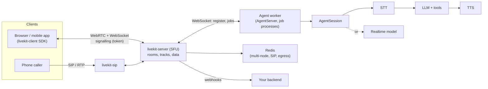

# LiveKit — Open-Source WebRTC Server and Agents Framework

**LiveKit** is an open-source real-time communication stack: a WebRTC **server** (an SFU written in Go) plus client SDKs, and the **LiveKit Agents** framework (`livekit-agents` on PyPI) that puts AI participants into the same rooms as people. This guide covers the open-source parts and the Python SDKs.

| Component | Repository / package | Licence |
|-----------|----------------------|---------|
| Server (SFU, signalling, TURN) | `livekit/livekit`, Docker image `livekit/livekit-server` | Apache-2.0 |
| Agents framework (Python) | `livekit-agents` and `livekit-plugins-*` | Apache-2.0 |
| Python SDKs | `livekit` (realtime client), `livekit-api` (tokens, server APIs) | Apache-2.0 |
| Egress, Ingress, SIP | `livekit/egress`, `livekit/ingress`, `livekit/sip` (Docker images of the same names) | Apache-2.0 |
| CLI | `lk` (`livekit/livekit-cli`) | Apache-2.0 |
| Turn-detector model weights | Hugging Face `livekit/turn-detector`, loaded by the `turn-detector` plugin | LiveKit Model License |

Not covered here: the hosted **LiveKit Cloud** (managed servers, agent hosting, `lk agent deploy`), the **LiveKit Inference** gateway behind `inference.STT/LLM/TTS` model strings, and features that call it (adaptive interruption model, Agent Simulations). Cloud is only a one-line alternative to self-hosting; everything below runs on your own infrastructure with provider plugins.

A voice agent in LiveKit is a **worker process** that registers with the server, receives **jobs** (one per room), and joins the room as a participant. Audio flows over WebRTC; the agent runs speech-to-text (STT), a language model (LLM) and text-to-speech (TTS), or a single speech-to-speech realtime model.



## Installation

```bash
uv add livekit-agents                                   # framework core (Python 3.10 to 3.14), bundled local VAD
uv add "livekit-agents[openai,silero,turn-detector]"    # provider plugins: one extra per provider
uv add "livekit-agents[mcp]"                            # MCP client toolsets
uv add livekit-api                                      # tokens, RoomService, dispatch, SIP, egress, ingress clients
uv add livekit                                          # realtime SDK: join a room from Python (bots, tests)
uv add --dev pytest pytest-asyncio aiohttp              # tests (see 05)

# server, CLI
docker run --rm -p 7880:7880 -p 7881:7881 -p 7882:7882/udp livekit/livekit-server --dev --bind 0.0.0.0
curl -sSL https://get.livekit.io/cli | bash             # the `lk` command (brew install livekit-cli on macOS)
```

Current lines: **livekit-agents 1.8**, **livekit-server 1.13**, `lk` 2.19. The framework has one extra per provider (`openai`, `deepgram`, `cartesia`, `elevenlabs`, `google`, `anthropic`, `groq`, ...); models downloaded at build time (turn detector) come from `python -m livekit.agents download-files`.

## Section Map

| File | Topics |
|------|--------|
| [01 Server, Rooms & Tokens](./01-server-rooms-tokens.md) | Rooms, participants, tracks, SFU, simulcast, data channels, `livekit-server` and its config, ports, TURN, Redis, `lk`, access tokens and grants, RoomService, webhooks, client SDKs |
| [02 Agents Framework](./02-agents-framework.md) | `Agent`, `AgentSession`, `AgentServer`, STT/LLM/TTS/VAD, turn handling and interruptions, preemptive generation, realtime models, startup modes, jobs, dispatch, prewarm |
| [03 Tools, Handoffs & Workflows](./03-tools-handoffs-workflows.md) | `@function_tool`, `RunContext`, `ToolError`, MCP, handoffs, `AgentTask`, userdata, chat context, turn hooks, text and data messaging, RPC |
| [04 Telephony, Egress, Ingress & Production](./04-telephony-egress-production.md) | SIP trunks and dispatch rules, egress, ingress, Docker Compose and Helm, scaling and draining workers, metrics, tracing, session reports, latency, security |
| [05 Testing & Evals](./05-testing-evals.md) | `AgentSession` in pytest, `run().expect`, `mock_tools`, `judge`, `JudgeGroup`, a fake OpenAI server, text-only sessions, `lk` load tests, CI |

## When to Choose LiveKit vs Pipecat

| Need | Choose |
|------|--------|
| Rooms with several humans plus one or more agents, recording, screen share, video | **LiveKit** (SFU is the core product) |
| Phone calls into an agent with trunks and dispatch rules you host | **LiveKit** (`livekit-sip`) |
| Browser or mobile client with ready SDKs and a worker model that scales by job | **LiveKit** |
| Custom processing between every pipeline stage (frame-level control, any transport) | [Pipecat](../pipecat/index.md) (`FrameProcessor`) |
| One Python process, any transport (WebSocket, SmallWebRTC, telephony serializers) and no media server | [Pipecat](../pipecat/index.md) |
| Text-only agent with tools | [Pydantic AI](../pydantic-ai/index.md) or [LangGraph](../langgraph/index.md) |

Rule of thumb: LiveKit is **infrastructure plus a framework** (server, rooms, dispatch, workers); Pipecat is a **pipeline library** you run anywhere. Pipecat can also use LiveKit as a transport.

## Core Ideas

- **Room**: a named space created on demand (or via API). **Participant**: a user, agent, SIP caller, ingress or egress; identified by `identity`, kinds are `STANDARD`, `INGRESS`, `EGRESS`, `SIP`, `AGENT`, `CONNECTOR`.
- **Track** and **publication**: a participant publishes audio/video tracks; others subscribe. The SFU forwards packets without mixing; **simulcast** (several video layers) is on by default.
- **Data**: text streams (`lk.chat`, `lk.transcription`), byte streams, RPC, participant attributes, room metadata.
- **Access token**: a JWT signed with the API secret that carries identity, room and grants; see [PyJWT](../pyjwt/index.md) for the underlying format.
- **Agent server** (`AgentServer`, formerly `Worker`): a process that registers with the LiveKit server and runs one **job** process per assigned room.
- **Dispatch**: automatic (an agent joins every new room) or explicit (`agent_name` set; dispatch by API, token, or SIP rule).
- **`AgentSession`**: the runtime that connects room audio, STT, LLM, TTS, VAD, turn detection and tools. **`Agent`**: instructions, tools and hooks; sessions can switch agents (handoff).

## Minimal Examples

Mint a join token and read it back (no server needed):

```python
import datetime

import jwt
from livekit import api

token = (
    api.AccessToken("devkey", "secret-at-least-32-characters-long")
    .with_identity("caller-1")
    .with_ttl(datetime.timedelta(minutes=15))
    .with_grants(api.VideoGrants(room_join=True, room="support-1"))
    .to_jwt()
)
claims = jwt.decode(token, "secret-at-least-32-characters-long", algorithms=["HS256"])
print(claims["video"])   # {'roomJoin': True, 'room': 'support-1', 'canPublish': True, 'canSubscribe': True, 'canPublishData': True}
```

A voice agent worker (needs `OPENAI_API_KEY`, `LIVEKIT_URL`, `LIVEKIT_API_KEY`, `LIVEKIT_API_SECRET`):

```python
from dotenv import load_dotenv

from livekit import agents
from livekit.agents import Agent, AgentServer, AgentSession, JobContext, JobProcess, TurnHandlingOptions, inference
from livekit.plugins import openai, silero

load_dotenv()


class Assistant(Agent):
    def __init__(self) -> None:
        super().__init__(instructions="You are a concise voice assistant. No markdown, no emojis.")


def prewarm(proc: JobProcess) -> None:
    proc.userdata["vad"] = silero.VAD.load()


server = AgentServer()
server.setup_fnc = prewarm


@server.rtc_session(agent_name="assistant")
async def entrypoint(ctx: JobContext) -> None:
    session = AgentSession(
        stt=openai.STT(model="gpt-4o-mini-transcribe"),
        llm=openai.LLM(model="gpt-4o-mini"),
        tts=openai.TTS(model="gpt-4o-mini-tts", voice="ash"),
        vad=ctx.proc.userdata["vad"],
        turn_handling=TurnHandlingOptions(turn_detection=inference.TurnDetector(version="v1-mini")),
    )
    await session.start(agent=Assistant(), room=ctx.room)
    await session.generate_reply(instructions="Greet the caller and ask how you can help.")


if __name__ == "__main__":
    agents.cli.run_app(server)
```

Run it with `python agent.py start` (production mode) or `lk agent dev` (reload); see [02](./02-agents-framework.md#startup-modes). `inference.TurnDetector(version="v1-mini")` runs the turn-detection model on your CPU; the default `inference.TurnDetector()` may call the hosted LiveKit Inference service.

## Names from Older Tutorials

The Agents framework changed a lot between 0.x and 1.x. Classes of the 0.x pipeline were removed in 1.0 and raise `ImportError`; the 1.x keyword arguments and helpers listed below still work in 1.8 but warn (removal is announced for 2.0):

| Old (0.x tutorials) | Current (1.8) |
|---------------------|---------------|
| `VoicePipelineAgent`, `MultimodalAgent` (removed in 1.0) | `Agent` + `AgentSession` (cascade or realtime model in one class) |
| `cli.run_app(WorkerOptions(entrypoint_fnc=entrypoint, prewarm_fnc=prewarm))` | `server = AgentServer()`, `@server.rtc_session(...)`, `server.setup_fnc = prewarm`, `cli.run_app(server)`. `WorkerOptions` is an alias of `ServerOptions` and still accepted by `run_app` |
| `await ctx.connect()` as the first line, `ctx.wait_for_participant()` | `await session.start(agent=..., room=ctx.room)` connects for you |
| `AgentSession(min_endpointing_delay=..., allow_interruptions=..., turn_detection=...)` | `AgentSession(turn_handling=TurnHandlingOptions(endpointing=..., interruption=..., turn_detection=..., preemptive_generation=...))` (old kwargs warn, removal in 2.0) |
| `room_input_options=RoomInputOptions(...)`, `RoomOutputOptions` | `room_options=room_io.RoomOptions(audio_input=..., text_output=...)` |
| `mcp_servers=[MCPServerHTTP(...)]` on `AgentSession` / `Agent` | `tools=[mcp.MCPToolset(id="...", mcp_server=mcp.MCPServerHTTP(...))]` |
| `metrics.UsageCollector`, session-level `metrics_collected` | `session.usage`, the `session_usage_updated` event, `ChatMessage.metrics` |
| `python agent.py dev` / `console` | `lk agent dev` / `lk agent console`; the script commands print *Deprecated* |
| `python agent.py download-files` | `python -m livekit.agents download-files` |
| `prometheus_port: 6789` in server `config.yaml` | `prometheus: {port: 6789}` (the old key logs a deprecation warning) |
| `livekit.plugins.turn_detector` (`EnglishModel`, `MultilingualModel`) | `inference.TurnDetector(version="v1-mini")`; the plugin package emits a deprecation warning pointing to `livekit.agents.inference.TurnDetector` |

## Quick Rules

1. **Set `agent_name`** on `@server.rtc_session` and dispatch explicitly (API, token, or SIP rule); automatic dispatch puts an agent in every room.
2. **Pass `turn_handling=TurnHandlingOptions(...)`**, not the old keyword arguments, and pin `inference.TurnDetector(version="v1-mini")` when you run without LiveKit Cloud.
3. **Create tokens on your backend only.** The API secret never reaches a browser; use short TTLs and the narrowest grants (`canPublish`, `canPublishSources`, `canPublishData`).
4. **Load models in `setup_fnc`** (prewarm) and read them from `ctx.proc.userdata`; do not load VAD or turn-detector weights inside the entrypoint.
5. **Keep tools small and typed**: docstring `Args:` for every parameter, `ToolError` for messages the model should see, `disallow_interruptions()` before mutating calls.
6. **Drain, do not kill**: give workers a long `terminationGracePeriodSeconds` / `stop_grace_period`, and autoscale on the same load signal as `load_threshold`.
7. **Test in text mode first**: `AgentSession(llm=...)` with no audio, `session.run(user_input=...)`, a fake OpenAI-compatible server; keep real-provider and real-audio tests to a nightly smoke suite.
8. **Verify webhooks and keep PII out of identities**: validate the signed `Authorization` header against the raw body; use opaque participant identities and room names (they are logged and not redacted).

---
## See also
- [Digital Garden: Knowledge Base](../../index.md)
- [Python Libraries](../index.md)
- [Pipecat — Open-Source Framework for Voice Agents](../pipecat/index.md)
- [PyJWT — JSON Web Tokens](../pyjwt/index.md)
- [DeepEval Guide — Part 8b: Voice Evaluation](../../llm-evaluation/01_metrics/08b_voice_metrics.md)
- [Pytest](../pytest/index.md)
- [Docker](../../tools/docker/index.md)
- [Kubernetes](../../tools/kubernetes/index.md)
- [Agentic AI Architecture](../../agentic-ai-architecture/index.md)
- [WebSocket](../../api-architectures/04-websocket/index.md)
