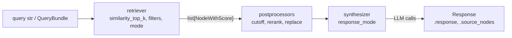

# LlamaIndex — Retrieval & Query Engines

A query engine is three replaceable stages: a **retriever** finds nodes, **node postprocessors** filter or reorder them, and a **response synthesizer** asks the LLM to answer from what is left. Keeping the stages separate is what makes RAG testable: retrieval can be asserted on without any LLM at all ([05](./05-testing-production.md)).



## Retrievers

```python
retriever = index.as_retriever(similarity_top_k=5)          # default top_k is 2
hits = retriever.retrieve("how long does express shipping take")   # list[NodeWithScore]
for hit in hits:
    print(hit.node_id, round(hit.score, 3), hit.metadata["topic"], hit.get_content()[:60])

hits = await retriever.aretrieve("...")                     # async variant
```

`retrieve` accepts a string or a `QueryBundle(query_str=..., custom_embedding_strs=[...])` when the text to embed differs from the text to ask. `NodeWithScore` exposes `.node`, `.score`, `.node_id`, `.metadata` and `.get_content()`. Scores are store-specific: cosine similarity in the in-memory store, but a distance-derived or fused score elsewhere, so compare scores only within one setup.

### Metadata filters

```python
from llama_index.core.vector_stores import FilterCondition, FilterOperator, MetadataFilter, MetadataFilters

filters = MetadataFilters(
    filters=[
        MetadataFilter(key="visibility", value="public", operator=FilterOperator.EQ),
        MetadataFilter(key="topic", value=["billing", "shipping"], operator=FilterOperator.IN),
        MetadataFilter(key="year", value=2025, operator=FilterOperator.GTE),
    ],
    condition=FilterCondition.AND,          # AND, OR, NOT
)
retriever = index.as_retriever(similarity_top_k=6, filters=filters)
engine = index.as_query_engine(similarity_top_k=6, filters=filters)
```

| `FilterOperator` | Meaning |
|------------------|---------|
| `EQ`, `NE` | equal, not equal (`==`, `!=`) |
| `GT`, `GTE`, `LT`, `LTE` | numeric or date comparison |
| `IN`, `NIN` | value in / not in a list |
| `ANY`, `ALL`, `CONTAINS` | list-valued metadata |
| `TEXT_MATCH`, `TEXT_MATCH_INSENSITIVE` | substring on text metadata |
| `IS_EMPTY` | metadata key missing or empty |

Filters are applied **before** the top-k cut inside stores that support them, so `similarity_top_k=3` with a filter still returns up to three allowed nodes. Operator support varies by vector store, so test the filters you rely on against the real store. Metadata used for filtering must exist on every node of the document (set it on `Document.metadata` before chunking).

### Hybrid, sparse and fusion

| Technique | How |
|-----------|-----|
| Store-side hybrid | `index.as_retriever(vector_store_query_mode="hybrid", similarity_top_k=5)` on stores that implement it: `PGVectorStore(hybrid_search=True)`, `QdrantVectorStore(enable_hybrid=True)` and others. `alpha=` weights dense against sparse where the store honours it (Postgres hybrid search does not accept `alpha`) |
| MMR | `vector_store_query_mode="mmr", vector_store_kwargs={"mmr_threshold": 0.3}` trades similarity for diversity (works with the in-memory store) |
| BM25 + vectors | `BM25Retriever` (`llama-index-retrievers-bm25`) fused with a vector retriever by `QueryFusionRetriever` |
| Multi-query | `QueryFusionRetriever(num_queries=4)` asks the LLM for query variants, retrieves for each and fuses |

```python
from llama_index.core.retrievers import QueryFusionRetriever
from llama_index.retrievers.bm25 import BM25Retriever

nodes = list(index.docstore.docs.values())                      # in-memory index; use your own node list otherwise
bm25 = BM25Retriever.from_defaults(nodes=nodes, similarity_top_k=5)
fusion = QueryFusionRetriever(
    [index.as_retriever(similarity_top_k=5), bm25],
    llm=llm,                       # resolved even when num_queries=1
    similarity_top_k=5,
    num_queries=1,                 # 1 = no LLM query rewriting; >1 calls the LLM
    mode="reciprocal_rerank",      # simple, reciprocal_rerank, relative_score, dist_based_score
    use_async=False,
)
engine = RetrieverQueryEngine.from_args(fusion, llm=llm)
```

`BM25Retriever` ranks by exact terms (IDs, error codes, product names) that embeddings blur. Rank-based fusion scores are small numbers (about 0.03 for reciprocal rank), not similarities.

## Node Postprocessors

Postprocessors run on the retrieved list before synthesis. Retrieve wide (`similarity_top_k=10`), then narrow.

| Postprocessor | Does | Cost |
|---------------|------|------|
| `SimilarityPostprocessor(similarity_cutoff=0.7)` | Drops nodes below a score | none |
| `KeywordNodePostprocessor(required_keywords=[...], exclude_keywords=[...])` | Keyword filter (needs `spacy`) | none |
| `SentenceTransformerRerank(model="cross-encoder/ms-marco-MiniLM-L-6-v2", top_n=3)` | Local cross-encoder rerank (`sentence-transformers`) | CPU/GPU |
| `LLMRerank(top_n=3, choice_batch_size=5)` | LLM rates each batch of nodes for relevance (1-10) | one call per batch |
| `StructuredLLMRerank(...)` | Same, with structured output | one call per batch |
| `MetadataReplacementPostProcessor(target_metadata_key="window")` | Swaps node text for a metadata value (sentence window) | none |
| `PrevNextNodePostprocessor(docstore=..., num_nodes=1, mode="both")` | Adds neighbouring nodes | none |
| `LongContextReorder()` | Moves best nodes to the start and end of the prompt | none |
| `PIINodePostprocessor(llm=...)`, `NERPIINodePostprocessor()` | Masks PII in node text (LLM or NER model) | LLM or model per node |
| `SentenceEmbeddingOptimizer`, `TimeWeightedPostprocessor`, `FixedRecencyPostprocessor` | Trim sentences by relevance; weight or keep the newest nodes by a date metadata field | varies |
| Hosted rerankers (`llama-index-postprocessor-cohere-rerank` and others) | `CohereRerank(top_n=3)` | API call |

```python
from llama_index.core.postprocessor import LLMRerank, SimilarityPostprocessor

engine = index.as_query_engine(
    similarity_top_k=10,
    node_postprocessors=[
        SimilarityPostprocessor(similarity_cutoff=0.2),
        LLMRerank(llm=llm, top_n=3, choice_batch_size=5),      # scores replace similarity scores
    ],
)
```

`LLMRerank` expects the model to answer `Doc: 2, Relevance: 9` lines and replaces `node.score` with the relevance number. `SentenceTransformerRerank` defaults to `trust_remote_code=True`; pass `False` for models that do not need it. A reranker only reorders what retrieval returned, so recall is bounded by `similarity_top_k`.

## Response Synthesizers

`get_response_synthesizer(response_mode=...)` decides how retrieved text becomes prompts. The default is `compact`.

| `response_mode` | Behaviour | LLM calls (n nodes) |
|-----------------|-----------|---------------------|
| `compact` (default) | Packs nodes into as few prompts as the context window allows, then refines across them | 1 when it fits |
| `refine` | Answers from node 1, then refines the answer with each further node | n, sequential |
| `tree_summarize` | Summarises batches, then summarises the summaries; good for "summarise" queries | fewer than n, then one more to merge |
| `simple_summarize` | Truncates all text to one prompt | 1 (can lose text) |
| `accumulate` | One answer per node, concatenated as `Response 1: ...` | n |
| `compact_accumulate` | Accumulate over packed chunks | fewer than n |
| `no_text` | No LLM call; returns only `source_nodes` | 0 |
| `context_only` | Returns the joined node text as the "answer" | 0 |
| `generation` | Ignores the context and asks the LLM directly | 1 |

```python
from llama_index.core.query_engine import RetrieverQueryEngine
from llama_index.core.response_synthesizers import get_response_synthesizer

synth = get_response_synthesizer(llm=llm, response_mode="tree_summarize", use_async=True)
engine = RetrieverQueryEngine(
    retriever=index.as_retriever(similarity_top_k=8),
    response_synthesizer=synth,
    node_postprocessors=[SimilarityPostprocessor(similarity_cutoff=0.2)],
)
response = engine.query("Summarise our shipping options")
```

`index.as_query_engine(**kwargs)` builds the same thing: retriever kwargs (`similarity_top_k`, `filters`, `vector_store_query_mode`), `node_postprocessors`, and synthesizer kwargs (`response_mode`, `streaming`, `output_cls`, `text_qa_template`, `refine_template`, `use_async`). Build `RetrieverQueryEngine` yourself when the retriever is not a plain vector retriever.

!!! note "`no_text` and `context_only` still resolve `Settings.llm`"
    The synthesizer base class reads `Settings.llm` when it is created, even in modes that never call it. Without an API key this raises. Set `Settings.llm = None` (a `MockLLM`) or use the retriever alone when you only need sources.

**What the LLM sees.** `as_query_engine` fills the `text_qa_template` with node text **including metadata** (`MetadataMode.LLM`): chunks arrive as `topic: shipping\nvisibility: public\n\n...`. Override prompts with `engine.update_prompts({"response_synthesizer:text_qa_template": PromptTemplate(...)})`; `engine.get_prompts()` lists the keys. `CitationQueryEngine` sends text without metadata by default.

### Streaming, async and sources

```python
engine = index.as_query_engine(streaming=True, similarity_top_k=3)
response = engine.query("express shipping time")            # StreamingResponse
for token in response.response_gen:                          # or response.print_response_stream()
    print(token, end="")

response = await index.as_query_engine().aquery("...")       # async; Response
response.source_nodes          # list[NodeWithScore]
response.metadata              # {node_id: node metadata}
```

Always return `source_nodes` (ids, scores, file names) next to the answer: that is the evidence a reviewer or a test needs.

## Choosing Between Several Sources

### `RouterQueryEngine`

An LLM picks one (or several) of a set of query engines by their descriptions.

```python
from llama_index.core.query_engine import RouterQueryEngine
from llama_index.core.selectors import LLMSingleSelector, PydanticSingleSelector
from llama_index.core.tools import QueryEngineTool

tools = [
    QueryEngineTool.from_defaults(billing.as_query_engine(), name="billing", description="Refund and billing policy"),
    QueryEngineTool.from_defaults(shipping.as_query_engine(), name="shipping", description="Shipping times and costs"),
]
router = RouterQueryEngine(selector=LLMSingleSelector.from_defaults(), query_engine_tools=tools)
response = router.query("how fast is express?")
response.metadata["selector_result"]          # which tool was chosen and why
```

`LLMSingleSelector` asks for a JSON choice in plain text; `PydanticSingleSelector` uses a function call (needs a function-calling LLM); `LLMMultiSelector` / `PydanticMultiSelector` can pick several and the engine summarises their answers. Selection quality depends on the descriptions: write them like tool descriptions.

### `SubQuestionQueryEngine`

Breaks a compound question into sub-questions, sends each to the named tool, and synthesises.

```python
from llama_index.core.query_engine import SubQuestionQueryEngine
from llama_index.core.question_gen import LLMQuestionGenerator

engine = SubQuestionQueryEngine.from_defaults(
    query_engine_tools=tools,
    question_gen=LLMQuestionGenerator.from_defaults(llm=llm),   # without this, from_defaults raises ImportError
    use_async=True,
)
engine.query("Compare the express delivery time with the refund window")
```

Without `question_gen`, `from_defaults` imports `llama_index.question_gen.openai` and raises an `ImportError` that suggests installing `llama-index-question-gen-openai`. That package (0.3.1) requires `llama-index-core<0.13`, so installing it downgrades core. Always pass `LLMQuestionGenerator`, which expects the model to return a JSON list of `{"sub_question", "tool_name"}` objects.

## Chat Engines

`index.as_chat_engine(chat_mode=...)` adds conversation memory around retrieval. The default mode `"best"` resolves to `condense_plus_context`.

| `chat_mode` | Flow | LLM calls per turn |
|-------------|------|--------------------|
| `simple` | LLM only, no retrieval (`SimpleChatEngine`) | 1 |
| `context` | Retrieve with the raw user message, put the text in the system prompt | 1 |
| `condense_plus_context` | Rewrite history plus message into a standalone question, retrieve for it, answer with context | 2 (1 on the first turn: nothing to condense) |
| `condense_question` | Rewrite to a standalone question, then run the **query engine** | 2 |
| `react`, `openai` | Removed (`ValueError`); use an agent with a query engine tool ([03](./03-agents-tools-workflows.md)) | n/a |

```python
from llama_index.core.memory import Memory

chat = index.as_chat_engine(
    chat_mode="condense_plus_context",
    llm=llm,
    memory=Memory.from_defaults(session_id="user-42", token_limit=3000),
    system_prompt="You are a support assistant. Answer only from the context.",
    similarity_top_k=3,
    node_postprocessors=[SimilarityPostprocessor(similarity_cutoff=0.2)],
)
r = chat.chat("express shipping time?")
r = await chat.achat("and the cost?")          # condensed to a standalone question first
print(r.response, [n.node_id for n in r.source_nodes])
for token in chat.stream_chat("thanks").response_gen:
    print(token, end="")
chat.chat_history                                  # list[ChatMessage]
chat.reset()                                       # clear this conversation
```

A chat engine holds **one conversation**. Create one engine (and one `Memory` with its own `session_id`) per user, never share one across users. `ChatMemoryBuffer.from_defaults(token_limit=...)` still works but is deprecated in favour of `Memory`; `Memory` keeps messages in a SQL store (SQLite in memory by default; pass `async_database_uri=` or `chat_store=` to persist, [03](./03-agents-tools-workflows.md)). Set `skip_condense=True` on `CondensePlusContextChatEngine` to save the extra call, and `condense_prompt=` to tune the rewrite.

## Citations and Structured Output

```python
from pydantic import BaseModel

from llama_index.core.query_engine import CitationQueryEngine

cite = CitationQueryEngine.from_args(index, llm=llm, similarity_top_k=3, citation_chunk_size=512)
response = cite.query("express shipping time")
print(response)                                   # "Express takes 1 to 2 days [1]."
for n in response.source_nodes:                   # numbered "Source 1:\n..." chunks, new node ids
    print(n.node.get_content()[:80])


class Shipping(BaseModel):
    days_min: int
    days_max: int
    price_usd: float | None = None


engine = index.as_query_engine(llm=llm, output_cls=Shipping, similarity_top_k=1)
response = engine.query("express shipping")       # PydanticResponse
response.response                                 # Shipping(days_min=1, days_max=2, price_usd=15.0)
```

`CitationQueryEngine` re-splits the retrieved nodes into `citation_chunk_size` pieces and numbers them, so citation ids point at the new pieces; map back with `node.ref_doc_id` or metadata. With `output_cls`, `response.response` is the Pydantic object (not a string) and `str(response)` is its JSON. With an OpenAI LLM the schema is sent as a JSON-schema `response_format`. For one-off extraction without retrieval use `llm.as_structured_llm(Shipping).complete("...")`; the parsed object is `.raw`.

## Advanced Retrieval Patterns

| Pattern | Idea | Building blocks |
|---------|------|-----------------|
| Sentence window | Embed single sentences, hand the LLM the surrounding window | `SentenceWindowNodeParser`, `MetadataReplacementPostProcessor(target_metadata_key="window")` |
| Auto-merging | Index small leaf chunks; when most children of a parent are retrieved, return the parent | `HierarchicalNodeParser`, `get_leaf_nodes`, `AutoMergingRetriever(retriever, storage_context, simple_ratio_thresh=0.5)` |
| Small-to-big | Search small chunks, answer from the bigger parent | `IndexNode(index_id=parent_id)`, `RecursiveRetriever` |
| HyDE | Embed an LLM-written hypothetical answer instead of the question | `HyDEQueryTransform(include_original=True)` + `TransformQueryEngine` |
| Multi-step | Decompose a question step by step, using earlier answers | `StepDecomposeQueryTransform` + `MultiStepQueryEngine` |
| Multi-query + fusion | Several rewrites, fused ranking | `QueryFusionRetriever(num_queries=4)` |
| Rerank | Retrieve wide, rerank narrow | `LLMRerank`, `SentenceTransformerRerank` |
| Metadata routing | Pick the index or the filter by question type | `RouterQueryEngine`, filters from the user's role |

```python
from llama_index.core import VectorStoreIndex
from llama_index.core.node_parser import SentenceWindowNodeParser
from llama_index.core.postprocessor import MetadataReplacementPostProcessor

window_parser = SentenceWindowNodeParser.from_defaults(window_size=1, window_metadata_key="window")
nodes = window_parser.get_nodes_from_documents(documents)         # text = one sentence; metadata["window"] = three
index = VectorStoreIndex(nodes, embed_model=embed_model)
engine = index.as_query_engine(
    llm=llm,
    similarity_top_k=3,
    node_postprocessors=[MetadataReplacementPostProcessor(target_metadata_key="window")],
)
```

```python
from llama_index.core import StorageContext
from llama_index.core.node_parser import HierarchicalNodeParser, get_leaf_nodes
from llama_index.core.retrievers import AutoMergingRetriever

all_nodes = HierarchicalNodeParser.from_defaults(chunk_sizes=[2048, 512, 128]).get_nodes_from_documents(documents)
storage = StorageContext.from_defaults()
storage.docstore.add_documents(all_nodes)                          # parents must be in the docstore
base = VectorStoreIndex(get_leaf_nodes(all_nodes), storage_context=storage, embed_model=embed_model)
retriever = AutoMergingRetriever(base.as_retriever(similarity_top_k=6), storage, simple_ratio_thresh=0.5)
```

Auto-merging needs the parent nodes in a docstore. With a remote vector store that keeps text in the store, keep your own `docstore` (for example persisted next to it) for the parents.

Add patterns one at a time and measure each against a golden set ([04](./04-evaluation-observability.md)); every extra stage adds latency and LLM calls, and a pattern that helps one corpus can hurt another. A side-by-side with LangChain retrievers is in [LangChain RAG & Retrieval](../langchain/03-rag-retrieval.md).

## Common Mistakes

| Mistake | Effect | Fix |
|---------|--------|-----|
| Default `similarity_top_k=2` | Answers miss facts spread across chunks | Raise it, then rerank down |
| Reranker with `similarity_top_k` equal to `top_n` | Nothing to rerank | Retrieve 3-5x more than `top_n` |
| Score cutoff tuned on one query | Empty retrievals on others | Tune on a golden set; fall back when empty |
| One shared chat engine for all users | Conversations leak across users | One engine and `Memory` per session |
| Expecting filters to be a security boundary on their own | Missing filter returns everything | Build filters server-side from the caller's identity ([05](./05-testing-production.md)) |
| `response_mode="refine"` on 20 nodes | 20 sequential calls | `compact` or `tree_summarize` |
| `SubQuestionQueryEngine.from_defaults` without `question_gen` | `ImportError` pointing at a package that pins an old core | Pass `LLMQuestionGenerator` |
| Trusting citation numbers | `[1]` refers to a re-chunked piece | Map to `ref_doc_id` and metadata |

---
## See also
- [LlamaIndex — RAG and Agents over Your Data](./index.md)
- [LlamaIndex — Data, Nodes & Indexing](./01-data-nodes-indexing.md)
- [LlamaIndex — Agents, Tools & Workflows](./03-agents-tools-workflows.md)
- [LangChain — RAG & Retrieval](../langchain/03-rag-retrieval.md)
- [Ragas — RAG Metrics](../ragas/02-rag-metrics.md)
- [Python Libraries](../index.md)
