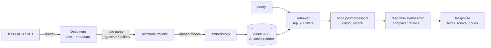
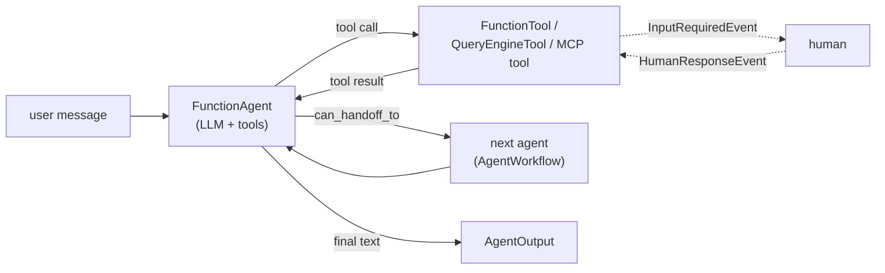

# LlamaIndex — RAG and Agents over Your Data

**LlamaIndex** (`llama-index` on PyPI, GitHub `run-llama/llama_index`) is an MIT-licensed Python framework for applications that answer questions over your own data and act on it. It covers the whole path: **readers** load files and services into `Document` objects, **node parsers** cut them into chunks (`TextNode`), an **index** stores the embeddings, a **retriever** finds chunks, a **response synthesizer** asks the LLM to answer from them, and **agents** and **Workflows** wrap this in tool use and multi-step logic.

This guide covers **llama-index-core 0.14.25** (released 21 September 2026) with `llama-index-workflows` 2.26, on Python 3.10 or newer. The hosted products LlamaParse and LlamaCloud are commercial services and are not covered.





## Installation

```bash
uv add llama-index-core                                 # Document, nodes, indices, engines, agents, Workflows, evaluators, MockLLM
uv add llama-index-llms-openai llama-index-embeddings-openai   # OpenAI LLM and embeddings (the defaults)
uv add llama-index                                      # starter bundle: core + OpenAI LLM + OpenAI embeddings + nltk
uv add llama-index-readers-file                         # PDF, DOCX, PPTX, CSV, XLSX, EPUB, ... for SimpleDirectoryReader
uv add llama-index-vector-stores-chroma                 # or -qdrant, -postgres, ...
uv add llama-index-retrievers-bm25                      # BM25Retriever
uv add llama-index-tools-mcp                            # MCP client tools
uv add llama-index-llms-openai-like llama-index-embeddings-openai-like   # any OpenAI-compatible server
uv add llama-index-llms-ollama llama-index-embeddings-ollama             # local Ollama models
uv add llama-index-embeddings-huggingface               # local sentence-transformers embeddings
uv add llama-index-observability-otel                   # OpenTelemetry export
uv add openinference-instrumentation-llama-index        # OpenInference spans (Phoenix, Langfuse, ...)
uv add llama-index-utils-workflow                       # draw_all_possible_flows
uv add --dev pytest pytest-asyncio
```

LlamaIndex is split into many packages. Install the smallest set you use.

| Package | Provides | Import |
|---------|----------|--------|
| `llama-index-core` | everything provider-independent | `llama_index.core` |
| `llama-index-workflows` | the `Workflow` engine (a dependency of core) | `workflows`, re-exported as `llama_index.core.workflow` |
| `llama-index` | starter bundle: core + `llama-index-llms-openai` + `llama-index-embeddings-openai` + `nltk` | none of its own |
| `llama-index-llms-<name>`, `llama-index-embeddings-<name>` | one provider each | `llama_index.llms.<name>`, `llama_index.embeddings.<name>` |
| `llama-index-vector-stores-<name>` | one vector database each | `llama_index.vector_stores.<name>` |
| `llama-index-readers-<name>` | one data source each (LlamaHub lists them) | `llama_index.readers.<name>` |
| `llama-index-tools-<name>`, `llama-index-postprocessor-<name>`, `llama-index-retrievers-<name>` | extras | `llama_index.tools.<name>`, ... |

!!! warning "Pin provider packages together"
    The `llama-index` bundle (0.14.25) pins older ranges of the OpenAI integrations than the newest releases (`llama-index-llms-openai<0.8`, `llama-index-embeddings-openai<0.7`). Prefer `llama-index-core` plus the provider packages you need and let `uv lock` pick compatible versions.

## Section Map

| File | Topics |
|------|--------|
| [01 Data, Nodes & Indexing](./01-data-nodes-indexing.md) | `Document`, `SimpleDirectoryReader`, metadata and what the LLM sees, node parsers, `Settings`, embeddings, `IngestionPipeline` with cache and docstore dedup, `VectorStoreIndex`, Chroma / Qdrant / pgvector, `StorageContext`, persistence, insert / delete / refresh, other indices |
| [02 Retrieval & Query Engines](./02-retrieval-query-engines.md) | retrievers, `MetadataFilters`, hybrid and fusion, node postprocessors and rerankers, response modes, query / router / sub-question engines, chat engines and `Memory`, streaming, citations, `output_cls`, advanced retrieval patterns |
| [03 Agents, Tools & Workflows](./03-agents-tools-workflows.md) | `FunctionTool`, `QueryEngineTool`, `FunctionAgent`, `AgentWorkflow` hand-off, `Context` state, events and streaming, human-in-the-loop, custom `Workflow`, MCP, `Memory`, structured output, guardrails |
| [04 Evaluation & Observability](./04-evaluation-observability.md) | built-in evaluators, retrieval metrics, `BatchEvalRunner`, question generation, Ragas and DeepEval on LlamaIndex outputs, instrumentation events, OpenTelemetry / OpenInference, Phoenix, Langfuse, LangSmith, token counting |
| [05 Testing & Production](./05-testing-production.md) | `MockLLM`, scripted tool-calling LLM, fake OpenAI server, deterministic retrieval tests, chunking snapshots, workflow and agent tests, golden-set gates, async, rate limits, FastAPI, security, versioning |

## When to Use LlamaIndex vs the Alternatives

| Need | Choose |
|------|--------|
| Ingest many file types, chunk, index and query documents with many vector stores and rerankers | **LlamaIndex** |
| RAG pipeline you can inspect and unit-test node by node (`NodeWithScore`, `source_nodes`) | **LlamaIndex** |
| Event-driven multi-step pipeline (retrieve, branch, loop, fan-out) with typed events | **LlamaIndex Workflows** |
| General chains, a very large integration catalogue, LCEL composition | [LangChain](../langchain/index.md) (RAG side by side: [LangChain RAG & Retrieval](../langchain/03-rag-retrieval.md)) |
| Long-running agents with checkpoints, time-travel and graph state | [LangGraph](../langgraph/index.md) |
| Typed agent output, dependency injection, offline `TestModel` | [Pydantic AI](../pydantic-ai/index.md) |
| One provider, one prompt, no retrieval | The provider SDK, or [LiteLLM](../litellm/index.md) for many providers |
| Score a RAG pipeline you already have | [Ragas](../ragas/index.md) or [DeepEval](../../llm-evaluation/index.md) on top of any of these |

Rule of thumb: LlamaIndex is strongest when the hard part is **your data** (parsing, chunking, metadata, retrieval quality). When the hard part is agent control flow, state and persistence, LangGraph or Pydantic AI fit better, and LlamaIndex still works as the retrieval layer inside them. Architectural background: [Agentic AI Architecture](../../agentic-ai-architecture/index.md).

## Core Ideas

| Object | Role |
|--------|------|
| `Document` | Source text plus `metadata`; `doc_id` identifies it for updates |
| `TextNode` / `NodeWithScore` | A chunk with relationships (source, previous, next); a retrieved chunk with its score |
| `Settings` | Global defaults: `llm`, `embed_model`, `chunk_size`, `callback_manager`; every component also accepts its own override |
| `VectorStoreIndex` | Embeds nodes into a vector store; `as_retriever`, `as_query_engine`, `as_chat_engine` |
| Retriever → postprocessors → synthesizer | The three replaceable stages inside a query engine |
| `Response` | `str(response)` is the answer, `response.source_nodes` the evidence |
| `FunctionAgent`, `AgentWorkflow` | Tool-calling agents on top of Workflows; `await agent.run(...)` |
| `Workflow`, `Event`, `@step` | Event-driven steps; `StartEvent` in, `StopEvent` out |
| `Memory` | Chat history with token limit and optional memory blocks |

## Minimal Example

```python
from llama_index.core import Settings, SimpleDirectoryReader, VectorStoreIndex
from llama_index.embeddings.openai import OpenAIEmbedding
from llama_index.llms.openai import OpenAI

Settings.llm = OpenAI(model="gpt-4o-mini", temperature=0)               # reads OPENAI_API_KEY
Settings.embed_model = OpenAIEmbedding(model="text-embedding-3-small")

documents = SimpleDirectoryReader("data").load_data()                   # one Document per file
index = VectorStoreIndex.from_documents(documents)                      # chunk, embed, store in memory
query_engine = index.as_query_engine(similarity_top_k=3)

response = query_engine.query("How long does express shipping take?")
print(response)                                                         # the answer
for hit in response.source_nodes:                                       # the evidence
    print(hit.node.metadata["file_name"], round(hit.score, 2))
```

## Names from Older Tutorials

LlamaIndex has been reorganised several times (package split, then agents rebuilt on Workflows), and many tutorials predate that. In core 0.14.25 these older patterns fail or behave differently:

| Old code | Current |
|----------|---------|
| `from llama_index import VectorStoreIndex` | `from llama_index.core import VectorStoreIndex` (the top-level `llama_index` package no longer exports it: `ImportError`) |
| `from llama_index.llms import OpenAI` | `from llama_index.llms.openai import OpenAI` (separate package `llama-index-llms-openai`) |
| `ServiceContext.from_defaults(...)`, `set_global_service_context(...)` | Both raise `ValueError: ServiceContext is deprecated`. Use `Settings`, or pass `llm=`, `embed_model=`, `transformations=` to the component |
| `LLMPredictor(llm=...)` | Removed; call `llm.complete(...)`, `llm.chat(...)` or `llm.predict(PromptTemplate(...), **kwargs)` |
| `OpenAIAgent`, `FunctionCallingAgent`, `FunctionCallingAgentWorker`, `AgentRunner`, `StructuredPlannerAgent` | Not importable. Use `FunctionAgent` or `AgentWorkflow` ([03](./03-agents-tools-workflows.md)) |
| `ReActAgent.from_tools(tools, llm=llm)` and `agent.chat("...")` | `from llama_index.core.agent.workflow import ReActAgent`; `ReActAgent(tools=..., llm=...)` and `await agent.run("...")`. `from_tools` and `chat` no longer exist |
| `index.as_chat_engine(chat_mode="react")` or `"openai"` | `ValueError: ChatMode.REACT and ChatMode.OPENAI are now deprecated and removed`. Build an agent with a `QueryEngineTool` |
| `QueryPipeline`, `llama_index.core.query_pipeline` | Module removed. Use a [Workflow](./03-agents-tools-workflows.md) or plain Python |
| `from llama_index.core import download_loader`, `llama_hub` | Removed. Install the reader package, for example `llama-index-readers-web`, and import it from `llama_index.readers.<name>` |
| `GPTVectorStoreIndex`, `GPTListIndex`, `ListIndex` | Still importable as aliases of `VectorStoreIndex` and `SummaryIndex`; use the new names |
| `SimpleNodeParser` | Alias of `SentenceSplitter`; use `SentenceSplitter` |
| `ChatMemoryBuffer`, `SimpleComposableMemory`, `VectorMemory` | Marked deprecated in favour of `Memory` with memory blocks; chat engines still accept `ChatMemoryBuffer` |
| `RagDatasetGenerator`, `LabelledRagDataset`, `llama_index.core.llama_dataset` | Not importable from core. `DatasetGenerator` in `llama_index.core.evaluation` still works but emits a `DeprecationWarning` naming them ([04](./04-evaluation-observability.md)) |
| `from llama_index.core.workflow import Workflow, step` | Still works; the engine lives in `llama-index-workflows` and is importable as `from workflows import Workflow, step` |
| `SubQuestionQueryEngine.from_defaults(...)` with no `question_gen` | `ImportError` suggesting `llama-index-question-gen-openai`, which pins `llama-index-core<0.13`. Pass `question_gen=LLMQuestionGenerator.from_defaults(llm=llm)` ([02](./02-retrieval-query-engines.md)) |

## Quick Rules

1. **Install per-provider packages** — `llama-index-core` plus the exact LLM, embedding and vector-store packages; pin them in `uv.lock`.
2. **Set `Settings.llm` and `Settings.embed_model` once at startup, and pass explicit models in libraries and tests** — the lazy default is OpenAI and fails without a key.
3. **Give every `Document` a stable `doc_id`** (`filename_as_id=True` or your own) — updates, deletes and dedup depend on it.
4. **Control what the model sees** — metadata is embedded and sent to the LLM unless you exclude it; `file_path` is included by default.
5. **Set `chunk_overlap` below `chunk_size`** and size chunks for your embedding model, not for the defaults (1024 / 200).
6. **Use the same embedding model for indexing and querying**, and record its name and dimension next to the index.
7. **Persist indexes** (`storage_context.persist`, or a real vector store) — an in-memory index is rebuilt, and re-embedded, on every start.
8. **Return `source_nodes` to callers** and test retrieval separately from generation.
9. **Use `FunctionAgent` / `AgentWorkflow` and `Workflow` for new code** — the old agent classes are gone.
10. **Run offline tests with `MockLLM`, a keyword embedding and a fake server; run evaluators with a real judge on a small golden set** ([05](./05-testing-production.md)).

---
## See also
- [Digital Garden: Knowledge Base](../../index.md)
- [Python Libraries](../index.md)
- [LangChain — LLM Application Framework](../langchain/index.md)
- [LangChain — RAG & Retrieval](../langchain/03-rag-retrieval.md)
- [LangGraph — Stateful Agent Orchestration](../langgraph/index.md)
- [Pydantic AI — Type-Safe Agents](../pydantic-ai/index.md)
- [Ragas — Evaluation for LLM, RAG and Agent Applications](../ragas/index.md)
- [LiteLLM — One API for 100+ LLM Providers](../litellm/index.md)
- [DeepEval — LLM Testing Guide](../../llm-evaluation/index.md)
- [Agentic AI Architecture](../../agentic-ai-architecture/index.md)
