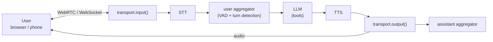

# Pipecat — Open-Source Framework for Voice Agents

**Pipecat** (`pipecat-ai` on PyPI, GitHub `pipecat-ai/pipecat`) is an open-source Python framework for real-time voice and multimodal agents. It is maintained by Daily and the community and licensed **BSD-2-Clause**. The framework is free; you pay only for the AI services and hosting you choose. This guide covers the open-source framework, not the commercial Pipecat Cloud.

A Pipecat agent is a **pipeline of frame processors**: audio comes in from a transport, flows through speech-to-text (STT), a language model (LLM) and text-to-speech (TTS), and goes back out as audio. Every step is a small, replaceable object, and everything that moves between them is a typed **frame**.



## Installation

```bash
uv add pipecat-ai                                  # core framework, Silero VAD, Smart Turn, testing utilities
uv add "pipecat-ai[openai,deepgram]"               # services you use (one extra per provider)
uv add "pipecat-ai[runner,webrtc]"                 # development runner (FastAPI) + SmallWebRTC transport
uv add "pipecat-ai[daily]"                         # Daily transport (WebRTC rooms)
uv add "pipecat-ai[evals]"                         # Pipecat Evals library
uv tool install "pipecat-ai[cli]"                  # the `pipecat` command: init, eval, cloud
uv add --dev pytest pytest-asyncio
```

Python **3.11 or newer** is required (3.12+ recommended). Version 1.13.0 has 57 extras. Not every provider needs one: `CartesiaTTSService` and `ElevenLabsTTSService` import with the base install, while Deepgram, Anthropic and Daily raise `No module named ...` until you install their extra. The error message names the extra to add.

Everything in this guide was run on **pipecat-ai 1.13.0** (released 19 October 2026) on Python 3.13, with `aiohttp` 3.14 and `pytest` 9.1. No provider API keys were used: LLM calls went to a local fake server, and the voice parts were exercised through Pipecat's own test utilities and eval harness. Code that needs real keys, microphones or a browser is marked as not run.

## Section Map

| File | Topics |
|------|--------|
| [01 Pipelines, Frames & Processors](./01-pipelines-frames-processors.md) | `Pipeline`, `PipelineWorker`, `WorkerRunner`, frame types and direction, writing a `FrameProcessor`, `ParallelPipeline`, lifecycle, termination, idle timeout |
| [02 Conversation: Turns, Context & Tools](./02-conversation-turns-tools.md) | STT/LLM/TTS services, `LLMContext` and aggregators, `system_instruction`, VAD, user turn strategies, Smart Turn, interruptions, function calling, `tool_options` |
| [03 Transports, Runner & Production](./03-transports-runner-production.md) | `bot()` entry point, development runner and its flags, `create_transport`, WebRTC / Daily / WebSocket / telephony, observers, latency, metrics, tracing, deployment patterns |
| [04 Testing & Evals](./04-testing-evals.md) | `run_test`, testing processors, a fake OpenAI server for the full tool loop, Pipecat Evals (scripted, simulated, library, CLI), DeepEval voice metrics |

## When to Choose Pipecat

| Need | Choose |
|------|--------|
| Full control of the voice pipeline, any STT/LLM/TTS mix, self-hosted, open source | **Pipecat** |
| Custom processing between stages (redaction, routing, language switching, analytics) | **Pipecat** (write a `FrameProcessor`) |
| One speech-to-speech model (OpenAI Realtime, Gemini Live) | Pipecat (it has speech-to-speech services) or the provider SDK directly |
| WebRTC infrastructure (rooms, SFU) managed for you | Pipecat + Daily or LiveKit transport |
| A hosted voice-agent platform with no code | A platform product (outside this guide) |
| Text-only agent with tools and structured output | [Pydantic AI](../pydantic-ai/index.md), [LangGraph](../langgraph/index.md) or [Agno](../agno/index.md) |

Rule of thumb: Pipecat is a **real-time media framework**, so choose it when latency, interruptions and audio handling matter. For an agent that only types, a text framework is simpler.

## Core Ideas

- **Frames** are the unit of data: `InputAudioRawFrame`, `TranscriptionFrame`, `LLMTextFrame`, `TTSSpeakFrame`, `OutputAudioRawFrame`, `EndFrame`, ... Each is a **SystemFrame** (high priority, never discarded by an interruption), a **DataFrame** or a **ControlFrame** (both queued in order).
- **Frame processors** receive frames, act, and **push every frame onward**. A pipeline is an ordered list of them; frames travel `DOWNSTREAM` (towards the user) or `UPSTREAM` (errors, control).
- **Services** (STT, LLM, TTS, speech-to-speech, vision, memory) are frame processors that call a provider. 150+ are integrated.
- **Transports** connect to the client: Daily, LiveKit, SmallWebRTC, FastAPI WebSocket, WebSocket server, Vonage, WhatsApp, local audio. **Serializers** adapt telephony streams: Twilio, Telnyx, Plivo, Exotel, Genesys, Vonage.
- **Aggregators** keep the conversation: the **user aggregator** turns transcripts into context messages and decides when the user's turn starts and ends; the **assistant aggregator** records what the bot actually said.
- **Observers** watch frames without being in the pipeline: latency, logging, metrics, tracing.

## Minimal Example

A processor you write yourself, tested in a few lines with Pipecat's own utility:

```python
import asyncio

from pipecat.frames.frames import TextFrame, TTSSpeakFrame
from pipecat.processors.frame_processor import FrameProcessor
from pipecat.tests.utils import run_test


class Redactor(FrameProcessor):
    """Masks digits in text before it reaches TTS."""

    async def process_frame(self, frame, direction):
        await super().process_frame(frame, direction)              # required first
        if isinstance(frame, TextFrame):
            frame = TextFrame(text="".join("*" if c.isdigit() else c for c in frame.text))
        await self.push_frame(frame, direction)                    # always push every frame


async def main():
    down, up = await run_test(
        Redactor(),
        frames_to_send=[TextFrame("card 4111 1111"), TTSSpeakFrame("ok")],
        expected_down_frames=[TextFrame, TTSSpeakFrame],
    )
    print([(type(f).__name__, getattr(f, "text", None)) for f in down])
    # [('TextFrame', 'card **** ****'), ('TTSSpeakFrame', 'ok')]


asyncio.run(main())
```

## Names from Older Tutorials

Pipecat reached 1.x and renamed core classes. The old names still work for now but warn and will be removed in **2.0.0**:

| Old (0.0.x tutorials) | Current (1.13.0) |
|-----------------------|------------------|
| `PipelineTask` | `PipelineWorker` (`from pipecat.pipeline.worker import PipelineWorker`). `PipelineTask` warns: *deprecated since 1.3.0 and will be removed in 2.0.0* |
| `PipelineRunner` | `WorkerRunner` (`from pipecat.pipeline.runner import WorkerRunner`; defined in `pipecat.workers.runner`) |
| `task.cancel()`, `runner.cancel()` | `await worker.cancel()` / `await runner.cancel()` |
| `EndTaskFrame`, `CancelTaskFrame` | `EndWorkerFrame`, `CancelWorkerFrame` (`EndTaskFrame` warns: *deprecated since 1.4.0*) |
| `{"role": "system", ...}` message for the bot's persona | `system_instruction` in the LLM service's `Settings` (system messages in context deprecated since 1.9.0) |
| `OpenAILLMContext` and per-provider contexts | the universal `LLMContext` with `LLMContextAggregatorPair`. The old module `pipecat.processors.aggregators.openai_llm_context` no longer exists in 1.13.0 (`ModuleNotFoundError`) |
| Audio sample rates read from `StartFrame` | `setup.audio_in_sample_rate` / `audio_out_sample_rate` in `FrameProcessor.setup()` (deprecated since 1.8.0) |
| `python bot.py -t eval` | Run the bot without `-t`; the eval harness connects to `/ws` (`-t eval` deprecated since 1.13.0) |
| `EvalJudge(llm)` | `EvalJudge(LLMClassifier(llm=llm), explainer=llm)` (since 1.12.0) |

## Quick Rules

1. **Always call `await super().process_frame(frame, direction)` first and push every frame** you receive. A processor that swallows frames stalls the pipeline.
2. **Order matters:** `transport.input() → STT → user aggregator → LLM → TTS → transport.output() → assistant aggregator`. The assistant aggregator goes *after* `transport.output()` so the context records what was really spoken after an interruption.
3. **Put the persona in `system_instruction`**, not in the context messages.
4. **Keep interruptions enabled** for natural conversations; tune VAD and turn strategies instead of disabling them.
5. **Write the bot as `run_bot(transport, runner_args)`** and create the transport in a separate `bot()`: the same agent then runs on WebRTC, Daily and telephony.
6. **Handle `on_client_disconnected`** (`await runner.cancel()`), and keep the default idle timeout so abandoned sessions free their resources.
7. **Set `PipelineParams(enable_metrics=True)`** and add `UserBotLatencyObserver`: you cannot tune what you do not measure.
8. **Test processors with `run_test`, flows with a fake LLM server, behavior with Pipecat Evals**, and put a small suite in CI.

---
## See also
- [Digital Garden: Knowledge Base](../../index.md)
- [Python Libraries](../index.md)
- [DeepEval Guide — Part 8b: Voice Evaluation](../../llm-evaluation/01_metrics/08b_voice_metrics.md)
- [aiohttp — Async HTTP Client & Server](../aiohttp/index.md)
- [FastAPI](../fastapi/index.md)
- [Pydantic AI — Type-Safe Agents](../pydantic-ai/index.md)
- [Agentic AI Architecture](../../agentic-ai-architecture/index.md)
- [WebSocket](../../api-architectures/04-websocket/index.md)
