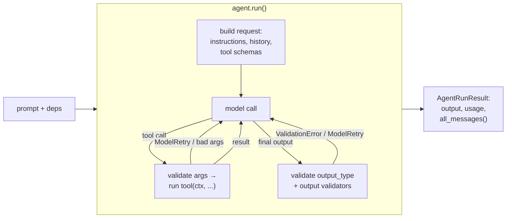

# Pydantic AI — Type-Safe Agents in Python

Pydantic AI (package `pydantic-ai`, or the lighter `pydantic-ai-slim`) is a Python agent framework from the Pydantic team. An `Agent` is a model plus instructions, tools and a **typed output**. Everything the model returns is validated with Pydantic, and a validation error is sent back to the model as a retry prompt instead of crashing your code.

Three ideas set it apart from LangChain and Agno:

- **Typed everywhere** — `Agent[Deps, Output]` is generic, so your IDE and `mypy` know the type of `result.output` and of `ctx.deps` inside a tool.
- **Dependency injection** — a `deps` object (database, HTTP client, settings) is passed per run and reaches tools and instructions through `RunContext`. Tests swap it for fakes.
- **Testable by design** — `TestModel`, `FunctionModel`, `Agent.override()` and `models.ALLOW_MODEL_REQUESTS = False` let you test agents offline, with no API key.

## Installation

```bash
uv add pydantic-ai-slim                    # core: Agent, tools, TestModel, FunctionModel
uv add "pydantic-ai-slim[openai]"          # + a model provider (anthropic, google, groq, mistral, bedrock, ...)
uv add "pydantic-ai-slim[mcp]"             # MCP client (MCPToolset)
uv add "pydantic-ai-slim[evals]"           # pydantic-evals
uv add "pydantic-ai-slim[logfire]"         # tracing
uv add --dev pytest pytest-asyncio
```

`uv add pydantic-ai` installs the same core with **all** provider SDKs; prefer `-slim` plus the one extra you use. Python 3.11 or newer is required.

Examples in this guide were run against **pydantic-ai-slim 2.57.0** (with `pydantic-evals` and `pydantic-graph` 2.57.0, Pydantic 2.14, `pytest` 9.1, `pytest-asyncio` 1.4) on Python 3.13. No API keys were used: the model was replaced with `TestModel` or `FunctionModel` from [04 Testing](./04-testing-evals.md). In real code pass a `"provider:model"` string such as `"openai:gpt-5-mini"` and set the provider's API key variable (`OPENAI_API_KEY`, `ANTHROPIC_API_KEY`, ...).

!!! tip "Silence the startup banner in CI"
    Pydantic AI 2.x prints an ASCII banner with an observability hint when an agent is first used. Set `PYDANTIC_AI_NO_BANNER=1` in tests and CI to keep the logs clean.

## Section Map

| File | Topics |
|------|--------|
| [01 Agents, Tools & Structured Output](./01-agents-tools-output.md) | `Agent` parameters, `instructions`, `deps_type` and `RunContext`, `@agent.tool` / `tool_plain`, tool schemas from docstrings, `ModelRetry`, `output_type` (models, unions, `ToolOutput`, `NativeOutput`, `PromptedOutput`, `TextOutput`), output validators, usage limits, `model_settings` |
| [02 Runs, History, Approval & Capabilities](./02-runs-history-capabilities.md) | `run` / `run_sync` / `run_stream` / `run_stream_events` / `iter`, message history and `Conversation`, JSON persistence, human approval with `DeferredToolRequests`, toolsets, MCP, `Hooks`, `ProcessHistory`, `FallbackModel` |
| [03 Multi-Agent & Graphs](./03-multi-agent-graphs.md) | Agent delegation as a tool, programmatic hand-off, usage tracking across agents, `pydantic_graph` `GraphBuilder`, choosing between them |
| [04 Testing, Evals & Observability](./04-testing-evals.md) | `TestModel`, `FunctionModel`, `override`, blocking real requests, asserting tool calls and messages, `capture_run_messages`, `pydantic-evals`, Logfire / OpenTelemetry, CI |

## When to Choose Pydantic AI

| Need | Good fit |
|------|----------|
| Structured, validated LLM output with automatic retry on bad data | **Pydantic AI** `output_type` |
| Agent code with full type checking and constructor-free dependency injection | **Pydantic AI** `deps_type` |
| Tests that run offline in milliseconds | **Pydantic AI** `TestModel` / `FunctionModel` |
| Arbitrary cycles, checkpoints, time-travel over state | **LangGraph** |
| Memory, knowledge base and an HTTP runtime in one package | **Agno** |
| Huge ecosystem of loaders and retrievers | **LangChain** |

Rule of thumb: pick Pydantic AI when the agent is part of a typed Python codebase (a FastAPI service, a pipeline) and you want the same discipline you already apply to the rest of your code. For a wider comparison see [Agentic AI Architecture](../../agentic-ai-architecture/index.md).

## Mental Model



- **Agent** — configuration that is built once and reused (it is stateless between runs).
- **`deps`** — per-run objects reached through `ctx.deps`.
- **Tools** — functions registered with `@agent.tool` (gets `RunContext`) or `@agent.tool_plain` (does not). Docstring and type hints become the JSON schema.
- **Output** — `str` by default, or a Pydantic model, a union, a function. Invalid output triggers a retry.
- **Result** — `result.output`, `result.usage`, `result.all_messages()`, `result.new_messages()`.

## Minimal Example

```python
from dataclasses import dataclass

from pydantic import BaseModel, Field
from pydantic_ai import Agent, RunContext


@dataclass
class Deps:
    orders: dict[str, str]


class Answer(BaseModel):
    order_id: str
    status: str = Field(description="Delivery status")


agent = Agent(
    "openai:gpt-5-mini",
    deps_type=Deps,
    output_type=Answer,
    instructions="You are a support agent. Use tools for order data.",
)


@agent.tool
def get_order_status(ctx: RunContext[Deps], order_id: str) -> str:
    """Return the delivery status of an order.

    Args:
        order_id: Order ID, for example "ord-42".
    """
    return ctx.deps.orders[order_id]


result = agent.run_sync("Where is ord-42?", deps=Deps({"ord-42": "shipped"}))
print(result.output)          # order_id='ord-42' status='shipped'
print(result.usage)           # RunUsage(input_tokens=..., output_tokens=..., requests=2, tool_calls=1)
```

## Names from Older Tutorials

Pydantic AI reached 2.x and many posts still show 0.x / 1.x names. In 2.57.0 these fail or behave differently:

| Old code | Current |
|----------|---------|
| `result.data` | `result.output` (`.data` no longer exists) |
| `result.usage()` | `result.usage` — a property, calling it raises `TypeError: 'RunUsage' object is not callable` |
| `result_type=`, `result_validator` | `output_type=` (the old keyword raises `TypeError`), `@agent.output_validator` |
| `system_prompt=` for the agent's role | `instructions=` — re-read from the *current* agent on every run, never stored in history. A `system_prompt` is stored in `message_history` and replayed to whatever agent continues the conversation (see [02](./02-runs-history-capabilities.md)) |
| `async for ev in agent.run_stream_events(...)` | `async with agent.run_stream_events(...) as events:` then `async for ev in events` |
| `Agent(..., instrument=True)` | Argument removed (`TypeError`). Use `Agent.instrument_all()` or `capabilities=[Instrumentation(...)]` |
| `MCPServerStdio`, `MCPServerStreamableHTTP` | `MCPToolset` (needs the `mcp` extra, backed by FastMCP) |
| `@toolset.tool` on a function without `RunContext` | `@toolset.tool_plain` — `tool` requires `RunContext` as the first parameter |
| `from pydantic_graph import Graph; Graph(nodes=[...])` | `GraphBuilder` — see [03](./03-multi-agent-graphs.md) |
| `Dataset(cases=[...])` | `Dataset(name="...", cases=[...])` — `name` is required |

## Quick Rules

1. **Create agents at module level, pass everything run-specific through `deps`** — one `Agent` instance serves all requests and all tests.
2. **Type `deps_type` and `output_type`** — they drive validation, IDE hints and the tool schemas.
3. **Write tool docstrings like API docs** — the model reads the description and the `Args:` section.
4. **Raise `ModelRetry` for mistakes the model can fix** (bad ID, wrong format); let real failures raise normally.
5. **Set `retries` and `UsageLimits`** — a looping agent otherwise runs until the provider rate-limits you.
6. **Put destructive tools behind `requires_approval=True`** and add `DeferredToolRequests` to `output_type`.
7. **Set `models.ALLOW_MODEL_REQUESTS = False` in `conftest.py`** — a test that forgets to override the model then fails instead of calling a paid API.
8. **Trace every environment and keep a small `pydantic-evals` suite** for real-model regression checks.

---
## See also
- [Digital Garden: Knowledge Base](../../index.md)
- [Python Libraries](../index.md)
- [Pydantic — Data Validation](../pydantic/index.md)
- [LangGraph — Stateful Agent Orchestration](../langgraph/index.md)
- [Agno — Agents, Teams & Workflows in Python](../agno/index.md)
- [LangChain — LLM Application Framework](../langchain/index.md)
- [Agentic AI Architecture](../../agentic-ai-architecture/index.md)
- [DeepEval — LLM Testing Guide](../../llm-evaluation/index.md)
