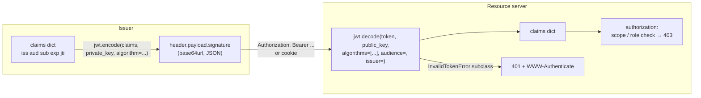

# PyJWT — JSON Web Tokens in Python

PyJWT (package `PyJWT`, imported as `jwt`) signs and verifies JSON Web Tokens: `jwt.encode()` turns a dict of claims into a signed token, `jwt.decode()` checks the signature and the registered claims (`exp`, `nbf`, `iat`, `iss`, `aud`, `sub`, `jti`) and returns the claims. It implements signed tokens (JWS) only: there is no encryption, no OAuth flow, no session handling.

For a QA engineer it matters twice: as the library behind most Python API authentication, and as a source of precise negative tests (expired, wrong audience, wrong signature, `alg: none`, key confusion).

## Installation

```bash
uv add pyjwt                       # HS256/384/512 only
uv add "pyjwt[crypto]"             # + RS*/PS*/ES*/EdDSA and JWK support (installs cryptography)
uv add --dev pytest freezegun      # testing helpers used in this guide
```

Covers PyJWT 2.x (current release 2.15.1, Python 3.9 or newer). The `crypto` extra is required for every asymmetric algorithm and for `PyJWK` / `PyJWKClient` with RSA, EC or OKP keys.

!!! tip "Starlette `TestClient` needs `httpx2`"
    The FastAPI examples in [04](./04-integration-fastapi.md) and the tests in [05](./05-testing-token-factory.md) use `fastapi.testclient.TestClient`. With Starlette 1.x install `httpx2` (`uv add --dev httpx2`); with plain `httpx` it still works but emits a `StarletteDeprecationWarning`.

## Section Map

| File | Topics |
|------|--------|
| [01 Encode, Decode & Claims](./01-encode-decode-claims.md) | Token structure, `encode` / `decode` / `decode_complete`, `get_unverified_header`, registered claims and how each is validated, `options`, `leeway`, `PyJWT` object, `json_encoder`, datetimes, exception hierarchy and HTTP 401/403/503 mapping |
| [02 Algorithms, Keys & JWKS](./02-algorithms-keys-jwks.md) | HS vs RS vs ES vs PS vs EdDSA, key formats, generating test keys, `PyJWK`, `PyJWKSet`, `PyJWKClient` caching, `kid` and rotation, OIDC discovery, key-length warnings, `register_algorithm` |
| [03 Security Pitfalls & Hardening](./03-security-pitfalls-hardening.md) | `algorithms=[...]`, `alg: none`, algorithm confusion, `aud` / `iss` / `exp`, lifetimes, `jti` revocation, refresh tokens, token storage, secrets, `kid` / `jku` / `x5u`, JWE, PyJWT advisories |
| [04 FastAPI Integration & Token Service](./04-integration-fastapi.md) | `TokenService` (issue access and refresh tokens, verify with `require`, `aud`, `iss`, `token_use`), FastAPI Bearer dependency, `require_scope`, refresh rotation, status mapping |
| [05 Testing: Token Factory & Negative Matrix](./05-testing-token-factory.md) | Token factory fixture, parametrised matrix of rejected tokens, 401 vs 403, `WWW-Authenticate`, refresh reuse, controlling time with `freezegun` or an injected clock, token leakage in logs |
| [06 Testing: JWKS Rotation, Smoke Tests & CI](./06-testing-jwks-ci.md) | Local fake JWKS server, key rotation and stale-cache tests, `fetch_data` override, forged-token smoke tests against a deployed API, CI gates |

## When to Use / Not Use

| Need | Choose |
|------|--------|
| Sign and verify JWTs (HS256, RS256, ES256, EdDSA) in an API or a test suite | **PyJWT** |
| Verify tokens issued by an identity provider through its JWKS endpoint | **PyJWT** `PyJWKClient` |
| Encrypted tokens (JWE) | a JOSE library that implements JWE, such as `jwcrypto` or `joserfc` |
| Full OAuth 2.0 / OpenID Connect client or authorization server | a framework such as Authlib; PyJWT only handles the token |
| Instant revocation, server-side session data, tokens that must never be readable by the client | opaque session IDs or reference tokens, not JWTs |
| Password hashing | not PyJWT: see [Auth, Config & Security Headers](../../code-security/04-auth-config-headers.md) |

## Mental Model



- **Header** — `alg` (algorithm), `typ`, optional `kid` (which key signed it).
- **Payload** — JSON claims. Base64url-encoded, **not** encrypted: anyone holding the token can read it.
- **Signature** — proves integrity and origin. It does not hide anything.
- **Verification** — signature first, then claim checks. Authorization (what the caller may do) is separate and happens after `decode`.

## Minimal Example

```python
from datetime import datetime, timedelta, timezone

import jwt

SECRET = "placeholder-secret-use-32-random-bytes-or-more"   # load from env or a secret store

now = datetime.now(timezone.utc)
token = jwt.encode(
    {"sub": "user-42", "iat": now, "exp": now + timedelta(minutes=15)},
    SECRET,
    algorithm="HS256",
)

claims = jwt.decode(token, SECRET, algorithms=["HS256"], options={"require": ["exp", "sub"]})
print(claims["sub"])                       # user-42

try:
    jwt.decode(token, "another-placeholder-secret-of-32-bytes!", algorithms=["HS256"])
except jwt.InvalidTokenError as exc:
    print(type(exc).__name__)              # InvalidSignatureError
```

`exp` and `iat` can be `datetime` objects: `encode` converts them to integer seconds since the epoch. `decode` returns them as integers.

## Names from Older Tutorials

Many posts predate PyJWT 2.x or use a different library.

| Old code | Current |
|----------|---------|
| `jwt.encode(...).decode("utf-8")` | `encode` returns `str`; calling `.decode` raises `AttributeError` |
| `jwt.decode(token, key)` | `algorithms=[...]` is required, otherwise `DecodeError` |
| `jwt.decode(token, key, verify=False)` | The `verify` argument does nothing (a mismatch with `verify_signature` only raises a `DeprecationWarning`), so the signature is still checked. Use `options={"verify_signature": False}` |
| `algorithms="HS256"` (a string) | Pass a list. A bare string is matched as a substring, so `"HS256 RS256"` would allow both |
| `jwt.ExpiredSignature`, `jwt.InvalidAudience`, `jwt.InvalidIssuer` | `jwt.ExpiredSignatureError`, `jwt.InvalidAudienceError`, `jwt.InvalidIssuerError`; the old names no longer exist |
| `from jose import jwt, JWTError` | A different package (`python-jose`). With PyJWT: `import jwt` and catch `jwt.InvalidTokenError` or `jwt.PyJWTError` |
| `datetime.utcnow() + timedelta(...)` for `exp` | `datetime.now(timezone.utc) + timedelta(...)`. `utcnow()` is deprecated in Python 3.12+; `encode` treats a naive datetime as UTC |
| Extra keyword arguments to `decode()` | Emit `RemovedInPyjwt3Warning` (a `DeprecationWarning` subclass) and are not used. Move settings into `options={...}` |
| `jwt.encode(payload, key)` with no `algorithm` | Defaults to `HS256`. Always pass `algorithm=` explicitly (with a `PyJWK` key the key's own algorithm is the default) |
| `jwt.InvalidSubjectError`, `jwt.InvalidJTIError` | Not exported at the top level: use `jwt.exceptions.InvalidSubjectError` / `jwt.exceptions.InvalidJTIError` |

## Quick Rules

1. **Always pass `algorithms=[...]` as a list**, hard-coded or configured next to the key. Never derive it from the token header.
2. **Verify `aud` and `iss`** with `audience=` and `issuer=`, and put `exp` (plus `iss`, `aud`, `sub`, `jti` where you use them) in `options={"require": [...]}`: `verify_*` options only run on claims that are present.
3. **Keep access tokens short** (minutes), allow a small `leeway` for clock skew, and use refresh tokens with rotation for long sessions.
4. **Treat the payload as public.** It is base64url JSON, not encrypted: no passwords, PII or secrets.
5. **Use asymmetric keys when other services verify your tokens** (RS256 / ES256 / EdDSA with `pyjwt[crypto]`); use HS256 only when issuer and verifier are the same service, with a 32-byte or longer random secret.
6. **Verify identity-provider tokens through `PyJWKClient`**: one shared instance, so the JWKS cache works; read the key with `get_signing_key_from_jwt`.
7. **Map failures correctly:** any `InvalidTokenError` is HTTP 401 with `WWW-Authenticate: Bearer`; 403 is for a valid token without permission; a JWKS fetch failure is 503.
8. **Test the negative paths:** a token factory plus a parametrised matrix covers expired, not-yet-valid, wrong `aud` / `iss`, wrong key, tampered payload, `alg: none` and missing claims.
9. **Keep PyJWT current.** Several key-confusion and JWKS-client fixes landed in 2.13 to 2.15; pin a recent lower bound and audit dependencies ([Dependency Security](../../code-security/02-dependency-security.md)).

---
## See also
- [Digital Garden: Knowledge Base](../../index.md)
- [Python Libraries](../index.md)
- [FastAPI](../fastapi/index.md)
- [Pytest](../pytest/index.md)
- [HTTPX — Modern Python HTTP Client](../httpx/index.md)
- [Pydantic — Data Validation](../pydantic/index.md)
- [OWASP API Security](../../owasp-api-security/index.md)
- [Auth, Config & Security Headers](../../code-security/04-auth-config-headers.md)
- [Security & Observability (API architectures)](../../api-architectures/05-cross-cutting/01-security-observability.md)
