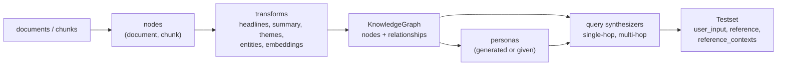

# Ragas — Test Sets & Experiments

Two jobs surround scoring: getting a test set (questions with reference answers and gold passages) and keeping the results of each run so you can compare them. Ragas generates test sets from your documents with a knowledge-graph pipeline and stores runs with the `@experiment` decorator.

## Test Set Generation



| Stage | What happens |
|-------|--------------|
| Transforms | An LLM extracts headlines (long documents are split at headlines), summaries, themes and named entities per node; an embedding model embeds summaries. Relationship builders link nodes by summary cosine similarity and entity overlap |
| Personas | Up to `num_personas` (default 3) personas are generated from the graph, or you pass `persona_list` |
| Synthesizers | Each synthesizer picks node clusters, matches personas to themes, writes a query in a style and length, then an answer from the cluster text |
| Output | One sample per scenario: question, reference answer, the passages it came from |

The default distribution (`default_query_distribution`) weights three synthesizers equally (1/3 each): `SingleHopSpecificQuerySynthesizer` (a fact in one chunk), `MultiHopAbstractQuerySynthesizer` (a theme spread over several chunks) and `MultiHopSpecificQuerySynthesizer` (specific facts joined across chunks). Multi-hop synthesizers need relationships in the graph, so a tiny or unrelated corpus yields mostly single-hop questions or fewer samples than requested.

```python
from langchain_community.document_loaders import DirectoryLoader      # needs langchain-community<0.4.2
from openai import AsyncOpenAI
from ragas.embeddings.base import embedding_factory
from ragas.llms import llm_factory
from ragas.testset import TestsetGenerator

client = AsyncOpenAI()
llm = llm_factory("gpt-4o-mini", client=client)
emb = embedding_factory("openai", model="text-embedding-3-small", client=client)

docs = DirectoryLoader("kb/", glob="**/*.md").load()                  # LangChain Documents
generator = TestsetGenerator(llm=llm, embedding_model=emb)
testset = generator.generate_with_langchain_docs(docs, testset_size=30, raise_exceptions=False)
df = testset.to_pandas()
```

The generator accepts an `llm_factory` judge with `embedding_factory` embeddings, or the legacy `LangchainLLMWrapper` / `LangchainEmbeddingsWrapper` pair; both work.

| Entry point | Input |
|-------------|-------|
| `generate_with_langchain_docs(documents, testset_size, ...)` | LangChain `Document` list |
| `generate_with_llamaindex_docs(documents, testset_size, ...)` | LlamaIndex documents (use `TestsetGenerator.from_llama_index(llm, embedding_model)`) |
| `generate_with_chunks(chunks, testset_size, ...)` | Plain strings or `Document`s that are already chunks; skips splitting |
| `generate(testset_size, query_distribution, num_personas)` | A knowledge graph you built or loaded (`TestsetGenerator(..., knowledge_graph=kg)`) |

Common arguments: `transforms` (custom list instead of `default_transforms`), `query_distribution` (list of `(synthesizer, weight)`), `run_config`, `raise_exceptions` (default `True`; `False` skips failed samples), `token_usage_parser`, `return_executor`. Without `transforms`, the default set depends on document length: when at least a quarter of the documents exceed 500 tokens they are split at headlines; otherwise, when at least a quarter are 101-500 tokens, documents are used whole; if neither holds, `ValueError: Documents appears to be too short (ie 100 tokens or less)` is raised.

Plain text, custom personas and a single synthesizer:

```python
from ragas.testset.persona import Persona
from ragas.testset.synthesizers.single_hop.specific import SingleHopSpecificQuerySynthesizer

chunks = ["Refunds are accepted within 30 days of purchase. Sale items are final.", "Shipping takes 3-5 business days within the EU."]
generator = TestsetGenerator(
    llm=llm, embedding_model=emb,
    persona_list=[Persona(name="Support agent", role_description="Answers customer questions about orders")],
)
testset = generator.generate_with_chunks(
    chunks, testset_size=20,
    query_distribution=[(SingleHopSpecificQuerySynthesizer(llm=llm), 1.0)],
)
```

Persona names are keys in the persona-to-theme matching step, so keep them unique.

### The Knowledge Graph Is Reusable

Extraction calls (several per node) are the main cost; question writing is smaller. Build and save the graph once, then generate more samples from it.

```python
from ragas.testset.graph import KnowledgeGraph

generator.knowledge_graph.save("kb_graph.json")
kg = KnowledgeGraph.load("kb_graph.json")                              # KnowledgeGraph(nodes: 3, relationships: 4)
more = TestsetGenerator(llm=llm, embedding_model=emb, knowledge_graph=kg).generate(testset_size=20)
```

Re-run extraction only when the documents change.

### Output and Review

`testset.to_pandas()` columns: `user_input`, `reference_contexts`, `reference`, `synthesizer_name`, plus `persona_name`, `query_style` and `query_length` on single-hop samples. The samples hold **no** `response` or `retrieved_contexts`: your pipeline fills those at evaluation time. `testset.to_evaluation_dataset()` returns an `EvaluationDataset`; `to_jsonl(path)` and `Testset.from_jsonl(path)` round-trip.

Generated questions are drafts. Review them before they become a golden set:

| Check | How |
|-------|-----|
| Duplicates | `df[~df["user_input"].duplicated()]` |
| Reference grounded in its passages | Score `reference` as the response of `Faithfulness` against `reference_contexts`; inspect rows that score low |
| Question answerable | Read a sample per `synthesizer_name`; multi-hop questions are the usual weak spot |
| Coverage | Count rows per source document and per `query_style` |
| Leakage | Remove questions that quote a chunk verbatim if retrieval is what you test |
| Sign-off | A person marks each kept row, then commit the JSONL |

```python
import asyncio

from openai import AsyncOpenAI
from ragas.llms import llm_factory
from ragas.metrics.collections import Faithfulness


async def ground_check(df, concurrency=8):
    llm = llm_factory("gpt-4o-mini", client=AsyncOpenAI(), temperature=0)     # client created inside the loop
    faith, sem = Faithfulness(llm=llm), asyncio.Semaphore(concurrency)

    async def one(row):
        async with sem:
            result = await faith.ascore(user_input=row.user_input, response=row.reference,
                                        retrieved_contexts=row.reference_contexts)
            return result.value

    return await asyncio.gather(*[one(r) for r in df.itertuples()])


df["ref_grounded"] = asyncio.run(ground_check(df))
suspect = df[df["ref_grounded"] < 0.8]
```

Freeze the reviewed set as `evals/datasets/golden.jsonl` (the layout `Dataset` with `local/jsonl` reads). Regenerating changes the questions, so every score changes with it; regenerate on purpose and re-baseline.

## Experiments

An experiment runs your application over a `Dataset` row by row, computes metrics, and saves one result row per input. `@experiment` wraps an async function; `.arun(dataset, name=...)` runs it.

```python
import asyncio

from openai import AsyncOpenAI
from pydantic import BaseModel
from ragas import Dataset, experiment
from ragas.llms import llm_factory
from ragas.metrics.collections import ContextRecall, Faithfulness


class Result(BaseModel):
    user_input: str
    response: str
    faithfulness: float
    context_recall: float


sem = asyncio.Semaphore(8)                                    # arun starts every row at once: bound it yourself


def build(llm):
    faith, recall = Faithfulness(llm=llm), ContextRecall(llm=llm)

    @experiment(Result, name_prefix="rag")
    async def run(row, model: str):
        async with sem:
            response, contexts = await my_rag_app(row["user_input"], model=model)       # your system under test
            f = await faith.ascore(user_input=row["user_input"], response=response, retrieved_contexts=contexts)
            r = await recall.ascore(user_input=row["user_input"], retrieved_contexts=contexts, reference=row["reference"])
            return Result(user_input=row["user_input"], response=response, faithfulness=f.value, context_recall=r.value)

    return run


async def main():
    llm = llm_factory("gpt-4o-mini", client=AsyncOpenAI(), temperature=0)
    run = build(llm)
    ds = Dataset.load("golden", "local/jsonl", root_dir="evals")                       # rows are dicts
    base = await run.arun(ds, name="baseline", model="small")                           # saved as evals/experiments/rag-baseline.jsonl
    cand = await run.arun(ds, name="candidate", model="large")
    return base, cand


base, cand = asyncio.run(main())
```

How `arun` behaves:

| Aspect | Behaviour |
|--------|-----------|
| Name | `name_prefix-name`; a memorable random name when `name` is omitted |
| Extra arguments | `arun(ds, name="x", model="large")` passes `model="large"` to every call of your function |
| Return value | A Pydantic model (validated), or a plain dict when no model is given; `None` rows are skipped |
| Concurrency | All rows are scheduled at once; there is no worker limit |
| Failures | An exception in one row prints `Warning: Task failed with error: ...` and **the row is dropped**; the run still succeeds |
| Order | Rows are stored in completion order, not dataset order |
| Storage | `<root_dir>/experiments/<name>.jsonl` through the dataset's backend, or `backend=` on `@experiment` / `arun` |

Because failures drop rows silently, always compare lengths:

```python
assert len(base) == len(ds) and len(cand) == len(ds), "rows were dropped by failures"
```

Comparing two runs is a pandas join on the input key:

```python
b, c = base.to_pandas().set_index("user_input"), cand.to_pandas().set_index("user_input")
cmp = b[["faithfulness", "context_recall"]].join(c[["faithfulness", "context_recall"]], lsuffix="_base", rsuffix="_cand")
cmp["d_faithfulness"] = cmp["faithfulness_cand"] - cmp["faithfulness_base"]
print(cmp[["faithfulness_base", "faithfulness_cand", "d_faithfulness"]].sort_values("d_faithfulness").head(10))   # worst regressions first
print(cmp.mean())
```

`ds.backend.list_experiments()` lists saved runs and `Experiment.load("baseline", "local/jsonl", root_dir="evals")` (`from ragas import Experiment`) reloads one, for comparing with an earlier commit's results. Available backends are `local/jsonl`, `local/csv` (flattens nested fields), `inmemory` and `gdrive`; the package contains no hosted-service backend.

`version_experiment("baseline_v1")` (needs `ragas[git]`) **commits changes to tracked files on your current branch** and creates the branch `ragas/baseline_v1` at that commit, returning the commit hash. Run it on a throwaway branch or in CI, not on a branch with unfinished work.

## Integrations

Metrics only need strings and lists, so integration means mapping your framework's output into sample fields.

| Framework | Mapping |
|-----------|---------|
| LangChain ([LangChain](../langchain/index.md)) | `docs = retriever.invoke(q)`; `retrieved_contexts=[d.page_content for d in docs]`; `response` is the chain output |
| LlamaIndex | `response = await query_engine.aquery(q)`; `response.response` is the answer, `[n.get_text() for n in response.source_nodes]` the contexts. `ragas.integrations.llama_index.evaluate(query_engine, dataset, metrics, llm, embeddings)` automates this and calls the legacy `evaluate()`; it needs LlamaIndex LLM and embedding objects |
| LangGraph ([LangGraph](../langgraph/index.md)) | `ragas.integrations.langgraph.convert_to_ragas_messages(state["messages"])` gives the message list for agent metrics |

`ragas.integrations.langchain.EvaluatorChain` cannot be imported on LangChain 1.x because it needs `langchain.chains`; call metrics from your own function instead:

```python
def to_sample(question: str, docs, answer: str) -> dict:
    return {"user_input": question, "retrieved_contexts": [d.page_content for d in docs], "response": answer}
```

Tracing and score storage:

| Tool | Use with Ragas |
|------|----------------|
| [LangSmith](../../tools/langsmith/index.md) | Set `LANGCHAIN_TRACING_V2=true`, `LANGCHAIN_API_KEY` and `LANGCHAIN_PROJECT`, then run the legacy `evaluate()` with a `LangchainLLMWrapper(ChatOpenAI(...))` judge; the Ragas docs describe the metric traces appearing in the project |
| [Langfuse](../../tools/langfuse/index.md), [Phoenix](../../tools/phoenix/index.md), [MLflow](../../tools/mlflow/index.md) | Score rows locally, then record `value` and `reason` per trace, span or run with that tool's own score or metric API, keyed by the sample ID; see each guide for datasets and experiments |

Keep the metric code and dataset in your repository and treat the tool as storage and a viewer; an upstream UI change then cannot alter what a score means.

## Common Mistakes

| Mistake | Effect | Fix |
|---------|--------|-----|
| Generating 500 questions from 3 short pages | Duplicates, few multi-hop samples, high cost | Larger corpus, smaller `testset_size`, review |
| Skipping review | Wrong references make good systems look bad | Ground-check references, sample by synthesizer |
| Regenerating before every run | Scores are not comparable | Freeze `evals/datasets/golden.jsonl`; save the knowledge graph |
| Unbounded `arun` on a large dataset | 429 errors and dropped rows | `asyncio.Semaphore`, then compare `len(exp)` to `len(ds)` |
| `local/csv` for rows with lists | Lists come back as strings | `local/jsonl` |
| `version_experiment` on a working branch | Unrelated tracked changes get committed | Throwaway branch or CI |
| `EvaluatorChain` import | `ModuleNotFoundError: langchain.chains` | Map outputs yourself |

---
## See also
- [Ragas — Evaluation for LLM, RAG and Agent Applications](./index.md)
- [Ragas — Datasets, Samples & Setup](./01-datasets-samples-setup.md)
- [Ragas — Testing & CI](./05-testing-ci.md)
- [DeepEval — Datasets and Goldens](../../llm-evaluation/03_practical/16_datasets.md)
- [LangChain — LLM Application Framework](../langchain/index.md)
- [LangGraph — Stateful Agent Orchestration](../langgraph/index.md)
- [LangSmith — LLM Tracing, Prompts & Evals](../../tools/langsmith/index.md)
- [Langfuse — LLM Tracing, Prompts & Evals](../../tools/langfuse/index.md)
- [MLflow — Experiment Tracking, LLM Tracing & Evaluation](../../tools/mlflow/index.md)
- [Arize Phoenix — LLM Tracing & Evaluation](../../tools/phoenix/index.md)
