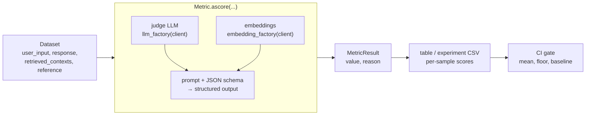

# Ragas — Evaluation for LLM, RAG and Agent Applications

**Ragas** (`ragas` on PyPI, GitHub `vibrantlabsai/ragas`, formerly `explodinggradients/ragas`) is an Apache-2.0 Python library that scores LLM applications. It supplies three things: a catalogue of **metrics** (LLM-judged, embedding-based and pure string/NLP), **synthetic test set generation** from your own documents, and a small **experiment** runner that stores results next to the dataset. It does not ship a test runner or a dashboard: you call it from `pytest`, a script or CI and decide what a failing score means.

This guide covers **ragas 0.4.3** (released 13 January 2026), the latest release on PyPI.



## Installation

```bash
uv add ragas "langchain-community<0.4.2"
uv add pandas sacrebleu rouge-score rapidfuzz     # to_pandas() and the NLP / string metrics
uv add "datacompy<1"                              # only for DataCompyScore
uv add "ragas[git]"                               # only for version_experiment()
uv add --dev pytest
```

Python 3.9 or newer. `ragas` pulls in `langchain`, `langchain-community`, `langchain-openai`, `openai`, `instructor`, `datasets` and `diskcache` as hard dependencies, so the install is large.

!!! warning "`import ragas` fails with langchain-community 0.4.2"
    ragas 0.4.3 imports `langchain_community.chat_models.vertexai`, which `langchain-community` 0.4.2 no longer contains, so `import ragas` raises `ModuleNotFoundError`. Pin `langchain-community<0.4.2` until a ragas release removes the import.

Provider SDKs other than `openai` are not dependencies: add `anthropic` or `litellm` when you need them (see [01](./01-datasets-samples-setup.md) for provider caveats).

!!! tip "Turn usage analytics off in CI"
    ragas sends anonymous usage events to `t.explodinggradients.com`. Set `RAGAS_DO_NOT_TRACK=true` in the environment to opt out.

## Two APIs in One Package

0.4 introduced a new metric system without removing the old one. Tutorials mix both, so identify which you are reading before copying code.

| | Current (0.4) | Legacy (0.2 / 0.3, still shipped) |
|---|---|---|
| Metric import | `from ragas.metrics.collections import Faithfulness` | `from ragas.metrics import Faithfulness` — works but emits `DeprecationWarning` (removal announced for v1.0) |
| Judge LLM | `llm_factory(model, client=AsyncOpenAI())` passed to the metric constructor | the same `llm_factory` object, or `LangchainLLMWrapper` (deprecated), passed to `evaluate(llm=...)` |
| Scoring call | `await metric.ascore(user_input=..., response=..., ...)` returns `MetricResult` | `await metric.single_turn_ascore(sample)` returns a float, or `evaluate(dataset, metrics)` |
| Running a dataset | your loop, or `@experiment` + `Dataset` | `evaluate()` — emits `DeprecationWarning` ("Use the @experiment decorator instead") |
| Data | any dict or Pydantic row | `SingleTurnSample` / `MultiTurnSample` in an `EvaluationDataset` |
| Metrics only here | collections: RAG, agent, NLP, rubric, SQL metrics | `AspectCritic`, `SimpleCriteriaScore`, `NonLLMContextPrecisionWithReference`, `NonLLMContextRecall`, `IDBasedContext*`, `FaithfulnesswithHHEM` |

`evaluate()` accepts only legacy metric objects; passing a collections metric raises `TypeError: All metrics must be initialised metric objects`. The guide shows the current API first and calls out the legacy path where it is the only option.

## Section Map

| File | Topics |
|------|--------|
| [01 Datasets, Samples & Setup](./01-datasets-samples-setup.md) | `SingleTurnSample`, `MultiTurnSample`, `EvaluationDataset`, loading from pandas / JSONL / Hugging Face, `Dataset` backends, `llm_factory` and `embedding_factory` per provider, `ascore` helpers, legacy `evaluate()` options, `RunConfig`, caching, telemetry |
| [02 RAG Metrics](./02-rag-metrics.md) | Faithfulness, AnswerRelevancy, ContextPrecision, ContextRecall, ContextEntityRecall, NoiseSensitivity, groundedness and relevance judges, non-LLM retrieval metrics, required inputs, formulas, LLM calls per metric, failure modes |
| [03 Other Metrics, Agents & Custom](./03-other-metrics-agents-custom.md) | `DiscreteMetric` / `NumericMetric` / `RankingMetric`, decorators, rubrics, BLEU / ROUGE / chrF / string / semantic similarity, SQL and table metrics, `ToolCallAccuracy`, `ToolCallF1`, `AgentGoalAccuracy`, `TopicAdherence`, custom metric classes, judge calibration and bias |
| [04 Test Sets & Experiments](./04-testsets-experiments.md) | `TestsetGenerator`, knowledge graph, personas, query synthesizers, reviewing generated samples, `@experiment`, comparing runs, `version_experiment`, LangChain / LangGraph / LlamaIndex and tracing tools |
| [05 Testing & CI](./05-testing-ci.md) | pytest layout, scripted and fake-server judges, aggregate and per-sample gates, baselines, non-determinism, GitHub Actions, cost counting, common failures, QA checklist |

## When to Use Ragas vs DeepEval vs promptfoo vs Custom

| Need | Best fit |
|------|----------|
| RAG diagnostics (retrieval vs generation), synthetic test sets from documents, agent tool-call metrics as plain functions | **Ragas** |
| Pytest-native assertions (`assert_test`), many built-in metrics, CI reports, red teaming — see [DeepEval](../../llm-evaluation/index.md) | **DeepEval** |
| Compare prompts and models side by side from YAML, assertions, red teaming — see [promptfoo](../../tools/promptfoo/index.md) | **promptfoo** |
| One domain rule ("answer cites a policy id", "JSON matches schema") | Plain `pytest` assertion, no judge |
| Rubric specific to your product, calibrated against human labels | Ragas `DiscreteMetric` / custom class, or DeepEval G-Eval |
| Hosted datasets, annotation queues, dashboards | [LangSmith](../../tools/langsmith/index.md), [Langfuse](../../tools/langfuse/index.md), [Phoenix](../../tools/phoenix/index.md), [MLflow](../../tools/mlflow/index.md) |

Ragas and DeepEval overlap on RAG metrics (faithfulness, answer relevancy, context precision and recall) but differ in implementation, prompts and score scales, so numbers from one are not comparable with the other. DeepEval also wraps four Ragas metrics as `RagasMetric` (see [DeepEval RAG metrics](../../llm-evaluation/01_metrics/02_rag_metrics.md)). Pick one library per metric family and keep it fixed across runs.

## Minimal Example

```python
import asyncio

from openai import AsyncOpenAI
from ragas.llms import llm_factory
from ragas.metrics.collections import ContextRecall, Faithfulness


async def main() -> None:
    client = AsyncOpenAI()                                   # reads OPENAI_API_KEY
    llm = llm_factory("gpt-4o-mini", client=client)          # judge model; async client required

    sample = dict(
        user_input="What is the refund window?",
        response="Refunds are accepted within 30 days.",
        retrieved_contexts=["Our policy: refunds are accepted within 30 days of purchase."],
        reference="Refunds are accepted within 30 days of purchase.",
    )
    faithfulness = await Faithfulness(llm=llm).ascore(
        user_input=sample["user_input"],
        response=sample["response"],
        retrieved_contexts=sample["retrieved_contexts"],
    )
    recall = await ContextRecall(llm=llm).ascore(
        user_input=sample["user_input"],
        retrieved_contexts=sample["retrieved_contexts"],
        reference=sample["reference"],
    )
    print(faithfulness.value, recall.value)                  # floats in 0.0 - 1.0


asyncio.run(main())
```

Each metric takes only the fields it needs as keyword arguments and returns a `MetricResult`. `MetricResult` behaves like its value in comparisons and arithmetic and also exposes `.value`, `.reason` and `.traces`. See [02](./02-rag-metrics.md) for which fields each metric requires and [05](./05-testing-ci.md) for gating on the scores.

## Names from Older Tutorials

| Old code | Current (0.4.3) |
|----------|-----------------|
| Hugging Face `Dataset` with `question`, `answer`, `contexts`, `ground_truth` | `SingleTurnSample` with `user_input`, `response`, `retrieved_contexts`, `reference`. `evaluate()` still renames the old columns |
| `ground_truths` (list of strings) | `reference` (one string) |
| `from ragas.metrics import faithfulness, answer_relevancy, context_precision, context_recall` (ready-made instances) | `from ragas.metrics.collections import Faithfulness, AnswerRelevancy, ContextPrecision, ContextRecall` and construct with `llm=` |
| `evaluate(dataset, metrics=[...])` | `evaluate()` is deprecated; use `ascore`, or `@experiment` with `Dataset` |
| `LangchainLLMWrapper(ChatOpenAI(...))`, `LangchainEmbeddingsWrapper(...)` | `llm_factory(model, client=AsyncOpenAI())`, `embedding_factory("openai", model=..., client=...)` |
| `instructor_llm_factory(...)` (0.3) | `llm_factory(...)` |
| `llm_factory("gpt-4o-mini")` with no client | `ValueError: llm_factory() requires a client instance` — pass `client=` |
| sync `OpenAI()` client in `llm_factory` for `ascore` | `AsyncOpenAI()`; a sync client raises `TypeError: Cannot use agenerate() with a synchronous client` |
| `metric.single_turn_ascore(sample)` returning a float | `await metric.ascore(**fields)` returning `MetricResult` (`.value`) |
| `ResponseRelevancy`, `LLMContextRecall`, `LLMContextPrecisionWithReference` | `AnswerRelevancy`, `ContextRecall`, `ContextPrecisionWithReference` |
| `AspectCritic`, `SimpleCriteriaScore` | `DiscreteMetric` / `NumericMetric`, or the `@discrete_metric` decorator |
| `TestsetGenerator(generator_llm, critic_llm, embeddings)`, `test_size=`, `simple` / `reasoning` / `multi_context` evolutions | `TestsetGenerator(llm=..., embedding_model=...)`, `testset_size=`, `query_distribution` of query synthesizers |
| Test set columns `question`, `contexts`, `ground_truth`, `evolution_type` | `user_input`, `reference_contexts`, `reference`, `synthesizer_name`, `persona_name`, `query_style`, `query_length` |
| `ragas.integrations.langchain.EvaluatorChain` | Import fails on LangChain 1.x (`langchain.chains` is gone); call metrics from your own function |
| `await my_experiment(dataset)` (migration guide snippet) | `await my_experiment.arun(dataset, name="...")` |

## Quick Rules

1. **Decide the API first** — new code uses `ragas.metrics.collections` with `llm_factory`; use legacy classes only for metrics that have no collections version.
2. **Pin `langchain-community<0.4.2` and `ragas==0.4.3`** — the library is in transition and renames happen between minors.
3. **Use an async client** (`AsyncOpenAI`, `litellm.acompletion`) and create it inside the running event loop; reusing one client across several `asyncio.run()` calls fails intermittently.
4. **Bound concurrency yourself** — `abatch_score` and `@experiment` start every row at once; wrap calls in an `asyncio.Semaphore`.
5. **Treat NaN as a failure, not as zero** — a failed judge call must fail the gate, not vanish from the mean.
6. **Fix the judge** — one judge model, temperature 0, same metric versions; a new judge needs a new baseline.
7. **Keep a small golden set and a cache** — 20 to 50 reviewed rows scored with `DiskCacheBackend` keeps CI cheap and stable.
8. **Test your own wiring offline** — a scripted `InstructorBaseRagasLLM` or a local fake server proves your harness and gates without spending tokens.

---
## See also
- [Digital Garden: Knowledge Base](../../index.md)
- [Python Libraries](../index.md)
- [DeepEval — LLM Testing Guide](../../llm-evaluation/index.md)
- [DeepEval — RAG Metrics](../../llm-evaluation/01_metrics/02_rag_metrics.md)
- [promptfoo — LLM Evals & Red Teaming from YAML](../../tools/promptfoo/index.md)
- [Eval Harness — Tools, Testing & CI](../../ai-harness/04-eval-harness-tools-ci.md)
- [Pytest — Python Testing Framework](../pytest/index.md)
- [LangChain — LLM Application Framework](../langchain/index.md)
- [LiteLLM — One API for 100+ LLM Providers](../litellm/index.md)
- [Agentic AI Architecture](../../agentic-ai-architecture/index.md)
