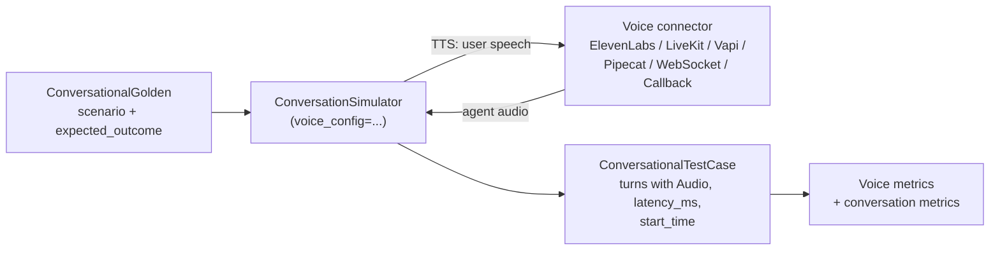

# DeepEval Guide — Part 8b: Voice Evaluation

Voice agents fail in ways a transcript never shows: a clipped reply, a dead stream in the middle of a sentence, a 3-second silence before the agent answers, a voice that changes between turns. DeepEval 4.2 (August 2026) added **voice evaluation**: simulate a phone call against your agent, keep the audio, and score the call with metrics that work on the **audio signal itself**.

> **Version note.** Voice evaluation appeared in `deepeval` 4.2.0, voice simulations were extended in 4.1.10, and `TranscriptionAccuracyMetric`, `AudioGlitchMetric` and audio input for judge models arrived in the October 2026 release. This page was verified against `deepeval==4.3.1` on Python 3.13. Earlier versions (this guide's base was 3.8.4) do not have these classes.

---

## How It Works



1. You write a `ConversationalGolden` (scenario and expected outcome), as for a text chatbot ([Part 5](05_chatbot_metrics.md)).
2. `ConversationSimulator` plays the **caller**: an LLM writes the user lines, a text-to-speech (TTS) model speaks them, and a **connector** delivers the audio to your agent and brings the reply back.
3. Every turn is stored with its audio and timing in a `ConversationalTestCase`.
4. Voice metrics read the audio and the timeline; ordinary conversation metrics (`GoalAccuracyMetric`, `TurnRelevancyMetric`, `ToolUseMetric`) read the transcript.

---

## Data Model

### `Audio`

```python
from deepeval.test_case import Audio

recording = Audio(url="./agent-reply.wav")                       # file or URL
recording = Audio.from_bytes(                                    # raw bytes
    wav_bytes, "audio/wav", sampleRate=24000, duration=3.2, start_time=2.1,
)
```

| Field | Meaning |
|-------|---------|
| `dataBase64` / `url` | The audio itself (one of them) |
| `mimeType`, `sampleRate`, `encoding` | Format |
| `duration` | Clip length in seconds |
| `start_time` | Seconds from the start of the call to the first sample of the clip. **Timing metrics need it** |

### `Turn` fields used by voice metrics

| Field | Meaning |
|-------|---------|
| `audio` | An `Audio` object; user turns hold the synthesized speech, assistant turns the agent's reply |
| `latency_ms` | Time until the agent started speaking after the user audio was sent (assistant turns) |
| `interrupted` | `True` if a caller barge-in cut the reply short |
| `provider_transcript` | What the **agent's own** speech-to-text heard (only some connectors provide it) |
| `content` | The text of the turn |

---

## Running a Simulated Call

```python
from deepeval import evaluate
from deepeval.dataset import ConversationalGolden
from deepeval.metrics import AudioIntegrityMetric, VoiceNaturalnessMetric, VoiceReliabilityMetric
from deepeval.simulator import ConversationSimulator
from deepeval.voice import ElevenLabsConnector, VoiceConfig

golden = ConversationalGolden(
    scenario="The user wants to change a restaurant reservation.",
    expected_outcome="The agent confirms the new reservation date.",
)

simulator = ConversationSimulator(
    voice_config=VoiceConfig(connector=ElevenLabsConnector(agent_id="your-agent-id")),
)
test_cases = simulator.simulate([golden])          # runs the call, records the audio

evaluate(
    test_cases=test_cases,
    metrics=[
        VoiceReliabilityMetric(threshold=0.9),
        VoiceNaturalnessMetric(threshold=0.7),
        AudioIntegrityMetric(threshold=0.8),
    ],
)
```

> This block needs a live agent and an API key (the simulator's user-LLM and TTS default to OpenAI), so it was **not run** here. The metric part below was run end to end on synthetic audio.

### Connectors

| Connector | Reaches |
|-----------|---------|
| `ElevenLabsConnector(agent_id=..., api_key=...)` | An ElevenLabs conversational agent |
| `LiveKitConnector` | An agent in a LiveKit room (URL, API key and secret) |
| `VapiConnector`, `PipecatConnector` | Vapi and Pipecat agents |
| `WebSocketConnector` / `WebRTCConnector` | Any agent behind a raw-audio WebSocket or WebRTC endpoint (you describe the message schema) |
| `CallbackVoiceConnector(agent=fn)` | An agent in the same Python process: `fn(audio: Audio)` returns an `Audio` (or a `ConnectorTurn`) |

`CallbackVoiceConnector` is the easiest way to start and to test your own code path:

```python
from deepeval.test_case import Audio
from deepeval.voice import CallbackVoiceConnector, VoiceConfig


def my_agent(user_audio: Audio) -> Audio:
    reply_text = run_my_pipeline(user_audio)       # your STT → LLM → TTS
    return synthesize(reply_text)                   # returns Audio


config = VoiceConfig(connector=CallbackVoiceConnector(my_agent, sample_rate=24000, turn_detection="balanced"))
```

`VoiceConfig` also takes `tts_model` / `stt_model` (strings or `DeepEvalBaseTTS` / `DeepEvalBaseSTT` subclasses), `output_dir` for the saved audio, `record_call` and `interruption_settings`.

### Requirements and limits

- The simulator's default TTS and STT are OpenAI models (the STT default is `gpt-4o-transcribe`). Environment variables `DEEPEVAL_TTS_MODEL` and `DEEPEVAL_STT_MODEL` select other models; other providers need `DeepEvalBaseTTS` / `DeepEvalBaseSTT` implementations.
- A connector holds **one live call**, so voice conversations run one after another, not in parallel.
- **Interruptions** (barge-in) need a full-duplex connector such as LiveKit and must be enabled on the persona; the default is half-duplex with no interruptions.
- End-of-turn detection is heuristic. Latency is comparable only between runs on the **same connector type**.
- Saved call audio goes to a configurable output folder and is excluded from version control by default.
- STT mistakes count as agent mistakes: transcription quality caps what you can measure.

---

## The Voice Metrics

All return a score from **0 to 1, higher is better**, and all expose `score_breakdown` after `measure()`. Parameters common to all of them: `threshold` (default `0.5`, `None` = score only), `include_reason=True`, `strict_mode=False`, `verbose_mode=False`, `flaky=False`.

| Metric | Question | Needs | LLM or STT? |
|--------|----------|-------|-------------|
| `VoiceNaturalnessMetric` | Does the agent's speech sound natural? | Audio on assistant turns, transcript | **No**: deterministic signal analysis |
| `SpeechIntelligibilityMetric` | Is the audio clear (noise, level, clipping, dropouts)? | Audio on assistant turns | **No** |
| `VoiceConsistencyMetric` | Does it sound like the same speaker all call? | ≥ 2 assistant turns with audio | **No** |
| `AudioIntegrityMetric` | Did the audio arrive intact (missing, looping, cut off, clipped)? | Audio | **No** |
| `AudioGlitchMetric` | Are there held tones, dead air, stream cuts, clipping on either side? | Audio with `start_time` | Signal analysis; an LLM only **writes the reason** |
| `AgentResponsivenessMetric` | Did the agent answer every time it was addressed? | Turn order and call metadata | **No** |
| `TurnTakingNaturalnessMetric` | Are gaps and overlaps between speakers natural? | `start_time` and `duration` on every clip | **No** |
| `VoiceReliabilityMetric` | One operational score: responsiveness + integrity | Same as its two halves | **No** |
| `TranscriptionAccuracyMetric` | Did the agent hear what the caller said? | `provider_transcript` (LiveKit, ElevenLabs, Vapi, Pipecat) | **Yes** (judge; optional STT) |

Seven of them need no LLM and cost no tokens, so they are safe to run on every call in CI. `AudioGlitchMetric` needs a judge model object only to write the reason (see Gotchas), and `TranscriptionAccuracyMetric` is judge-based.

### Scoring details

| Metric | How the score is built |
|--------|------------------------|
| `VoiceNaturalness` | Each assistant clip starts at 1 and loses penalties: clipping (max 0.35), dropouts (0.25), repeated audio (0.2), silence > 45% of the clip (0.2), SNR < 15 dB (0.2), speaking rate outside 80-240 WPM (0.2), pitch variation outside 4-90 Hz (0.1). Score = mean over turns |
| `SpeechIntelligibility` | Turn = 0.4 × SNR + 0.25 × volume + 0.2 × clipping + 0.15 × dropouts, each clamped to 0-1 (SNR: 0 at 3 dB, 1 at 25 dB; volume peaks at -20 dBFS) |
| `VoiceConsistency` | 0.4 × pitch + 0.35 × loudness + 0.25 × timbre stability across assistant turns (skipped with fewer than two turns) |
| `AudioIntegrity` | 1 − sum of defect severities; any **critical** defect (`assistant_turn_missing`, `audio_missing`, `audio_undecodable`, three or more repeated windows) forces 0. Non-critical: `abrupt_cutoff` 0.12, short loops 0.15, dropouts 0.08 each, clipping up to 0.35 |
| `AudioGlitch` | Turns with audio and no glitch ÷ turns with audio. Glitches: `held_tone`, `dead_stream`, `stream_cut`, `clipping`, `audio_undecodable` |
| `AgentResponsiveness` | 0 on `agent_failed_to_respond`, `assistant_audio_missing` or `unexpected_end` (agent hangup, error, idle timeout); otherwise `max(0, 1 − 0.25 × reprompts)` |
| `TurnTakingNaturalness` | Each speaker change scores `exp(−gap/τ)` with τ = 2.5 s for a gap, 2.0 s for a user barge-in, 0.6 s for the agent talking over the caller; with ≥ 3 reply gaps: 0.8 × mean + 0.2 × consistency |
| `VoiceReliability` | 0.5 × responsiveness + 0.5 × integrity; a critical failure on either side forces 0 |
| `TranscriptionAccuracy` | Exchanges the agent heard faithfully ÷ all exchanges |

### Running them offline on audio you already have

You do not need a live agent to evaluate recordings. Build a `ConversationalTestCase` yourself (from call logs, QA recordings or the output of a simulation):

```python
from deepeval.test_case import Audio, ConversationalTestCase, Turn
from deepeval.metrics import (
    AgentResponsivenessMetric,
    AudioIntegrityMetric,
    TurnTakingNaturalnessMetric,
    VoiceNaturalnessMetric,
    VoiceReliabilityMetric,
)

tc = ConversationalTestCase(
    scenario="User asks for an order status.",
    turns=[
        Turn(role="user", content="Where is my order?",
             audio=Audio.from_bytes(user_wav, "audio/wav", sampleRate=16000, duration=1.5, start_time=0.0)),
        Turn(role="assistant", content="Your order shipped yesterday and arrives on Friday afternoon.",
             audio=Audio.from_bytes(agent_wav, "audio/wav", sampleRate=16000, duration=4.3, start_time=2.1),
             latency_ms=600),
    ],
)

for metric in (VoiceNaturalnessMetric(threshold=0.7), AudioIntegrityMetric(threshold=0.7),
               AgentResponsivenessMetric(threshold=0.7), TurnTakingNaturalnessMetric(threshold=0.7),
               VoiceReliabilityMetric(threshold=0.7)):
    metric.measure(tc)
    print(type(metric).__name__, round(metric.score, 2), metric.success)
```

To check the metrics themselves, the examples below were run on **synthetic audio**: speech-like bursts of a 150-250 Hz tone with short pauses (about 4 s), written with the `wave` module. A "good" agent reply is clean; a "clipped" reply has the same signal driven 6× into the ceiling. Results with `threshold=0.7`:

| Metric | Clean reply | Clipped reply |
|--------|-------------|---------------|
| `VoiceNaturalnessMetric` | **1.00** ✔ | **0.65** ✘ |
| `AudioIntegrityMetric` | **1.00** ✔ | **0.65** ✘ |
| `AgentResponsivenessMetric` | 1.00 ✔ | 1.00 ✔ |
| `TurnTakingNaturalnessMetric` | 0.89 ✔ | 0.89 ✔ |
| `VoiceReliabilityMetric` | **1.00** ✔ | **0.82** ✔ |

The breakdown explains the clipped score:

```python
metric = VoiceNaturalnessMetric(threshold=0.7); metric.measure(clipped_call)
print(metric.score_breakdown["turns"][0])
# {'turn': 1, 'score': 0.65, 'speaking_rate_wpm': 177.6, 'silence_fraction': 0.29,
#  'pitch_variation_hz': 29.7, 'clipping_fraction': 0.157, 'dropout_events': 0, 'loop_events': 0}

metric = AudioIntegrityMetric(threshold=0.7); metric.measure(clipped_call)
print(metric.score_breakdown)
# {'critical_failure': False, 'events': [{'type': 'clipping', 'turn': 1, 'fraction': 0.157, 'severity': 0.35, 'critical': False}]}
```

Note `VoiceReliabilityMetric` still passes `0.7` at 0.82 because clipping is non-critical and responsiveness is perfect. Choose thresholds per metric, and use `VoiceReliabilityMetric` as a gate for **critical** failures rather than as a quality score.

### Metrics catch different defects

A second synthetic call: the agent's reply has **1.2 s of digital silence** (an exact-zero stream) in the middle.

| Metric | Result |
|--------|--------|
| `AudioGlitchMetric` | **0.50 ✘**, event `dead_stream` on turn 1 (assistant) |
| `AudioIntegrityMetric` | 1.00 ✔ (no events) |
| `VoiceNaturalnessMetric` | 1.00 ✔ (`dropout_events=0`; `silence_fraction=0.447`, just under the 45% penalty trigger) |

`AudioGlitchMetric` caught it, while the other two did not. Run several voice metrics together: each one looks for different failures.

### Use them in pytest

```python
import pytest
from deepeval import assert_test


@pytest.mark.parametrize("call", recorded_calls)
def test_voice_quality(call):
    assert_test(test_case=call, metrics=[VoiceReliabilityMetric(threshold=0.9), AudioGlitchMetric(threshold=0.8)])
```

A failing call raises `AssertionError: Metrics: Audio Integrity (score: 0.65, threshold: 0.9, ...) failed.` Run with `deepeval test run test_voice.py`.

---

## Gotchas

| Gotcha | Detail |
|--------|--------|
| `AudioGlitchMetric` needs a judge model object | Its constructor builds an LLM client immediately. Without `OPENAI_API_KEY` (or a custom `model=`), constructing it raises `DeepEvalError: OpenAI API key is not configured`, even with `include_reason=False`. `include_reason=False` only avoids calling the model later |
| Timing metrics skip silently | `TurnTakingNaturalnessMetric` and glitch detection need `Audio.start_time` on every clip; without it the metric returns no score and the case is skipped |
| `abrupt_cutoff` is often not a defect | A clip that ends while still loud lowers `AudioIntegrity` by 0.12, but it is the normal result of a caller **barge-in**. In my synthetic "clean" clip it appeared until I added 0.3 s of near-silence at the end |
| `VoiceConsistencyMetric` needs two replies | A single-exchange call is skipped, not scored 0 |
| `VoiceReliabilityMetric` scores 0 for text | A conversation without assistant audio is a critical failure |
| `TranscriptionAccuracyMetric` raises for SIP and text | Connectors that do not report the agent's own transcript cannot be scored; the metric raises instead of returning 0 |
| Latency is not absolute | `latency_ms` includes end-of-turn detection of the simulator; compare runs, not absolute thresholds across connectors |
| Synthetic audio is not speech | The numbers above prove the metric logic, not what real TTS output scores. Calibrate thresholds on recordings of your own agent |

## Evaluation Strategy

1. **Smoke gate (every commit):** `VoiceReliabilityMetric` + `AudioGlitchMetric` over a handful of simulated calls: catches hangups, missing audio, dead streams.
2. **Quality (nightly):** naturalness, intelligibility, consistency and turn-taking over 20+ scenarios; track the **trend** per connector.
3. **Content:** the usual conversation metrics (`GoalAccuracyMetric`, `ToolUseMetric`, `TurnRelevancyMetric`) on the same test cases, see [Part 5](05_chatbot_metrics.md) and [Part 20](../03_practical/20_e2e_complex_tests.md).
4. **Hearing:** `TranscriptionAccuracyMetric` when the platform exposes the agent's own transcript: it separates "the agent misheard" from "the agent answered badly".
5. **Calibrate on real calls:** play 10 recordings, mark good and bad ones, and set thresholds where the metric agrees with the listener.

---

### Sources

- [DeepEval — Voice evaluation](https://deepeval.com/docs/evaluation-voice)
- [Voice Naturalness](https://deepeval.com/docs/metrics-voice-naturalness), [Voice Reliability](https://deepeval.com/docs/metrics-voice-reliability), [Voice Consistency](https://deepeval.com/docs/metrics-voice-consistency)
- [Audio Integrity](https://deepeval.com/docs/metrics-audio-integrity), [Audio Glitch](https://deepeval.com/docs/metrics-audio-glitch), [Transcription Accuracy](https://deepeval.com/docs/metrics-transcription-accuracy)
- [Turn-Taking Naturalness](https://deepeval.com/docs/metrics-turn-taking-naturalness), [Speech Intelligibility](https://deepeval.com/docs/metrics-speech-intelligibility), [Agent Responsiveness](https://deepeval.com/docs/metrics-agent-responsiveness)
- [DeepEval releases on GitHub](https://github.com/confident-ai/deepeval/releases), [2026 changelog](https://deepeval.com/changelog/changelog-2026)

---
## See also
- [DeepEval Guide — Part 5: Chatbot Metrics](05_chatbot_metrics.md)
- [DeepEval Guide — Part 8: Multimodal (Image) Metrics](08_multimodal_metrics.md)
- [DeepEval Guide — Part 21: What's New in DeepEval 4.x](../03_practical/21_whats_new_4x.md)
- [DeepEval Guide — Part 22: Classifiers & Expectations](../03_practical/22_classifiers_expectations.md)
- [DeepEval — LLM Testing Guide](../index.md)
