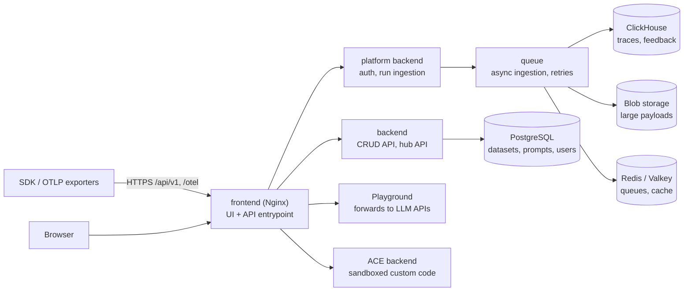

# LangSmith — Setup & Architecture

## Hosting Options

| Aspect | Cloud (SaaS) | BYOC (Bring Your Own Cloud) | Self-hosted |
|--------|--------------|-----------------------------|-------------|
| Who runs it | LangChain | LangChain runs the control plane, you own the data plane | You, on Kubernetes |
| Where trace data lives | LangChain's cloud, in the sign-up region | Your cloud account (AWS) | Your infrastructure |
| Upgrades, scaling | Automatic | Automatic, by LangChain | Manual (Helm chart upgrades) |
| Plan | Developer, Plus, Enterprise | Enterprise | Enterprise add-on, license key |
| Includes | Observability, evaluation, prompts, Insights, Chat, Deployment | Same, plus Deployment control plane in your data plane | Same; Sandboxes, Engine, Fleet, LLM Gateway, Deployment optional |

- **Hybrid** is a topology of *LangSmith Deployment* (agent hosting), not a separate observability product: Agent Servers run in your infrastructure and send traces to LangSmith Cloud or to a self-hosted instance via `LANGSMITH_ENDPOINT`.
- *Observability only* (no agent hosting) works on Cloud or self-hosted: run the app anywhere and send traces.
- Licensing: the SDKs are MIT-licensed; the platform is a commercial product. Self-hosting and BYOC require an Enterprise contract.

!!! tip "For a QA team"
    Start on Cloud with a dedicated project for CI traffic. Move to self-hosted or BYOC only when prompts, inputs or outputs may not leave your network.

## Cloud Regions

The region is fixed by the URL where the account was created. An organization cannot span regions and cannot be migrated between them; features and prices are the same everywhere.

| Region | UI | API (`LANGSMITH_ENDPOINT`) | Location |
|--------|----|----------------------------|----------|
| GCP US (default) | `https://smith.langchain.com` | `https://api.smith.langchain.com` | us-central1 (Iowa) |
| GCP EU | `https://eu.smith.langchain.com` | `https://eu.api.smith.langchain.com` | europe-west4 (Netherlands) |
| GCP APAC | `https://apac.smith.langchain.com` | `https://apac.api.smith.langchain.com` | australia-southeast1 (Sydney) |
| AWS US | `https://aws.smith.langchain.com` | `https://aws.api.smith.langchain.com` | us-east-2 (Ohio) |

- Billing and payment data are stored in the US regardless of region.
- BYOC data planes are placed in a chosen AWS region (US, Canada, EU, APAC); the control plane (users, roles, billing, SSO, API keys) stays in `us-east-2`.

## Self-Hosted Architecture



| Component | Role |
|-----------|------|
| **Frontend** | Nginx: serves the UI and routes API calls; the only service exposed to users |
| **Backend** / **platform backend** | CRUD and hub API; authentication and high-volume run ingestion |
| **Queue** | Ingests traces and feedback asynchronously with integrity checks and retries |
| **ClickHouse** | Primary store for traces and feedback; optional **SmithDB** (LangSmith 0.17+) is a columnar store built for agent traces |
| **PostgreSQL** | Transactional data: everything except traces and feedback |
| **Redis / Valkey** | Queueing and caching |
| **Blob storage** | S3, Azure Blob or GCS for large artifacts; optional but recommended in production |

- Install with Helm on Kubernetes; Terraform modules exist for AWS, GCP and Azure. Use external managed ClickHouse, PostgreSQL and Redis for production.
- Ingestion is asynchronous: a run is queryable shortly after it is sent, not instantly — poll when tests read traces back.
- Features in the base install: observability, evaluation, prompt engineering, Insights, Chat. Agent-based workspaces are **not** available on self-hosted.

## Workspaces, Projects and Agents

```text
Organization (billing, SSO, members)
 └── Workspace  (API-key scope, RBAC, datasets, prompts, annotation queues)
      ├── project-based:  Tracing project  → traces, experiments
      └── agent-based:    Agent → Environment (local | development | staging | production) → traces
```

| | Project-based workspace | Agent-based workspace (Cloud only) |
|---|---|---|
| Top-left control | LangSmith logo | Workspace switcher |
| Trace destination | `LANGSMITH_PROJECT` (default `default`), created on first trace | `LANGSMITH_AGENT_ID` + `LANGSMITH_AGENT_ENVIRONMENT` |
| Retention tier set on | The project | Each environment |
| Alerts, evaluators, dashboards scoped to | One project | One environment of one agent |

```bash
# project addressing
export LANGSMITH_PROJECT=checkout-ci

# agent addressing (langsmith >= 0.14.9, agent-based workspaces)
export LANGSMITH_AGENT_ID=checkout              # 1-63 chars: lowercase letters, digits, hyphens
export LANGSMITH_AGENT_ENVIRONMENT=development  # local | development | staging | production
```

- An agent *or* a project — never both. Setting both is a warning, and passing `address` and `project_name` together in code raises `LangSmithUserError`.
- In code: `@traceable(address=ls.agent_address("checkout", "production"))` or `tracing_context(address=...)`. The `address` argument is marked beta in the SDK.
- In an agent-based workspace, the first trace to a new `LANGSMITH_PROJECT` name creates an agent of that name with the project as its Production environment.
- Self-hosted instances reject agent-addressed runs with HTTP 403.
- Separate trust boundaries (teams, customers) by **workspace**; separate environments (CI, staging, production) by **project** or **environment**.

## API Keys

| Key type | Scope | Use |
|----------|-------|-----|
| **Personal access token (PAT)** | Inherits the creating user's permissions | Local scripts and notebooks |
| **Service key** | One or more workspaces, or the whole organization; Enterprise can assign a workspace role | Production services and CI |
| **Tracing key** (`lsv2_tr_` prefix) | Selected workspaces; only `runs:create` and `projects:create` | Apps that must only *send* traces |

- Create keys in **Settings → API Keys**; the secret is shown once. Set an expiration.
- Evaluations, datasets and prompts need a PAT or service key — a tracing key cannot read traces, run experiments or manage keys.
- A key linked to several workspaces needs `LANGSMITH_WORKSPACE_ID` (direct API calls send `X-Tenant-Id`).
- Deactivating or deleting a key takes effect within about a minute (auth results are cached). Service keys can only be deleted.

## Configuration

| Variable | Default | Purpose |
|----------|---------|---------|
| `LANGSMITH_TRACING` | unset (off) | `true` enables `@traceable`, wrappers and LangChain tracing |
| `LANGSMITH_API_KEY` | — | Key for the workspace |
| `LANGSMITH_ENDPOINT` | `https://api.smith.langchain.com` | API URL: regional, or `https://<host>/api/v1` for self-hosted |
| `LANGSMITH_PROJECT` | `default` | Destination tracing project |
| `LANGSMITH_WORKSPACE_ID` | — | Required for keys with multi-workspace scope |
| `LANGSMITH_AGENT_ID`, `LANGSMITH_AGENT_ENVIRONMENT` | — | Agent addressing; set both or neither |
| `LANGSMITH_PROFILE`, `LANGSMITH_CONFIG_FILE` | `~/.langsmith/config.json` | Select a named profile / profile file |
| `LANGSMITH_TRACING_SAMPLING_RATE` | `1` | Fraction of traces to send (0–1) |
| `LANGSMITH_HIDE_INPUTS`, `LANGSMITH_HIDE_OUTPUTS`, `LANGSMITH_HIDE_METADATA` | `false` | Drop inputs / outputs / metadata before upload |
| `LANGSMITH_REVISION_ID` | `git describe` output, if in a repo | Code version stored as `revision_id` in run metadata |
| `LANGSMITH_RUNS_ENDPOINTS` | — | JSON list of replica destinations; cannot be combined with `LANGSMITH_ENDPOINT` |
| `LANGSMITH_TRACING_MODE` | `langsmith` | `langsmith`, `hybrid` or `otel` export mode |
| `LANGSMITH_OTEL_ENABLED`, `LANGSMITH_OTEL_ONLY` | `false` | Legacy switches for hybrid / OTLP-only export |

- `LANGCHAIN_*` names (`LANGCHAIN_PROJECT`, `LANGCHAIN_API_KEY`) are legacy aliases of the `LANGSMITH_*` variables.
- Other `LANGSMITH_*` variables, except secret-like names (containing `key`, `secret`, `token`, `password`, ...), are copied into run metadata. Do not store sensitive values in them.

Without environment variables, pass a client explicitly:

```python
import langsmith as ls

client = ls.Client(api_key="lsv2_pt_...", api_url="https://eu.api.smith.langchain.com", workspace_id="<workspace-id>")

with ls.tracing_context(client=client, project_name="ci-run", enabled=True):
    run_app()                       # everything traced inside goes to that workspace and project
```

Profiles keep several setups side by side (`langsmith profile create eu --api-url https://eu.api.smith.langchain.com --workspace-id <id>`, then `LANGSMITH_PROFILE=eu`). The profile file holds secrets: `chmod 600`, never commit it.

## RBAC

| Level | Roles | Notes |
|-------|-------|-------|
| Organization | Admin, Operator, User, Viewer | System-defined. User and Viewer exist on Plus and Enterprise; on Developer every user is Admin |
| Workspace | Admin, Editor, Viewer | Role-based access control per workspace is an **Enterprise** feature; other plans use Admin for everyone |
| Custom | Custom workspace roles, ABAC (tag-based policies, e.g. block PII-tagged resources), SCIM, SSO | Enterprise |

Typical QA setup: QA engineers are Editors on the test workspace (create datasets, annotate, run experiments) and Viewers on production; CI uses a workspace-scoped service key; the production app uses a tracing key.

## Data Retention

| | Base | Extended |
|---|------|----------|
| Retention | 14 days | 180 days (SaaS maximum) |
| Default for | Traces | Experiment runs; traces upgraded by the actions below |

- The tier is a property of the project (per environment in agent workspaces); changing it affects new traces only. Enterprise can customize the extended period per workspace up to the SaaS maximum.
- **Auto-upgrade to extended** (and the higher price) happens when an online evaluator or automation rule with retention extension matches a run, or when feedback is created through the SDK/API with `extend_trace_retention=True` (the Python default). UI feedback, notes and manually adding runs to a queue do not upgrade.
- Datasets are never deleted by retention: copy valuable runs into a dataset. Monitoring charts keep working after base traces expire.
- Self-hosted: TTL is enabled in the Helm chart (`config.ttl`); chart defaults are 14 days (`shortlived`) and 400 days (`longlived`), and Enterprise sets the extended period per workspace in the UI.
- Limits worth knowing: 25,000 runs per trace; HTTP 429 when rate or plan limits are hit (the SDK batches up to 100 runs per request).

## Relation to OpenTelemetry

| Direction | How |
|-----------|-----|
| OTLP **into** LangSmith | `OTEL_EXPORTER_OTLP_ENDPOINT=https://api.smith.langchain.com/otel` (self-hosted: `https://<host>/api/v1/otel`), header `x-api-key=<key>`; optional `Langsmith-Project=<name>` or the agent headers |
| SDK **as** OTel exporter | `langsmith[otel]`: `LANGSMITH_OTEL_ENABLED=true` (hybrid) or `LANGSMITH_OTEL_ONLY=true`; `langsmith.integrations.otel.configure()` |
| Fan-out | OpenTelemetry Collector sends the same spans to LangSmith and another backend |

- `OTEL_EXPORTER_OTLP_ENDPOINT` is a base URL: exporters append `/v1/traces`; do not include it.
- Mapping: `langsmith.span.kind` → run type, `langsmith.metadata.<key>` → metadata, `gen_ai.*` and OpenInference attributes → LLM fields, `OTEL_RESOURCE_ATTRIBUTES` → metadata.
- Agent workspaces use `Langsmith-Agent-Id` and `Langsmith-Agent-Environment` headers instead of `Langsmith-Project`; send both or neither.

Details and code: [02 Tracing with the Python SDK](./02-tracing-sdk.md#opentelemetry).

---
## See also
- [LangSmith — LLM Tracing, Prompts & Evals](./index.md)
- [LangSmith — Tracing with the Python SDK](./02-tracing-sdk.md)
- [OpenTelemetry — Python Observability](../../libs/opentelemetry/index.md)
- [Jaeger — Distributed Tracing for OpenTelemetry](../jaeger/index.md)
- [Langfuse — Setup & Architecture](../langfuse/01-setup-architecture.md)
- [LangGraph — Observability & Deployment](../../libs/langgraph/06-observability-deployment.md)
