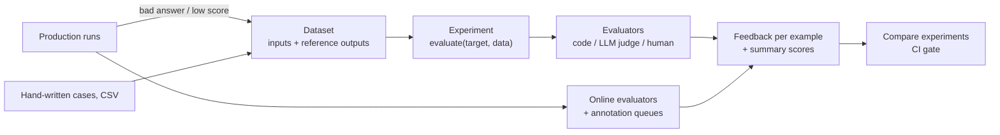

# LangSmith — Datasets & Evaluations

A **dataset** is a versioned set of test cases. An **experiment** runs one version of your application over it; **evaluators** turn each output into **feedback** (scores); LangSmith stores every experiment so versions can be compared.

## Evaluation Loop



| | Offline | Online |
|---|---------|--------|
| Target | Dataset examples (with reference outputs) | Production runs and threads (no reference outputs) |
| Used for | Benchmarking, regression, unit-style checks, backtests | Monitoring, anomaly detection, finding new test cases |
| Evaluators | Code, LLM-as-judge, pairwise, summary | Reference-free code, LLM-as-judge, decision model, multi-turn |

## Datasets

| Field | Use |
|-------|-----|
| `inputs` | Dict passed to your target function |
| `outputs` (alias `reference_outputs`) | Ground truth for evaluators; never passed to the target |
| `metadata` | Category, source, tenant — filter and group results by it |
| `split` | One or more split names (`smoke`, `regression`) to evaluate subsets |
| `source_run_id` | Links the example to the run it was created from |
| `attachments` | Files and images for multimodal evaluations |

```python
from langsmith import Client

client = Client()

dataset = client.create_dataset(
    dataset_name="triage-regression",
    description="Ticket triage: priority and routing",
    inputs_schema={"type": "object", "properties": {"ticket": {"type": "string"}}, "required": ["ticket"]},
    outputs_schema={"type": "object", "properties": {"priority": {"type": "string", "enum": ["P1", "P2", "P3", "P4"]}, "team": {"type": "string"}}, "required": ["priority"]},
)
client.create_examples(
    dataset_id=dataset.id,
    examples=[
        {"inputs": {"ticket": "Checkout returns 500 for all EU users"}, "outputs": {"priority": "P1", "team": "payments"}, "metadata": {"source": "manual"}, "split": "smoke"},
        {"inputs": {"ticket": "Typo on the About page"}, "outputs": {"priority": "P4", "team": "content"}, "split": ["regression"]},
    ],
)
```

- `inputs_schema` / `outputs_schema` (JSON Schema, plus prebuilt message and tool types) validate new examples; optional **transformations** normalize them (for example to OpenAI message format).
- **CSV**: `client.upload_csv("tickets.csv", input_keys=["ticket"], output_keys=["priority"], name="tickets-csv", data_type="kv")`. The UI also imports CSV and JSONL.
- Update with `update_examples(dataset_name="triage-regression", updates=[{"id": example_id, "outputs": {...}}])`; query with `list_examples(dataset_name=..., splits=[...], metadata={...}, filter='exists(metadata, "tenant_id")')`.

### From production runs

In the UI: open a run → **Add to dataset** (schema validation and transformations are shown). An automation rule can add matching runs automatically. In code:

```python
import asyncio
import datetime as dt


async def negative_feedback_runs(project: str, hours: int = 24):
    project_id = client.read_project(project_name=project).id
    since = dt.datetime.now(dt.timezone.utc) - dt.timedelta(hours=hours)
    return [
        run
        async for run in client.runs.query(
            project_ids=[str(project_id)],
            is_root=True,
            min_start_time=since,                       # defaults to the last 24 hours when omitted
            filter='and(eq(feedback_key, "user_score"), eq(feedback_score, 0))',
            selects=["ID", "INPUTS", "OUTPUTS"],
            page_size=100,
        )
    ]


runs = asyncio.run(negative_feedback_runs("support-bot-prod"))
client.create_examples(
    dataset_name="triage-regression",
    examples=[
        {"inputs": r.inputs, "outputs": r.outputs, "source_run_id": str(r.id), "metadata": {"source": "negative-feedback"}}
        for r in runs
    ],
)
```

Review and correct `outputs` afterwards — the recorded output is the *wrong* answer. `client.list_runs()` is the older query method and is being replaced by `client.runs.query()`.

### Versions, tags, splits

Every add, update or delete creates a new dataset **version** (a timestamp). Tag a version to pin it:

```python
import datetime as dt

client.update_dataset_tag(dataset_name="triage-regression", as_of=dt.datetime(2026, 10, 1, tzinfo=dt.timezone.utc), tag="prod")
examples = client.list_examples(dataset_name="triage-regression", as_of="prod", splits=["regression"])
client.update_dataset_splits(dataset_name="triage-regression", split_name="smoke", example_ids=[ex_id])
```

`as_of` accepts `"latest"`, a datetime or a tag; pass the iterator as `data=` to `evaluate()` for reproducible runs on a version or split. `list_dataset_versions()` lists versions; `list_dataset_splits()` lists split names.

## Running Experiments

```python
from langsmith import Client, evaluate, traceable

client = Client()


@traceable
def triage(inputs: dict) -> dict:                       # target: dict in, dict out
    return call_triage_model(inputs["ticket"])


def priority_match(outputs: dict, reference_outputs: dict) -> bool:
    return outputs["priority"] == reference_outputs["priority"]


def team_match(inputs: dict, outputs: dict, reference_outputs: dict) -> dict:
    return {"key": "team_match", "score": int(outputs["team"] == reference_outputs["team"])}


def accuracy(outputs: list[dict], reference_outputs: list[dict]) -> dict:     # summary evaluator
    ok = sum(o["priority"] == r["priority"] for o, r in zip(outputs, reference_outputs))
    return {"key": "priority_accuracy", "score": ok / len(outputs)}


results = evaluate(
    triage,
    data=client.list_examples(dataset_name="triage-regression", as_of="prod"),   # or a dataset name / UUID
    evaluators=[priority_match, team_match],
    summary_evaluators=[accuracy],
    experiment_prefix="triage-gpt-4o-mini",
    description="Baseline prompt v2",
    metadata={"models": ["openai:gpt-4o-mini"], "prompts": ["ticket-triage:staging"]},
    max_concurrency=4,
    num_repetitions=3,
)
for row in results:
    print(row["example"].inputs, row["run"].outputs, [(r.key, r.score) for r in row["evaluation_results"]["results"]])
```

| `evaluate` argument | Notes |
|--------------------|-------|
| `target` | Function `dict -> dict`, a LangChain runnable / LangGraph graph, an existing experiment, or a tuple of two experiments (pairwise) |
| `data` | Dataset name or UUID, or an iterable of examples (`list_examples(...)`) |
| `evaluators`, `summary_evaluators` | Per-example and whole-experiment scorers |
| `num_repetitions` | Run each example N times — reduces noise for non-deterministic agents; UI shows the average |
| `max_concurrency` | `0` (default) sequential, `None` unlimited; lower it for provider rate limits |
| `blocking=False` | Stream results while the experiment runs |
| `error_handling` | `"log"` (default) records failed runs with the error; `"ignore"` drops them |
| `upload_results=False` | Beta: run target and evaluators locally, record nothing |
| `experiment`, `disable_evaluator_tracing` | Extend an existing experiment; skip tracing evaluator calls |

- `aevaluate()` has the same arguments for `async` targets and evaluators and returns an async iterator: `await aevaluate(atarget, data=..., evaluators=[...])`.
- With `upload_results=False`, `data` must be `Example` objects (for example from `list_examples`), not plain dicts.
- Evaluators attached to the dataset in the UI run automatically on every new experiment, in addition to those passed in code.
- Rate limits: lower `max_concurrency`, add `tenacity` retries or a LangChain `InMemoryRateLimiter` to model clients.
- `evaluate_existing(experiment, evaluators=[...])` adds evaluators to a finished experiment.

### Evaluator signatures

Use any subset of these argument names:

| Argument | Content |
|----------|---------|
| `inputs`, `outputs`, `reference_outputs` | Example inputs, target outputs, example reference outputs |
| `run`, `example` | Full `Run` (child runs, latency, tokens) and `Example` (metadata) objects |

| Return | Becomes |
|--------|---------|
| `bool`, `int`, `float` | Numeric metric named after the function |
| `str` | Categorical metric named after the function |
| `{"key": ..., "score": ...}` / `{"key": ..., "value": ..., "comment": ...}` | Named numeric / categorical metric with explanation |
| `list[dict]` | Several metrics from one evaluator |

Summary evaluators take lists — any of `inputs`, `outputs`, `reference_outputs` (one entry per example) or `runs`, `examples` — and return one metric for the whole experiment (accuracy, F1, pass rate).

## LLM-as-a-Judge

```python
import openai
from openevals.llm import create_llm_as_judge
from openevals.prompts import CORRECTNESS_PROMPT, CONCISENESS_PROMPT
from openevals.exact import exact_match

correctness = create_llm_as_judge(prompt=CORRECTNESS_PROMPT, feedback_key="correctness", model="openai:gpt-4o-mini")
conciseness = create_llm_as_judge(prompt=CONCISENESS_PROMPT, feedback_key="conciseness", model="openai:gpt-4o-mini")

client.evaluate(support_bot, data="support-qa", evaluators=[correctness, conciseness, exact_match])
```

- `openevals` ships prompts for correctness, conciseness, hallucination, groundedness, toxicity, PII leakage, prompt injection, task completion and agent trajectories, plus `exact_match`, JSON and string evaluators. Calling a judge directly returns `{"key", "score", "comment"}`.
- Options: `continuous=True` (0–1 score), `choices=[...]`, `use_reasoning`, `few_shot_examples`, `system`, `output_schema`, and `judge=` to pass your own OpenAI-compatible client (also useful to stub the LLM in tests).
- A hand-written judge is just an evaluator that calls a (wrapped) model; use structured output and `temperature=0`. Pin the judge model, and keep a small human-labelled set to measure agreement.
- In the UI: **Evaluators → + Evaluator** (LLM-as-judge from scratch or from a template: security, safety, quality, conversation, trajectory), map `{{input}}`, `{{output}}`, `{{reference}}` variables to the data, attach to a dataset to run on each experiment. **Decision model** evaluators (typed questions answered by a decision model) are UI-only; **composite** evaluators combine several scores.
- Evaluator LLM spend can be capped weekly per organization or evaluator.

## Pairwise Experiments

```python
from langsmith import evaluate


def ranked_preference(inputs: dict, outputs: list[dict]) -> list[int]:
    a, b = (o.get("answer", "") for o in outputs)          # outputs of experiment 1 and 2 for one example
    return [int(len(a) <= len(b)), int(len(b) <= len(a))]   # a heuristic; use an LLM judge for quality


evaluate(("triage-gpt-4o-mini-1a2b3c4d", "triage-gpt-4o-3c4d5e6f"), evaluators=[ranked_preference], randomize_order=True, max_concurrency=4)
```

Pairwise evaluators receive `inputs`, `outputs` (list of two), `reference_outputs`, `runs`, `example`, and return a two-item score list or `{"key": "pairwise_...", "scores": {run_id: score}, "comment": ...}`. Prefix keys with `pairwise_` or `ranked_`. `randomize_order` reduces position bias.

## Comparing Experiments

**Datasets & Experiments → dataset → select two or more experiments → Compare.** The first selected experiment is the source: runs that regressed on a feedback key are red, improved ones green; filter by feedback, status, latency or metadata; **Diff** view for two experiments; group results by example metadata. Experiment metadata (`models`, `prompts`, `tools`) fills comparison columns.

## Online Evaluators

Configured per tracing project or agent environment: **Tracing → project → Evaluators → + Evaluator**.

| Type | Notes |
|------|-------|
| LLM-as-judge | Prompt with `{{variables}}` mapped to run input/output/metadata; supports multimodal attachments |
| Code | Python or JS function `perform_eval(run)` returning `{"key": value}`; stdlib plus numpy, pandas, jsonschema, scipy, scikit-learn; no network |
| Multi-turn | Scores whole threads after they go idle |
| Decision model, LangChain tuned evaluators, composite | UI-configured |

- **Filter** which runs trigger it (`has(tags, "support_agent")`, a feedback key, metadata, tool call), set a **sampling rate**, optionally **backfill** past runs (only when creating the rule), and chain evaluators by filtering on another evaluator's feedback key.
- Each run is judged without a reference answer: use reference-free criteria (safety, format, groundedness, helpfulness).
- Matching runs are **upgraded to extended retention** unless you opt out when configuring the evaluator; judge calls cost LLM spend.
- Online results feed dashboards and alerts on feedback score ([05](./05-testing-ci-production.md#monitoring-alerts-and-automations)).

## Annotation Queues and Human Feedback

| Queue type | Reviewer sees | Use |
|------------|---------------|-----|
| **Single-run** | One run or thread, rubric items, instructions | Triage failures, build datasets (**Add to dataset**), write *assertions* for later grading |
| **Pairwise** | Two runs side by side | Fast A/B preference between experiments |

Settings: number of reviewers per item, reservations, assigned reviewers, default dataset. Reviewers cannot see each other's feedback.

```python
import datetime as dt
from langsmith.schemas import AnnotationQueueRubricItem

client.create_feedback_config(
    "priority_ok",
    feedback_config={"type": "categorical", "categories": [{"value": 1, "label": "Pass"}, {"value": 0, "label": "Fail"}]},
)
queue = client.create_annotation_queue(
    name="triage-weekly-review",
    rubric_instructions="Is the assigned priority right for the customer impact?",
    rubric_items=[AnnotationQueueRubricItem(feedback_key="priority_ok", description="P-level matches impact")],
)
client.add_runs_to_annotation_queue(
    queue.id,
    runs=[{"run_id": str(run.id), "session_id": str(project_id), "start_time": run.start_time}],   # RunKey: run, project, start time
)
```

Automation rules can fill a queue automatically (all runs with negative feedback, 10% sample).

## Feedback Model

| Field | Meaning |
|-------|---------|
| `key` | Metric name (`correctness`, `user_score`); same keys aggregate across runs |
| `score` | Number or bool — averaged, sorted, thresholded |
| `value` | String / categorical or structured value |
| `comment` | Justification (judge reasoning, reviewer note) |
| `correction` | Reference output proposed by a reviewer |
| `feedback_config` | Typing: `continuous` (min, max), `categorical` (value + label), `freeform`; `is_lower_score_better` |
| `feedback_source` | Origin, e.g. `api` (SDK call), `app` (UI, annotation queue), `evaluator` / `model` (automatic evaluators, judges) |

Feedback attaches to any run, including child runs, an experiment's runs, and the experiment itself (summary evaluators). Creating feedback through the API with `extend_trace_retention=True` (default) upgrades the trace's retention tier.

---
## See also
- [LangSmith — LLM Tracing, Prompts & Evals](./index.md)
- [LangSmith — Prompt Management](./03-prompt-management.md)
- [LangSmith — Testing, CI & Production](./05-testing-ci-production.md)
- [DeepEval — LLM Testing Guide](../../llm-evaluation/index.md)
- [LangChain — Security, Evaluation & Operations](../../libs/langchain/07-security-evaluation-operations.md)
- [Langfuse — Datasets & Evaluations](../langfuse/04-datasets-evaluations.md)
- [Arize Phoenix](../phoenix/index.md)
