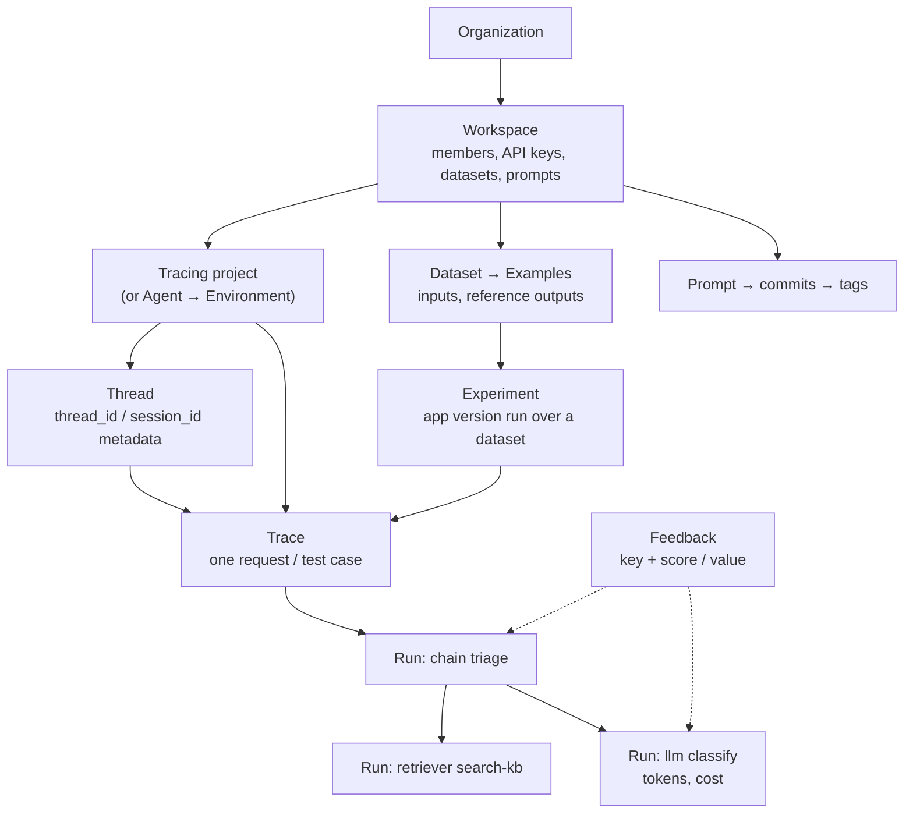

# LangSmith — LLM Tracing, Prompts & Evals

LangChain's platform for tracing, evaluating and versioning LLM applications and agents. It works with or without LangChain: the Python SDK (`langsmith`, MIT) instruments any code, and the platform runs as a managed cloud, in your own cloud, or on your Kubernetes cluster.

## What LangSmith Gives a QA Engineer

| Need | LangSmith feature |
|------|-------------------|
| "Why did the agent answer that?" | Trace tree of **runs**: inputs, outputs, tool calls, latency, tokens, cost |
| Reproduce a bad answer | Save the run to a **dataset**, replay it in an **experiment** |
| Regression gate for prompt/model changes | `evaluate()` with evaluators, or the `@pytest.mark.langsmith` plugin, in CI |
| Quality signal in production | **Online evaluators**, user **feedback**, **annotation queues**, automation rules |
| Change prompts without redeploying | **Prompt Hub**: commits, tags, `staging` / `production` environments |
| Budget and SLO checks | Monitoring dashboards, cost tracking, **alerts** (Slack, PagerDuty, webhook) |
| Find failure patterns in many traces | **Insights** reports over a project or agent environment |

## Installation

```bash
uv add langsmith                  # SDK: tracing, datasets, evaluate(), prompts
uv add "langsmith[pytest]"        # pytest plugin extras: rich output, HTTP caching
uv add "langsmith[otel]"          # OpenTelemetry integration
uv add openevals                  # prebuilt evaluators (LLM-as-judge, exact match, ...)

export LANGSMITH_TRACING=true
export LANGSMITH_API_KEY="lsv2_pt_..."
export LANGSMITH_PROJECT="support-bot-ci"                     # default: "default"
# export LANGSMITH_ENDPOINT="https://eu.api.smith.langchain.com"   # non-US region or self-hosted
```

## Data Model



| Object | What it is | Typical QA use |
|--------|-----------|----------------|
| **Run** | One unit of work (span): LLM call, tool, retriever, chain | Assert which steps ran |
| **Trace** | All runs of one operation, tied by a trace ID (max 25,000 runs) | One trace per test or request |
| **Thread** | Traces of one multi-turn conversation, grouped by `thread_id` metadata | Replay a whole chat |
| **Project** / **Agent + Environment** | Container for traces; an agent splits into `local`, `development`, `staging`, `production` | Keep CI traffic out of production views |
| **Feedback** | Score or value (`key` + `score`/`value` + `comment`) on a run | User thumbs, judge scores, test results |
| **Dataset / Example** | Test cases: `inputs`, optional `reference_outputs`, `metadata`, `split` | Versioned regression suite |
| **Experiment** | Results of one application version over a dataset | Compare prompt or model changes |
| **Evaluator** | Workspace-level scorer: code, LLM-as-judge, decision model, composite | Offline gates, online monitoring |
| **Prompt** | Versioned template with commits and tags | Test a prompt version, then promote it |

## Section Map

| File | Topics |
|------|--------|
| [01 Setup & Architecture](./01-setup-architecture.md) | Cloud / BYOC / self-hosted / hybrid, regions, API keys, workspaces, projects vs agents, env vars, RBAC, retention, OpenTelemetry |
| [02 Tracing with the Python SDK](./02-tracing-sdk.md) | `@traceable`, `trace`, `tracing_context`, wrappers, LangChain/LangGraph, threads, feedback, distributed tracing, OTel, flushing, sampling, masking |
| [03 Prompt Management](./03-prompt-management.md) | Commits, tags, environments, `push_prompt` / `pull_prompt`, caching, LangChain usage, testing prompts |
| [04 Datasets & Evaluations](./04-datasets-evaluations.md) | Datasets, `evaluate()` / `aevaluate()`, code and LLM-as-judge evaluators, pairwise, online evaluators, annotation queues |
| [05 Testing, CI & Production](./05-testing-ci-production.md) | pytest plugin, CI gates, asserting on traces, dashboards, alerts, automation rules, cost, PII, tool comparison |

## Minimal Trace

```python
from langsmith import traceable, Client
from langsmith.wrappers import wrap_openai
import openai

oai = wrap_openai(openai.OpenAI())          # every call becomes an llm run with token usage


@traceable(name="triage", tags=["smoke"], metadata={"thread_id": "t-1"})
def triage(ticket: str) -> str:
    resp = oai.chat.completions.create(
        model="gpt-4o-mini",
        messages=[{"role": "user", "content": f"Classify priority P1-P4: {ticket}"}],
    )
    return resp.choices[0].message.content


print(triage("Checkout returns 500 for all EU users"))
Client().flush()                            # short-lived script: send buffered runs before exit
```

## Quick Commands

| Command | Use |
|---------|-----|
| `uv add langsmith` | Install the Python SDK |
| `curl -fsSL https://cli.langsmith.com/install.sh \| sh` | Install the `langsmith` CLI |
| `langsmith auth login` | Browser login; stores a profile in `~/.langsmith/config.json` |
| `langsmith --profile eu project list` | Query a specific profile (region / workspace) |
| `uv run python -c "from langsmith import Client; print([p.name for p in Client().list_projects(limit=3)])"` | Check key, endpoint and workspace |
| `LANGSMITH_TRACING=false uv run pytest` | Run tests without sending traces |
| `LANGSMITH_TEST_TRACKING=false uv run pytest` | Run `@pytest.mark.langsmith` tests without syncing results |
| `LANGSMITH_TEST_SUITE="triage" uv run pytest` | Group all tests of a run into one dataset and experiment |

## LangSmith vs Langfuse

| Aspect | LangSmith | [Langfuse](../langfuse/index.md) |
|--------|-----------|----------|
| Instrumentation | Own SDK (`@traceable`, wrappers), native LangChain/LangGraph tracing; accepts OTLP | Own SDK on OpenTelemetry; accepts OTLP |
| Evaluation | `evaluate()`, pytest plugin, online evaluators, annotation queues, pairwise | Dataset experiments, LLM-as-judge, annotation queues |
| Prompts | Commits, tags, `staging` / `production` environments | Versions and labels |
| Hosting | Cloud (GCP US, EU, APAC; AWS US), BYOC, self-hosted on Kubernetes (Enterprise) | Cloud or self-hosted (Compose / Helm) |
| License | SDKs MIT; platform commercial | MIT core, Enterprise Edition features |

Full decision table including [Phoenix](../phoenix/index.md) and [MLflow](../mlflow/index.md): [05 Testing, CI & Production](./05-testing-ci-production.md#langsmith-vs-langfuse-vs-phoenix-vs-mlflow).

## Quick Rules

1. **Set `LANGSMITH_TRACING=true` explicitly** — decorators and wrappers do nothing without it; it is also the off switch for tests.
2. **Match `LANGSMITH_ENDPOINT` to the region** where the account was created; a US endpoint rejects an EU key.
3. **Separate test traffic**: a dedicated project (or the `local` / `development` agent environment) for CI, short retention.
4. **Put `thread_id` metadata on every run** of a conversation, not only the root.
5. **Always flush** (`Client().flush()`) in scripts, jobs and serverless handlers.
6. **Pull prompts by tag** (`name:production`), never hard-code a commit hash in production code.
7. **Turn bad production runs into dataset examples** — the dataset is the regression suite.
8. **Gate CI on aggregate scores** (summary evaluators, thresholds), not on exact string matches.
9. **Mask PII in the SDK** (`anonymizer`, `hide_inputs`, `process_inputs`) — runs are sent raw by default.
10. **Use service or tracing keys** for apps and CI, not personal access tokens.

---
## See also
- [Digital Garden: Knowledge Base](../../index.md)
- [Tools — Practical Reference Guides](../index.md)
- [Langfuse — LLM Tracing, Prompts & Evals](../langfuse/index.md)
- [Arize Phoenix](../phoenix/index.md)
- [MLflow — Experiment Tracking, LLM Tracing & Evaluation](../mlflow/index.md)
- [Jaeger — Distributed Tracing for OpenTelemetry](../jaeger/index.md)
- [LangChain — LLM Application Framework](../../libs/langchain/index.md)
- [LangGraph — Stateful Agent Orchestration](../../libs/langgraph/index.md)
- [OpenTelemetry — Python Observability](../../libs/opentelemetry/index.md)
- [DeepEval — LLM Testing Guide](../../llm-evaluation/index.md)
