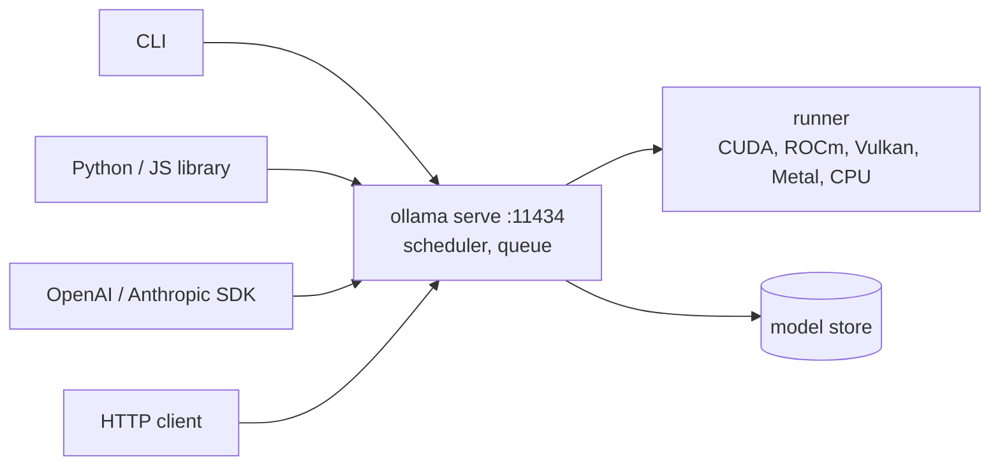

# Ollama — Local LLM Runtime

**Ollama** (MIT, built on llama.cpp) runs open-weight models on your own hardware behind one local server: `127.0.0.1:11434`. Clients are the CLI, a REST API, OpenAI- and Anthropic-compatible endpoints, and official Python and JavaScript libraries. Local inference sends no prompt or response to Ollama. Only the hosted cloud models do, and they are out of scope here.

Sources: `docs.ollama.com` and `ollama.com/library/clef`, read 20 October 2026. Ollama was not installed while writing, so none of the commands were run; fields and defaults are quoted from the docs.



## Fit

| Use Ollama for | Do not use it for |
|----------------|-------------------|
| Local development, prototypes, private data, offline work | High-concurrency multi-tenant serving (use a serving engine such as vLLM) |
| An OpenAI-compatible endpoint for tests and CI | Frontier-model quality; open models run smaller |
| Embeddings, structured extraction, tool-calling agents on small models | Anything that needs request authentication on the server itself (none built in) |

## Install

| Platform | Command |
|----------|---------|
| Linux, macOS | `curl -fsSL https://ollama.com/install.sh \| sh` |
| Windows | `irm https://ollama.com/install.ps1 \| iex` |
| Docker, CPU | `docker run -d -v ollama:/root/.ollama -p 11434:11434 --name ollama ollama/ollama` |
| Docker, NVIDIA | install NVIDIA Container Toolkit, `sudo nvidia-ctk runtime configure --runtime=docker`, restart Docker, then add `--gpus=all` |
| Docker, AMD | `docker run -d --device /dev/kfd --device /dev/dri -v ollama:/root/.ollama -p 11434:11434 ollama/ollama:rocm` |

- On Linux the installer creates a `systemd` unit `ollama`. Update by running the installer again; pin with `OLLAMA_VERSION=<x.y.z>`.
- Manual Linux install extracts `ollama-linux-amd64.tar.zst` (plus `-rocm` for AMD, or the `arm64` archive) into `/usr`.
- GPU in Docker works on Linux and on Windows with WSL2. Docker Desktop on macOS has no GPU passthrough.
- Read an install script before piping it to a shell.

## Models

A model is `name:tag`; no tag means `:latest`. Library: `ollama.com/library`.

| Command | Purpose |
|---------|---------|
| `ollama pull <model>` | Download or update |
| `ollama run <model> ["prompt"] [image.png]` | Chat, or one prompt; an image path attaches an image for vision models |
| `ollama ls`, `ollama ps` | Local models, loaded models |
| `ollama show <model>` | Details, parameters, capabilities |
| `ollama cp`, `ollama rm`, `ollama stop` | Copy, delete, unload |
| `ollama create <name> -f Modelfile` | Build a model |

Storage: Linux service `/usr/share/ollama/.ollama/models`, macOS `~/.ollama/models`, Windows `C:\Users\<user>\.ollama\models`. Override with `OLLAMA_MODELS`; on Linux run `sudo chown -R ollama:ollama <dir>`.

**Sizing.** Memory needed ≈ model file + KV cache + overhead. The KV cache grows with context length and with parallel requests. The model page's download size is the floor, so compare it with free RAM or VRAM before `pull`. After loading, `ollama ps` shows the real footprint, the processor split and the allocated `CONTEXT`.

## Hardware Acceleration

| Backend | Requirements |
|---------|--------------|
| NVIDIA CUDA | Compute capability ≥ 5.0; driver ≥ 550 (570 for capability 5.0–6.2) |
| AMD ROCm | ROCm v7 driver; a listed Radeon, Radeon PRO, Ryzen AI or Instinct card |
| Vulkan | Windows and Linux; covers GPUs outside CUDA/ROCm. Linux needs extra packages (Mesa or vendor driver) |
| Apple Metal | Apple devices, through the Metal API |
| CPU | Always available; slowest |

| Task | Setting |
|------|---------|
| Pick NVIDIA GPUs | `CUDA_VISIBLE_DEVICES` (UUIDs from `nvidia-smi -L` are stable; `-1` forces CPU) |
| Pick AMD GPUs | `ROCR_VISIBLE_DEVICES` (`rocminfo`; `-1` forces CPU) |
| Unsupported AMD target | `HSA_OVERRIDE_GFX_VERSION=x.y.z` (per device: `_0`, `_1`) |
| Vulkan on/off, device | `OLLAMA_VULKAN=0` disables; `GGML_VK_VISIBLE_DEVICES=<ids>` selects |
| Force a CPU build | `OLLAMA_LLM_LIBRARY=cpu_avx2` (`cpu_avx`, `cpu`) |

Scheduling rules: a model that fits on one GPU is placed there; otherwise it is spread across all GPUs; with GPU inference a new model must fit entirely in VRAM to load next to another. A partly offloaded model (`48%/52% CPU/GPU` in `ollama ps`) is much slower than a fully resident one.

## Server Configuration

Variables apply to the server process. For the Linux service use `sudo systemctl edit ollama.service`, add `Environment="NAME=value"` under `[Service]`, then `sudo systemctl daemon-reload && sudo systemctl restart ollama`. Shell `export` does not reach the service.

| Variable | Purpose | Default |
|----------|---------|---------|
| `OLLAMA_HOST` | Bind address | `127.0.0.1:11434` |
| `OLLAMA_MODELS` | Model store | per platform |
| `OLLAMA_CONTEXT_LENGTH` | Context window, tokens | by VRAM, see below |
| `OLLAMA_KEEP_ALIVE` | Idle time before unload | `5m` |
| `OLLAMA_NUM_PARALLEL` | Parallel requests per model | `1` |
| `OLLAMA_MAX_LOADED_MODELS` | Concurrently loaded models | 3 × GPUs, 3 on CPU |
| `OLLAMA_MAX_QUEUE` | Queue length; beyond it HTTP 503 | `512` |
| `OLLAMA_FLASH_ATTENTION` | `1` force on, `0` off | automatic |
| `OLLAMA_KV_CACHE_TYPE` | `f16`, `q8_0`, `q4_0` | `f16` |
| `OLLAMA_ORIGINS` | Allowed browser origins | `127.0.0.1`, `0.0.0.0` |
| `OLLAMA_DEBUG` | `1` for debug logs | off |
| `HTTPS_PROXY` | Proxy for downloads (do not set `HTTP_PROXY`) | unset |

**Context length** defaults by available VRAM: under 24 GiB → 4k, 24–48 GiB → 32k, 48 GiB or more → 256k. Override per server (`OLLAMA_CONTEXT_LENGTH`), per request (`options.num_ctx`) or per model (`PARAMETER num_ctx`). Agents, web search and coding tools need at least 64000 tokens. Memory cost is real: parallel requests multiply the window (2K × 4 parallel = 8K), so RAM scales with `NUM_PARALLEL × CONTEXT_LENGTH`.

**KV cache.** `q8_0` uses about half the memory of `f16` with very small loss; `q4_0` about a quarter with small to medium loss. It applies to every model and requires Flash Attention.

**Residency.** `keep_alive` per request overrides the env default: `-1` keeps the model loaded, `0` unloads it. Preload with `ollama run <model> ""` or a request that contains only `model`.

## API

Base: `http://localhost:11434/api`. No authentication locally. The API is not strictly versioned but is meant to stay backward compatible.

| Endpoint | Purpose |
|----------|---------|
| `POST /api/chat` | Chat with history, tools, images, thinking |
| `POST /api/generate` | Single prompt; adds `system`, `suffix` (fill-in-the-middle), `raw` |
| `POST /api/embed` | Embeddings, `input` is a string or a list |
| `GET /api/tags`, `GET /api/ps` | Local models, loaded models |
| `POST /api/show`, `/api/pull`, `/api/create`, `DELETE /api/delete` | Inspect (capabilities, thinking values), download, build, remove |

**Chat request fields:** `model`, `messages` (`role`, `content`, `images` as base64, `tool_calls`), `tools`, `format`, `options`, `stream` (default `true`), `think`, `keep_alive`, `logprobs`, `top_logprobs`. Common `options`: `seed`, `temperature`, `top_k`, `top_p`, `min_p`, `stop`, `num_ctx`, `num_predict`.

**Streaming** is NDJSON (`application/x-ndjson`): one JSON object per line, the last has `"done": true` and `done_reason`. `"stream": false` returns one object.

**Metrics** in the final response, durations in nanoseconds: `total_duration`, `load_duration`, `prompt_eval_count`, `prompt_eval_duration`, `eval_count`, `eval_duration`.

```text
generation speed (tokens/s) = eval_count / eval_duration * 1e9
prompt speed     (tokens/s) = prompt_eval_count / prompt_eval_duration * 1e9
```

A large `load_duration` means a cold model; raise `keep_alive`.

### Structured output

```python
from ollama import chat
from pydantic import BaseModel


class Country(BaseModel):
    name: str
    capital: str
    languages: list[str]


response = chat(
    model="gpt-oss",
    messages=[{"role": "user", "content": "Tell me about Canada."}],
    format=Country.model_json_schema(),
    options={"temperature": 0},
)
country = Country.model_validate_json(response.message.content)
```

`format` constrains the shape, not the facts: validate, set `temperature` 0, and describe the schema in the prompt too.

### Tool calling

```python
from ollama import chat


def get_temperature(city: str) -> str:
    """Get the current temperature for a city."""
    return {"New York": "22°C"}.get(city, "Unknown")


messages = [{"role": "user", "content": "Temperature in New York?"}]
while True:
    response = chat(model="qwen3", messages=messages, tools=[get_temperature])
    messages.append(response.message)
    if not response.message.tool_calls:
        break
    for call in response.message.tool_calls:          # several calls may arrive in one turn
        result = get_temperature(**call.function.arguments)
        messages.append({"role": "tool", "tool_name": call.function.name, "content": str(result)})
print(response.message.content)
```

One `tool` message per call, results in the same follow-up request. Tool calls carry no `id`; match on `tool_name`. Only models that report the `tools` capability in `/api/show` work. When streaming, accumulate `thinking`, `content` and `tool_calls` from every chunk into one assistant message.

### Thinking, vision, embeddings

- **Thinking:** `think` is `true`, `false`, `null` (model default) or a model-defined level string; numbers are rejected. `/api/show` lists the valid `thinking.values`. Output arrives in `message.thinking` before `message.content`.
- **Vision:** `images` per message, base64 on the REST API; the Python and JS libraries also accept a path or bytes.
- **Embeddings:** `/api/embed` returns L2-normalized vectors, one per input; use cosine similarity and the **same model** for indexing and queries. Vector length is model-specific.

### Compatible APIs

| API | Base | Notes |
|-----|------|-------|
| OpenAI | `http://localhost:11434/v1/` | `/chat/completions` (streaming, JSON mode, vision, tools), `/completions`, `/responses` (stateless), `/embeddings`, `/models`. No `logprobs`. `api_key` is required but ignored |
| Anthropic | `http://localhost:11434` | SDK appends `/v1/messages` |

The OpenAI API has no context field: set `num_ctx` through the server default or a Modelfile. Tools that hard-code a model name can use `ollama cp llama3.2 gpt-3.5-turbo`. In [LiteLLM](../../libs/litellm/index.md) the model is `ollama/<name>`.

## Modelfile and Import

```text
FROM llama3.2
PARAMETER temperature 0.2
PARAMETER num_ctx 8192
SYSTEM You are a strict code reviewer. Answer in short bullet points.
```

`ollama create reviewer -f Modelfile`. Instructions: `FROM` (required), `PARAMETER`, `SYSTEM`, `TEMPLATE` (Go template; leave a library model's template alone), `MESSAGE`, `LICENSE`, `REQUIRES`, `CAPABILITY`.

- **Safetensors:** `FROM <directory>` (or `FROM .`), then `ollama create`.
- **GGUF:** `FROM /path/model.gguf` or a wildcard for shards (`model-*.gguf`, keep the original shard names). Ollama **does not quantize GGUF on import**: quantize first, for example with llama.cpp `llama-quantize`.
- **Publish:** add your public key at ollama.com, name the model `user/model` (`ollama cp`), `ollama push user/model`.

## Security and Deployment

- The API has **no authentication**. Keep `OLLAMA_HOST` on loopback. To serve other hosts, bind explicitly and put a reverse proxy with auth and TLS in front; an nginx `location /` must set `proxy_set_header Host localhost:11434;`.
- Tunnels (`ngrok`, `cloudflared`) publish the API as it is; never use them without an authenticating layer. They also need `--host-header="localhost:11434"`.
- `OLLAMA_ORIGINS` controls browser CORS; add extension origins only when needed.
- Run the service as the dedicated `ollama` user, as the installer does. Behind a TLS-inspecting proxy, install its CA as a system certificate (in Docker, build an image that adds it).
- Pin the Ollama version and model tags in CI and production-like environments; `latest` moves.

## Testing Code That Calls Ollama

- Unit tests: fake the client call; never load a model.
- Integration tests: small model, `temperature: 0`, fixed `seed`; assert structure, labels and schema validity, not exact text.
- CI: cache the model store, since downloads are GB-sized, or move model tests to a scheduled job.
- Latency and cost: log `load_duration`, `eval_count` and the speeds above; trace with [MLflow](../mlflow/index.md), [Phoenix](../phoenix/index.md) or [Langfuse](../langfuse/index.md); score with [DeepEval](../../llm-evaluation/index.md).

## Clef — A Local Decision Model

**Clef** (`ollama.com/library/clef`, Apache 2.0) is a 27B multimodal model fine-tuned from a Qwen base. It is not a chat model. You send a **state** (text, JSON or images) and **typed questions**; it scores every option of every question in **one non-autoregressive pass** and returns probabilities. No text is generated (`output_tokens` is `0`). Typical uses: ticket routing, policy checks, gating an agent's tool call, classifying receipts and screenshots.

| Item | Value |
|------|-------|
| Local tag | `clef` (= `clef:27b`), about 18–20 GB |
| Requires | Ollama ≥ 0.35.1; Python `ollama` ≥ 0.6.3 |
| Input | Text, JSON, images (base64 PNG, JPEG, WebP) |
| Questions per request | 1–64, names up to 100 characters (`[A-Za-z0-9_.-]`) |
| Context | The page states 256K for local tags in one place and 64K in another; confirm with `ollama show clef` |
| Quantization | Not stated |

| Question type | `criteria` | Result |
|---------------|-----------|--------|
| `choice` | Map option → description; 2–26 options locally; values may be `null` | `choice`, `probabilities`, `confidence` |
| `noul` | Optional `true` / `false` descriptions | `noul`: probability the answer is true |
| `score` | 2–10 level descriptions, lowest first | `score` (probability-weighted level), `legend`, `probabilities`, `confidence` |

`confidence` (0–1) measures how concentrated the probabilities are, **not** whether the answer is right.

```bash
ollama pull clef
ollama run clef --ask "Is a refund being requested?" < ticket.txt              # yes  99%
ollama run clef --ask "Which team?" \
  --choice billing="Payments and refunds" --choice technical="Bugs" --choice other="Anything else" \
  --ask "How urgent?" --level Routine --level Soon --level Immediate < ticket.txt
```

`--ask` opens a question, `--choice label="description"` and `--level label` set its type, `--format json` prints the full response. The model page shows `clef:cloud`; locally use `clef`.

```python
import ollama

response = ollama.systemone(
    model="clef",
    state={"ticket": "I was charged twice. Please refund the extra payment."},
    questions={
        "team": {
            "type": "choice",
            "instructions": "Which team should handle this ticket?",
            "criteria": {"billing": "Payments and refunds", "technical": "Bugs and integrations", "other": "None of the above"},
        },
        "refund": {"type": "noul", "instructions": "Does the customer explicitly ask for a refund?"},
        "urgency": {"type": "score", "instructions": "How urgent is this ticket?", "criteria": ["Routine", "Soon", "Urgent"]},
    },
)
refund_p = response.answers["refund"].noul          # 0.9916, a probability
```

The HTTP form is `POST /v1/systemone` with `model`, `state`, optional `images` and `questions`; a local request may add `keep_alive`. Sample response from the model page:

```json
{"model": "clef",
 "answers": {
   "team":    {"type": "choice", "choice": "billing", "probabilities": {"billing": 0.9888, "technical": 0.0044, "other": 0.0068}, "confidence": 0.9667},
   "refund":  {"type": "noul", "noul": 0.9916},
   "urgency": {"type": "score", "score": 1.5481, "legend": {"0": "Routine", "1": "Soon", "2": "Urgent"}, "confidence": 0.2322}},
 "usage": {"input_tokens": 332, "output_tokens": 0}}
```

Practice:

- Write `instructions` as a precise, answerable question; add short, mutually exclusive `criteria`.
- Treat `noul` as a probability and choose thresholds on **your own labeled data**. Route the band between them to a human or a stronger check. The published benchmarks are the vendor's, on their own suite.
- Batch questions about one state into one request.
- Use it for decisions only; use a chat model for generation.

## Troubleshooting

| Symptom | Check and fix |
|---------|---------------|
| Slow generation | `ollama ps`: `PROCESSOR` shows CPU or a split; use a smaller model or quantization, or a smaller context |
| Context truncated, model "forgets" the start | Prompt exceeds `num_ctx`; set it explicitly and confirm in `ollama ps` (`CONTEXT`) |
| GPU not used (Linux, NVIDIA) | `nvidia-smi`; reload `nvidia_uvm` (`sudo rmmod nvidia_uvm && sudo modprobe nvidia_uvm`); in containers verify `docker run --gpus all ubuntu nvidia-smi` |
| Fell back to CPU after suspend/resume | Reload `nvidia_uvm` as above |
| GPU not used (AMD) | ROCm v7 driver; user in `video`/`render`; `--group-add` in containers |
| GPU lost in Docker after working at first | Set `"exec-opts": ["native.cgroupdriver=cgroupfs"]` in `/etc/docker/daemon.json` |
| Env var ignored | Service: use the systemd override and restart |
| HTTP 503 | Queue full; reduce load or raise `OLLAMA_MAX_QUEUE` |
| Model cold on every request | Raise `keep_alive`; check `load_duration` |
| Models "missing" after moving the store | Wrong owner or empty `OLLAMA_MODELS`; pull as the user that runs the server |

Logs: Linux `journalctl -u ollama --no-pager --follow --pager-end`; Docker `docker logs <container>`; macOS `~/.ollama/logs/server.log`; Windows `%LOCALAPPDATA%\Ollama\server.log`. Add `OLLAMA_DEBUG=1`, `CUDA_ERROR_LEVEL=50` (NVIDIA) or `AMD_LOG_LEVEL=3` (AMD) for detail.

## See Also

- [LiteLLM](../../libs/litellm/index.md): one interface for many providers, including `ollama/<model>`
- [Pydantic AI](../../libs/pydantic-ai/index.md), [Agno](../../libs/agno/index.md): agent frameworks that can use an Ollama model
