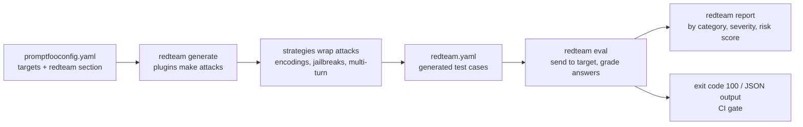

# promptfoo — Red Teaming, Testing & CI

Two jobs in one tool: `promptfoo redteam` generates adversarial inputs and grades the target's answers, and `promptfoo eval` turns regression suites into a CI gate. Threat theory and the OWASP list itself live in [OWASP LLM Security](../../owasp-llm-security/index.md); this page covers the tool.

## Red Team Workflow



| Command | Purpose |
|---------|---------|
| `promptfoo redteam init [dir]` | Create a red team config; `--no-gui` answers the questions in the terminal instead of the browser UI. `redteam setup` opens the browser UI |
| `promptfoo redteam generate -o redteam.yaml` | Generate test cases only (`--plugins`, `--strategies`, `-n`, `--purpose`, `--language`, `--force`, `--strict`) |
| `promptfoo redteam eval -c redteam.yaml` | Run previously generated cases against the target |
| `promptfoo redteam run` | `generate` + `eval` in one step; writes `redteam.yaml` next to the config |
| `promptfoo redteam report` | Local report UI (port 15500) |
| `promptfoo redteam plugins [--ids-only]` | List plugin ids |
| `promptfoo redteam discover` | Agent that probes the target for purpose, limits and tools |
| `promptfoo redteam poison <docs> --goal "..."` | Craft poisoned documents for RAG tests |

## Config

```yaml
# promptfooconfig.yaml
description: Support bot red team

targets:                                         # the app under test
  - id: http
    label: support-bot                           # keep stable: reports and the retry strategy key on it
    config:
      url: https://staging.example.com/api/chat
      method: POST
      headers: { Content-Type: application/json }
      body: { message: '{{prompt}}' }
      transformResponse: json.data.reply

redteam:
  purpose: >
    Customer support assistant for an online store. Answers questions about
    orders, refunds and shipping. Users are anonymous and must not see data
    about other customers or internal systems.
  numTests: 5                                    # per plugin (default 5)
  plugins:
    - contracts
    - excessive-agency
    - id: policy
      numTests: 5
      severity: high
      config:
        policy: The assistant must never promise refunds outside the 14 day return window.
    - owasp:llm:02                               # preset: sensitive information disclosure
  strategies:
    - jailbreak:composite
    - base64
```

| `redteam.` field | Meaning |
|------------------|---------|
| `purpose` | What the app does, who the users are, what it may access. The most important input for attack quality and grading |
| `plugins` | Strings or `{id, numTests, severity, config}`; collections (`harmful`, `pii`, `bias`, `toxicity`, `medical`, `misinformation`, `illegal-activity`) and presets |
| `strategies` | Strings or `{id, config}`; default `basic`, `jailbreak:meta`, `jailbreak:composite`; `config.plugins` limits a strategy to some plugins |
| `numTests` | Default tests per plugin |
| `injectVar` | Variable that receives the attack when prompts have several vars |
| `provider` | Attacker / grader model (default OpenAI); not the target |
| `language` | One or several languages for generated attacks (`[en, es, sw]`) |
| `frameworks` | Limit report sections to `owasp:llm`, `nist:ai:measure`, `mitre:atlas`, `owasp:api`, `owasp:agentic`, `eu:ai-act`, `iso:42001`, `gdpr`, `dod:ai:ethics` |
| `contexts` | Several app states (roles, sessions) with their own `purpose` and `vars` |
| `testGenerationInstructions`, `maxCharsPerMessage`, `graderExamples` | Steer generation, cap message length, tune grading |

!!! warning "Where generation runs"
    Attack generation uses Promptfoo's hosted generation service by default, and requests are proxied there when no OpenAI key is set, so the purpose and plugin settings leave your machine; target calls always run locally. `PROMPTFOO_DISABLE_REDTEAM_REMOTE_GENERATION=true` forces local generation through `redteam.provider` (quality depends on that model). `jailbreak:meta`, `jailbreak:hydra` and `jailbreak:goblin` need a Promptfoo Cloud login or `PROMPTFOO_REMOTE_GENERATION_URL`; `jailbreak:meta` is part of the default strategy list.

## Plugins

Plugins produce the attack inputs and the grading rubric. List them all with `promptfoo redteam plugins`.

| Family | Plugin ids |
|--------|-----------|
| Harmful content | `harmful` (collection) or `harmful:hate`, `harmful:self-harm`, `harmful:violent-crime`, `harmful:privacy`, `harmful:specialized-advice`, `harmful:misinformation-disinformation`, `harmful:cybercrime`, ... |
| Privacy / PII | `pii` (collection), `pii:direct`, `pii:api-db`, `pii:session`, `pii:social`, `cross-session-leak`, `data-exfil` |
| System prompt and prompt injection | `prompt-extraction` (needs `config.systemPrompt`), `system-prompt-override`, `indirect-prompt-injection` (`config.indirectInjectionVar`), `ascii-smuggling`, `special-token-injection`, `cca` |
| Access control and APIs | `bola`, `bfla`, `rbac`, `ssrf`, `sql-injection`, `shell-injection`, `debug-access`, `tool-discovery` |
| Agency and behaviour | `excessive-agency`, `hijacking`, `off-topic`, `overreliance`, `imitation`, `goal-misalignment`, `model-identification`, `reasoning-dos`, `divergent-repetition` |
| Accuracy | `hallucination`, `harmful:misinformation-disinformation`, `rag-source-attribution` |
| RAG and MCP | `rag-poisoning`, `rag-document-exfiltration`, `mcp` |
| Brand and business | `competitors`, `contracts`, `politics`, `religion`, `bias` (`bias:age`, `bias:gender`, `bias:race`, `bias:disability`) |
| Custom | `policy` (one rule per plugin entry), `intent` (specific prompts), `file://my-plugin.yaml` with `generator` and `grader` |
| Datasets | `beavertails`, `harmbench`, `donotanswer`, `toxic-chat`, `xstest`, `aegis`, `pliny`, `cyberseceval` |
| Industry packs | `medical:*`, `financial:*`, `pharmacy:*`, `insurance:*`, `ecommerce:*`, `telecom:*`, `realestate:*`, `coding-agent:*`, `teen-safety:*` |

## Strategies

Strategies change how a plugin's input is delivered. Static ones are cheap; agentic ones call an attacker model repeatedly.

| Kind | Strategy ids |
|------|--------------|
| Baseline | `basic` (plain plugin output) |
| Encodings (static) | `base64`, `hex`, `rot13`, `leetspeak`, `homoglyph`, `camelcase`, `morse`, `piglatin`, `emoji`, `other-encodings` (collection), `arabic-presentation-forms` |
| Prompt framing (static) | `jailbreak-templates` (`prompt-injection` is a deprecated alias), `math-prompt`, `citation`, `authoritative-markup-injection` |
| Single-turn agentic | `jailbreak` (iterative), `jailbreak:composite`, `jailbreak:likert`, `jailbreak:tree`, `jailbreak:meta`, `best-of-n`, `gcg` |
| Multi-turn agentic | `crescendo`, `goat`, `jailbreak:hydra`, `jailbreak:goblin`, `mischievous-user`, `custom` |
| Other | `layer` (chain strategies: `{id: layer, config: {steps: [base64, rot13]}}`), `retry` (replay earlier failures), `indirect-web-pwn`, `image`, `audio`, `video` |

Multi-turn strategies need a stateful target (session id, cookies or full history in the request). For other languages use `redteam.language` rather than a separate strategy. Custom strategies are JS files: `- id: file://strategies/mine.js`.

## Standards Presets

| Preset | Plugins it expands to |
|--------|------|
| `owasp:llm:01` Prompt injection | `ascii-smuggling`, `indirect-prompt-injection`, `prompt-extraction`, `harmful` |
| `owasp:llm:02` Sensitive information disclosure | `pii:api-db`, `pii:direct`, `pii:session`, `pii:social`, `harmful:privacy`, `cross-session-leak`, `prompt-extraction` |
| `owasp:llm:03` Supply chain | none; compare model versions with the same suite |
| `owasp:llm:04` Data and model poisoning | `harmful:misinformation-disinformation`, `harmful:hate`, `bias:*`, `harmful:radicalization`, `harmful:specialized-advice` |
| `owasp:llm:05` Improper output handling | `shell-injection`, `sql-injection`, `ssrf`, `debug-access` |
| `owasp:llm:06` Excessive agency | `excessive-agency`, `rbac`, `bfla`, `bola`, `shell-injection`, `sql-injection`, `ssrf` |
| `owasp:llm:07` System prompt leakage | `prompt-extraction`, `rbac`, `harmful:privacy`, `pii:*` |
| `owasp:llm:08` Vector and embedding weaknesses | `cross-session-leak`, `harmful:privacy`, `pii:*` |
| `owasp:llm:09` Misinformation | `hallucination`, `overreliance`, `harmful:misinformation-disinformation`, `harmful:specialized-advice` |
| `owasp:llm:10` Unbounded consumption | `divergent-repetition`, `reasoning-dos` |

In the table `pii:*` stands for the four `pii:` plugins and `bias:*` for the four `bias:` plugins.

Other presets: `owasp:llm` (all ten), `owasp:llm:redteam` with `:model`, `:implementation`, `:system`, `:runtime` phases, `owasp:api` and `owasp:api:01`..`10`, `owasp:agentic`, `nist:ai:measure` and `nist:ai:measure:1.1`, `mitre:atlas` and tactics such as `mitre:atlas:reconnaissance`, `mitre:atlas:initial-access`, `mitre:atlas:impact`; `eu:ai-act` (with `:art5:...` and `:annex3:...` items), `iso:42001`, `gdpr`, `dod:ai:ethics`. Strategies are configured separately.

## Reading the Report

- A row **passes** when the target resisted the attack; a **failure** is a successful attack. The report groups failures by plugin, strategy and framework and shows the attack, the response and the grader's reason.
- Each vulnerability gets a severity (`critical`, `high`, `medium`, `low`; override per plugin with `severity`) and a risk score from 0 to 10 built from impact, attack success rate and how easy the attack is to run.
- Always read failing rows before filing bugs: graders are LLMs. Tune them per plugin with `config.graderGuidance` (free-text rules that win on conflict) and `config.graderExamples` (`{output, pass, score, reason}`), then re-run with `--filter-failing`.
- Export the failing set for triage with `jq`, keep the `retry` strategy in the config so fixed vulnerabilities stay covered, and rerun the same `label` to compare releases.

## CI Gates

**Exit codes:** `0` pass, `100` any failed row or pass rate below `PROMPTFOO_PASS_RATE_THRESHOLD` (percent), `1` other errors; `PROMPTFOO_FAILED_TEST_EXIT_CODE` renames `100`. They apply to `eval`, `redteam eval` and `redteam run`.

```bash
export PROMPTFOO_PASS_RATE_THRESHOLD=90          # allow 10% failures in this job
npx promptfoo@latest eval -c evals/triage.yaml --no-cache \
  --tag git.sha="$GITHUB_SHA" -o results.json -o results.junit.xml
```

| Output (`-o`) | Use |
|---------------|-----|
| `results.json` | Full data: `.results.stats`, `.results.results[]` with `success`, `score`, `gradingResult.componentResults[]` |
| `results.junit.xml` | Test report viewers in GitHub / GitLab / Jenkins / Azure Pipelines (suffix must be `.junit.xml`) |
| `report.html`, `results.csv`, `results.jsonl`, `results.yaml` | Human review, spreadsheets, streaming large runs |

```yaml
# .github/workflows/prompt-evals.yml
name: Prompt evals
on:
  pull_request:
    paths: ['prompts/**', 'evals/**']
jobs:
  eval:
    runs-on: ubuntu-latest
    permissions: { contents: read, pull-requests: write }
    steps:
      - uses: actions/checkout@v4
      - uses: actions/setup-node@v4
        with: { node-version: '24' }
      - uses: actions/cache@v4
        with:
          path: .cache/promptfoo
          key: ${{ runner.os }}-promptfoo-${{ hashFiles('prompts/**') }}
          restore-keys: ${{ runner.os }}-promptfoo-
      - name: Run evals
        env:
          OPENAI_API_KEY: ${{ secrets.OPENAI_API_KEY }}
          PROMPTFOO_CACHE_PATH: ${{ github.workspace }}/.cache/promptfoo
          PROMPTFOO_PASS_RATE_THRESHOLD: '90'
          PROMPTFOO_DISABLE_TELEMETRY: '1'
        run: npx promptfoo@latest eval -c evals/triage.yaml -o results.json -o results.junit.xml
      - uses: actions/upload-artifact@v4
        if: always()
        with: { name: promptfoo-results, path: 'results.*' }
```

```yaml
      # alternative step: before/after comparison of changed prompts, result summary posted on the PR
      - uses: promptfoo/promptfoo-action@v1
        with:
          github-token: ${{ secrets.GITHUB_TOKEN }}
          config: evals/triage.yaml
          prompts: 'prompts/**/*.txt'
          openai-api-key: ${{ secrets.OPENAI_API_KEY }}
          cache-path: .cache/promptfoo
          fail-on-threshold: '90'          # success rate in percent
          repeat: '3'
          repeat-min-pass: '2'             # each test must pass 2 of 3 runs
          no-share: 'true'
```

The action needs Node.js `>=22.22.0` on the runner (Node 24 recommended); other inputs include `working-directory`, `promptfoo-version`, `max-concurrency`, `no-cache`, `disable-comment`, `env-files`. Red team in CI is a plain CLI step: `npx promptfoo@latest redteam run -c redteam/promptfooconfig.yaml -o redteam-results.json --tag git.sha=$GITHUB_SHA` on a nightly `schedule`, with `PROMPTFOO_PASS_RATE_THRESHOLD` or a `jq` check on the JSON. On `redteam run`, `-o` redirects the generated-cases file and the results JSON is written to the same path, so give it a name of its own (`-o results.json`), never `-o redteam.yaml`.

**Baseline comparison:** run the suite on the base branch and on the PR, then compare stats or individual rows.

```bash
rate() { jq '.results.stats | .successes / (.successes + .failures + .errors)' "$1"; }
awk -v b="$(rate base.json)" -v h="$(rate head.json)" 'BEGIN { exit !(h + 0.02 >= b) }' \
  || { echo "pass rate dropped by more than 2 points"; exit 1; }

jq -rs '(.[0].results.results | map({key: "\(.testIdx)/\(.promptIdx)", value: .success}) | from_entries) as $base
  | .[1].results.results[] | select(.success | not) | select($base["\(.testIdx)/\(.promptIdx)"] == true)
  | "regressed: test \(.testIdx), prompt \(.promptIdx): \(.gradingResult.reason)"' base.json head.json
```

**Cost and time control:**

| Lever | How |
|-------|-----|
| Cache | Persist `PROMPTFOO_CACHE_PATH` between runs; key it on prompt files |
| Path filters | Trigger evals only on `prompts/**`, `evals/**`, tool and agent code |
| Subset | `--filter-first-n 20`, `--filter-sample 30 --filter-sample-seed 1`, `--filter-metadata tier=smoke` on PRs; full set nightly |
| Deterministic first | Prefer code assertions; model-graded checks only where needed; cheaper grader via `defaultTest.options.provider` |
| Output caps | `max_tokens` / `max_output_tokens` on providers; `evaluateOptions.maxEvalTimeMs` and `timeoutMs` bound runaway runs |
| Red team size | Small `numTests` on PRs, larger on schedule; agentic strategies multiply calls |
| Repeats | `--repeat` multiplies calls; use it on the suspect subset |

## Library Mode

```javascript
// scripts/gate.mjs  (npm install --save-dev promptfoo)
import promptfoo from 'promptfoo';

const evalRecord = await promptfoo.evaluate(
  {
    prompts: ['Question: {{question}}'],
    providers: [{ id: 'openai:chat:gpt-6-luna', config: { temperature: 0 } }],
    tests: [
      {
        vars: { question: 'How long do refunds take?' },
        assert: [
          { type: 'contains', value: '14 days' },
          { type: 'javascript', value: (output) => output.length < 200 },   // functions are allowed here
        ],
      },
    ],
    writeLatestResults: true,                  // makes the run visible in `promptfoo view`
  },
  { maxConcurrency: 2, cache: false },
);

const { successes, failures, errors } = (await evalRecord.toEvaluateSummary()).stats;
const rate = successes / (successes + failures + errors);
if (rate < 0.9) {
  console.error(`pass rate ${(rate * 100).toFixed(0)}% < 90%`);
  process.exitCode = 1;
}
```

`prompts`, `providers` and `assert` values may be functions; `transform`, `transformVars` and `contextTransform` accept functions (not persisted with `writeLatestResults`). The same API runs from Jest, Vitest or Mocha when a test runner should own the assertions.

## Self-Hosting the Share Server

```bash
docker run -d --name promptfoo -p 3000:3000 \
  -v "$PWD/promptfoo_data:/home/promptfoo/.promptfoo" \
  ghcr.io/promptfoo/promptfoo:latest              # data (SQLite) lives in the mounted directory

export PROMPTFOO_REMOTE_API_BASE_URL=http://localhost:3000
export PROMPTFOO_REMOTE_APP_BASE_URL=http://localhost:3000
promptfoo eval --share                            # or `promptfoo share` for the latest eval
```

The same URLs can be set as `sharing: {apiBaseUrl, appBaseUrl}` in the config, and the container exposes `/health`. It is a single-instance server on SQLite with no built-in authentication: run one replica, put it behind your own access control, and set `PROMPTFOO_SHARE_CHUNK_SIZE` (e.g. `10`) if a proxy rejects large uploads. Shared snapshots contain prompts, variables and outputs.

## promptfoo vs Other Tools

| Aspect | promptfoo | [DeepEval](../../llm-evaluation/index.md) | [Ragas](../../libs/ragas/index.md) | [Langfuse](../langfuse/index.md) | [LangSmith](../langsmith/index.md) | [Phoenix](../phoenix/index.md) |
|--------|-----------|---------|-------|----------|-----------|---------|
| Form | CLI + Node library, YAML config | Python library, pytest | Python library | Platform (traces, prompts, datasets) | Platform (traces, datasets, evals) | Platform (traces, evals) |
| Test definition | Declarative `tests` + `assert` | Python test cases and metrics | Python datasets and metrics | Datasets + evaluators in code | Datasets + evaluators in code | Datasets + evaluators in code |
| Targets | Any model, HTTP API, script, MCP | Python callables | Python pipelines | Instrumented apps | Instrumented apps | Instrumented apps |
| Red teaming | Built in (`redteam`) | RedTeamer / DeepTeam | No | No | No | No |
| Tracing of production | Eval-time traces only | Optional LLM tracing | No | Core feature | Core feature | Core feature |
| CI gate | Exit code, JSON / JUnit, GitHub Action | `deepeval test run` / pytest | Your test runner | Experiments in CI | Experiments in CI | Experiments in CI |
| Licence | MIT | Apache-2.0 | Apache-2.0 | MIT core, enterprise features | SDKs MIT, platform commercial | Elastic License 2.0 |

Rule of thumb: promptfoo for provider-agnostic regression suites, prompt / model comparisons and red teaming straight from YAML; DeepEval or Ragas when metrics must live inside Python tests ([pytest](../../libs/pytest/index.md)); Langfuse, LangSmith, Phoenix or [MLflow](../mlflow/index.md) when production traces and shared datasets are the main need. They combine well: promptfoo gates the PR, a tracing platform watches production, and failures found there become new promptfoo rows ([eval harness overview](../../ai-harness/04-eval-harness-tools-ci.md), [CI/CD](../../ci-cd-approaches/index.md)).

## Quick Rules

1. **Exit code is the gate**; archive `results.json` and JUnit XML with `if: always()`.
2. **Separate suites by speed**: deterministic PR suite, wider nightly run, red team on a schedule.
3. **Write a real `purpose`** and keep the target `label` stable.
4. **Select plugins by risk** (presets for coverage, individual plugins for depth); add strategies deliberately, agentic ones cost the most.
5. **Review graded failures** before treating them as bugs; tune graders with `graderGuidance` and `graderExamples`.
6. **Never aim red team runs at production** with real accounts; use staging data and rate limits.
7. **Pin the judge model** and re-baseline when it changes.
8. **Tag runs** (`--tag git.sha=...`) so results from different pipelines are comparable.

---
## See also
- [promptfoo — LLM Evals & Red Teaming from YAML](./index.md)
- [promptfoo — Test Cases & Assertions](./03-test-cases-assertions.md)
- [promptfoo — RAG, Agents & Multi-turn](./04-rag-agents-multiturn.md)
- [OWASP LLM Security](../../owasp-llm-security/index.md)
- [Eval Harness — Tools, Testing & CI](../../ai-harness/04-eval-harness-tools-ci.md)
- [AI Harness](../../ai-harness/index.md)
- [CI/CD](../../ci-cd-approaches/index.md)
- [DeepEval — LLM Testing Guide](../../llm-evaluation/index.md)
- [Langfuse — LLM Tracing, Prompts & Evals](../langfuse/index.md)
- [LangSmith — LLM Tracing, Prompts & Evals](../langsmith/index.md)
- [Arize Phoenix — LLM Tracing & Evaluation](../phoenix/index.md)
- [MLflow — Experiment Tracking, LLM Tracing & Evaluation](../mlflow/index.md)
