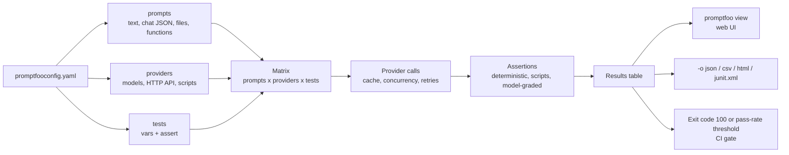

# promptfoo — LLM Evals & Red Teaming from YAML

Open-source CLI and Node.js library for testing prompts, models, RAG pipelines and agents. A declarative `promptfooconfig.yaml` combines prompts, providers and test cases, runs every combination, scores the outputs with assertions and exits with a non-zero code when quality drops. The same engine generates adversarial inputs for red teaming.

This guide covers **promptfoo 0.125.1** (Node.js `>=22.22.0`). Licence: **MIT**. Source: [github.com/promptfoo/promptfoo](https://github.com/promptfoo/promptfoo). The project README states that Promptfoo is now part of OpenAI and remains open source and MIT licensed.

## What promptfoo Gives a QA Engineer

| Need | promptfoo feature |
|------|-------------------|
| Regression suite for prompts without writing test code | `tests` with `vars` and `assert`, run by `promptfoo eval` |
| Compare two prompts, two models, or prompt A on model B | Matrix of `prompts` × `providers` in one run, side-by-side web UI |
| Test your own app endpoint, not just a model | **HTTP provider** with request / response transforms, custom Python / JS / Go providers |
| Deterministic checks | `equals`, `contains`, `regex`, `is-json` + schema, `levenshtein`, `latency`, `cost`, `javascript`, `python` |
| Quality checks that need judgement | Model-graded assertions: `llm-rubric`, `factuality`, `g-eval`, `context-faithfulness`, `select-best` |
| RAG and agent checks | `context-*` assertions, tool-call assertions, trace-based `trajectory:*` assertions, `_conversation` multi-turn |
| Security and safety testing | `promptfoo redteam`: plugins (what to attack) × strategies (how to deliver), OWASP LLM / NIST / MITRE ATLAS presets |
| CI gate | Exit code `100` on failures, `PROMPTFOO_PASS_RATE_THRESHOLD`, JSON / JUnit output, GitHub Action |
| Share results with the team | `promptfoo view`, `promptfoo share`, self-hosted server |

## Installation

```bash
npx promptfoo@latest init --example getting-started   # no install, always latest
npm install -g promptfoo                              # global CLI
npm install --save-dev promptfoo                      # project dependency, also needed for library mode
brew install promptfoo                                # macOS / Linux
pip install promptfoo                                 # Python wrapper around the CLI

promptfoo --version
```

```bash
# Self-hosted viewer / share server (web UI + API on port 3000); not the CLI
docker run -d --name promptfoo -p 3000:3000 \
  -v "$PWD/promptfoo_data:/home/promptfoo/.promptfoo" \
  ghcr.io/promptfoo/promptfoo:latest
```

!!! warning "Node.js version"
    npm and npx need Node.js `22.22.0` or newer; Node.js 24 LTS is recommended. In CI use `actions/setup-node` with `node-version: '24'`, or the `node:24` image.

## How a Run Works



| Concept | Meaning |
|---------|---------|
| **prompt** | Template with `{{vars}}`: inline text, `file://` text, chat-format JSON, or a JS / Python function |
| **provider** (alias `targets`) | What gets called: `openai:...`, `anthropic:messages:...`, `http`, `file://provider.py`, `exec:...`, `echo` |
| **test** | One row: `vars` filled into every prompt, plus `assert` checks. A test runs against every prompt and provider unless filtered |
| **assertion** | Check on the output: returns pass / fail and a score between 0 and 1 |
| **grader** | LLM used by model-graded assertions; set with `defaultTest.options.provider` or `--grader` |
| **metric** | Name that groups assertion scores in the report (`metric: accuracy`) |
| **scenario** | Cross product of data sets and test sets |

## Minimal Config

```yaml
# yaml-language-server: $schema=https://promptfoo.dev/config-schema.json
description: Ticket triage smoke test

prompts:
  - 'Classify this support ticket as billing or technical. Reply with one word. Ticket: {{ticket}}'

providers:
  - openai:gpt-6-luna
  - anthropic:messages:claude-sonnet-5-5

defaultTest:
  options:
    provider: openai:gpt-6-sol        # grader for model-graded assertions

tests:
  - vars:
      ticket: I was charged twice for my subscription.
    assert:
      - type: icontains
        value: billing
  - vars:
      ticket: The app crashes when I try to sign in.
    assert:
      - type: icontains
        value: technical
      - type: llm-rubric
        value: Answers with a single word and no explanation
```

```bash
export OPENAI_API_KEY="sk-..."
export ANTHROPIC_API_KEY="sk-ant-..."
promptfoo eval          # run, print table, store the result locally
promptfoo view          # open the web UI
```

## Section Map

| File | Topics |
|------|--------|
| [01 Setup & Config](./01-setup-config.md) | `init`, config anatomy, prompts and templating, env vars and `.env`, caching, `eval` flags, web UI, data location, telemetry |
| [02 Providers](./02-providers.md) | OpenAI, Anthropic, Azure, Bedrock, Google, Ollama, OpenAI-compatible gateways, HTTP provider, Python / JS / Go / exec providers, concurrency and rate limits |
| [03 Test Cases & Assertions](./03-test-cases-assertions.md) | Loading tests, deterministic / tool-call / similarity / model-graded assertions, custom scripts, weights, thresholds, metrics, transforms |
| [04 RAG, Agents & Multi-turn](./04-rag-agents-multiturn.md) | RAG evals, `_conversation`, tool calling, structured output, traces and trajectories, MCP, prompt versions, regression sets, scenarios |
| [05 Red Teaming, Testing & CI](./05-redteam-ci.md) | `redteam` commands, plugins and strategies, OWASP presets, CI gates, GitHub Action, library mode, self-hosting, tool comparison |

## Quick Commands

| Command | Use |
|---------|-----|
| `promptfoo init [dir]` | Interactive project setup; `--no-interactive` writes a starter config, `--example <name>` downloads an example |
| `promptfoo eval` | Run `promptfooconfig.yaml` in the current directory |
| `promptfoo eval -c a.yaml -o out.json -o report.html` | Explicit config, several output files |
| `promptfoo eval --no-cache -j 8` | Fresh calls, up to 8 in parallel |
| `promptfoo eval --filter-failing out.json` | Re-run only tests that failed in a previous run |
| `promptfoo view` | Web UI on port 15500 |
| `promptfoo validate config -c promptfooconfig.yaml` | Check a config without calling providers |
| `promptfoo redteam run` | Generate attacks and run them against the target |
| `promptfoo redteam report` | Open the red team report |
| `promptfoo share` | Upload the latest eval to Promptfoo Cloud or a self-hosted server |
| `promptfoo cache clear` | Drop cached provider responses |
| `LOG_LEVEL=debug promptfoo eval` | Verbose logs when a provider or assertion misbehaves |

## Quick Rules

1. **Start with deterministic assertions**; add `llm-rubric` only for what code cannot check.
2. **Pin the grader** with `defaultTest.options.provider`; do not let it follow whichever API key is set.
3. **Use `temperature: 0`** where the provider allows it, and `--repeat` for the rest.
4. **Treat `defaultTest.assert` as shared weight**: those assertions count in every test's score.
5. **Set `method: POST` explicitly** on HTTP providers and `transformResponse` to the field that holds the answer.
6. **Use `--no-cache`** whenever latency, cost or fresh behaviour is the thing under test.
7. **Gate CI on the exit code**, not on console output; archive `-o results.json` and `-o results.junit.xml`.
8. **Keep red team runs separate** from regression evals: they are slower, cost more and need a `purpose`.
9. **Never put secrets in the config**; use environment variables, `.env` files and CI secrets.

---
## See also
- [Digital Garden: Knowledge Base](../../index.md)
- [Tools — Practical Reference Guides](../index.md)
- [Langfuse — LLM Tracing, Prompts & Evals](../langfuse/index.md)
- [LangSmith — LLM Tracing, Prompts & Evals](../langsmith/index.md)
- [Arize Phoenix — LLM Tracing & Evaluation](../phoenix/index.md)
- [MLflow — Experiment Tracking, LLM Tracing & Evaluation](../mlflow/index.md)
- [DeepEval — LLM Testing Guide](../../llm-evaluation/index.md)
- [Eval Harness — Tools, Testing & CI](../../ai-harness/04-eval-harness-tools-ci.md)
- [OWASP LLM Security](../../owasp-llm-security/index.md)
