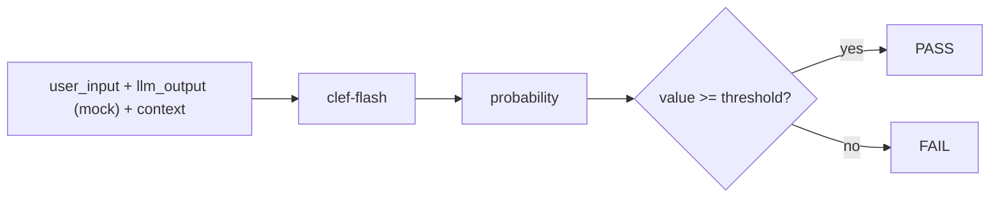

# LLM Output Evaluation with Clef

A pytest-based framework that evaluates mocked LLM outputs with [Cloudflare clef-flash](https://huggingface.co/Cloudflare/clef-flash), a 9B decision model running locally in Ollama. Clef answers typed questions with probabilities, and each metric turns them into a value from 0 to 1 and PASS or FAIL against a threshold.

Clef-flash is not a regular LLM. In Jev terms it is a "System One" model: it doesn't generate text, it takes a state (text or JSON) and typed questions, and returns probabilities. Cloudflare describes it as Jev-API compatible. The model is deterministic, so the same case always gets the same score, and answers are cached: the first eval run takes about 20 minutes on CPU, later ones take seconds.



## What's Covered

- **RAG** — faithfulness, answer relevance, context relevance
- **Correctness and summaries** — correctness and completeness against a reference, summary coverage
- **Safety** — toxicity, PII leak, prompt injection, harmful compliance, refusal (both unsafe compliance and over-refusal)
- **Style and instructions** — politeness, language match, conciseness, system prompt rules
- **Classification, routing and tools** — intent label, agent route, escalation to a human, tool choice, tool arguments
- **Dialogue and A/B** — context retention, pairwise comparison of two model versions with a position bias check
- **Custom metrics** — new metrics in code or YAML, with a guide to picking a threshold
- **Clef in QA beyond LLMs** — CI failure triage, bug severity, requirement coverage, search relevance, error message clarity

## How It's Built

- **Three question types** — `noul` (yes/no), `choice` (pick an option) and `score` (ordered scale) metrics turn the judge's answer into a value from 0 to 1.
- **YAML case suites** — 12 suites in `tests/data/`, one per category; good cases must pass, and bad ones list in `expect_fail` the metrics that must fail on them, so every suite checks that the judge can tell good from bad.
- **Blind judging** — `hide` removes fields from what the judge sees, so for classification, routing and tool choice clef makes its own decision instead of agreeing with the LLM.
- **Answer cache** — judge answers are kept per model digest in `.clef_cache/`, so an unchanged case is never sent to the model twice.
- **Make target per rubric** — `make test-rag`, `make test-qa-ops` and so on, for any suite.
- **Unit tests without the model** — the framework is tested against a fake judge.
- **Structured JSON logs** — a log file per run and one JSON line per metric with value, threshold and result; `CLEF_LOG_STATE=false` keeps case data out of logs and reports.

## Tech Stack

- `clef-flash` in `Ollama` — the judge model, `/v1/systemone` endpoint
- `httpx` — client for the judge
- `pytest` + `pytest-html` — test runner and HTML reports
- `pydantic` + `pydantic-settings` — schemas and env-based configuration
- `PyYAML` — case suites
- `uv` — Python package manager
- `ruff` + `mypy` + `pylint` — linting and type checking
- `Docker` + `docker compose` — Ollama and containerised test execution

## Running It

Requirements: Python 3.11+, `uv`, Docker with compose and about 10 GB of disk for the model.

```bash
make install     # install dependencies (uv sync)
make env         # create .env from .env.example
make pull        # start Ollama in Docker and download clef-flash (~9.7 GB)
make test-unit   # framework tests, no model needed
make test-evals  # evals with the model → reports/evals.html
```

The same runs work in Docker: `make docker-test-evals` starts Ollama, pulls the model if it's missing and runs the evals.

## Learn More

- [Framework Reference](https://github.com/serhiismetanskyi/llm-output-evaluation-with-clef/blob/main/docs/framework.md){ target=_blank } — the model, suites, case format, logs, security and errors
- [How Scoring Works](https://github.com/serhiismetanskyi/llm-output-evaluation-with-clef/blob/main/docs/scoring.md){ target=_blank } — question types, thresholds, `hide`, `expect_fail`
- [Testing LLMs with Jev-Based Evals: Clef as the Judge](../blog/posts/testing-llms-with-jev-based-evals-clef-as-the-judge.md) — a walkthrough of the metrics with real scores

<div class="page-actions" markdown>

[:material-arrow-left: All projects](index.md){ .md-button }
[:fontawesome-brands-github: View on GitHub](https://github.com/serhiismetanskyi/llm-output-evaluation-with-clef){ .md-button .md-button--primary target=_blank }

</div>
